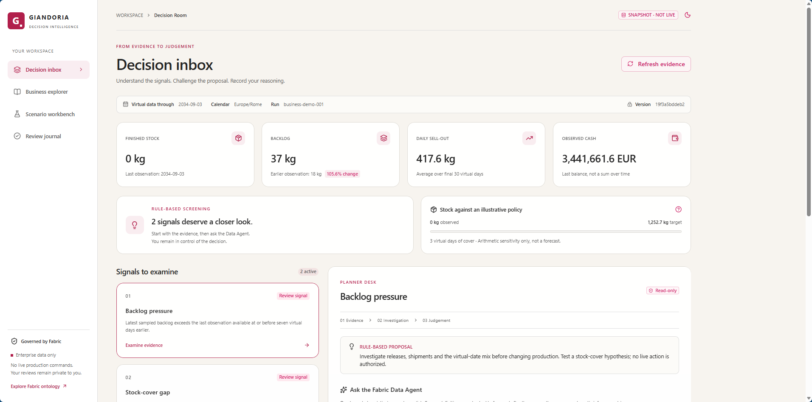
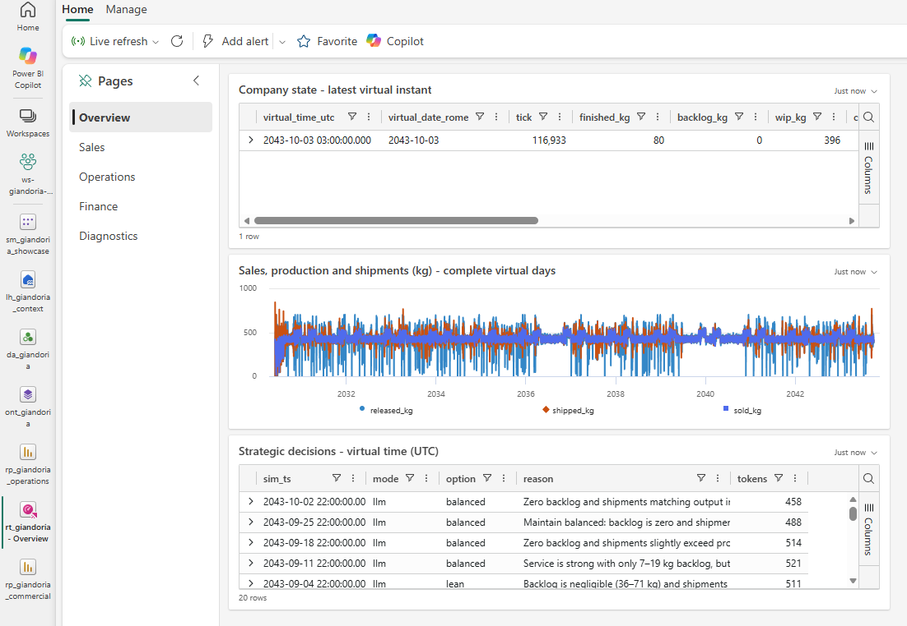
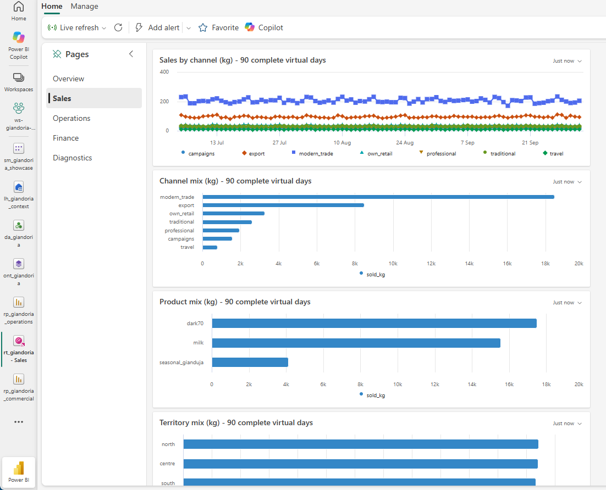
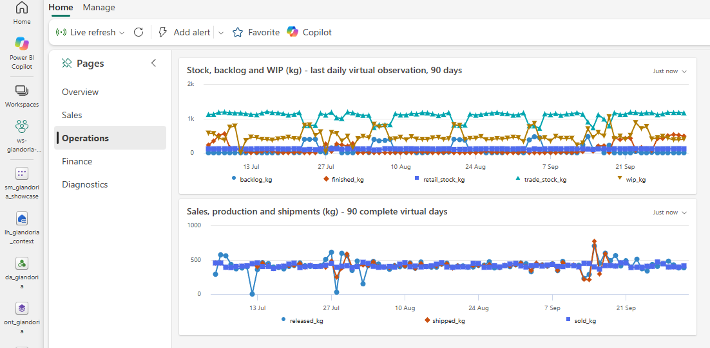
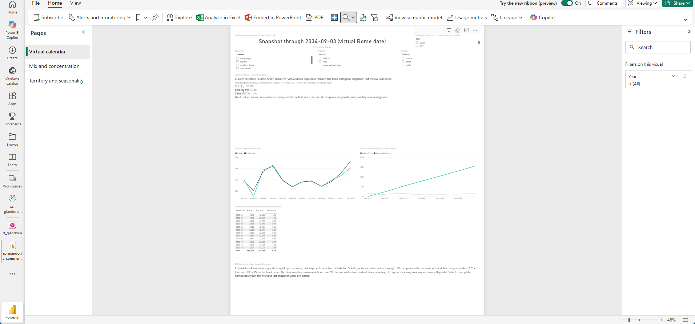
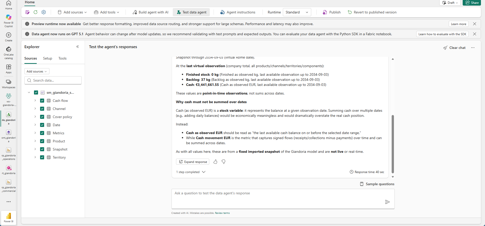
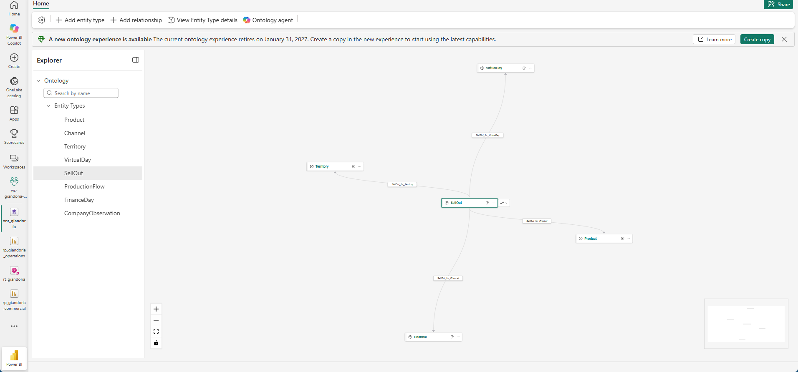
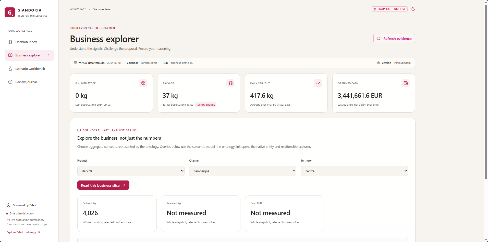
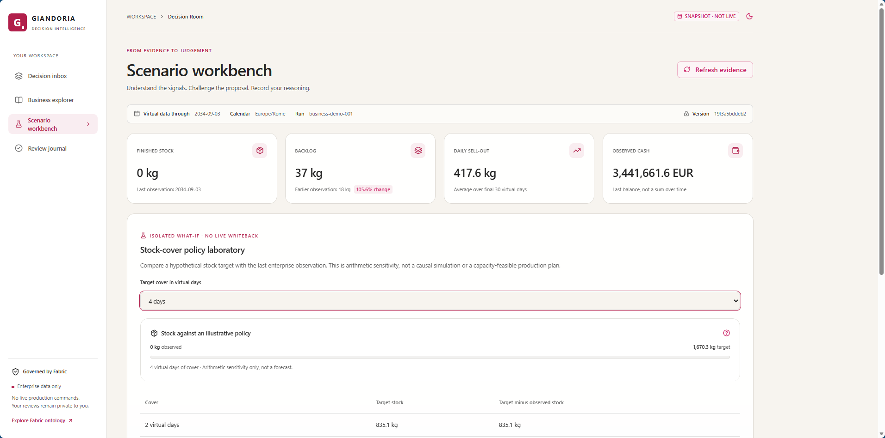
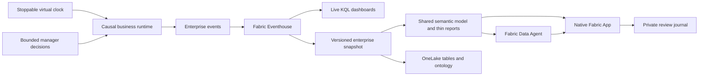

# Chocoverse

### A chocolate company that exists only in software. Its operational headaches are surprisingly convincing.

> **An openly AI-generated laboratory.** Artificial intelligence researched, built, documented and exercised
> this project. The repository owner contributed absolutely nothing, except the gloriously awkward idea in
> [chapter 17](./docs/17-reverse-time-simulation.md) and sporadic interruptions he insisted on calling "prompts".
> Human management, apparently, is an interrupt handler.
>
> The joke is deliberate; so is the disclosure. Code, explanations and this showcase are extensively AI-generated.
> Automated checks and observed cloud behavior are evidence, not independent certification or a guarantee of
> correctness. Chapter 17 preserves the human origin of the planning idea and its prior-art caveats.

**Chocoverse** is the repository. **Giandoria** is the fictional Italian chocolate company living inside it.
The experiment connects a stoppable business simulation, Azure, Microsoft Fabric, analytical semantics and
bounded AI investigations. It is a working learning laboratory, not a production ERP or a chocolate sales pitch.
No actual chocolate was harmed. No actual chocolate was produced, either.

[Take the illustrated tour](#the-illustrated-tour) |
[Read the architecture](./docs/README.md) |
[Run the laboratory](./infra/demo/README.md) |
[Study Fabric App authoring](./docs/27-decision-room.md)

## Why build an entire company instead of another dashboard demo?

Because a chart is more interesting when its numbers have consequences.

Giandoria buys materials, starts production, releases finished goods, ships orders, records sell-out and posts
financial movements. Its reduced-detail runtime links these facts causally rather than drawing unrelated random
numbers. A manager backed by a language model periodically chooses among bounded planning options.
Events, observations and decisions become something a reader can inspect, question and compare.

The larger design explores seasonal chocolate manufacturing, finite-capacity planning and role-scoped agents.
The implemented runtime is deliberately smaller: three product categories, seven channels and three territories.
The design chapters are not a claim that every planned simulator or business process is already running.

### One rule that changes everything: business time is virtual

Pause the lab for dinner; the chocolate does not age while you eat.

Business dates come from the continuous **virtual Europe/Rome calendar**. Stopping, restarting or accelerating
the simulator does not insert real-world gaps into sales trends, shift a reporting month or change a comparison.
Wall time belongs to operational diagnostics and shutdown schedules, not to business measures.

There are also **two analytical freshness contracts**:

| Experience | What it reads | Does it advance with the company? |
|---|---|---|
| Real-Time Dashboard | Changing enterprise events in Eventhouse | Yes, after ingestion and query refresh |
| Power BI reports, Data Agent, ontology and Decision Room | A governed, versioned enterprise snapshot | No; a new extraction/publication is explicit |

The screenshots deliberately show different virtual dates on these two paths. That is provenance, not a broken clock.

## The illustrated tour

These are actual authenticated product screens, not generated interface mockups.
Browser chrome and account headers are cropped out; synthetic business values are not retouched.
Screenshots illustrate a particular observed state, not a live public service or a performance benchmark.
Click an image to inspect the original.
[More screenshots and the capture method](./docs/images/showcase/README.md) explain the remaining views.

### 1. Watch the company move

The five-page Real-Time Dashboard covers **Overview, Sales, Operations, Finance and Diagnostics**.
Daily sales, released production and shipments are different flows. Finished stock, backlog, WIP and cash are
observed balances. The overview also exposes model-backed manager decisions alongside their virtual dates.

Sales views expose channel and product mix; operations show stock and backlog; finance distinguishes postings
from balances. Only Diagnostics uses real time to describe the technical event flow.

| Sales and channel mix | Operations and inventory |
|---|---|
|  |  |

[Dashboard engineering and the fifteen authoritative queries](./docs/22-dashboard-engineering.md)

### 2. Make the numbers mean something

One shared import semantic model supplies **two thin Power BI reports with six pages**.
They demonstrate a continuous Date dimension, previous-year/YTD/rolling calculations, context-aware measures,
semi-additive balances and a disconnected stock-cover policy selector.
Native **Smart narratives** change with the selected context; optional KPI reading guides sit below the charts.
The [native model view](./docs/images/showcase/semantic-model.png) also exposes the fact/dimension relationships.

Selecting four cover days produces an illustrative target of **1,670.3 kg** in the captured snapshot.
It is arithmetic sensitivity, not an optimized production schedule, forecast or command to the simulator.
Unsupported allocations return blank rather than inventing product-level cash or revenue.

[Semantic model, DAX patterns and report generation](./docs/23-semantic-model-showcase.md)

### 3. Ask the data, without giving the agent omniscience

The Fabric Data Agent queries the enterprise semantic snapshot, not the simulator's hidden truth.
In the illustrated question it retrieves finished stock, backlog and cash, states the virtual cutoff and explains
why adding daily cash balances would produce nonsense. The captured values were checked against the snapshot.

That successful answer is not a promise that every future answer will be correct.
Source-definition checks detect drift; they do not turn fluent prose into a proof.
The separate S&OP evidence-to-decision experiment is isolated and does not write its decision into the live company.

[Data Agent boundaries](./docs/24-data-agent-showcase.md) |
[Secretless application authentication](./docs/25-data-agent-authentication.md)

**Does delegation actually help?** The [CEO and line-lead experiment](./docs/28-data-agent-delegation-experiment.md)
compares the same generalist alone and with the Data Agent on real snapshot questions.
It includes an evidence-supplied control and the cases where neither should invent an answer.

### 4. Give the business an explicit vocabulary

The native Fabric IQ ontology binds **eight entity types and eight relationship types** to immutable OneLake
snapshot tables. A SellOut instance is identified by virtual date, channel, product and territory.
Its connections describe meaning; they do not replace DAX calculations.

Instance browsing resolves real bound rows, rather than stopping at an attractive relationship diagram.
The published ontology uses a preview experience with a retirement notice; migration requires contract and
binding verification, not merely a new screenshot.

[Ontology grains, bindings and preview limitations](./docs/26-fabric-ontology.md)

### 5. Turn evidence into a reviewable judgement

The **Decision Room** is a native Fabric App authored with **Rayfin, React and Radix Themes**.
It combines a signal inbox, semantic-model exploration, a stock-cover sandbox and a private review journal.
Hosted investigations call the existing Data Agent and check source contracts around the answer.

Readers can challenge a rule-based proposal, record a verdict and preserve the supporting snapshot and reasoning.
Reviews are stored in the app-managed database under caller-scoped policies.
Approval records an opinion: it cannot authorize production, move cash or rewrite the running simulation.

The authoring guide distinguishes authored React/data/function contracts from generated SDK and deployment
artifacts, explains local validation and guarded publication, and documents the actual identity boundaries.
External Fabric calls from the hosted Function use the item owner's identity; this is not end-to-end caller
delegation. A single-user demonstration is not proof of cross-user isolation.

[How this Fabric App is authored, secured and published](./docs/27-decision-room.md)

## Under the wrapper

Infrastructure and publication live in source: **Bicep/AVM, PowerShell, Python, KQL, TMSL/DAX and PBIR**.
The app adds TypeScript contracts, a semantic connector, hosted Functions and app-managed records.
Recorded operations, source readback, numerical reconciliation and targeted regression tests complement
browser observation. A cloud shutdown deadline bounds each active lab session.

## What this does not pretend to be

* Not the full target architecture: consult the current implementation notes before treating a design as shipped.
* Not certified financial reporting, measured profitability, a causal what-if forecast or an autonomous factory.
* Not live everywhere: the snapshot consumers remain fixed until explicitly republished.
* Not a free service: active F4, model calls, retained data and supporting Azure services have costs.
* Not self-healing: a cloud I/O failure can stop the worker while capacity stays active until scheduled shutdown.
  Inspect actual execution health; a saved `Running` session record is not evidence that the company is advancing.
  Recovery uses guarded controls and the stored checkpoint, not a new company.
* Not a public tenant endpoint: reproducing it requires your own authorized Azure/Fabric context and prerequisites.
* Not independently audited just because the same AI wrote tests and then looked pleased with itself.

## Explore or reproduce

Start with the [documentation map](./docs/README.md), the [cloud operating runbook](./infra/demo/README.md)
or the [local offline increment](./docs/README.md#running-the-first-local-increment).
Copy the empty [configuration template](./.env.example) to an ignored local environment file;
never commit deployment identities, credentials, runtime ledgers or private reviews.
The repository is source and methodology, not a portable copy of a tenant or its authentication state.

For the original planning idea, read [chapter 17: reverse-time simulation](./docs/17-reverse-time-simulation.md).
It turns out the human's "awkward idea" was worth an entire chocolate universe.
