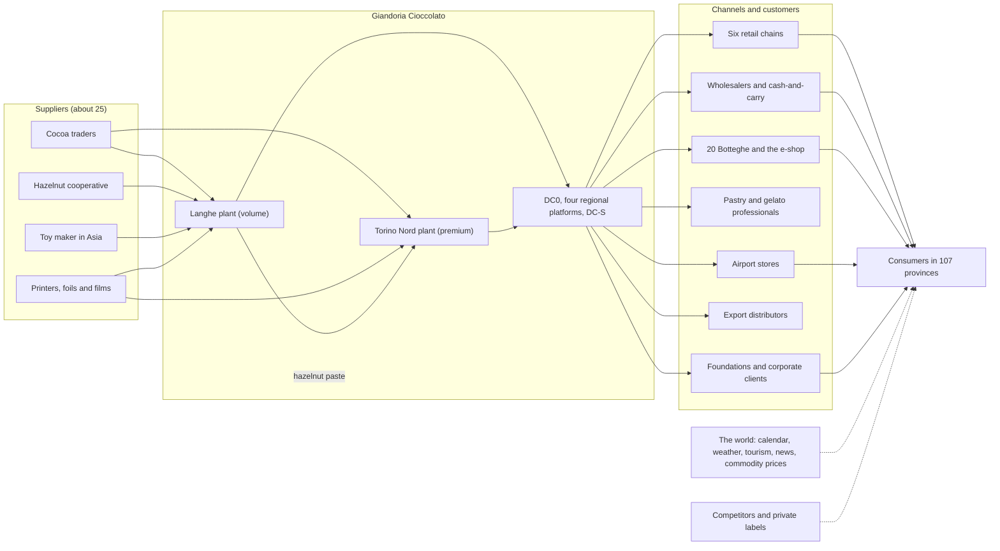
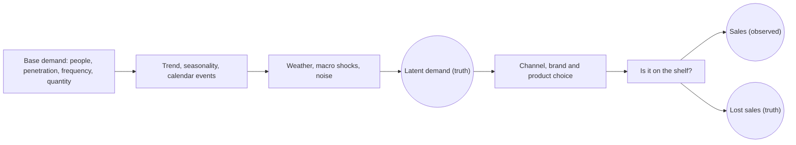
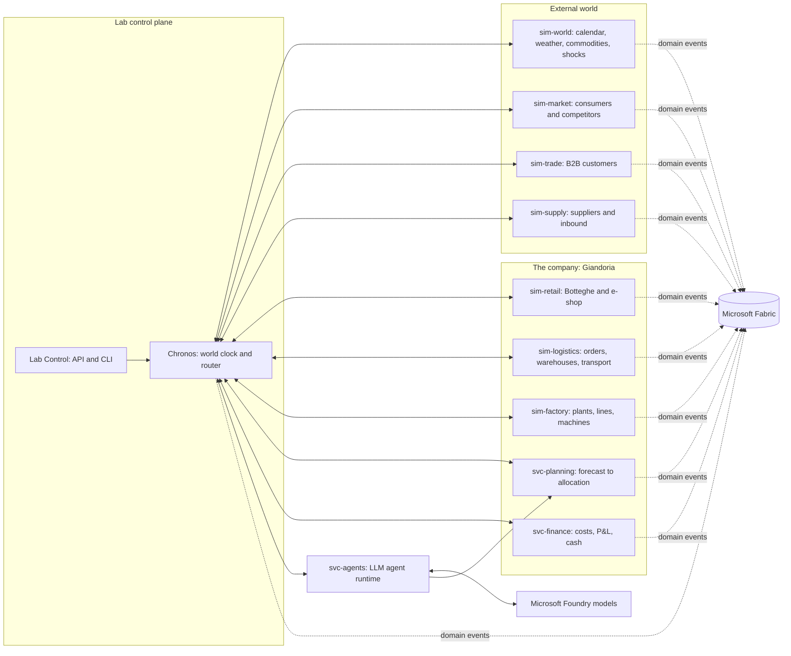
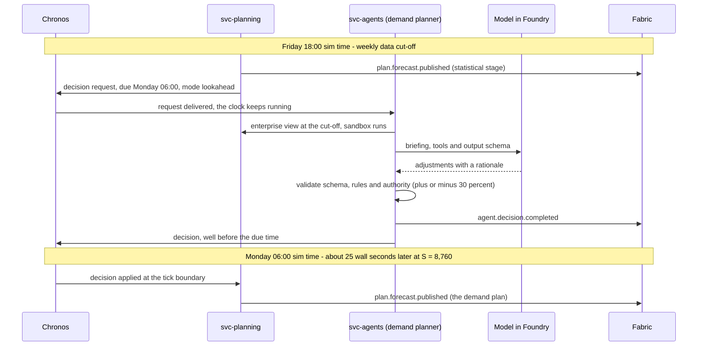
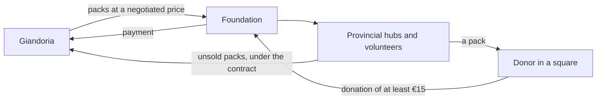
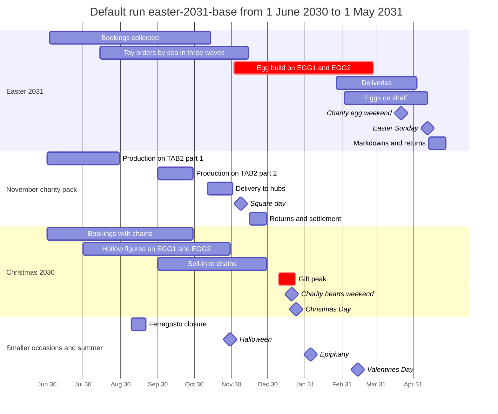

# 01 — Vision and Mental Model

> This chapter is the **shared mental model** of Giandoria: a simulated universe built around a fictional Italian
> chocolate company and the market around it. It explains how the main parts connect; specialist chapters own the
> detailed design, evidence and operational guidance.
>
> * This chapter describes the target universe, not the complete implementation. See the
>   [index](./README.md) for current scope and [chapter 15](./15-open-decisions.md) for adopted choices and
>   open checks.
> * **Everything in the universe is fictional:** the company, its brands, the retailers, the suppliers, the
>   foundations and the people. Real-world facts are used only to make it realistic. Chapter 16 lists the sources.
> * Numbers describe the default universe (**Profile M**) and the default scenario `easter-2031-base`. They are
>   tunable. The specialist chapters provide their sources and mark estimates and assumptions.

---

## 1.1 The idea in one page

Giandoria is a laboratory in which the fictional Piedmontese chocolate maker **Giandoria Cioccolato S.p.A.** lives
through whole seasons. It buys ingredients and packaging, makes and ships chocolate, and sells through retail,
wholesale, export, travel and campaign channels across a simulated Italy. Consumers buy according to the calendar,
weather, prices, promotions and what is actually on the shelf.

Connected simulators represent the company and its surroundings. Rules and planning engines handle routine decisions;
agents backed by large language models (LLMs) may handle judgement calls. Events carry **virtual timestamps** and flow
to **Microsoft Fabric** for observation and analysis. The target is built by code, and its speed is calibrated to F4
rather than promising a fixed year-per-hour rate.

Six ideas hold the design together.

1. **One connected chain.** Nothing is generated in isolation. A film jam on an egg wrapper in February delays a
   production order. The delay leaves a chain's shelf empty in a supermarket in Brescia two weeks before Easter. A
   family buys a competitor's egg instead: a lost sale that Giandoria never sees directly. The chain's buyer lowers
   Giandoria's relationship score, and the following June the buyer books fewer eggs. Every link is an event, and
   every event can be traced back to its cause.
2. **The calendar drives demand.** Chocolate in Italy is seasonal. Easter eggs sell for about ten weeks, Christmas is
   the largest event in value, summer heat stops praline shipments, and charity campaigns sell on fixed days in town
   squares. The universe uses the real calendar of each year, so an early Easter behaves differently from a late one.
3. **Commit before knowing.** Toys for kids' eggs travel by sea for 9–15 weeks. Easter eggs are built from November
   to February and stored for months. The first toy order is placed when only about a quarter of the Easter volume
   is booked. The company must plan ahead under uncertainty and live with its commitments. This is what makes the
   universe worth simulating, and it is what the agents are tested on.
4. **A hidden truth.** The universe knows things the company cannot see: true demand, lost sales, actual machine
   wear and supplier capacity. The company and its agents see only what their systems would record, often with delay.
   Truth is kept apart and used to evaluate forecasts and decisions.
5. **Virtual time.** The universe has its own clock. It can run a sim year in a wall hour, slow down to watch one
   factory week, or run unpaced to build history. When the lab pauses or hibernates, sim time stops: nothing ages,
   and the next event continues from the last one. Events also carry wall time for operations.
6. **Built by code, stopped by default.** Every Azure resource and every Fabric item is created by scripts and
   pipelines, not by portal changes. Hibernation suspends compute but does not eliminate every cost: retained data,
   registry and tenant services may still incur charges.

---

## 1.2 The company and its world

### Giandoria at a glance

Giandoria is a mid-sized fictional Piedmontese maker, with two plants, about 180 products and sales in Italy and
abroad. It serves retail, professional, travel and campaign customers through year-round, seasonal and made-to-order
products. The [domain model](./02-universe-domain-model.md) owns its profile, channels, sites and customer counts.

### The world around the company

Demand follows a calendar of peaks, while supply decisions often precede those peaks by months. Easter is the
clearest example: toy orders, artwork, production and delivery must be coordinated long before the short selling
season (§1.7). The [market chapter](./03-market-and-seasonality.md) explains the calendar; the
[factory chapter](./04-factory-and-processes.md) explains how products are made.

---

## 1.3 Truth and observation

After virtual time, this is the most important idea in Giandoria. **The universe knows everything. The company
knows only what real systems would record**, and usually later.

### How demand is born

Demand is generated in ten simple layers (chapter 03 §3.2). The first seven produce **latent demand**: what the
people of each province and segment would buy of each category on each day. The last three turn it into **sales**:
which channel people visit, which brand and product they choose, and whether that product is on the shelf.

When the chosen product is missing, a consumer switches to another product of the same brand, switches to a
competitor, or gives up. Only the first case leaves a trace in Giandoria's data.

### What is hidden, and what the company sees instead

| Hidden truth | Kept by | What the company sees instead | How late |
|---|---|---|---|
| Latent demand per province, segment, category and day | sim-market | Own-store receipts, e-shop orders and customer orders; sell-out from the chains that share it; a sampled retail panel with market shares and errors | From immediately (own channels and orders) to 1 day – 1 week (chain sell-out) and 3–4 weeks after each month (panel) |
| Lost sales caused by empty shelves | sim-market | Nothing directly: only lower sales and, sometimes, an unhappy buyer | Never |
| The health of each critical machine component | sim-factory | Symptoms in the sensor data: vibration, motor current, temperature, rejects | Continuously, if someone looks |
| A supplier's true capacity | sim-supply | Order confirmations, ETAs, and what the supplier's sales rep chooses to say | Days to weeks |
| The size of the hazelnut harvest | sim-world | Crop estimates from June, with errors that shrink until the August harvest | Months |

Weather, commodity prices and news are public: everybody sees them at once.

### Who may see what

Every event carries a **visibility** (chapter 10 §10.11):

| Visibility | Meaning | Who may see it |
|---|---|---|
| `enterprise` | What Giandoria's own systems record: production, warehouses, orders, stores, plans, decisions | Everyone. Agents see it through their role, at their data cut-off |
| `partner` | What customers', suppliers' and carriers' systems record | Analysts, in the "god view". Agents see only what partners send them as messages |
| `truth` | The hidden state of nature | Evaluation only |
| `lab` | The laboratory itself: clock, ledger, costs, lag | Lab operators |

### Where the truth lives

Truth events travel on their own Eventstream, `es_truth`, into their own KQL database, `kqldb_truth`. A separate
Lakehouse, `lh_evaluation`, and a separate semantic model, `sm_evaluation`, use them for evaluation reports only:
lost sales in the season review, forecast error against latent demand, the value of a decision. Dashboards about
the company show only `enterprise` data. Agents never query the truth: by default they do not query Fabric at all,
and they receive briefings built from the enterprise view. A stricter option puts truth in a separate workspace that
only evaluators can open (decision D8, chapter 15).

### Why this matters

* **Sales are censored demand.** When the shelf was empty, demand was higher than sales. A forecaster who learns
  only from sales under-forecasts exactly the products that ran out. Giandoria's planners must handle this, as real
  planners do (chapter 06 §6.6).
* **Giandoria can measure what no real company can.** Because the truth is known, forecast accuracy, lost sales and
  the value of each decision can be computed exactly. Every agent decision is scored weeks or months later, when its
  outcome is known (`agent.decision.evaluated`).
* **Agents are tested fairly.** They face the same fog as real managers, and their results are judged against the
  same truth as the rule-based alternatives.

---

## 1.4 How the universe moves

### The engine room

Seven simulators and five services make the universe live (chapter 08). **Chronos**, the world clock, is the only
component that moves time. Every simulator owns one part of reality and talks to the others only through
in-universe messages, such as purchase orders, delivery notes and invoices, which Chronos routes with a send time and
a delivery time. Every meaningful fact also becomes a domain event that goes straight to Fabric.

Each simulator owns its part of the state; Chronos advances time and routes messages, while planning and agent
services support decisions. In the target design they share a modular runtime by default. Chapter 08 defines
component ownership, event families and deployment modes.

Simulators own the world and emit events; deterministic rules and planning engines handle routine work. Role-based
agents may propose selected decisions, but the runtime validates their answers before applying them. People may
approve decisions where the scenario allows it. The specialist chapters define component contracts and controls.

### One week in the life of a decision

Decisions are requested **before** they are due, with a fixed data cut-off, exactly as in a real company. This
overlaps model latency: at the reference speed S = 8,760, the weekly window from Friday 18:00 to Monday 06:00 is
about 25 wall seconds if the runtime keeps up; the clock need not stop to wait.

If no valid answer arrives in time, the statistical forecast stands, and `agent.decision.fallback` records why.

### Roles and safeguards

The target design gives agents roles inside Giandoria and among its partners: planners, buyers, supplier
representatives and others. Each role sees a limited briefing, has defined authority and a deterministic fallback.
The [agent chapter](./09-llm-agents.md) owns the roster, models, conversations, budgets and rollout sequence.

Agents do not see truth or act directly on simulators or Fabric. Their structured answers are validated before
application; late or invalid answers fall back to rules, and recorded decisions can be replayed. Requests may keep
the clock running, wait at a decision point or apply asynchronously; the choice depends on the decision's importance
and timing. A person may also approve a decision through Lab Control (D13). Chapter 09 defines these controls.

---

## 1.5 Time: two clocks, never mixed

The universe has its own clock. Everything in Giandoria depends on keeping it separate from the clock on the wall
(chapter 07).

### One event, two clocks

When an egg wrapper jams on 12 February 2031 at 09:17 in the universe, the event records that **sim time** as well
as the **wall time** when the lab emitted it. The lab can create that event in a different year; business meaning
still comes from sim time. Fabric adds an ingestion time to measure delivery delay.

| Field | Example | Meaning |
|---|---|---|
| `sim_ts` | 2031-02-12 08:17 UTC | 09:17 in Italy, inside the universe |
| `wall_ts` | 2026-11-05 14:42 UTC | When the lab emitted the event |
| Ingestion time | Added by Fabric | When Fabric stored the event |

The universe uses the Gregorian calendar and Italian holidays. Its default epoch, 1 June 2030, is synthetic;
the [time chapter](./07-time-model.md) defines speed, calendars and the event contract.

### Start, pause, hibernate, stop

Running advances sim time. Pause freezes it while compute remains available; hibernation also saves state, scales
compute to zero and suspends capacity. Resuming continues from the saved state. Hibernation is the normal resting
state, but retained data and tenant services may still cost money (chapter 13).

### Nothing ages while the lab sleeps

Simulator timers use sim time, so a pause or hibernation does not age chocolate, move trucks or expire orders.
On resume, the next event follows the last one in sim time.

### Forks, replays and seeds

Seeded runs and snapshots allow the same history to be replayed or forked to compare a different policy. Recorded
agent decisions can be reused without another model call. Chapter 07 defines the clock and replay contracts.

---

## 1.6 Planning ahead: commit before you know

Planning is the heart of Giandoria (chapter 06). Three clocks run at very different speeds in this business:

| Clock | Typical length | Example |
|---|---|---|
| Selling window | Days to weeks | Easter eggs sell over ≈ 10 weeks, most of them in the last 3 |
| Manufacturing lead time | Days | A milk tablet takes ≈ 2–4 days from mass to released pallet |
| Cumulative lead time | Months | Toy surprises, licensed artwork and printed foils push the first Easter decision ≈ 9–10 months before Easter |

When the cumulative lead time is much longer than the selling window, the company must **commit before it knows**.
Every interesting planning problem in the universe comes from this gap:

* **Commit early or wait?** Early commitments are safe for supply but blind to demand.
* **Build ahead or chase demand?** Building ahead uses capacity that would otherwise sit idle, but it ties up cash
  and warehouse space, and the stock ages.
* **Who gets what when there is not enough?** Allocation decides which customers are served and shapes relationships.
* **How much should a plan change?** Each re-plan reacts to news, but too many changes create chaos on the shop
  floor and at suppliers.

Planning connects forecasts and customer commitments to the date goods must be delivered. A toy order may be due
months before Easter, while production and allocation must fit shared lines and delivery windows. Plans change as
bookings, supplier dates and capacity change; planners must balance early supply commitments against better demand
information. Chapter 06 owns the planning hierarchy, delivery outlook, fences and worked calculations.

In the target design, the reverse-time method checks finite capacity by planning back from due dates, then testing
the candidate schedule forward. Chapter 17 explains its origin and prior art; the full engine is not implemented.

### How much to commit: the newsvendor rule

The **critical ratio**, Cu / (Cu + Co), compares the cost of one unit too few (Cu) with one too many (Co) and sets
the demand quantile for a one-shot seasonal order. This leads to **postponement**: reserve cheap, long-lead materials
early, but delay commitment to expensive finished goods when better demand information arrives. Chapter 06 explains
the planning rules; its sandbox tests options without exposing hidden truth.

### No universe starts empty

The first day of a run may inherit open orders, bookings, stock, forecasts and earlier plans from a backfill snapshot.
This lets the run begin with realistic decisions already in flight; decision D11 and chapter 06 §6.14 define the
target approach. The default scenario starts on 1 June 2030 and follows the Easter 2031 cycle through its post-season
review, about eleven sim months.

---

## 1.7 Easter 2031, decision by decision

Easter Sunday falls on **13 April 2031**. The first decision is due about 45 weeks earlier. The "wall minute" values
are reference conversions at S = 8,760, assuming the runtime keeps up; actual duration depends on measured effective
speed (chapter 07). The table shows when each step happens after the start of the run (chapter 06 §6.9).

| # | Sim date | Wall minute | What happens | Who decides |
|---|---|---:|---|---|
| E1 | Mon 3 June 2030 | 0.3 | Easter range (≈ 25 SKUs) and volume target v1; design briefs go to the licensor and the printers | Seasonal category manager, S&OP chair |
| E2 | June → 15 October | 0.3–22.4 | Range presentations; chains book quantities with weekly delivery splits | Key account managers and chain buyers |
| E3 | Mon 15 July | 7.2 | Toy order, wave 1: ≈ 60% of the planned toys, to ShenTai Toys, with only ≈ 20–30% of the volume booked | Procurement manager, category manager |
| E4 | Fri 2 August and Fri 13 September | 10.2 and 17.1 | Artwork freeze A (eggs built in November–December) and B (January–February); foils and boxes go to print | Category manager, marketing |
| E5 | Mon 30 September | 19.9 | Charity contract with Associazione Luce per la Vita: 400k–600k eggs for the square weekend of 22–23 March | Key account manager, CEO |
| E6 | Tue 15 October | 22.4 | Booking cut-off with ≈ 85–95% of the volume booked; seasonal plan v2; toy wave 3 sized | S&OP chair, category manager |
| E7 | Mon 21 October | 23.3 | Build and shift plan: EGG1 and EGG2 on 3 shifts × 6 days from 3 November; temporary hires | Production planner |
| E8 | Sun 3 November, 22:00 | 25.6 | The build starts, after 1–2 days of conversion from Christmas figures | — |
| E9 | Mon 16 December | 32.6 | Mid-build review at the December S&OP: air freight for late toys? A different mix for January–February? | S&OP chair, procurement manager |
| E10 | Wed 15 January 2031 | 37.5 | Allocation plan v1, only if supply is projected to be short | Logistics allocator, key account managers |
| — | Mon 27 January | 39.5 | First deliveries to chains and stores | — |
| E12 | Weekly, Mon 3 February → Fri 4 April | 40.6–50.5 | Eggs reach the shelves. Every week the remaining stock is re-allocated, until the last delivery on 4 April | Logistics allocator |
| — | Wed 12 February, 09:17 | 42.2 | A film jam on the EGG1 wrapper (the event of §1.5) | sim-factory |
| — | Fri 14 February | 42.4 | Valentine's Day, in the middle of the build | — |
| E11 | Thu 27 February | 44.6 | Last production day and a final mix re-balance; the egg lines go to mould maintenance in March | Production planner |
| — | Sat–Sun 22–23 March | 48.3 | Charity egg weekend in ≈ 4,900 squares | — |
| — | Sun 13 April | 51.9 | Easter Sunday. The last two weeks have brought ≈ 46% of the season's sales | — |
| E13 | Mon 14 April | 52.1 | Post-season review: returns, markdowns, write-offs, lessons; the inputs for Easter 2032 | Category manager, controller |
| — | 14 → 28 April | 52.1–54.4 | Markdowns and contractual returns | — |
| — | Thu 1 May | 54.9 | End of the scenario horizon: the run completes and hibernates | Chronos |

Along the way, Fabric shows bookings against the plan, toy waves and their ETAs, build progress against the MPS, and
the sell-out curve against the forecast. After the season, the season review adds what only the truth knows, such as
the eggs that families wanted but could not find.

**Volumes and space.** The egg lines build ≈ 3.2 M eggs (Junior ≈ 1.8 M, private label ≈ 0.9 M, charity ≈ 0.5 M),
and the premium cell in Torino ≈ 0.45 M more: ≈ 3.65 M eggs, ≈ 940 t, about 200,000 eggs a week on the two egg lines.
Stock peaks at the end of January at ≈ 2.5–3 M eggs, or ≈ 7,000–8,000 pallet positions, which is why the overflow
warehouse DC-S is rented from October.

**What makes it hard.**

* The first toy wave is ordered when only a quarter of the volume is booked.
* The charity contract is signed after toy wave 1, so the planner pre-orders simple surprises for a contract that has
  not yet been won.
* The build ends six weeks before Easter, so the peak weeks can only be served from stock.
* Sales are concentrated at the end. The weekly sell-out curve *(assumption)*:

| Week before Easter | −9 | −8 | −7 | −6 | −5 | −4 | −3 | −2 | −1 | After |
|---|---:|---:|---:|---:|---:|---:|---:|---:|---:|---:|
| Share of the season | 2% | 3% | 4% | 6% | 8% | 11% | 15% | 21% | 25% | 5% (markdowns) |

**Seasons overlap.** E1 for Easter 2032 is due in June 2031, after the horizon of the default run, while the 2031
returns are still being processed. Easter 2032 falls on 28 March, so the next season is shorter. The company always
plans several seasons at once.

### The shortage game

A shock from the catalogue: **toy wave 2 arrives three weeks late**, and about 300,000 Junior eggs cannot be made in
January as planned. The engines compute the consequences of each option; the agents choose and explain.

| Option | Effect | Cost |
|---|---|---|
| A. Air-freight part of the toys | They arrive in 7–14 days instead of 4–6 weeks | Several times the sea freight |
| B. Re-sequence | Private-label and charity eggs first, because their materials are on site; Junior eggs later | Extra shifts at the end of the build; early deliveries at risk |
| C. Cut the Junior volume | Fair-share allocation on the chains' bookings | Lost sales, OTIF penalties, damaged relationships |
| D. A mix of A–C | Usually the best | Needs a well-argued decision |

When supply is short, allocation follows default priority classes:

1. **Ring-fenced:** the charity contract and signed private-label contracts, reserved at build time.
2. **Booked:** chains, wholesalers and export, by **fair share**: available ÷ booked, per SKU and week. The allocator
   may deviate by up to ± 10% per customer and must explain why.
3. **Own channels:** the Botteghe and the e-shop, which must not run out before Easter week.
4. **Spot:** whatever is left.

The consequences flow back into the universe: lower fill rates, OTIF penalties, lower relationship scores of the
chain buyers, and lost sales that only the truth records. A fork can replay the same shock with another option, to
measure what the choice was worth.

### One egg's story

1. **Wed 12 February 2031, 09:17.** On LG-EGG1, manufacturing order `MO-2031-LG-01822` is making Junior eggs
   (`JR-EGG-150`) when the wrapper jams (`mes.machine.state_changed`: running → breakdown, `FILM_JAM`). The order
   ends late and short.
2. The day's eggs become lot `L-LG-31043-EGG1-07` (Langhe, 2031, day 043, line EGG1, batch 07). The lot starts on hold
   (`qc.lot.held`) and is released after the laboratory results (`qc.lot.released`).
3. The lost output lowers projected supply. The next weekly re-allocation gives each chain its fair share of what is
   left (`plan.allocation.published`).
4. A chain's order for the second week before Easter is confirmed short, with a reason (`o2c.order.confirmed`), then
   shipped and delivered (`o2c.order.shipped`, `o2c.order.delivered`).
5. In a supermarket in Brescia the shelf runs empty two weeks before Easter. The chain's sell-out report shows it days
   later (`trade.sellout.daily`). Only the truth records that families bought a competitor's egg instead
   (`truth.market.lost_sales`).
6. The chain buyer's relationship score falls, and the buyer will remember it at the next booking round.
7. In Fabric, one genealogy query follows the lot forward to shipments and stores, and backward to its mass batch,
   its cocoa and milk-powder lots and its toy lot.

---

## 1.8 The November charity box, step by step

Campaigns are business-to-business projects with a public date that never moves, which makes them ideal planning
cases (chapters 02 §2.8 and 03 §3.6). The November campaign of **Fondazione Orizzonte Ricerca** sells a 200 g dark
chocolate pack with a booklet, offered by volunteers in ≈ 2,400 squares and schools for a donation of at least €15.
The volume is 250k–400k packs.

| Step | Sim time (default run) | Wall minute | What happens | Who |
|---|---|---:|---|---|
| Tender and contract | Spring 2030, before the epoch | — | Giandoria wins the tender: quantity, price, date and hub list are fixed; the foundation approves the artwork. In the default run these are inherited from the backfill (§1.6) | Key account manager; the foundation's tender committee |
| Production, part 1 | June–July 2030 | 0–10.0 | Levelled on LG-TAB2 between continuous tablets. Dark chocolate keeps 18–24 months, so it can be made early | Production planner; ring-fenced in the MPS |
| Ferragosto closure | ≈ 10–22 August | 11.5–13.5 | The plants are closed for the annual overhaul | — |
| Production, part 2 | September | 15.1–20.1 | The rest of the volume, before the Christmas peak | Production planner |
| Delivery to hubs | Sat 12 October → Sat 2 November | 21.9–25.3 | Groupage from DC0 to dozens of provincial hubs, 1–4 weeks before the day | sim-logistics |
| Square day | Sat 9 November 2030 | 26.5 | Volunteers offer the pack in the squares for a donation of at least €15 | sim-market (the donor segment) |
| Returns and redistribution | 16–23 November *(illustrative)* | 27.6–28.8 | Unsold packs return under the contract or move between hubs | sim-trade, sim-logistics |
| Settlement | By 30 November *(illustrative)* | 29.9 | Final quantities, credits for returns, the campaign report | Key account manager, controller |

**How the money flows.** The foundation buys from Giandoria at a negotiated unit price, and the public donates to the
foundation. Giandoria records a business-to-business sale; the foundation records donations; unsold units return
under the contract. The main risks are a late artwork approval and late deliveries to many hubs at once.

The two other campaigns follow the same life cycle: the **Easter charity egg** of Associazione Luce per la Vita
(E5 in §1.7), which competes with Giandoria's own eggs for the egg lines, and the **heart box** of Fondazione Cuore
Raro, made on TN-PR1 in October–November and packed in TN-GFT for the weekend before Christmas
(Saturday 21 December 2030, wall
minute 33.4), which competes with Christmas pralines. **Corporate gifts** work the same way at a smaller scale: about
150 clients, quotes from September, confirmations from October to mid-November, logo boxes, and a hard delivery
deadline in mid-December. Before quoting a date, the key account manager asks svc-planning whether the order can be
made in time (capable to promise).

---

## 1.9 One run, from June to May

The default run spans eleven sim months, from 1 June 2030 to 1 May 2031. The wall-minute values below assume the
reference speed S = 8,760 and no lag; actual elapsed time depends on effective speed. Several seasons overlap:

The Gantt shows how Easter, Christmas and charity campaigns overlap. The Easter decisions and their effects are
worked through in §1.7; the Fabric views are described in §1.10. A longer scenario or a fork can continue into
Easter 2032.

---

## 1.10 Where the data goes

Fabric is where people **watch and analyse** the universe, not where the universe lives. The live path streams
events to dashboards; the batch path stores history for reports. Simulators own business state, Azure Storage
preserves runtime state, and hidden truth follows a separate path for evaluation. Dashboards can lag behind sim time,
so they show a watermark. Chapter 10 defines the data contract; chapter 11 defines the platform and experiences.

---

## 1.11 Built by code, stopped by default

Resources and Fabric items are managed as code. Hibernation stops compute, but retained data and tenant services may
still cost money; chapters 13 and 18 own the operating and cost details.

### Everything is created by code

The bootstrap establishes tenant and environment foundations. CI uses Bicep/AVM for Azure resources, `fab`/REST for
workspace configuration and `fabric-cicd` for supported Fabric item definitions. Lab Control creates run-level
state. Idempotency, identity and provisioning order are detailed in chapters 11 and 12; secrets are not stored in
the repository.

### The inventory

Chapter 12 is the authoritative inventory, with IDs, ownership and provisioning order.

### What the user interface is for (decision D18)

| Use of the user interface | Allowed |
|---|---|
| Viewing dashboards, reports and monitoring; taking part in a run, for example approving a decision in the Lab Control form | Yes |
| Designing dashboards, reports and Activator rules visually in the stopped `demo`, then `fab export` and a pull request | Yes. Nothing reaches another environment except through Git |
| A one-time administrator check that capacity overage is off, if no API can read it (check 27) | Yes, as the only portal step, recorded in the bootstrap guide |
| Creating or starting a Fabric capacity through the user interface | No. Use the approved code path, including for bounded spikes |
| Creating or changing any element of chapter 12 in any other way | No. The next release would silently undo it |

### Environments

There is one cloud environment: `demo`, on a fixed F4 in Sweden Central. Local development and isolated spikes do not
create cloud `dev` or `stress` environments. If F4 cannot sustain a scenario, reduce speed, fidelity or profile;
there is no automatic SKU or region fallback (D1, D4 and D17).

### Stopped by default

Hibernation preserves datasets and restart state, scales compute to zero and suspends F4. A start/resume operation
must restore state and resume Fabric before events flow; cleanup must suspend capacity even after failures. Chapter 13
documents the runbooks and safeguards.

### What it costs *(estimate)*

The adopted objectives are about EUR 200 initially for a useful retained dataset if needed, a few tens of euros per
active demo day and low idle costs. The EUR 500 monthly ceiling applies to the whole subscription, not just Giandoria.
Treat these as guardrails and targets, not as a complete current price or automatic spending stop: retained data and
tenant Defender/governance can still cost money. Chapter 13 owns estimates and measurements; chapter 18 explains the
tenant baseline.

### Limits for every run (RT-03)

Per-run money, token and wall-time limits still need to be measured and implemented. Do not treat historical
multi-environment sizing tables as current operating limits.

### Three leaks, nine layers

Cost controls combine admission checks, leases, watchdogs, shutdown schedules and subscription budgets. These layers
reduce the chance and duration of forgotten spend; they do not make retained resources free or guarantee an
automatic stop at a particular euro amount. Chapter 13 documents which controls are implemented and which still need
measurement or wiring.

---

## 1.12 Deliberately simple

A universe that models everything is never finished, so each chapter lists what it leaves out on purpose. The test
is always the same: a simplification is acceptable if the decisions it feeds stay realistic, and if it can be
refined later without changing the event contracts.

| Area | Simplified on purpose | What stays realistic | Where |
|---|---|---|---|
| Market and consumers | Six consumer segments per province instead of individuals. Competitors are archetypes driven by rules. Chain stock is modelled per cluster of stores, not per shelf | Demand follows the calendar, weather, tourism, prices, promotions and empty shelves; lost sales are known exactly | Chapters 03, 05 §5.16 and 08 |
| Factory | No physics: heat transfer, flow and crystallisation are not computed; their effects on cycle times, defects and energy are drawn from distributions. Fixed recipes, crews instead of employees, packaging counted in units | Every step has realistic durations, changeovers, hidden wear, breakdowns, quality holds and capacity | Chapter 04 §4.13 |
| Supply and logistics | No vehicle routing: transit times come from a route-time matrix plus random delays. Customs is a delay and a document check. Standard pallets; payment terms and credit risk are parameters | Lead-time distributions per lane, disruptions, dock and picker capacity, temperature limits in summer | Chapter 05 §5.16 |
| Planning | Small, transparent engines instead of a commercial planning suite. One bucket size per level, simple safety-stock formulas, fixed campaign lengths. Cocoa hedging is a procurement decision with limits; contracts are versioned messages with parameters | The planning ladder, the fences, the delivery outlook and the points of no return | Chapter 06 §6.17 |
| Agents | One agent per role, not per employee; key account managers use personas instead of separate agents. No fine-tuning: agents improve through memory and prompt versions tested with replay. Negotiations have a turn limit and a structured result | Briefings with a data cut-off, authority limits, fallbacks, scores against the truth | Chapter 09 §9.11 |
| Time | Ticks of at most one sim hour, so at full speed the simulators react to each other hour by hour | Every event keeps its exact timestamp inside the tick | Chapter 07 §7.5 |
| Data | JSON everywhere. Delivery at least once, with deterministic IDs and duplicate monitoring. One bronze schema, typed only in silver. No change-data capture of simulator state | Every fact is an event with both timestamps, traceable to its cause | Chapter 10 §10.16 |
| Platform | One region per environment and no disaster recovery: a lost environment is redeployed from code, and runs are regenerated from scenarios, seeds and decision logs. Public endpoints with Entra ID, one runtime container, no Fabric deployment pipelines | Everything is code; layered cost controls reduce exposure, while numeric run limits still need implementation | Chapter 11 §11.9 |

### What the universe is not

* **Not a copy of a real company.** Giandoria, its brands, customers, suppliers and foundations are fictional. Real
  facts set the orders of magnitude, and the chapters mark every estimate.
* **Not a forecast of the real market.** The default epoch lies in 2030, so that nobody mistakes the data for real
  data (§1.5).
* **Not a register of people.** Consumers are synthetic and aggregated. The only individuals, e-shop customers and
  loyalty members, are synthetic too. There is no personal data.
* **Not run by the lab's own assistants.** The Fabric data agent and the optional operations agent answer people's
  questions and watch the lab. They are tools for humans and never act inside the universe (chapter 09).

The extensions that seem worth it later, such as a competitor as a full simulator, Profile L as a regular demo size
or private networking, are listed in chapter 14 §14.19.

---

## 1.13 What must be agreed

The design uses adopted assumptions to proceed, while keeping platform checks and cost measurements open until
evidence is available. An adopted choice is not proof that its dependencies work or that a target has been measured.

[Chapter 15](./15-open-decisions.md) is the authoritative log for the twenty decisions, their status and evidence.
[Chapter 12 §12.16](./12-elements-to-create.md#1216-counts-and-open-checks) lists the open platform checks;
[chapter 13 §13.12](./13-cost-control-and-operations.md#1312-cost-measurements) lists cost measurements; and
[chapter 14](./14-implementation-plan.md) owns the phases and exit criteria. The
[phase-0 worksheet](../decisions/phase-0-decisions.md) records tenant and repository facts that do not belong in
the design log.

---

## 1.14 Glossary

The words below recur in every chapter. Each one has a short meaning here and a pointer to where it is explained. In
the *See* column, §1.x is a section of this chapter; any other section number also names its chapter, so §6.4 is
section 4 of chapter 06. Chapter 07 §7.2 holds the precise vocabulary of time.

| Term | Meaning | See |
|---|---|---|
| Activator | The Fabric item that watches data and fires alerts and actions. Its business rules test states and thresholds computed on `sim_ts`; wall-time rules serve only lab health. Its rules start and stop with each run, and it never calls the simulators | §1.10; §11.5, §11.6 |
| Agent | An LLM that plays one role inside the universe, at Giandoria or at a partner: the S&OP chair, a chain buyer, a supplier's sales rep. It reads a briefing, uses the engines as tools, decides within its authority and explains why. Its output acts only after validation | §1.4; §9.1, §9.2, §9.3 |
| Allowance | A proposed spending limit for a run or environment, distinct from the EUR 500 subscription ceiling. Exact operating limits and enforcement remain to be measured and implemented | §1.11; §13; §15 D16 |
| Analysis session | The Fabric capacity switched on for people, without a run and with a fixed expiry: `lab open --hours 2`. Nothing else starts | §1.11; §13.3 |
| ATP and allocation | Available to promise: what can still be promised to an incoming order. Allocation decides who gets scarce stock | §1.6; §6.11 |
| Backfill | An unpaced run that builds 12–18 sim months of history before the epoch. The live run forks from its snapshot and inherits the plans in flight (decision D11) | §1.6; §6.14 |
| Barrier mode | How a decision request relates to the clock. *Lookahead*, the default: the clock keeps running. *Wait*: the clock stops at the due time until the answer or a wall-time deadline arrives. *Async*: the answer applies whenever it arrives | §1.4; §9.4 |
| Booking | A customer's seasonal intention to buy, with weekly delivery splits. It is revised several times before the customer calls off firm orders against it | §1.6; §6.5 |
| Botteghe Giandoria | Giandoria's 20 own stores: city-centre flagships, high-street, station and airport stores, a mountain-resort store, a museum store and two outlets. With the e-shop they form the own-retail channel | §1.2; §2.6 |
| Briefing | Everything an agent receives for one decision, built from the enterprise view at its data cut-off. It never contains the truth | §1.4; §9.3 |
| Bronze, silver, gold | The layers in the Eventhouse: raw envelopes; typed tables with one row per document line; materialized views and functions ready for dashboards | §1.10; §10.8 |
| Campaign product | A product made to order for a charity or corporate campaign, with a fixed quantity, a fixed date and custom packaging. Charity contracts are won by tender each year, and unsold units come back | §1.2, §1.8; §2.8, §3.6 |
| Capacity | The Fabric compute that all Fabric items run on, sized by SKU (F4, F8, …) and billed while active. Suspending it stops capacity charges, but retained data and tenant services may still cost money | §1.11; §11.7, §13, §18 |
| Giandoria | The laboratory as a whole: the simulated universe, the programs that run and control it, and the Fabric workspace where people watch it | §1.1 |
| Chronos | The world clock and the only component that moves time. It runs the ticks, routes in-universe messages, keeps the time ledger, takes snapshots and runs the cost meter | §1.4, §1.5; §8.5 |
| Cost meter | Chronos's counter for tracking money, tokens and wall hours; chapter 13 describes its design, while chapter 15 records open operating limits | §1.11; §13.6 |
| Critical ratio | Cu / (Cu + Co): the cost of one unit too few against the cost of one unit too many. It sets the quantile at which a one-shot seasonal quantity is planned | §1.6; §6.12 |
| Cumulative lead time | The time from the first commitment to the sale, along the whole chain. Toys, licensed artwork and printed foils put the first Easter decision ≈ 9–10 months before Easter | §1.6; §6.1 |
| Data agent | The Fabric item `da_giandoria`, which answers people's questions about the data in plain language. It never reads the truth and never acts inside the universe | §1.10, §1.12; §9.9, §12.9 |
| Data cut-off | The sim time at which a briefing's data is taken: the agent sees the company as it was at that moment. A decision is usually requested before its due time, with a fixed cut-off, so the clock need not stop | §1.4; §7.9, §9.4 |
| DC0, DC-S | DC0 is the central warehouse, kept at 15–18 °C. DC-S is the seasonal overflow warehouse, rented for the peak | §1.2; §5.1, §5.8 |
| Delivery outlook | What the company expects to deliver, to whom and when: firm orders, plus open bookings times a learned conversion factor, plus the forecast for the rest, with P10, P50 and P90. Published weekly, it is the main briefing input of every agent who plans ahead | §1.6; §6.5 |
| Deployment mode | How the programs are packaged. A: a modular monolith in one container, the default. B: one container app per simulator. C: a batch job for backfills (decision D5) | §1.4; §8.8 |
| Direct Lake | The Power BI mode that reads Delta tables in OneLake directly, without importing or copying them | §1.10; §11.3 |
| DRP | Distribution requirements planning: where finished goods should be and which transfers move them, daily over 4–8 weeks | §1.6; §6.2 |
| Effective speed, lag | The effective speed is the speed actually reached. When the simulators cannot keep up with S, it falls below the target, and the gap is recorded as lag, never hidden | §1.5; §7.2, §7.5 |
| Emitter | The shared library through which every simulator and service sends its events: one envelope, deterministic IDs, and an outbox when Fabric is away | §1.10; §8.7 |
| Engine | A planning algorithm in svc-planning: fast, deterministic and explainable, it always produces a valid plan. Engines run every cycle; agents use them as tools | §1.4, §1.6; §6.13 |
| Envelope | The common wrapper of every event, following CloudEvents 1.0: ID, type, source, `sim_ts` and `wall_ts`, run, tick, speed, visibility, correlation IDs and payload | §1.10; §10.2 |
| Epoch | The sim time at which a run starts. The default scenario starts on 1 June 2030 | §1.5; §7.2, §7.7 |
| Eventhouse | The Fabric store for event data, queried with KQL. Giandoria has one, `eh_giandoria`, with the databases `kqldb_giandoria` and `kqldb_truth` | §1.10; §10.8 |
| Eventstream | The Fabric item that receives events and routes them to the Eventhouse. Giandoria has four, each with one custom endpoint and no windowed operators, so nothing in a stream depends on arrival time | §1.10; §10.7 |
| Fallback | The rule-based default that applies when an agent's answer is late, is still invalid after one repair round, or cannot come because the model is unavailable or the budget is spent. Every decision type has one, and every use is recorded | §1.4, §1.11; §9.1, §9.3 |
| Fences | The zones of the MPS that say what may still change: frozen (weeks 1–2), slushy (weeks 3–8) and liquid (week 9 onwards) | §1.6; §6.4 |
| Fidelity | How much machine telemetry a run emits. L0, always on: states, counts and alarms. L1, the default: one snapshot per machine every 15 sim minutes. L2: one value per tag per sim minute on a showcase line, only at S ≤ 168 | §1.10; §4.10 |
| Fork | A new run started from a snapshot of an existing run, usually with another policy or scenario: "what if cocoa doubles in March?" | §1.5; §7.11 |
| Genesis | The job that creates a universe's master data from a profile, a seed and public reference data: products, plants, lines, suppliers, stores, customers and segments. It is deterministic and versioned | §1.10; §14.14 |
| God view | The analysts' view: what Giandoria records, plus what partners' systems record and, in evaluation reports, the truth. Agents see only what partners send them as messages | §1.3; §10.11 |
| Hibernate | A pause that also takes a snapshot, scales compute to zero and suspends the Fabric capacity. Retained data and tenant services can still incur costs | §1.5; §7.2, §13.3, §18 |
| Horizon | The sim time at which a scenario ends. There the run completes and hibernates | §1.5; §7.4 |
| KQL | Kusto Query Language, used to query the Eventhouse. Giandoria adds sim-time functions such as `SimNow`, `SimAgo` and `SimWindow` | §1.5, §1.10; §7.10 |
| Lab Control | The API and command line that start, pause, resume, hibernate, fork and stop runs, check limits and budgets, and switch the Azure and Fabric resources on and off. It lives on wall time only | §1.4, §1.11; §11.5 |
| Lakehouse, OneLake | OneLake is Fabric's single data lake. A Lakehouse is an item in it that holds Delta tables and files. `lh_giandoria` holds master data, the sim calendar, plan lines, shortcuts to Eventhouse tables, backfills and archives; `lh_evaluation` holds only the shortcuts to the truth tables | §1.10; §10.9 |
| Latent demand | What the people of each province and segment would buy of each category on each day, before channels, brands and empty shelves come into play. Only the truth knows it | §1.3; §3.2, §3.10 |
| Lease | A record that says "the capacity is needed now". Every actor takes one before it resumes the capacity. Run, job and workflow leases last 15 minutes and are renewed every 5; an analysis session's lease has a fixed expiry. The watchdog suspends any active capacity without a valid lease | §1.11; §12.10, §13.7 |
| Lost sale | Demand that met an empty shelf: the consumer bought a competitor's product or nothing. Giandoria never sees it directly; the truth records it exactly | §1.1, §1.3; §3.10 |
| MPS | Master production schedule: what to make, on which line, in which week, over 12–26 weeks | §1.6; §6.7 |
| MRP | Material requirements planning: which materials are needed when, and what to order, expedite or postpone | §1.6; §6.7 |
| Multiverse | All the runs of an environment, side by side in Fabric and separated by `run_id`, so that comparing them takes one query | §1.5; §10.10 |
| Nervousness | How much a plan changes between versions inside the slushy zone. High nervousness unsettles suppliers and the factory | §1.6; §6.4 |
| OEE | Overall equipment effectiveness: availability × performance × quality. Giandoria sets Giandoria's lines at 55–70% | §1.2; §4.4 |
| OTIF | On time in full: the share of orders delivered complete on the agreed date. Some chains charge penalties, as invoice deductions, when it falls short | §1.7; §5.11, §6.16 |
| Outbox | The place in Azure Storage where the emitter keeps batches of events while the Fabric endpoint is unavailable. They are sent before the clock restarts | §1.10; §8.7 |
| Pause | The clock is frozen: no ticks, no events, no sim time. The capacity stays on, so a pause is for minutes; after 30 idle minutes the watchdog hibernates the run | §1.5; §7.2 |
| Plan version | Every plan is a versioned, bi-temporal object: it records when it was known and which weeks it is about, so Fabric can answer "what did we know when we decided?" | §1.6; §6.2, §7.8 |
| Planning ladder | This chapter's name for the planning hierarchy of chapter 06: the nested levels of planning, from the annual budget and S&OP down to the daily schedule and per-order ATP | §1.6; §6.2 |
| Planning sandbox | A re-run of the planning engines on a copy of the company's state with one assumption changed. It takes wall seconds and never sees the truth | §1.6; §6.12 |
| Point of no return | The last moment at which a material can still be ordered in time. For toy surprises by sea: ≈ 12–18 weeks before the first production week that needs them | §1.6; §6.4 |
| Private label | Products that Giandoria makes under a retail chain's own brand | §1.2; §2.2 |
| Profile | A size class for the simulated universe: S, M or L, with M as the design default. It does not define a separate cloud environment; volumes are estimates | §1.10; §2.12, §10 |
| Real-Time Intelligence | The Fabric workload for streaming data: Eventstreams, the Eventhouse, Real-Time Dashboards and Activator. It is the live path of Giandoria | §1.10; §11.3 |
| Replay | A run that reuses the recorded agent decisions instead of calling the models: the same universe, at no LLM cost. A replay with substitution re-decides one role only, with another model, prompt or rule | §1.5; §7.11, §9.4 |
| Reverse-time simulation | A target planning method that simulates from due dates towards the past against finite capacity, then checks the candidate schedule forward. The full engine is not implemented | §1.6; §17 |
| Run | One continuous simulated history, identified by `run_id`. It is created from a scenario and a seed, or forked from a snapshot of another run | §1.5; §7.2, §10.10 |
| S (speed factor) | How many sim seconds pass per wall second. S = 8,760 is a reference target of one sim year per wall hour, subject to measured F4 capacity | §1.5; §7.2, §7.3; §15 D2 |
| S&OP | Sales and operations planning: the monthly cycle that balances demand and supply over 18 months and chooses the levers | §1.6; §6.8 |
| Scenario | A file that sets a run's epoch, horizon, profile, seed, shock schedule, agent roster and optional directives such as "pause at". The default is `easter-2031-base` | §1.5; §12.10 |
| Segment | Two meanings. A group of consumers who behave alike: there are six, such as families, gift buyers and tourists. A span of the time ledger at one speed | §1.2, §1.5; §2.9, §7.6 |
| Sell-in, sell-out | Sell-in is what Giandoria sells to its trade customers. Sell-out is what retailers sell to consumers; only some chains share it | §1.3; §3.3, §3.10 |
| Shock | A disruption from a catalogue, scheduled by the scenario, drawn at random or injected live from Lab Control: a toy supplier delay, a heatwave, a cocoa crop failure, a quality incident | §1.7; §8.6 |
| Sim time, wall time | Sim time is the universe's clock; wall time is the real one. Every event carries both, as `sim_ts` and `wall_ts`, and business meaning comes only from `sim_ts` | §1.5; §7.1 |
| `SimNow` | The KQL function that returns the sim "now" of a run. Dashboards and alerts use it instead of the wall clock | §1.5; §7.9, §7.10 |
| Simulators and services | The programs that make the universe live: seven simulators (sim-world, sim-market, sim-retail, sim-trade, sim-logistics, sim-factory, sim-supply) and five services (Chronos, Lab Control, svc-planning, svc-agents, svc-finance) | §1.4; §8.4, §8.5 |
| SKU | Two meanings. A product variant: Giandoria sells ≈ 180. The size of a Fabric capacity, such as F8 | §1.2, §1.11; §2.3, §11.7 |
| Slack | How much later a step can start than its earliest possible start without making an order late: its latest start minus its earliest start, in hours. Negative slack means an order will be late: the engine raises an exception, and an agent or a fallback rule decides what to change | §1.6; §17.5 |
| Snapshot | The saved state of the whole universe at a tick boundary, taken at a set sim interval, such as every sim month, and at every hibernate. Forks and resumes start from snapshots | §1.5; §7.11 |
| Step contract | The operations every simulator implements: `init`, `step` over one tick, `observe` at a cut-off, `snapshot` and `restore`, `health`. Because it is the same in every deployment mode, moving from one container to many is a packaging change, not a rewrite | §1.4; §8.3, §8.8 |
| Tick | The interval `[t, t + Δ)` that every simulator processes before any of them moves on. Δ is the sim time of about half a wall second, between 1 sim second and 1 sim hour: one sim hour at S = 8,760, 84 sim seconds at S = 168 | §1.4, §1.5; §7.5 |
| Time ledger | The append-only list of segments, each mapping a wall interval to a sim interval at one speed: the only place where the two clocks meet | §1.5; §7.6 |
| Toy wave | One of the three orders of toy surprises for the Easter kids' eggs, shipped by sea from Asia. Wave 1 is ordered in July, when only about a quarter of the volume is booked | §1.7; §5.6, §6.9 |
| Truth | What the universe knows and the company cannot see: true demand, lost sales, real machine wear, what suppliers can really deliver. It is kept in `kqldb_truth` and `lh_evaluation` and used only for evaluation | §1.3; §3.10, §10.11 |
| Giandoria | Giandoria Cioccolato S.p.A., the fictional Piedmontese chocolate maker at the centre of the universe | §1.1, §1.2; §2.1 |
| Visibility | The label on every event that says who may see it: `enterprise`, `partner`, `truth` or `lab` | §1.3; §10.11 |
| Watchdog | A job that runs every 10 minutes. It hibernates runs paused for more than 30 minutes, suspends any active capacity without a valid lease, and scales the apps to zero when no run is live | §1.11; §13.7 |
| Watermark | For one source, the latest sim time up to which its data is complete. Dashboards show it next to `SimNow` | §1.5; §7.2, §7.9 |

---

## 1.15 How to read the rest

This chapter explains the target in plain language; specialist chapters own the detailed design, evidence and
operational guidance. The [index](./README.md#the-documents) is the complete chapter map.

### Four reading paths

| Reader | Path | Questions it answers |
|---|---|---|
| Business: planning, sales, supply chain | 01 → 02 → 03 → 06 → 17 → 09 → 15. Factory and supply experts add 04 and 05 before 06 | Is the company believable? Are these the decisions that matter, with the right information at the right time? |
| Engineering: platform, data, simulation | 01 → 07 → 08 → 10 → 11 → 12 → 14, then 09 §9.9 for the agent runtime, 17 §17.8 for the planning engine, 13 for the cost controls and 18 for the rules of the reference tenant | Can it be built as designed? What exactly is created, and in what order? |
| Cost and governance | §1.5 and §1.11 → 13 → 11 §11.7 → 15 (D16, D17) → 14 §14.17 → 18 | What does it cost, what stops the costs, and who may spend what? |
| Approval | §1.13 → 15 → 14 → 12 §12.16 → 13 §13.12 → 18 §18.10 | What exactly is being agreed, and what is still unknown? |

### Conventions

* **Defaults.** Unless a chapter says otherwise, numbers describe Profile M and the default scenario
  `easter-2031-base`. They are tunable.
* **Two clocks.** Durations name their clock: sim hours, wall seconds. Dates inside the universe, such as 1 June
  2030, are sim dates.
* **Markers.** Values and claims without a source carry a marker:

| Marker | Meaning |
|---|---|
| *(estimate)* | A judgement based on the research, to be calibrated |
| *(assumption)* | A design choice, to be confirmed |
| *(derivation)* | Follows from other values or facts in the documents |
| *(illustrative)* | An example, not a parameter |
| *(scenario parameter)* | Set by the scenario file |
| *(verify)* | A fact still to confirm, often about a preview feature or a price. Phase 0 answers the ones that matter (§1.13) |
| *(inferred)* | A platform status that the documentation implies but does not state |
| *(optional)* | Not part of the default design |
| *(site)* | In chapter 16: a source recorded only at the level of its website |

* **Sources.** Chapters 02 to 15, 17 and 18 cite sources as [M#] for the market and seasonality, [P#] for production,
  supply and planning methods, and [F#] for the platform, Azure and cost. Chapter 16 resolves every ID. This chapter
  cites none: each fact points to the chapter that holds its source. Chapter 16 records source dates and freshness.
* **IDs.**

| ID | What it names | Where |
|---|---|---|
| D1–D20 | Decisions and adopted assumptions, with their current status | Chapter 15 §15.2 |
| Checks 1–29 | Open questions of fact about the platform, each with what changes if the answer is no | Chapter 12 §12.16 |
| CM-01 to CM-10 | Cost measurements | Chapter 13 §13.12 |
| BS, GR, AZ, FB, KQ, LH, VZ, RT, CI, plus a number | Elements to create, by family, such as AZ-15 or RT-04 | Chapter 12 |
| OP-01 to OP-11 | Runbooks | Chapter 13 §13.11 |
| E1–E13 | Easter 2031 milestones | §1.7; chapter 06 §6.9 |
| M, P, F, plus a number | Sources | Chapter 16 |

* **Names.** Most Azure names carry a type prefix and the environment, as in `rg-giandoria-core-demo`. Fabric item
  names carry a type prefix and no environment, as in `eh_giandoria` or `rtd_lab`, because each environment has its
  own workspace (chapter 12 §12.15).
* **Diagrams** are written in Mermaid. GitHub renders them directly; other viewers may need a Mermaid extension.

Comments are most useful when they name a section, a decision or a check. For current decision status, open checks
and implementation phases, use chapters 15, 12 and 14 respectively.
