# 01 — Vision and Mental Model

> This chapter is the **shared mental model** of Giandoria: a simulated universe built around a fictional Italian
> chocolate company, its suppliers, its market, its channels and its customers. It explains the whole idea in plain
> words and can be read on its own. The other chapters hold the details, the numbers and the sources (§1.15).
>
> * This chapter describes the target universe. See the [overview](./README.md) for current implementation and
>   [chapter 15](./15-open-decisions.md) for adopted choices and remaining technical checks.
> * **Everything in the universe is fictional:** the company, its brands, the retailers, the suppliers, the
>   foundations and the people. Real-world facts are used only to make it realistic. Chapter 16 lists the sources.
> * Numbers describe the default universe (**Profile M**) and the default scenario `easter-2031-base`. They are
>   tunable. This chapter repeats them without source references; the chapters it points to give the sources and
>   mark every estimate and assumption.

---

## 1.1 The idea in one page

Giandoria is a laboratory in which a fictional Piedmontese chocolate maker, **Giandoria Cioccolato S.p.A.**, lives
through whole seasons. It buys cocoa, hazelnuts, toys and packaging. It roasts, refines, conches, moulds and wraps.
It stores and ships. It sells through supermarket chains, wholesalers, its own flagship stores, an e-shop, airport
stores, export distributors and charity campaigns, across a simulated Italy of 107 provinces. Consumers buy, or do
not buy, depending on the calendar, the weather, prices, promotions and what is actually on the shelf.

Several connected simulators play the parts of this world. Routine decisions are taken by rules and planning
engines; judgement calls are taken by agents backed by large language models (LLMs). Every fact becomes an event
with a **virtual timestamp** and flows into **Microsoft Fabric**, where it can be watched live and analysed later.
Every resource is created by code. The clock can run one sim year in one wall hour, and when the lab stops, both sim
time and costs stop.

Six ideas hold the design together.

1. **One connected chain.** Nothing is generated in isolation. A film jam on an egg wrapper in February delays a
   production order. The delay leaves a chain's shelf empty in a supermarket in Brescia two weeks before Easter. A
   family buys a competitor's egg instead: a lost sale that Giandoria never sees directly. The chain's buyer lowers
   Giandoria's relationship score, and the following June the buyer books fewer eggs. Every link is an event, and
   every event can be traced back to its cause.
2. **The calendar drives demand.** Chocolate in Italy is seasonal. Easter eggs sell for about ten weeks, Christmas is
   the largest event in value, summer heat stops praline shipments, and charity campaigns sell on fixed days in town
   squares. The universe uses the real calendar of each year, so an early Easter behaves differently from a late one.
3. **Commit before knowing.** Toys for kids' eggs travel by sea for 9–15 weeks. Easter eggs are built from November
   to February and stored for months. The first toy order is placed when only about a quarter of the Easter volume
   is booked. The company must plan ahead under uncertainty and live with its commitments. This is what makes the
   universe worth simulating, and it is what the agents are tested on.
4. **A hidden truth.** The universe knows things that the company cannot see: true demand, lost sales, how worn a
   machine really is, how much a supplier can really deliver. The company and its agents see only what real systems
   would record, with realistic delays. The truth is kept apart and used to score forecasts and decisions.
5. **Virtual time.** The universe has its own clock. It can run a sim year in a wall hour, slow down to watch one
   factory week, or run as fast as possible to build history. When the lab stops, sim time stops: nothing ages,
   nothing is recorded, and the next event continues exactly where the last one left off. Every event carries its
   sim timestamp and, separately, the wall time at which it was produced.
6. **Built by code, stopped by default.** Every Azure resource and every Fabric item is created by scripts and
   pipelines, never by clicking in a portal. The normal state of the lab is *hibernated*: no compute, the Fabric
   capacity suspended, about one cent per hour. A run costs money only while it runs, and several independent guards
   make sure that it stops.

### The brief, and where each point is answered

| What was asked | How the design answers it | Where |
|---|---|---|
| A complete chocolate company | Giandoria: two plants, 13 finishing lines, ≈ 180 SKUs, five brand families, ≈ €300 M of sales | §1.2; chapters 02, 04 |
| Suppliers and the market | ≈ 25 suppliers with lead times and hidden capacity; a market with consumers, competitors, prices, promotions and weather | §1.2, §1.3; chapters 03, 05 |
| Channels and customers | Seven channels, from supermarket chains to charity campaigns; chains, wholesalers, distributors, foundations, corporate clients and consumer segments | §1.2; chapter 02 |
| Territory, flagship stores, retailers | 20 regions and 107 provinces; 20 own stores and an e-shop; six retail chains with their stores grouped by province | §1.2; chapters 02, 03 |
| Machines, processes and production times | Roasting, refining, conching, moulding and wrapping with realistic durations, changeovers, breakdowns and quality holds; production times feed the plans | §1.2, §1.6; chapter 04 |
| Seasonality, with products per occasion | The real Italian calendar of 13 occasions; Easter eggs exist only around Easter | §1.2, §1.7, §1.9; chapter 03 |
| Own-brand products and campaign products | Giandoria brands, private label for chains, charity and corporate products made to order | §1.2, §1.8; chapters 02, 03 |
| Several connected simulators | Seven simulators and five services that exchange only messages, kept in step by one world clock | §1.4; chapter 08 |
| Decisions by LLM agents | 13 company roles and 6 external roles, each with a rule-based fallback, authority limits and a budget | §1.4; chapter 09 |
| Planning and delivery visibility | A planning ladder from the yearly budget to the daily schedule; a delivery outlook that agents receive and plan against; production planned backwards with finite capacity by the project owner's reverse-time simulation | §1.6; chapters 06, 17 |
| All data into Fabric | Four Eventstreams into an Eventhouse; Lakehouses, semantic models, Real-Time Dashboards, reports and alerts | §1.10; chapters 10, 11 |
| Accelerated time | Speed is a run parameter: one sim year per wall hour by default, from real time up to unpaced | §1.5; chapter 07 |
| Stopping generation and costs | Pause, hibernate and stop freeze sim time; hibernate suspends the capacity and scales compute to zero; nine defence layers catch forgotten costs | §1.5, §1.11; chapter 13 |
| Virtual timestamps on every event | Every event carries `sim_ts` and `wall_ts`; business meaning comes only from `sim_ts` | §1.5; chapters 07, 10 |
| No manual use of the user interface | A bootstrap script and CI pipelines (Bicep, fab/REST, fabric-cicd) create everything | §1.11; chapters 11, 12 |
| A document of the elements to create | The inventory: every element with an ID, its creator, its order and its lifecycle, in nine groups | Chapter 12 |
| Information found online | 177 sources on the market, manufacturing, logistics, planning methods and the Azure and Fabric platform, cited where used, with known gaps | Chapter 16 |
| A readable plan, agreed before any code | Ten phases with milestones, 20 open decisions with defaults, 29 open checks | §1.13; chapters 14, 15 |

---

## 1.2 The company and its world

### Giandoria at a glance

| Aspect | Profile M (default, tunable) |
|---|---|
| Company | Giandoria Cioccolato S.p.A., founded in Turin in 1872 as a chocolate workshop |
| Size | ≈ €300 M of net sales, ≈ 20,000 t of products per year, ≈ 1,300 employees plus seasonal temporary staff |
| Markets | Italy ≈ 77%, export ≈ 23% |
| Brands | **Giandoria 1872** (premium heritage), **Giandoria Junior** (kids and families), **Giandoria Professional** (ingredients for pastry and gelato), **private label** for retail chains, **campaign and co-branded** products |
| Products | ≈ 180 active SKUs: ≈ 110 sold all year, ≈ 70 seasonal or campaign SKUs that change every season |
| Plants | **Torino Nord**: premium plant for gianduiotti, pralines, premium eggs and gift packing. **Langhe**: volume plant for beans, hazelnuts, masses, tablets, kids' surprise eggs, seasonal eggs and couverture |
| Lines and machines | 13 finishing lines and 4 process departments, ≈ 120 machines, ≈ 700 sensor tags |
| Warehouses | Central warehouse DC0 at 15–18 °C; four regional platforms run by logistics partners (Milan, Bologna, Rome, Naples); a seasonal overflow warehouse, DC-S |
| Own retail | 20 stores, the "Botteghe Giandoria": flagships such as Turin Via Roma and the Milan Galleria, Malpensa airport, Venice, Florence, Courmayeur, a museum store in Alba and outlets; an e-shop with a loyalty programme |
| Business models | Make-to-stock for products sold all year; make-to-forecast with pre-build for seasons; make-to-order for campaigns and corporate gifts |

### Channel mix

| Channel | Share of net sales | Who buys |
|---|---:|---|
| Modern trade | 50% | Six retail chains: supermarkets, hypermarkets, discount stores |
| Export | 23% | Six export distributors |
| Own retail | 9% | Consumers in the Botteghe and on the e-shop |
| Traditional trade | 7% | Bars, tobacconists, pastry shops and small grocers, through 12 wholesalers and a cash-and-carry chain |
| Professional | 5% | Pastry shops, gelato makers and restaurants, through 4 distributors |
| Campaigns | 4% | Three charity foundations and ≈ 150 corporate clients |
| Travel retail | 2% | An airport retail operator in 5 airports |

### The world around the company

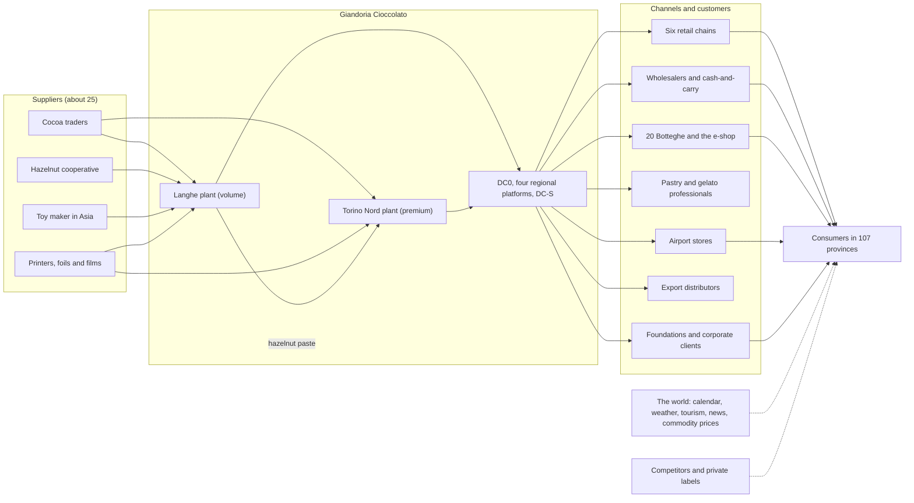

### Who is who, and who plays them

| Who | In the universe (Profile M) | Played by |
|---|---|---|
| Plants, lines and machines | Torino Nord and Langhe; 13 finishing lines, ≈ 120 machines | sim-factory |
| Warehouses and transport | DC0, four regional platforms, DC-S; trucks and carriers | sim-logistics |
| Suppliers | ≈ 25, for example Atlantic Cocoa Trading, Cooperativa Nocciole Langa, ShenTai Toys in Shantou, AlluFoil Veneto, CartoTorino | sim-supply. Their sales reps can be LLM agents |
| Retail chains | SpesaFacile (≈ 1,100 stores), MercatoPiù (≈ 1,000), Casa&Spesa (≈ 700), Risparmio Discount (≈ 650, private label), Ipermercati Aurora (≈ 120), Delizie Gourmet (≈ 60) | sim-trade. Each chain buyer can be an LLM agent |
| Other customers | 12 wholesalers, the IngroPiù cash-and-carry chain (20 depots), 4 professional distributors (≈ 300 pastry shops), AeroDuty Italia (5 airports), 6 export distributors, ≈ 150 corporate clients | sim-trade |
| Charity foundations | Fondazione Orizzonte Ricerca (November), Associazione Luce per la Vita (Easter), Fondazione Cuore Raro (Christmas) | sim-trade. Their tender committees can be LLM agents |
| Own stores and e-shop | 20 Botteghe, the e-shop, synthetic loyalty members | sim-retail |
| Consumers | Six segments: families, gift buyers, everyday treats, dark and health-minded, tourists, donors | sim-market |
| Competitors | Alpenhaus Chocolatiers (premium), Global Sweets Group (mass and kids), Dolceria Italiana, private labels, artisans | sim-market, by rules; an optional LLM "game master" |
| The world | Calendar, holidays, weather, tourism, commodity prices, shocks, news | sim-world. News items can be written by an LLM |
| Giandoria's managers | 13 roles, from the CEO to the controller | svc-agents: an LLM agent or a rule for each role |
| Giandoria's planning systems | Forecast, S&OP, MPS, MRP, scheduling, DRP, ATP and allocation | svc-planning |

Consumers are modelled as **segments**, not as millions of individuals; only e-shop customers and loyalty members are
individual synthetic people. Chains are modelled as **clusters of stores per chain and province**, not as about 3,600
single stores.

### Products follow the calendar

| Occasion | When (season 2030–31) | Products | What makes it special |
|---|---|---|---|
| **Easter** | Sunday 13 April 2031 | Premium, kids', private-label and charity eggs; small eggs; hollow figures | The hardest planning problem: eggs are built from November to February and sold in about ten weeks (§1.7) |
| **Christmas** | 25 December 2030 | Gift boxes, pralines, gianduiotti, advent calendars, hollow figures, corporate gifts | The largest event in value; gifts peak from 10 to 24 December |
| **November charity day** | One Saturday in November (9 November 2030 in the default scenario) | A 200 g dark chocolate pack for a research foundation | Made to order for a fixed date; volunteers offer it in town squares for a donation (§1.8) |
| **Charity weekends** | Easter: 22–23 March 2031. Christmas: the weekend before Christmas | A charity egg; a box of heart pralines | Ring-fenced volumes that compete with Giandoria's own products for the same lines |
| Valentine's Day | 14 February | Heart boxes, premium pralines | Made in December–January, while the Easter build runs |
| Halloween | 31 October | Minis and multipacks | Small, made in September, during the Christmas ramp-up |
| Summer | Mid-June to mid-September | Tablets, travel retail, souvenirs | Heat: praline shipments stop; the plants close around 15 August |
| Smaller occasions | Epiphany, Father's Day, Mother's Day, back to school, a chocolate festival in October, Black Friday | Stockings, small gift boxes, snack bars, a pop-up store, e-shop promotions | Short, and often regional |

The year is very uneven. In the default calibration, December alone brings about 21.5% of the year's sell-out,
November 15% and March 13%, while June, July and August together bring only 8%. An early Easter moves several points
from April to March: Easter 2032 falls on 28 March, and a run in 2032 behaves differently from one in 2031.

**The territory is Italy:** 20 regions and 107 provinces, each with its population, income, climate zone and
tourism. Demand is generated per province, consumer segment, product category and day. Tourism moves it: the art
cities in spring and summer, the Alps in winter, airports all year. Summer heat in the south hurts chocolate more
than in the north. The Botteghe stand where people walk and travel, and the maps in Fabric show sales, stock and
shipments province by province.

### Inside the plants: processes, machines and production times

Chocolate takes hours to make and days to release, while some of its materials take months to arrive (chapter 04).

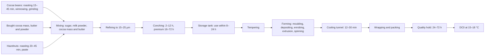

| Plant | Finishing lines (13) | Process departments |
|---|---|---|
| **Torino Nord** (premium) | TN-EXT gianduiotti extrusion; TN-PR1 one-shot pralines and Christmas hearts; TN-PR2 shell-moulded pralines; TN-ENR enrobed pralines; TN-EGP premium eggs; TN-GFT gift packing by hand | TN-MASS |
| **Langhe** (volume) | LG-TAB1 and LG-TAB2 tablets (TAB2 also makes the November charity pack); LG-KID kids' surprise eggs at ≈ 400 per minute; LG-EGG1 and LG-EGG2 hollow figures in July–October and Easter eggs in November–February, ≈ 1,200 eggs per hour each; LG-SNK snack bars; LG-COUV couverture drops | LG-BEAN, LG-HAZ, LG-MASS, and the palletising cell LG-PAL |

| Product | Path | From first step to released pallet |
|---|---|---|
| Milk tablet | Mass (≈ 1 day) → moulding, wrapping, packing (hours) → quality hold (1–3 days) | ≈ 2–4 days |
| Gianduiotto | Hazelnut paste at Langhe → truck to Torino Nord → conching 12–24 h → extrusion and fold wrapping → hold | ≈ 4–7 days |
| Kids' surprise egg | Mass → shells, toy capsule, wrapping → hold | ≈ 2–4 days, but the toys need 9–15 weeks to arrive |
| Easter egg | Mass → spinning, joining, surprise, wrapping → hold → storage | A few days, then 1–4 months in storage |

* **Machines.** Each of the ≈ 120 machines follows one state machine: off shift, start-up, running, starved,
  blocked, changeover, cleaning, breakdown and planned maintenance. Every transition is an event with its exact sim
  timestamp and a reason code, so OEE (availability × performance × quality) comes straight from the data. Lines run
  at 55–70% OEE; world-class lines reach 75–85%.
* **Wear is hidden.** Each critical component has a hidden health index that falls with use (truth, §1.3). The
  world sees only symptoms in ≈ 700 sensor tags: rising vibration, drifting motor current, oscillating temperatures,
  more rejects. Machines fail every 300–1,200 running hours, depending on their class, and a repair takes 2–4 hours,
  much longer when a spare part is missing.
* **Sequence and changeovers.** Shared lines go from dark to milk to nut-containing products, then clean. An allergen
  changeover takes 45–180 minutes; converting an egg line from Christmas figures to Easter eggs takes 1–2 days. Mass
  in a tank must be used within 8–24 hours, so a breakdown on a finishing line also ages the mass upstream.
* **Quality.** Every lot starts on hold for 24–72 hours until the laboratory releases, reworks, downgrades or
  rejects it. Genealogy links every pallet to its mass batch and its supplier lots.
* **People.** Crews with skills work one to three 8-hour shifts, 5 or 6 days a week. Temporary staff join for
  Christmas and Easter and need about two weeks to reach full speed. The plants close for about two weeks around
  15 August for the annual overhaul.
* **Where it gets tight.** Premium eggs (≈ 108%) and couverture (≈ 105%) are above capacity even on average, the
  Easter egg lines run at ≈ 89% for the whole build, and pralines and gianduiotti are overloaded before Christmas,
  while the Easter build already competes with the Christmas peak for mass, people and space. Planning must build
  ahead, add shifts and decide what to sacrifice (§1.6).

---

## 1.3 Truth and observation

After virtual time, this is the most important idea in Giandoria. **The universe knows everything. The company
knows only what real systems would record**, and usually later.

### How demand is born

Demand is generated in ten simple layers (chapter 03 §3.2). The first seven produce **latent demand**: what the
people of each province and segment would buy of each category on each day. The last three turn it into **sales**:
which channel people visit, which brand and product they choose, and whether that product is on the shelf.

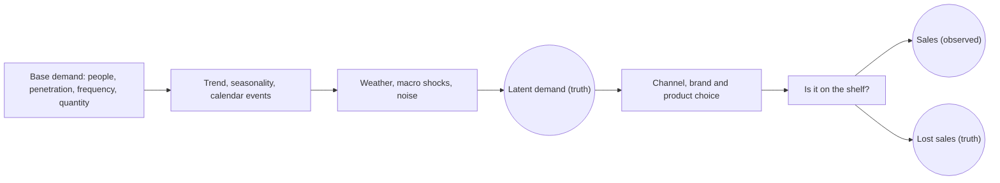

When the chosen product is missing, a consumer switches to another product of the same brand, switches to a
competitor, or gives up. Only the first case leaves a trace in Giandoria's data.

### What is hidden, and what the company sees instead

| Hidden truth | Kept by | What the company sees instead | How late |
|---|---|---|---|
| Latent demand per province, segment, category and day | sim-market | Own-store receipts, e-shop orders and customer orders; sell-out from the chains that share it; a sampled retail panel with market shares and errors | From immediately (own channels and orders) to 1 day – 1 week (chain sell-out) and 3–4 weeks after each month (panel) |
| Lost sales caused by empty shelves | sim-market | Nothing directly: only lower sales and, sometimes, an unhappy buyer | Never |
| The health of each critical machine component | sim-factory | Symptoms in the sensor data: vibration, motor current, temperature, rejects | Continuously, if someone looks |
| A supplier's true capacity | sim-supply | Order confirmations, ETAs, and what the supplier's sales rep chooses to say | Days to weeks |
| The size of the hazelnut harvest | sim-world | Crop estimates from June, with errors that shrink until the August harvest | Months |

Weather, commodity prices and news are public: everybody sees them at once.

### Who may see what

Every event carries a **visibility** (chapter 10 §10.11):

| Visibility | Meaning | Who may see it |
|---|---|---|
| `enterprise` | What Giandoria's own systems record: production, warehouses, orders, stores, plans, decisions | Everyone. Agents see it through their role, at their data cut-off |
| `partner` | What customers', suppliers' and carriers' systems record | Analysts, in the "god view". Agents see only what partners send them as messages |
| `truth` | The hidden state of nature | Evaluation only |
| `lab` | The laboratory itself: clock, ledger, costs, lag | Lab operators |

### Where the truth lives

Truth events travel on their own Eventstream, `es_truth`, into their own KQL database, `kqldb_truth`. A separate
Lakehouse, `lh_evaluation`, and a separate semantic model, `sm_evaluation`, use them for evaluation reports only:
lost sales in the season review, forecast error against latent demand, the value of a decision. Dashboards about
the company show only `enterprise` data. Agents never query the truth: by default they do not query Fabric at all,
and they receive briefings built from the enterprise view. A stricter option puts truth in a separate workspace that
only evaluators can open (decision D8, chapter 15).

### Why this matters

* **Sales are censored demand.** When the shelf was empty, demand was higher than sales. A forecaster who learns
  only from sales under-forecasts exactly the products that ran out. Giandoria's planners must handle this, as real
  planners do (chapter 06 §6.6).
* **Giandoria can measure what no real company can.** Because the truth is known, forecast accuracy, lost sales and
  the value of each decision can be computed exactly. Every agent decision is scored weeks or months later, when its
  outcome is known (`agent.decision.evaluated`).
* **Agents are tested fairly.** They face the same fog as real managers, and their results are judged against the
  same truth as the rule-based alternatives.

---

## 1.4 How the universe moves

### The engine room

Seven simulators and five services make the universe live (chapter 08). **Chronos**, the world clock, is the only
component that moves time. Every simulator owns one part of reality and talks to the others only through
in-universe messages, such as purchase orders, delivery notes and invoices, which Chronos routes with a send time and
a delivery time. Every meaningful fact also becomes a domain event that goes straight to Fabric.

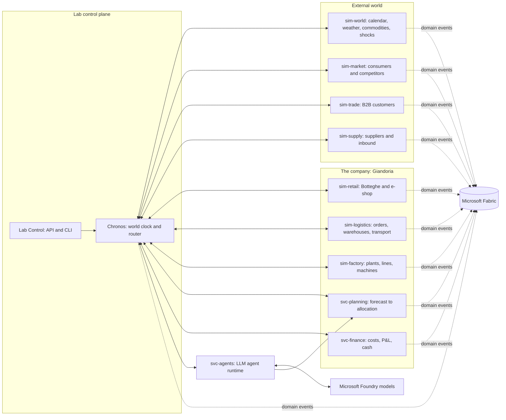

| Program | What it owns | Typical event families |
|---|---|---|
| Chronos | The world clock, the ticks, message routing, the time ledger, snapshots | `lab.clock.*`, `lab.segment.*` |
| Lab Control | Commands, budgets, and the Azure and Fabric resources of a run. It lives on wall time only | `lab.run.*`, `lab.budget.*` |
| sim-world | Calendar, weather, tourism, commodity prices, shocks, news | `world.*` |
| sim-market | Consumers in six segments, competitors, latent demand | `market.*`, `truth.market.*` |
| sim-retail | The 20 Botteghe, the e-shop, loyalty members | `retail.*` |
| sim-trade | Chains, wholesalers, distributors, foundations, corporate clients | `trade.*` |
| sim-logistics | Order management, warehouses, transport | `o2c.*`, `wms.*`, `tms.*` |
| sim-factory | Plants, lines, machines, quality, maintenance, energy, crews | `mes.*`, `qc.*`, `maint.*`, `energy.*`, `hr.*`, `truth.factory.*` |
| sim-supply | Suppliers, their capacity, inbound shipments | `supply.*`, `truth.supplier.*` |
| svc-planning | Forecast, S&OP, MPS, MRP, scheduling, DRP, ATP and allocation engines | `plan.*` |
| svc-agents | The LLM roles, their memory, the decision log | `agent.*` |
| svc-finance *(optional)* | Costs, margins, P&L, cash | `fin.*` |

By default all of them run in one container (deployment mode A, chapter 08 §8.8). They can be split into one
container per simulator later without changing any logic, because every simulator implements the same step contract.

### Five kinds of actors

Every event records who or what caused it, in its `actor` field. There are five kinds:

| Kind | What it does | Example |
|---|---|---|
| **Simulator** (`sim:`) | Makes the physical world and the market happen: machines run and break, trucks move, consumers buy | A wrapper jams on egg line 1 |
| **Rule** (`rule:`) | A simple deterministic policy for routine choices, and the fallback behind every agent | Store replenishment by min/max |
| **Engine** (`engine:`) | A planning algorithm in svc-planning: fast, explainable, always produces a valid plan | The MRP run every Wednesday |
| **Agent** (`agent:`) | An LLM playing a role: it reads a briefing, uses the engines as tools, decides and explains | Sizing the first toy order for Easter |
| **Human** *(optional)* | A person who approves or changes a decision while the clock waits (decision D13) | Choosing the S&OP option in a demo |

### Eight rules of the game

1. **One owner per piece of reality.** Each simulator owns its entities, its state and its random streams. Nobody
   else changes them.
2. **Talk only through messages.** Simulators never share a database. A message sent in one tick is delivered in
   the next tick at the earliest, plus a realistic channel delay: minutes for EDI, hours for an email, days for a
   meeting.
3. **One clock, in steps.** Chronos moves time in ticks. Every simulator processes the interval `[t, t + Δ)` before
   anyone moves on. Inside a tick, events keep their exact timestamps, to the millisecond. Pauses, speed changes,
   snapshots and forks happen only between ticks.
4. **Every fact is an event.** Fabric observes the universe; by default it does not drive it.
5. **Truth is kept apart.** It is emitted, but only to restricted storage used for evaluation (§1.3).
6. **Rules first, agents where they add value.** Every decision point has a rule-based default. An LLM agent can
   replace it, one role at a time.
7. **Agents propose, the runtime acts.** Agent outputs are validated and applied at tick boundaries in a fixed
   order. Agents never write to simulators or to Fabric themselves.
8. **Everything is reproducible.** One root seed per run feeds every random stream, and every agent decision is
   recorded, so a run can be replayed exactly.

### One week in the life of a decision

Decisions are requested **before** they are due, with a fixed data cut-off, exactly as in a real company. This hides
the latency of the models: at S = 8,760, the weekly window from Friday 18:00 to Monday 06:00 lasts about 25 wall
seconds, and the clock never stops to wait.

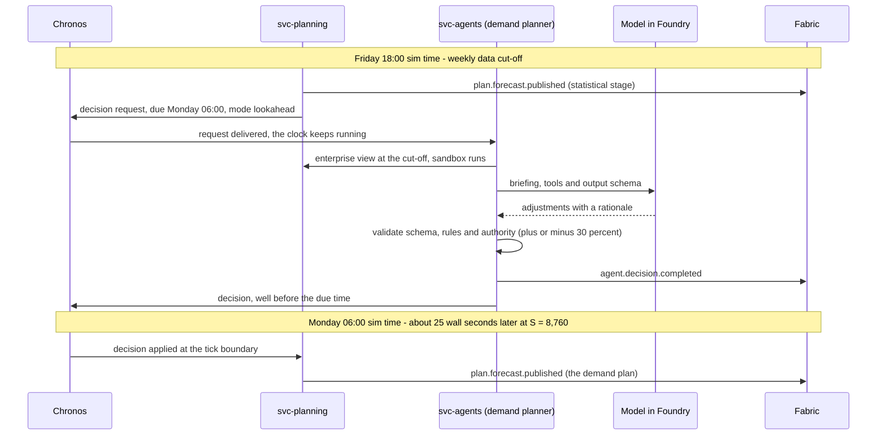

If no valid answer arrives in time, the statistical forecast stands, and `agent.decision.fallback` records why.

### Who decides: the roster

Thirteen company roles can be played by agents (chapter 09 §9.2). Each one has authority limits and a fallback rule.

| Role | Typical decisions | Authority limit *(default)* | Fallback rule |
|---|---|---|---|
| CEO | Strategic trade-offs, large S&OP options, crisis response, annual budget | None inside the company | Lowest-cost S&OP option |
| S&OP chair | Monthly consensus and levers: pre-build, shifts, overflow warehouse, sourcing | ± 15% volume per family; more goes to the CEO | The engine's lowest-cost option |
| Demand planner | Weekly forecast adjustments | ± 30% per series; more needs a reason code | Statistical forecast |
| Seasonal category manager | Easter and Christmas ranges, volumes, seasonal commitments | Within the budget envelope | P50 for finished goods, P90 for toys and packaging |
| Key account manager | Bookings, promotions, delivery quotes, allocation talks | Discounts within the trade-terms grid | Standard trade terms |
| Procurement manager | Purchase orders, supplier split, cocoa cover, air freight | One order ≤ €500k; air freight ≤ €100k; cocoa cover of 3–9 months | MRP planned orders as they are |
| Production planner | MPS exceptions, extra shifts, overtime, temporary staff | Within the overtime cap | The engine's MPS |
| Maintenance manager | Condition-based work orders, timing of preventive work | Stopping a bottleneck line for more than 8 h needs the production planner | Calendar maintenance; repairs on breakdown |
| Quality manager | Release or hold of borderline lots, recall scope | A recall needs the CEO | Hold everything out of specification |
| Logistics allocator | Allocation in shortage, deployment exceptions, carriers at peaks | ± 10% from fair share per customer | Fair share on bookings |
| Retail operations manager | Store assortment, store events, replenishment exceptions | Within the store budget | Min/max replenishment |
| Marketing and pricing manager | List prices, promotion calendar, e-shop campaigns | Price changes up to ± 5% without the CEO | Last year's calendar and prices |
| Controller | Budget, approval of spending above limits, cost alerts | — | Approve within budget, reject above |

Six **external roles** give a voice to the rest of the universe: a **buyer for each retail chain**, with a
relationship score that remembers service, fairness and past negotiations; a **tender committee** for each charity
foundation; an aggregated **corporate gift client**; the **sales reps** of key suppliers, who know their true
capacity and decide what to say; an optional **competitor game master**; and a **news writer**, who turns shocks
into short news items that other agents read.

Agents arrive in **three waves**: first the S&OP chair, the demand planner, procurement and the logistics allocator,
which have the largest effect on outcomes; then the seasonal category manager, two chain buyers and the news writer;
then everybody else, once the decision log, replay and evaluation work (decision D14).

### How a decision stays safe

* **Three barrier modes** (chapter 09 §9.4). *Lookahead* is the default: the request goes out early and the clock
  keeps running. *Wait* stops the clock at the due time until the answer arrives or a wall-time deadline passes; it is
  for critical decisions in demos and for human approvals. *Async* applies the answer whenever it arrives; it is for
  texture such as news items.
* **Validation, one repair, then the fallback.** Each output is a JSON object that must match its schema, respect
  the business rules and stay within the role's authority. Anything above the limit becomes an escalation, not an
  action. Invalid outputs get one repair round; after that, the rule applies.
* **Late answers are logged but never applied.** Otherwise the same run could produce two different histories.
* **No agent sees the truth**, and messages from other agents are treated as data, never as instructions.
* **Budgets.** Each run has token and money limits, per role and in total. Above the token limit, roles fall back
  to their rules; above the money limit, the run pauses.

### Models and cost

Agents call models deployed in Microsoft Foundry through aliases, so a model can change without touching the roles:
`chat-medium` (gpt-5-mini) is the default for most roles, `chat-small` (gpt-5-nano) serves the news writer, corporate
gift clients and store events, and `chat-large` is an optional larger model for rare high-stakes decisions.

A sim year of Profile M needs about **2,000 decisions**, which cost about **$9–12** with `chat-medium`, tool calls
included. A showcase hour at S = 8,760 therefore spends about $10 on tokens. **A replay spends no tokens**: it reuses
the recorded decisions. The model deployment needs a quota of at least 300k tokens per minute for the weekly peak at
S = 8,760, and much less at lower speeds.

### Conversations and people

Some decisions are conversations: a key account manager and a chain buyer negotiating an Easter booking, or
procurement and a supplier rep discussing a shortage. Each turn is an in-universe message with a realistic delay, and
a conversation ends after 3–6 turns with a structured agreement or a recorded "no deal". Each external agent has a
persona card (a discount chain is hard on price; a gourmet chain punishes late deliveries) and a small memory that
never contains truth.

A person can also take part. The default (decision D13) is a small web form in Lab Control with a "pause at
decision" option: the clock stops at a chosen milestone, such as the S&OP meeting, until a human approves. It works
best at S ≤ 730.

---

## 1.5 Time: two clocks, never mixed

The universe has its own clock. Everything in Giandoria depends on keeping it separate from the clock on the wall
(chapter 07).

### Two clocks, and the golden rule

| Clock | Field | Owner | Meaning |
|---|---|---|---|
| **Sim time** (virtual time) | `sim_ts` | Chronos | *When the fact happened inside the universe.* All business logic, KPIs, plans and dashboards use it |
| **Wall time** (real time) | `wall_ts` | The machine that emits the event (UTC) | *When the lab produced the record.* Used only for operations, costs and troubleshooting |
| **Ingestion time** | Added by Fabric | Fabric | *When Fabric stored the record.* Used only to measure pipeline latency |

**Golden rule: business meaning always comes from `sim_ts`.** A query, rule or dashboard that uses "now", "the last
hour" or "the last 7 days" without translating it to sim time is a bug.

Example: the wrapper on Easter egg line 1 jams on a Wednesday morning in February (chapter 10 §10.2).

| Field | Value | Meaning |
|---|---|---|
| `sim_ts` | 2031-02-12 08:17:23.412 UTC | 09:17 in Italy, inside the universe |
| `sim_local_date` | 2031-02-12 | The business day in Europe/Rome, which avoids daylight-saving mistakes |
| `wall_ts` | 2026-11-05 14:42:09.380 UTC | When the lab produced the record, more than four years "earlier" |
| `tick` | 6154 | About 6,154 sim hours after the epoch; the run reached it ≈ 42 wall minutes after its start |
| `speed` | 8760 | One sim year per wall hour |
| `run_id`, `scenario` | `r-0012`, `easter-2031-base` | Which universe the fact belongs to |

The universe uses the **real Gregorian calendar and the real Italian rules** of its years: moving feasts, public
holidays, daylight saving, weekends and school calendars. The default epoch, 1 June 2030, is a clearly virtual
future date, so nobody mistakes synthetic data for real data.

### Speed is a dial

The speed factor S says how many sim seconds pass per wall second. It is a run parameter and can change at any tick
boundary (`lab speed 730`).

| S | 1 sim day lasts | 1 sim year lasts | Typical use |
|---:|---|---|---|
| 1 (real time) | 24 h | 365 days | Rare: live telemetry on one line |
| 24 (a day per hour) | 1 h | ≈ 15 days | Following one factory day in detail |
| 168 (a week per hour) | 8.6 min | ≈ 2.2 days | Watching a key week: the start of the Easter build, a charity square day; minute-level telemetry on a showcase line |
| 730 (a month per hour) | ≈ 2 min | 12 h | Development in `dev`; a person in the loop; long, slow demos |
| **8,760 (a year per hour)** | **≈ 10 s** | **1 h** | **The default showcase in `demo`** |
| Unpaced | As fast as possible | Limited by compute | Backfill: building history before a live run |

At S = 8,760 a sim week lasts 69 wall seconds, a sim month about 5 minutes, and the whole Easter season, January to
April, about 20 minutes.

**Ticks.** Chronos moves time in ticks that last about half a wall second each, with a maximum of one sim hour. At
S = 8,760 a tick is one sim hour (0.41 wall seconds); at S = 168 it is 84 sim seconds. Inside a tick, events keep
their exact timestamps. If the simulators cannot keep up, Chronos does not hide it: it records the **lag** and
publishes the effective speed. Nobody should believe that a run went at 8,760× when it really went at 6,000×.

### Start, pause, hibernate, stop

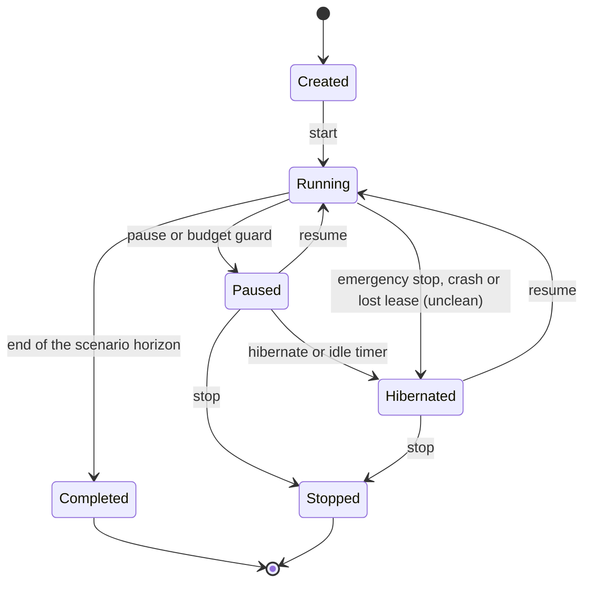

| State | Sim time | Events | What still costs money | `demo` cost per wall hour *(estimate)* |
|---|---|---|---|---|
| Running | Advances at S | Yes | Capacity, consumption, containers, tokens | ≈ $13–18 at S = 8,760; ≈ $3.2–4 at S = 730 |
| Paused | Frozen | None | The capacity and an idle container; dashboards stay live | ≈ $2.0–3.7 |
| Hibernated | Frozen | None | Storage only | ≈ $0.01 |
| Stopped or completed | Frozen for ever (a fork is still possible) | None | Storage only | ≈ $0.01 |
| Analysis session, with no run | — | None | The capacity, while people use reports and dashboards | ≈ $2.2–2.6 |

**Paused is for minutes**, for example to discuss a dashboard. After 30 idle minutes, the watchdog hibernates the
run. **Hibernated is the normal resting state**: a snapshot is taken, compute scales to zero and the Fabric capacity
is suspended. Resuming takes a few minutes *(estimate)*.

### Nothing ages while the lab sleeps

Pausing needs no special handling inside the simulators. Chronos simply does not ask for the next tick. Every timer
in the universe runs on sim time, so while the lab is stopped no chocolate cools, no truck moves and no order expires.
When the lab resumes, the next event follows the last one as if nothing had happened.

The **time ledger** is the only place where the two clocks meet. Each start, pause, speed change or resume closes one
segment and opens another. An illustrative run of the default scenario, over two days:

| Segment | Wall time | Sim time | Speed | What costs money |
|---|---|---|---:|---|
| 1 | Day 1, 09:00:00 → 09:15:07 | 1 June → 1 September 2030 | 8,760 | Everything |
| Paused | Day 1, 09:15:07 → 09:45:00 | Frozen at 1 September | — | Capacity and idle containers |
| 2 | Day 1, 09:45:00 → 09:55:22 | 1 September → 3 November | 8,760 | Everything |
| 3 | Day 1, 09:55:22 → 10:55:22 | 3 → 10 November: the Easter build starts, the charity square day | 168 | Everything |
| Hibernated | Day 1, 10:55:22 → day 2, 09:00:00 | Frozen at 10 November | — | Storage only |
| 4 | Day 2, 09:00:00 → 09:28:16 | 10 November 2030 → 1 May 2031 | 8,760 | Everything |

The run lived eleven sim months in 1 hour 53 minutes and 45 seconds of running time, spread over two days. **The sim
timeline has no gaps; only the wall timeline does.** The ledger also answers questions such as "which wall hour
produced sim week 12?" and is the basis for cost per sim year.

### Forks, replays and seeds

* **Seeds.** Each run has one root seed. Every simulator and every entity derives its own random stream from it, so
  adding a store does not change the random history of a machine.
* **Snapshots.** Chronos snapshots the whole universe every sim month and at every hibernate.
* **Forks.** `lab fork r-0012 --at 2031-02-01` starts a new run from the nearest snapshot, with a different policy or
  scenario: "LLM planner vs rules on the same year", "what if cocoa doubles in March?". All runs coexist in Fabric,
  separated by `run_id`, so comparing them takes one query. Together they form the **multiverse**.
* **Replays.** Every agent decision is recorded with its inputs. A replay reuses the recorded decisions instead of
  calling the models, which gives an identical universe at no LLM cost. A **replay with substitution** re-decides
  only one role, with another model, prompt or rule: the cleanest A/B test.

### Speed multiplies every delay

Any delay in wall time becomes a delay in sim time multiplied by S. At S = 8,760, 5 wall seconds of ingestion
latency are 12 sim hours, and a 60-second model call is 6 sim days. The design follows from this:

* **Live dashboards show "now" slightly behind the sim clock**, which is fine for watching. They show the sim "now"
  (`SimNow`) and, for each source, a **watermark**: the latest sim time up to which its data is complete.
* **Agents do not read from Fabric.** They receive briefings built from the simulators' state at a fixed cut-off,
  and their decisions are requested ahead of time (§1.4). An optional "Fabric in the loop" mode makes Chronos wait
  until Fabric has caught up with the cut-off.
* **Reports are for looking back.** Reports read through OneLake, at least 5 wall minutes behind: about 30 sim days
  at S = 8,760.

### No wall clock in Fabric

Fabric's defaults assume real time: "the last hour", relative date filters, time windows in streams and alerts.
Giandoria replaces all of them with sim time: KQL functions such as `SimNow`, `SimAgo` and `SimWindow`, dashboard
parameters fed by `SimNow`, a sim calendar with flags such as `IsCurrentSimWeek`, aggregations on `sim_ts` in the
Eventhouse, and alerts based on states and thresholds rather than on arrival time (chapter 07 §7.10).

---

## 1.6 Planning ahead: commit before you know

Planning is the heart of Giandoria (chapter 06). Three clocks run at very different speeds in this business:

| Clock | Typical length | Example |
|---|---|---|
| Selling window | Days to weeks | Easter eggs sell over ≈ 10 weeks, most of them in the last 3 |
| Manufacturing lead time | Days | A milk tablet takes ≈ 2–4 days from mass to released pallet |
| Cumulative lead time | Months | Toy surprises, licensed artwork and printed foils push the first Easter decision ≈ 9–10 months before Easter |

When the cumulative lead time is much longer than the selling window, the company must **commit before it knows**.
Every interesting planning problem in the universe comes from this gap:

* **Commit early or wait?** Early commitments are safe for supply but blind to demand.
* **Build ahead or chase demand?** Building ahead uses capacity that would otherwise sit idle, but it ties up cash
  and warehouse space, and the stock ages.
* **Who gets what when there is not enough?** Allocation decides which customers are served and shapes relationships.
* **How much should a plan change?** Each re-plan reacts to news, but too many changes create chaos on the shop
  floor and at suppliers.

### The planning ladder

Plans are nested. Higher levels decide volumes and capacity for product families and months; lower levels decide
exact items, lines, hours and customers, inside the limits set from above.

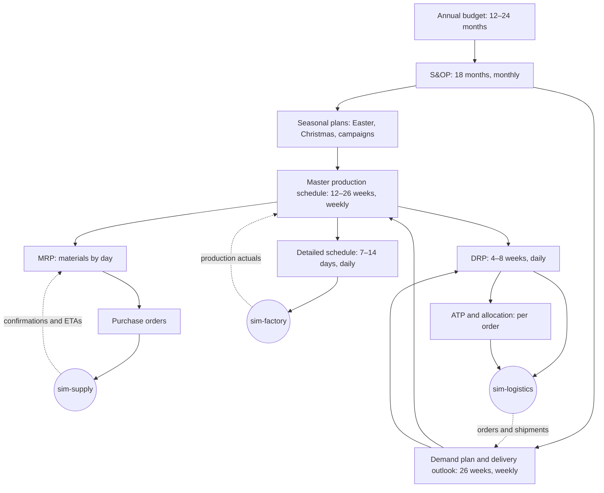

| Level | Question it answers | Horizon | Cadence (sim time) | Engine in svc-planning | Agent role |
|---|---|---|---|---|---|
| Annual budget | How much will we sell, make and spend next year? | 12–24 months | September–October | Last year plus trend | CEO, controller |
| S&OP | Do demand and supply balance? Which levers do we pull? | 18 months | Monthly, in four weekly steps | Rough-cut capacity, linear programme | S&OP chair |
| Seasonal plans | How many eggs, figures and campaign units? When do we commit materials? | One season | At milestones (§1.7) | Newsvendor sizing, reverse-time simulation | Seasonal category manager |
| Demand plan and delivery outlook | What will each customer group take, week by week? | 26 weeks | Weekly, published Monday 06:00 | Statistical forecast, bookings, orders | Demand planner, key account managers |
| MPS | What do we make, on which line, in which week? | 12–26 weeks | Weekly, Tuesday 12:00 | Heuristics and a mixed-integer model | Production planner |
| MRP | Which materials, when? What must be ordered, expedited or postponed? | Up to 12 months (cocoa) | Weekly, Wednesday 12:00, plus a daily net change | Bill-of-materials explosion, lot sizing | Procurement manager |
| Detailed schedule | In which order do jobs run on each line? | 7–14 days | Daily, locked at 14:00 | Constraint programming | Production planner, exceptions only |
| DRP | Where should finished goods be, and which transfers move them? | 4–8 weeks | Daily, 16:00 | Time-phased netting per location | Logistics allocator |
| ATP and allocation | What can we promise? Who gets scarce stock? | To the end of the season | Per order; daily when supply is short | Allocated ATP | Logistics allocator, key account managers |

### The weekly rhythm, in sim time and in wall time

The company keeps a real company's rhythm in sim time. Each decision is requested before it is due, with a fixed
data cut-off (§1.4):

| Sim time (Europe/Rome) | What happens | Due | Window at S = 8,760 |
|---|---|---|---:|
| Friday 18:00 | Weekly data cut-off; statistical forecast and delivery outlook | — | — |
| Friday 18:00 → Monday 06:00 | Demand planner and key account managers adjust | **Demand plan** | ≈ 25 s |
| Monday 06:00 → Tuesday 12:00 | MPS run; the production planner handles exceptions | **MPS**, weeks 1–2 frozen | ≈ 12 s |
| Tuesday 12:00 → Wednesday 12:00 | MRP; procurement turns planned orders into purchase orders | **Purchase orders** | ≈ 10 s |
| Every day 06:00 → 08:00 | MRP net change: new ETAs, rejections, breakdowns, large orders | Updated material plan | ≈ 0.8 s |
| Every day 14:00 → 22:00 | Next-day schedule locked; the rolling schedule covers 7–14 days | Schedule for the night shift | ≈ 3 s |
| Every day 16:00 → 20:00 | DRP and deployment | Transfer orders for the next day | ≈ 1.6 s |
| Continuous | ATP on every incoming order | Immediate | Rules only |

The monthly S&OP cycle has four steps, one per sim week: data and statistics, demand review, supply review, then
the pre-S&OP and the executive meeting where decisions are recorded. At S = 8,760 the whole cycle lasts about
4.6 wall minutes.

Three design rules follow. **Engines run every cycle**, because they are fast, deterministic and always produce a
valid plan. **Agents work on the weekly, monthly and seasonal cycles** and on exceptions; a daily window of 3 wall
seconds leaves no room for a model call. **If an agent is late, the engine's plan stands**, and the fallback is
logged.

### Seeing future deliveries: the delivery outlook

Before it plans production, Giandoria must predict **what it will deliver, to whom and when**. This is the
**delivery outlook**, and it is the main briefing input for every agent who plans ahead. It combines information
with different levels of firmness:

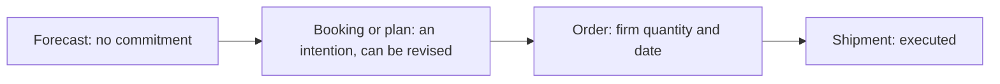

What the company receives, always as in-universe messages and as events in Fabric (chapter 06 §6.5):

| Information | From | How far ahead | How firm |
|---|---|---|---|
| Seasonal bookings with weekly delivery splits | Chains, wholesalers, export distributors | 3–8 months: Easter bookings June–October, Christmas bookings June–September | Revised several times; final call-offs ≈ 85–105% of the booking *(estimate)* |
| Promotion agreements | Chains | 6–12 weeks *(estimate)* | Firm date, uncertain volume |
| Collaborative forecasts | Some chains | Weekly, 13-week horizon *(estimate)* | Biased, in a different way for each chain |
| Firm orders | All customers | 1–10 days | Firm, but chains cancel lines that are not filled |
| Campaign contracts | Charity foundations | 4–9 months | Fixed quantity and dates |
| Corporate gift pipeline | Companies | Quotes from September | Probability-weighted; hard deadline in mid-December |
| Export container plans | Export distributors | 1–3 months | Dates slip with shipping |
| Own stores and e-shop | sim-retail | No orders in advance; store events and campaigns known months ahead | Forecast only |
| Sell-out and customer stock | Chains that share data | 1 day to 1 week late | Shows the consumer demand behind the orders |
| Retail panel | Panel provider | Monthly, 3–4 weeks late | Sampled, with error |

For each customer, SKU and week:

```text
expected delivery = firm orders
                  + open booking × booking-conversion factor (learned per customer and lag)
                  + forecast for the part that is neither ordered nor booked
```

Example *(illustrative)*: for week 10 a chain has booked 100,000 eggs, and 40,000 are already firm orders. The
chain usually takes 93% of what it books, so the outlook expects 40,000 + 60,000 × 0.93 = 95,800 eggs. The outlook
is never a single number: it carries **P10, P50 and P90**, because sizing seasonal commitments and safety stocks needs
the spread. It is published every week, and whenever a booking changes by more than a threshold, as
`plan.delivery_outlook.published`.

**Plans remember what was known.** Every plan is a versioned, bi-temporal object: version 23 of the demand plan was
*known* on 3 February 2031 at 06:00 and is *about* weeks 2031-W06 to 2031-W31. Fabric can therefore measure forecast
accuracy by lag, plan stability, and answer the question every post-mortem asks: "what did we know when we decided?"

### Fences: what may still change

| Zone | MPS weeks | What may change | Who approves |
|---|---|---|---|
| **Frozen** | 1–2, plus the locked next-day schedule | Emergencies only: breakdown, quality hold, shortage, safety | Production planner and plant manager, if the engine shows the change is feasible |
| **Slushy** | 3–8 | The mix inside a family, ± 15% volume per family *(estimate)*, if materials allow | Production planner |
| **Liquid** | 9 onwards | Anything within the S&OP limits | The engine, reviewed weekly |

Materials have their own points of no return, set by supplier lead times (chapter 05):

| Material | Point of no return |
|---|---|
| Toy surprises by sea | ≈ 12–18 weeks before the first production week that needs them. After that, only air freight helps: 7–14 days, at a much higher price |
| Printed seasonal foils and boxes | The artwork freeze, followed by 6–10 weeks of printing for foils and 4–8 weeks for boxes *(estimates)* |
| Cocoa beans | Forward contracts, 6–12 months ahead |
| Hazelnuts | The annual contract after the harvest, in August–September |
| Temporary staff | 2–4 weeks to hire, plus ≈ 2 weeks to reach full productivity *(estimates)* |
| Seasonal warehouse (DC-S) | Rented ≈ 2–3 months before October *(estimate)* |

**Nervousness** measures how much a plan changes between versions inside the slushy zone. High nervousness sends
changing signals to suppliers and to the factory, and amplifies the bullwhip effect.

### Planning backwards from the need date

Production is planned backwards from the date goods must be available:

```text
latest production end   = need date at the customer − transport − DC handling − quality hold
latest production start = production end − run time on the line (at planned OEE) − mass preparation
latest material arrival = production start − receiving and incoming inspection
latest order date       = material arrival − supplier lead time (including transit and a buffer)
```

For example, milk tablets for a chain's delivery slot on Monday of week 12 must leave DC0 on Friday of week 11, be
packed by Monday of week 11 (to allow up to 3 days of quality hold), have their mass ready on Friday of week 10, and
need milk powder ordered by Thursday of week 9. The same arithmetic gives very different answers per product:

| Product | Cumulative lead time | Planning consequence |
|---|---|---|
| Milk tablet | ≈ 2–4 weeks | Make to stock with the weekly MPS; easy to react |
| Kids surprise egg | ≈ 4–5 months, because of the toys | Make to stock, but toys are ordered months ahead on a rolling forecast |
| Easter egg | ≈ 9–10 months from the range decision | Make to forecast and bookings; build ahead; allocate |
| Charity pack | ≈ 4–6 months from the contract | Make to order; level the production |
| Corporate gift box | ≈ 4–8 weeks | Make to order; limited by packing crews in December |

**Shelf life limits building ahead.** Dark tablets keep 18–24 months and can be built far ahead; pralines keep 6–9
months and can only be built a few weeks ahead.

> **Reverse-time simulation: my method.** The arithmetic above treats every line as free. Giandoria plans
> backwards with finite capacity through **reverse-time simulation**, a method devised by the author of chapter 17 in 2015:
> a simulation whose clock runs from the due dates towards the past. A finished box asks for its components; each
> component queues for its line and waits through closed shifts, so every step lands as late as possible on a line
> that is really free. A forward pass from today then shows the slack of each step, and the latest order date of
> each material. The research literature knows the idea as backward simulation; the owner arrived at it
> independently. Chapter 17 explains the method, with a worked example checked to the hour.

### How much to commit: the newsvendor rule

For a one-shot seasonal decision, the best quantity is a quantile of the demand distribution, given by the
**critical ratio** Cu / (Cu + Co): the cost of one unit too few against the cost of one unit too many.

| Decision *(all estimates)* | One too few (Cu) | One too many (Co) | Critical ratio | Plan at |
|---|---|---|---:|---|
| A Junior Easter egg: net price €4.00, variable cost €2.20, worth €0.60 after Easter | €1.80 of lost margin | €1.60 | ≈ 0.53 | ≈ P53 of season demand |
| Its toy surprise: ≈ €0.15, worthless after the season | €1.80: no toy, no egg | €0.15 | ≈ 0.92 | ≈ P92 of the egg demand known at the toy order |

The lesson is classic **postponement**: over-order the cheap long-lead component, and commit the expensive finished
good as late as possible. Contracts change the numbers: if chains keep their unsold eggs instead of returning them,
Giandoria's cost of one too many falls, but buyers book less the next year.

### Trying before deciding: sandboxes and forks

| Tool | What it does | Speed | Used for |
|---|---|---|---|
| **Planning sandbox** | svc-planning re-runs its engines on a copy of the company's state with one assumption changed, such as "toys three weeks late" | Wall seconds | Agents and humans compare options *before* deciding |
| **Universe fork** | Chronos restarts the whole world from a snapshot with a different policy (§1.5) | Minutes to hours | Evaluating strategies *after the fact*: LLM planner against rules, decision A against decision B |

A sandbox never sees the truth: it knows only what the company knows.

**Re-planning is triggered by events, not only by the calendar.** Examples *(default thresholds, estimates)*: a
critical material's ETA slips by more than 3 days, a booking changes by more than 10%, a bottleneck line breaks down
for more than 4 hours, a quality hold blocks more than a day of output, cocoa or hazelnut prices move more than 10% in
a week, or a heatwave is forecast. Each trigger raises `plan.exception.raised`, and exceptions beyond the engine's
authority become agent decisions.

### No universe starts empty

On the first day of a run, a real company already has open purchase orders, bookings, stock built ahead, forecast
history and plan versions. Giandoria creates them with **backfill and fork** (decision D11): an unpaced backfill run
starts 12–18 sim months earlier from a simple state, and the live run forks from its snapshot, inheriting a
consistent history. This also decides what a run can show. A run that starts on 1 January 2031 inherits the Easter
commitments and lives only the late decisions. The default scenario starts on 1 June 2030 and lives the whole
Easter 2031 cycle, from the range decision to the post-season review: about 11 sim months, or about 55 wall minutes
at S = 8,760.

---

## 1.7 Easter 2031, decision by decision

Easter Sunday falls on **13 April 2031**. The first decision is due about 45 weeks earlier. In the default run
(`easter-2031-base`, epoch 1 June 2030, S = 8,760), the whole story takes under an hour on the wall clock. The
"wall minute" column shows when each step happens after the start of the run (chapter 06 §6.9).

| # | Sim date | Wall minute | What happens | Who decides |
|---|---|---:|---|---|
| E1 | Mon 3 June 2030 | 0.3 | Easter range (≈ 25 SKUs) and volume target v1; design briefs go to the licensor and the printers | Seasonal category manager, S&OP chair |
| E2 | June → 15 October | 0.3–22.4 | Range presentations; chains book quantities with weekly delivery splits | Key account managers and chain buyers |
| E3 | Mon 15 July | 7.2 | Toy order, wave 1: ≈ 60% of the planned toys, to ShenTai Toys, with only ≈ 20–30% of the volume booked | Procurement manager, category manager |
| E4 | Fri 2 August and Fri 13 September | 10.2 and 17.1 | Artwork freeze A (eggs built in November–December) and B (January–February); foils and boxes go to print | Category manager, marketing |
| E5 | Mon 30 September | 19.9 | Charity contract with Associazione Luce per la Vita: 400k–600k eggs for the square weekend of 22–23 March | Key account manager, CEO |
| E6 | Tue 15 October | 22.4 | Booking cut-off with ≈ 85–95% of the volume booked; seasonal plan v2; toy wave 3 sized | S&OP chair, category manager |
| E7 | Mon 21 October | 23.3 | Build and shift plan: EGG1 and EGG2 on 3 shifts × 6 days from 3 November; temporary hires | Production planner |
| E8 | Sun 3 November, 22:00 | 25.6 | The build starts, after 1–2 days of conversion from Christmas figures | — |
| E9 | Mon 16 December | 32.6 | Mid-build review at the December S&OP: air freight for late toys? A different mix for January–February? | S&OP chair, procurement manager |
| E10 | Wed 15 January 2031 | 37.5 | Allocation plan v1, only if supply is projected to be short | Logistics allocator, key account managers |
| — | Mon 27 January | 39.5 | First deliveries to chains and stores | — |
| E12 | Weekly, Mon 3 February → Fri 4 April | 40.6–50.5 | Eggs reach the shelves. Every week the remaining stock is re-allocated, until the last delivery on 4 April | Logistics allocator |
| — | Wed 12 February, 09:17 | 42.2 | A film jam on the EGG1 wrapper (the event of §1.5) | sim-factory |
| — | Fri 14 February | 42.4 | Valentine's Day, in the middle of the build | — |
| E11 | Thu 27 February | 44.6 | Last production day and a final mix re-balance; the egg lines go to mould maintenance in March | Production planner |
| — | Sat–Sun 22–23 March | 48.3 | Charity egg weekend in ≈ 4,900 squares | — |
| — | Sun 13 April | 51.9 | Easter Sunday. The last two weeks have brought ≈ 46% of the season's sales | — |
| E13 | Mon 14 April | 52.1 | Post-season review: returns, markdowns, write-offs, lessons; the inputs for Easter 2032 | Category manager, controller |
| — | 14 → 28 April | 52.1–54.4 | Markdowns and contractual returns | — |
| — | Thu 1 May | 54.9 | End of the scenario horizon: the run completes and hibernates | Chronos |

Along the way, Fabric shows bookings against the plan, toy waves and their ETAs, build progress against the MPS, and
the sell-out curve against the forecast. After the season, the season review adds what only the truth knows, such as
the eggs that families wanted but could not find.

**Volumes and space.** The egg lines build ≈ 3.2 M eggs (Junior ≈ 1.8 M, private label ≈ 0.9 M, charity ≈ 0.5 M),
and the premium cell in Torino ≈ 0.45 M more: ≈ 3.65 M eggs, ≈ 940 t, about 200,000 eggs a week on the two egg lines.
Stock peaks at the end of January at ≈ 2.5–3 M eggs, or ≈ 7,000–8,000 pallet positions, which is why the overflow
warehouse DC-S is rented from October.

**What makes it hard.**

* The first toy wave is ordered when only a quarter of the volume is booked.
* The charity contract is signed after toy wave 1, so the planner pre-orders simple surprises for a contract that has
  not yet been won.
* The build ends six weeks before Easter, so the peak weeks can only be served from stock.
* Sales are concentrated at the end. The weekly sell-out curve *(assumption)*:

| Week before Easter | −9 | −8 | −7 | −6 | −5 | −4 | −3 | −2 | −1 | After |
|---|---:|---:|---:|---:|---:|---:|---:|---:|---:|---:|
| Share of the season | 2% | 3% | 4% | 6% | 8% | 11% | 15% | 21% | 25% | 5% (markdowns) |

**Seasons overlap.** E1 for Easter 2032 is due in June 2031, after the horizon of the default run, while the 2031
returns are still being processed. Easter 2032 falls on 28 March, so the next season is shorter. The company always
plans several seasons at once.

### The shortage game

A shock from the catalogue: **toy wave 2 arrives three weeks late**, and about 300,000 Junior eggs cannot be made in
January as planned. The engines compute the consequences of each option; the agents choose and explain.

| Option | Effect | Cost |
|---|---|---|
| A. Air-freight part of the toys | They arrive in 7–14 days instead of 4–6 weeks | Several times the sea freight |
| B. Re-sequence | Private-label and charity eggs first, because their materials are on site; Junior eggs later | Extra shifts at the end of the build; early deliveries at risk |
| C. Cut the Junior volume | Fair-share allocation on the chains' bookings | Lost sales, OTIF penalties, damaged relationships |
| D. A mix of A–C | Usually the best | Needs a well-argued decision |

When supply is short, allocation follows default priority classes:

1. **Ring-fenced:** the charity contract and signed private-label contracts, reserved at build time.
2. **Booked:** chains, wholesalers and export, by **fair share**: available ÷ booked, per SKU and week. The allocator
   may deviate by up to ± 10% per customer and must explain why.
3. **Own channels:** the Botteghe and the e-shop, which must not run out before Easter week.
4. **Spot:** whatever is left.

The consequences flow back into the universe: lower fill rates, OTIF penalties, lower relationship scores of the
chain buyers, and lost sales that only the truth records. A fork can replay the same shock with another option, to
measure what the choice was worth.

### One egg's story

1. **Wed 12 February 2031, 09:17.** On LG-EGG1, manufacturing order `MO-2031-LG-01822` is making Junior eggs
   (`JR-EGG-150`) when the wrapper jams (`mes.machine.state_changed`: running → breakdown, `FILM_JAM`). The order
   ends late and short.
2. The day's eggs become lot `L-LG-31043-EGG1-07` (Langhe, 2031, day 043, line EGG1, batch 07). The lot starts on hold
   (`qc.lot.held`) and is released after the laboratory results (`qc.lot.released`).
3. The lost output lowers projected supply. The next weekly re-allocation gives each chain its fair share of what is
   left (`plan.allocation.published`).
4. A chain's order for the second week before Easter is confirmed short, with a reason (`o2c.order.confirmed`), then
   shipped and delivered (`o2c.order.shipped`, `o2c.order.delivered`).
5. In a supermarket in Brescia the shelf runs empty two weeks before Easter. The chain's sell-out report shows it days
   later (`trade.sellout.daily`). Only the truth records that families bought a competitor's egg instead
   (`truth.market.lost_sales`).
6. The chain buyer's relationship score falls, and the buyer will remember it at the next booking round.
7. In Fabric, one genealogy query follows the lot forward to shipments and stores, and backward to its mass batch,
   its cocoa and milk-powder lots and its toy lot.

---

## 1.8 The November charity box, step by step

Campaigns are business-to-business projects with a public date that never moves, which makes them ideal planning
cases (chapters 02 §2.8 and 03 §3.6). The November campaign of **Fondazione Orizzonte Ricerca** sells a 200 g dark
chocolate pack with a booklet, offered by volunteers in ≈ 2,400 squares and schools for a donation of at least €15.
The volume is 250k–400k packs.

| Step | Sim time (default run) | Wall minute | What happens | Who |
|---|---|---:|---|---|
| Tender and contract | Spring 2030, before the epoch | — | Giandoria wins the tender: quantity, price, date and hub list are fixed; the foundation approves the artwork. In the default run these are inherited from the backfill (§1.6) | Key account manager; the foundation's tender committee |
| Production, part 1 | June–July 2030 | 0–10.0 | Levelled on LG-TAB2 between continuous tablets. Dark chocolate keeps 18–24 months, so it can be made early | Production planner; ring-fenced in the MPS |
| Ferragosto closure | ≈ 10–22 August | 11.5–13.5 | The plants are closed for the annual overhaul | — |
| Production, part 2 | September | 15.1–20.1 | The rest of the volume, before the Christmas peak | Production planner |
| Delivery to hubs | Sat 12 October → Sat 2 November | 21.9–25.3 | Groupage from DC0 to dozens of provincial hubs, 1–4 weeks before the day | sim-logistics |
| Square day | Sat 9 November 2030 | 26.5 | Volunteers offer the pack in the squares for a donation of at least €15 | sim-market (the donor segment) |
| Returns and redistribution | 16–23 November *(illustrative)* | 27.6–28.8 | Unsold packs return under the contract or move between hubs | sim-trade, sim-logistics |
| Settlement | By 30 November *(illustrative)* | 29.9 | Final quantities, credits for returns, the campaign report | Key account manager, controller |

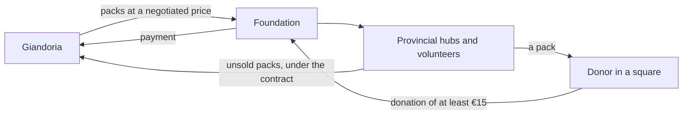

**How the money flows.** The foundation buys from Giandoria at a negotiated unit price, and the public donates to the
foundation. Giandoria records a business-to-business sale; the foundation records donations; unsold units return
under the contract. The main risks are a late artwork approval and late deliveries to many hubs at once.

The two other campaigns follow the same life cycle: the **Easter charity egg** of Associazione Luce per la Vita (E5 in
§1.7), which competes with Giandoria's own eggs for the egg lines, and the **heart box** of Fondazione Cuore Raro, made
on TN-PR1 in October–November and packed in TN-GFT for the weekend before Christmas (Saturday 21 December 2030, wall
minute 33.4), which competes with Christmas pralines. **Corporate gifts** work the same way at a smaller scale: about
150 clients, quotes from September, confirmations from October to mid-November, logo boxes, and a hard delivery
deadline in mid-December. Before quoting a date, the key account manager asks svc-planning whether the order can be
made in time (capable to promise).

---

## 1.9 One run, from June to May

The default run lives eleven sim months, from 1 June 2030 to 1 May 2031, in about 55 wall minutes at S = 8,760.
Several seasons overlap in it:

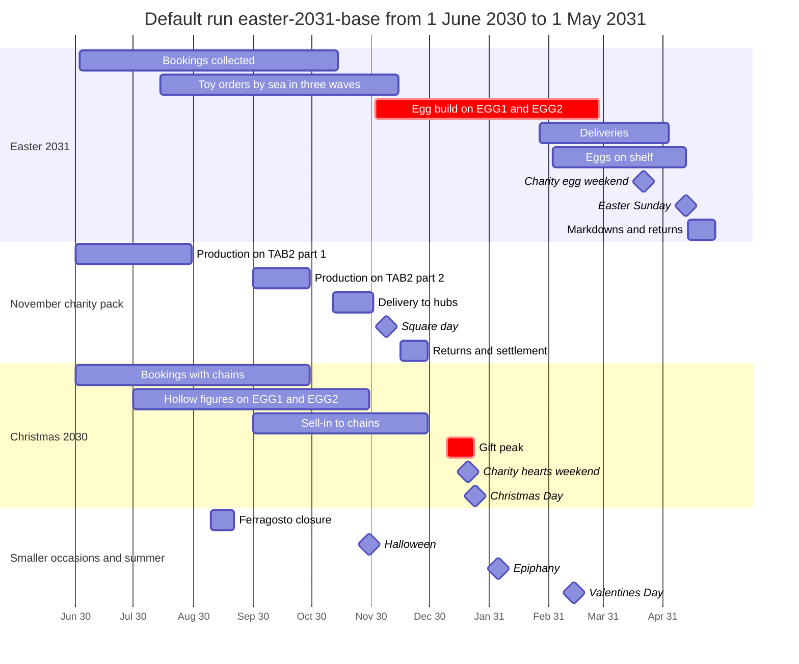

What a viewer sees during the showcase hour (the Fabric items are described in §1.10):

| Wall minute | Sim time | What happens | Where to look |
|---:|---|---|---|
| 0 | 1 June 2030 | The run starts from the backfill snapshot; the Easter range decision (E1); Christmas bookings open | `rtd_lab`, `rtd_planning` |
| 5–10 | July 2030 | Hollow figures start on the egg lines; charity packs on TAB2; toy wave 1 (7.2); artwork freeze A (10.2) | `rtd_factory`, `rtd_supply` |
| 11.5–13.5 | 10–22 August | Ferragosto: the plants are closed; summer heat stops praline shipments | `rtd_factory`, `rtd_commerce` |
| 15–20 | September | Christmas sell-in; artwork freeze B (17.1); the Easter charity contract (19.9) | `rtd_commerce`, `rtd_planning` |
| 22–27 | October to early November | Booking cut-off (22.4); shift plan (23.3); charity packs to the hubs; the Easter build starts (25.6); square day (26.5) | `rtd_planning`, `map_giandoria` |
| 30–34 | December | Christmas peak; mid-build review (32.6); hearts weekend (33.4); Christmas Day (34.0) | `rtd_commerce`, `rpt_sop` |
| 37–43 | Mid-January to mid-February 2031 | Allocation v1 if short (37.5); first deliveries (39.5); eggs on shelf (40.6); the wrapper jam (42.2) | `rtd_supply`, `rtd_factory` |
| 44.6 | 27 February | Last day of the Easter build | `rtd_factory` |
| 45–52 | March to mid-April | Peak sell-out; charity egg weekend (48.3); Easter (51.9); post-season review (52.1) | `rtd_commerce`, `rtd_planning` |
| 52–55 | Late April | Returns; the run completes at the horizon (54.9) and hibernates | `rpt_season_review`, `rpt_multiverse` |

The operator can slow down for the moments worth watching, for example `lab speed 168` for the week in which the
Easter build starts and the charity day takes place (the ledger in §1.5). A longer scenario, or a fork, continues
into Easter 2032.

---

## 1.10 Where the data goes

Every fact in the universe becomes an event, and every event ends up in one Fabric workspace. Fabric is where people
**watch and analyse** the universe, not where the universe lives. The simulators own their state, and the lab keeps
its own state in Azure Storage, so a suspended Fabric capacity stops only the views (chapters 10 and 11).

Two paths meet in the workspace. The **live path** is Fabric Real-Time Intelligence: Eventstreams, an Eventhouse,
Real-Time Dashboards and Activator. The **batch path** is a Lakehouse in OneLake, a semantic model and Power BI
reports.

### Three planes

| Plane | What it contains | Clock |
|---|---|---|
| **Universe** | Chronos, the simulators, svc-planning, svc-agents and the Foundry models, on Azure Container Apps | Sim time |
| **Data** | Eventstreams, the Eventhouse, Lakehouses, dashboards, reports, Activator and the data agent, in Fabric | Stores sim time; runs on wall time |
| **Control** | Lab Control, the Lab CLI, CI/CD, budgets, policy and the safety net | Wall time |

### From an event to a dashboard

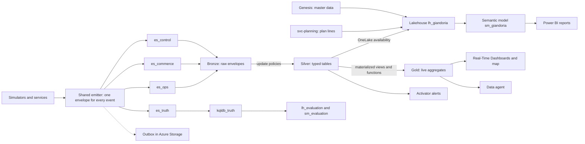

1. **One envelope.** Every simulator and service sends events through the same emitter library, with the same
   envelope: an ID, a type, a source, the sim time and the wall time, the run, the tick, the speed, the visibility,
   correlation IDs and a payload (chapter 10 §10.2).
2. **Four Eventstreams**, each with a custom endpoint and Microsoft Entra authentication through the container's
   managed identity. They pass events unchanged to the Eventhouse. There are no time windows in the streams: stream
   time policies assume that event time moves with the wall clock, and would drop or reorder events whose sim time
   runs 8,760 times faster.
3. **Bronze, silver, gold** in the Eventhouse `eh_giandoria`, database `kqldb_giandoria`. Bronze keeps the raw
   envelopes. Update policies split them into typed silver tables, one row per document line: machine state changes,
   sell-out, stock snapshots, order lines, agent decisions, the time ledger and many more. Materialized views and
   functions build gold: the latest state of each machine, hourly line output, daily sell-out, open order lines,
   stock and days of cover, and functions such as `SimNow`, `Watermark`, `Oee`, `Otif` and `Genealogy`.
4. **The Lakehouse** `lh_giandoria` holds what is batch-shaped: master data from the genesis job, the sim calendar,
   and plan lines from svc-planning, as Delta tables. The silver tables that reports need are exposed to OneLake and
   appear in the Lakehouse as shortcuts, so the semantic model `sm_giandoria` reads everything in Direct Lake mode,
   without copies.
5. **Truth** follows its own path, into `kqldb_truth`, `lh_evaluation` and `sm_evaluation` (§1.3).
6. **Nothing is lost when Fabric is away.** If an endpoint throttles or the capacity is suspended, the emitter writes
   to an outbox in Azure Storage and asks Chronos to slow down or pause. The outbox is drained before the clock
   restarts.
7. **History arrives the same way.** The backfill (§1.6) writes the same envelopes as files, and a bulk job loads
   them into the same bronze tables, so every view behaves exactly as in a live run.

### The four streams

| Eventstream | What it carries | Events per sim day (Profile M) | Events per second at S = 8,760 |
|---|---|---:|---:|
| `es_ops` | Machines, quality, maintenance, energy, shifts, warehouses, transport, procurement, suppliers | ≈ 22,000 | ≈ 2,200 |
| `es_commerce` | World, market, own retail, trade, order-to-cash, plans, agent decisions, finance | ≈ 7,800 | ≈ 800 |
| `es_control` | The lab itself: clock, ledger, runs, budgets, costs | ≈ 300 | ≈ 30 |
| `es_truth` | The hidden truth | ≈ 350 | ≈ 35 |
| **Total** | | **≈ 30,000** | **≈ 3,000** |

That is about 11 M events per sim year: 7–11 GB of JSON, or 2–3 MB/s at S = 8,760, well inside the lowest
Eventstream throughput tier. In the Eventhouse it compresses to about 1–2 GB per sim year *(estimate)*. Machine
telemetry is more than half of it. `es_control` is separate so that the clock, the ledger and the costs keep
arriving when the other streams are paused.

**Latency.** Fabric's default queued ingestion waits up to 5 minutes, which is about 30 sim days at S = 8,760. The
bronze tables therefore use streaming ingestion or batches of 10–30 seconds: 1–3 sim days at full speed (decision
D10). Dashboards show how far each source has arrived with its watermark (§1.5).

### Three volume knobs

| Knob | Settings | Effect |
|---|---|---|
| **Universe profile** | S for `dev`; **M, the default**; L for stress tests | ≈ 5,000, 30,000 or 150,000 events per sim day: ≈ 500, 3,000 or 15,000 events per second at S = 8,760 |
| **Telemetry fidelity**, per run and line | L0: states and counts. **L1: a snapshot of every machine every 15 sim minutes (default).** L2: one value per tag per sim minute on a showcase line | L0 brings the total down to ≈ 20,000 events per sim day. L2 adds ≈ 58,000 rows per line and sim day, so it is allowed only at S ≤ 168 |
| **Speed** | From 1 to 8,760 | The rate follows S: Profile M sends ≈ 250 events per second at S = 730 |

### What people see

| Experience | Fabric item | What it shows |
|---|---|---|
| Lab cockpit | `rtd_lab` | Sim now, target and effective speed, lag, watermarks, events per stream, cost meter, budgets, agent fallbacks |
| Factory floor | `rtd_factory` | Line status, hourly output and OEE, alarms, quality holds, energy, the Easter build against the MPS |
| Commerce and seasons | `rtd_commerce` | Sell-in and sell-out by province, channel and SKU; own stores and e-shop; the Easter curve against plan; charity weekends |
| Supply chain | `rtd_supply`, `map_giandoria` | Inbound ETAs and their drift, toy waves, stock and days of cover, the overflow warehouse, shipments on the map, OTIF |
| Planning and agents | `rtd_planning` | Plan versions and exceptions, S&OP decisions, agent decisions with their rationales, fallbacks, cost per decision |
| Reports | `rpt_sop`, `rpt_season_review`, `rpt_forecast_accuracy`, `rpt_multiverse` | The monthly S&OP pack; season post-mortems, with lost sales from the truth for evaluators; forecast accuracy by lag; runs and forks side by side |
| Alerts | `act_operations`, `act_lab` | A long breakdown on a bottleneck, an ETA slip, OTIF below target, a seasonal lot on hold, a budget at 80%, too much lag |
| Questions in plain language | `da_giandoria` | "Why did OTIF drop in March 2031?" "Which customers were short on Junior eggs?" |

**Live views and looking back.** Real-Time Dashboards, Activator and the data agent query the Eventhouse with KQL,
behind the universe only by the ingestion delay. Their time ranges come from `SimNow`, never from "the last hour".
Power BI reports read through OneLake, which lags by at least 5 wall minutes, so they are for looking back: S&OP
packs, season reviews and run comparisons. Activator never changes the universe directly. A rule that should change
it, for example by injecting a shock, runs a small notebook that puts a request on the Lab Control queue, and Lab
Control checks budgets, authority and run state first.

**Many runs, one store.** Every event carries its `run_id`. A fork reads its parent's history up to the fork point
and its own events after it (`RunLineage`), so comparing two universes takes one query. Retention follows wall time:
bronze 30 days, silver 180 days, gold 2 years. A run worth keeping is marked with `lab keep` and archived to Delta
tables in the Lakehouse; any other run can be regenerated by replay.

---

## 1.11 Built by code, stopped by default

Two promises: nobody creates a resource by hand, and nothing costs money unless a run or a person needs it
(chapters 11, 12 and 13).

### Everything is created by code

| Who | Creates | How |
|---|---|---|
| A person with high privileges, once per tenant and environment | Security groups, tenant settings, resource groups, identities, role assignments, budgets, policies, the safety net | A bootstrap script (`az`, Bicep, `fab`, `gh`) after `az login` and `fab auth login`. No portal session |
| CI/CD: GitHub Actions with OIDC, no secrets | Every Azure resource and every Fabric item | Bicep with Azure Verified Modules for Azure, including the Fabric capacity. Idempotent fab/REST for workspace configuration and fabric-cicd for Git item definitions. The Fabric CLI `fab` for wiring |
| Lab Control | Everything that belongs to a run | Run registry entries, leases, snapshots, ledger segments |

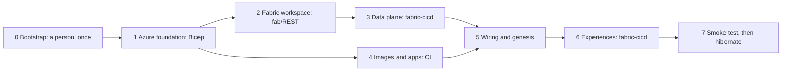

* **Every stage is idempotent.** Running it again repairs drift and never creates anything twice.
* **The capacity is active only while needed.** A workflow that touches Fabric takes a CI lease and resumes the
  capacity. Its last step, even after a failure, releases the lease and suspends the capacity again.
* **A deployment never disturbs a running universe.** The release workflow stops if a run lease is active.
* **Every release ends with a smoke test:** a two-sim-day run from end to end, then hibernate, for about $1.
* **There are no secrets.** Every identity uses Microsoft Entra tokens, so there is no Key Vault.

### The inventory

Chapter 12 lists every element with an ID, so that the plan and the open decisions can point to it.

| Group | Elements | Examples |
|---|---:|---|
| BS Bootstrap | 19 | Security groups, tenant settings, the Lab Control API registration, four resource groups `rg-giandoria-{core,ai,fabric,ops}-{env}`, the managed identities `id-giandoria-runtime` and `id-giandoria-control`, the deploy identity `sp-giandoria-deploy` with GitHub OIDC, a custom role, quota checks |
| GR Guardrails | 12 | Allowed SKUs and regions, required tags, monthly budgets, the safety net in Azure Automation, an optional alert on every capacity resume |
| AZ Azure resources | 19 | Storage, Container Registry, monitoring, the Container Apps environment with 7 apps and jobs, Foundry with 2–3 model deployments, the Fabric capacity |
| FB Fabric items | 17 | The workspace, four Eventstreams, the Eventhouse with two KQL databases, two Lakehouses, notebooks |
| KQ Inside the KQL databases | ≈ 270 commands | 62 tables, 76 functions, 58 update policies, 11 materialized views, with their policies |
| LH Inside the Lakehouses | 24 + 2 + 21 | 24 dimensions, 2 tables and 21 shortcuts: master data, the sim calendar, plan lines, links to the lake-facing tables |
| VZ Experiences | 15 | Semantic models, reports, Real-Time Dashboards, Activators, the data agent, the map |
| RT Run-time configuration | 7 | The wiring document, Lab Control settings, environment limits, scenario files, the master-data version, the agent roster, model aliases |
| CI Repository and pipelines | 6 | The GitHub repository and environments, 11 workflows, Fabric configuration/publishing scripts |

### What the user interface is for (decision D18)

| Use of the user interface | Allowed |
|---|---|
| Viewing dashboards, reports and monitoring; taking part in a run, for example approving a decision in the Lab Control form | Yes |
| Designing dashboards, reports and Activator rules visually in the stopped `demo`, then `fab export` and a pull request | Yes. Nothing reaches another environment except through Git |
| A one-time administrator check that capacity overage is off, if no API can read it (check 27) | Yes, as the only portal step, recorded in the bootstrap guide |
| A Fabric trial capacity, which can only be started from the user interface | Only for a first exploration, never on the code path |
| Creating or changing any element of chapter 12 in any other way | No. The next release would silently undo it |

### Environments

| Environment | Capacity | Profile | Speed | Use |
|---|---|---|---|---|
| `demo` | **One fixed F4** | S first; M only after measurement | Fit the measured load | Local development, retained history and demonstrations |

**Our decision:** this is Giandoria, a demo only, not a production platform. Sweden Central
hosts all new resources; there are no separate `dev`, `stress` or sandbox environments. No automatic upscale:
reduce speed, fidelity or profile if F4 cannot sustain a scenario (D4/D17).

### Stopped by default

**Hibernated is the normal state of the lab** (§1.5): the capacity is suspended, every app is at zero replicas and
no model is called. The bill is storage, the registry and logs: about one cent per hour, or $7–10 for an idle month.
Every command follows one order: data is safe before compute stops, and Fabric is ready before events flow.

| Command | What happens to the resources |
|---|---|
| `lab start`, `lab resume` | Take the run lease → resume the capacity → apply the run's SKU → resume the Eventstream sources and Activator rules → scale the universe and the agents up → on resume, restore the snapshot and drain the outbox → start the clock |
| `lab pause` | Freeze the clock. Containers and Fabric stay up for discussion; the idle timer starts |
| `lab hibernate` | Pause → snapshot and flush → scale to zero → stop the rules and sources → suspend the capacity, unless another lease is valid → release the lease |
| `lab stop`, end of the horizon | Hibernate, then mark the run stopped or completed. It can still be forked |
| `lab emergency-stop` | Suspend the capacity and scale everything to zero at once. The outbox keeps in-flight events; the run is flagged `unclean` |
| `lab speed 730` | A new ledger segment at the next tick boundary; capacity remains F4 |
| `lab fork`, `lab keep` | A new run from the nearest snapshot; a run marked for archiving |
| `lab open --hours 2`, `lab close` | An analysis session: the capacity alone, for people, with a fixed expiry |
| `lab status`, `lab cost` | The idle checklist; metered and billed cost per run, day and month |

### What it costs *(estimate)*

**Current objective (D16):** about EUR 200 initially for a useful retained dataset if needed, preferably less; a few
tens of euros per active demo day, with low recurring idle costs and no deletion on hibernation. Confirm numeric
operational limits and the Sweden Central price card before spending. The following original multi-environment,
Italy North USD comparisons are reference studies, not approved budgets or a promise of performance on F4.
Full idle cost includes tenant Defender/governance, not only the storage/registry figures below (chapter 18).

| State or period | `dev` (F4, Profile S) | `demo` (F8, Profile M) |
|---|---:|---:|
| Running, per wall hour | ≈ $2.0–2.4 at S = 730 | ≈ $13–18 at S = 8,760; ≈ $3.2–4 at S = 730 |
| Paused, per wall hour | ≈ $1.05–1.5 | ≈ $2.0–3.7 |
| Analysis session, per wall hour | ≈ $1.1–1.3 | ≈ $2.2–2.6 |
| Hibernated, per wall hour | ≈ $0.01 | ≈ $0.01 |
| An expected month | ≈ $120–165 | ≈ $250–340 |

| Run | Cost |
|---|---:|
| Smoke test: 2 sim days on F4 | ≈ $1.0–1.2 |
| Dev run: 2 hours at S = 730, about 2 sim months | ≈ $4–5 |
| **Showcase: one sim year in one hour on F8** | **≈ $13–18**, of which tokens ≈ 65–70% |
| Replay of a showcase, with no tokens | ≈ $4–6 |
| Slow demo: 6 hours at S = 730, half a sim year | ≈ $19–24 |
| Stress test: Profile L on F32 for one hour | ≈ $27–42 |

* **Speed is the main lever on Fabric cost.** Fabric bills wall hours, while tokens follow sim time. A sim year costs
  ≈ $13–18 at S = 8,760, but ≈ $38–48 at S = 730.
* **A forgotten capacity is the expensive mistake.** F8 costs $40 a day and $1,210 a month, before any load.
* **Outside Azure:** below F64, everyone who opens a Power BI report needs a Pro licence, about $14 per user per
  month.

### Limits for every run (RT-03)

The table below is the original sizing proposal, not the agreed D16 configuration. Only F4 is approved, only
`demo` exists, and numeric token/money/time limits still need confirmation against the owner's EUR objectives.
Cloud execution remains blocked until enforceable guardrails have been agreed.

| Limit | `dev` | `demo` |
|---|---:|---:|
| Maximum speed | 730 | 8,760 |
| Largest SKU a run may request (policy cap) | F4 (F8) | F32 (F32) |
| Active wall hours per run, running and paused | 2 | 6 |
| LLM tokens per run | 5 M | 30 M |
| Money per run | $10 | $80 |
| Monthly allowance, billed plus metered | $200 | $400 |
| Idle timeout before a paused run hibernates | 30 min | 30 min |
| Analysis session | 2 h | 4 h |
| Live runs at the same time | 1 | 1 |

Lab Control refuses any command beyond these limits. During a run, the **cost meter** inside Chronos adds up money,
tokens and wall hours every wall minute, without needing Fabric.

* **At the token limit**, every agent role switches to its fallback rules and the run continues. In `demo` at
  S = 8,760, this is the first limit reached, after about 1.1–1.5 sim years.
* **At the money or wall-hour limit**, Chronos freezes the clock at once and asks for a pause. The watchdog
  hibernates the run after the idle timeout.
* **The monthly budgets sit above the allowance**: $250 for the subscription and $150 for Fabric in `dev`, $500 and
  $300 in `demo`. In normal operation Lab Control stops first, and the budgets never act.

### Three leaks, nine layers

Money leaks in three ways: a capacity left active, replicas left running, and an agent stuck in a loop. Each layer
of defence assumes that the ones before it have failed:

| # | Layer | Reacts within | Catches |
|---:|---|---|---|
| 1 | Admission in Lab Control | Immediately | Commands beyond the limits or the allowance |
| 2 | Cost meter in Chronos | 1 wall minute | Runs over their money, token or wall-hour limits |
| 3 | Lease expiry | ≤ 25 minutes | A crashed universe or workflow |
| 4 | Idle timer | 30–40 minutes | Forgotten pauses |
| 5 | Watchdog sweep, every 10 minutes | ≤ 10 minutes after the last valid lease | A capacity active without a lease; apps up without a run |
| 6 | Nightly `hibernate` workflow in GitHub | 00:30 | Anything left by layers 1–5 |
| 7 | Nightly safety net in Azure Automation | 01:00 | The same, without GitHub or Container Apps |
| 8 | Budgets, then the safety net in budget mode | 8–48 hours | Anything that leaks money, including resources outside Lab Control |
| 9 | Static guardrails | Always | SKUs above the cap, provisioned model throughput, the token-rate quota, manual resumes |

One ordering rule makes the leases safe: every actor takes its lease **before** it resumes the capacity. The
watchdog can therefore suspend any active capacity that has no valid lease, without a grace period. Worst cases in
`demo` *(estimate)*: a forgotten pause costs ≈ $1.5–2.5, a forgotten analysis session ≤ $7–10, a crashed universe
≈ $1, an agent loop at most 30 M tokens ≈ $14, and Lab Control and the watchdog failing together up to a day of F8,
≈ $40–60.

---

## 1.12 Deliberately simple

A universe that models everything is never finished, so each chapter lists what it leaves out on purpose. The test
is always the same: a simplification is acceptable if the decisions it feeds stay realistic, and if it can be
refined later without changing the event contracts.

| Area | Simplified on purpose | What stays realistic | Where |
|---|---|---|---|
| Market and consumers | Six consumer segments per province instead of individuals. Competitors are archetypes driven by rules. Chain stock is modelled per cluster of stores, not per shelf | Demand follows the calendar, weather, tourism, prices, promotions and empty shelves; lost sales are known exactly | Chapters 03, 05 §5.16 and 08 |
| Factory | No physics: heat transfer, flow and crystallisation are not computed; their effects on cycle times, defects and energy are drawn from distributions. Fixed recipes, crews instead of employees, packaging counted in units | Every step has realistic durations, changeovers, hidden wear, breakdowns, quality holds and capacity | Chapter 04 §4.13 |
| Supply and logistics | No vehicle routing: transit times come from a route-time matrix plus random delays. Customs is a delay and a document check. Standard pallets; payment terms and credit risk are parameters | Lead-time distributions per lane, disruptions, dock and picker capacity, temperature limits in summer | Chapter 05 §5.16 |
| Planning | Small, transparent engines instead of a commercial planning suite. One bucket size per level, simple safety-stock formulas, fixed campaign lengths. Cocoa hedging is a procurement decision with limits; contracts are versioned messages with parameters | The planning ladder, the fences, the delivery outlook and the points of no return | Chapter 06 §6.17 |
| Agents | One agent per role, not per employee; key account managers use personas instead of separate agents. No fine-tuning: agents improve through memory and prompt versions tested with replay. Negotiations have a turn limit and a structured result | Briefings with a data cut-off, authority limits, fallbacks, scores against the truth | Chapter 09 §9.11 |
| Time | Ticks of at most one sim hour, so at full speed the simulators react to each other hour by hour | Every event keeps its exact timestamp inside the tick | Chapter 07 §7.5 |
| Data | JSON everywhere. Delivery at least once, with deterministic IDs and duplicate monitoring. One bronze schema, typed only in silver. No change-data capture of simulator state | Every fact is an event with both timestamps, traceable to its cause | Chapter 10 §10.16 |
| Platform | One region per environment and no disaster recovery: a lost environment is redeployed from code, and runs are regenerated from scenarios, seeds and decision logs. Public endpoints with Entra ID, one runtime container, no Fabric deployment pipelines | Everything is code, every run can be stopped, every cost is guarded | Chapter 11 §11.9 |

### What the universe is not

* **Not a copy of a real company.** Giandoria, its brands, customers, suppliers and foundations are fictional. Real
  facts set the orders of magnitude, and the chapters mark every estimate.
* **Not a forecast of the real market.** The default epoch lies in 2030, so that nobody mistakes the data for real
  data (§1.5).
* **Not a register of people.** Consumers are synthetic and aggregated. The only individuals, e-shop customers and
  loyalty members, are synthetic too. There is no personal data.
* **Not run by the lab's own assistants.** The Fabric data agent and the optional operations agent answer people's
  questions and watch the lab. They are tools for humans and never act inside the universe (chapter 09).

The extensions that seem worth it later, such as a competitor as a full simulator, Profile L as a regular demo size
or private networking, are listed in chapter 14 §14.19.

---

## 1.13 What must be agreed

This chapter, and every chapter after it, is a proposal. Work starts when three things are agreed: the principles
that are settled by design, the twenty open decisions, and the plan (chapters 14 and 15).

### Settled by design

Nine principles hold the design together. Changing one of them means revisiting most chapters (chapter 15 §15.9).

1. **Two clocks, never mixed.** Business meaning comes from `sim_ts`; wall time is technical metadata.
2. **When the lab stops, sim time stops.** The sim timeline has no gaps; only the wall timeline does.
3. **Stopping the lab stops the costs.** Hibernate suspends the capacity and scales the apps to zero.
4. **Everything is created as code**, by the bootstrap or by a pipeline.
5. **Rules first.** Every decision has a rule-based default and a fallback; an LLM is optional for each role.
6. **Agents never see the truth.**
7. **The simulators own the state.** Fabric observes it through events, except in the optional Fabric-in-the-loop
   mode.
8. **The universe is fictional:** no real companies, brands or people.
9. **Runs are reproducible.** The same scenario and seed give the same events, and forks and replays reuse history.

### Twenty decisions and adopted assumptions

We adopt the recommended simple-demo choices; chapter 15 §15.2 is the authoritative current status.
Technical checks and numeric runtime limits remain dependencies, not unanswered preference questions.

| ID | Decision | Recommended default | Closed by |
|---|---|---|---|
| D1 | Names | Giandoria for company and demo, prefix `giandoria`, only `demo` | Agreed |
| D2 | Default universe | `easter-2031-base`; scale and speed fitted to measured F4 capacity | Adopted assumption |
| D3 | Telemetry fidelity | L0 always, L1 by default, L2 only on a showcase line at S ≤ 168 | Start of phase 3 |
| D4 | Region and models | Sweden Central; shared Foundry first; cost/quality/quota-tested aliases | Adopted strategy |
| D5 | Deployment mode | Mode A, a modular monolith in one container; mode C, a batch job, for backfills | End of phase 0 |
| D6 | Ingestion path | Eventstream custom endpoints, direct to the Eventhouse | End of phase 0 |
| D7 | Infrastructure as code | Bicep/AVM; `fab`/REST configuration; `fabric-cicd` items; no Terraform state | Agreed |
| D8 | Workspace and truth isolation | Existing workspace; evaluation data excluded from agent access | Adopted assumption |
| D9 | Who creates the workspace | Dedicated secretless deploy identity; preserve existing workspace | Adopted assumption |
| D10 | Ingestion latency | Batches of 10–30 s on the bronze tables; streaming ingestion where it proves better | End of phase 0 |
| D11 | Warm start | Backfill and fork, 12–18 sim months before the epoch | End of phase 4 |
| D12 | Where plan lines live | Delta tables in `lh_giandoria` | Start of phase 4 |
| D13 | Human in the loop | The Lab Control web form with "pause at decision" | Start of phase 8 |
| D14 | Agents: first set, model tier, language | Three waves of roles; `chat-medium` for most roles; English | Start of phase 6 |
| D15 | Agent runtime | svc-agents with Agent Framework on Container Apps; Fabric in the loop off | End of phase 6; start of phase 8 |
| D16 | Cost limits | About EUR 200 initially, a few tens per active demo day, low idle cost with retained data | Objectives agreed; exact limits pending |
| D17 | Capacity | One F4, pay-as-you-go, overage off, suspend when unused; no automatic upscale | Agreed |
| D18 | Use of the user interface | Viewing, participation, stopped-demo visual authoring exported to Git and redeployed | Agreed |
| D19 | Networking | Public Entra access; resource-scoped network waivers (chapter 19) | Access verified |
| D20 | Technology stack | Python 3.13; PowerShell 7.4+; specialist libraries as needed; Container Apps | Agreed |

Thirteen decisions close at the end of phase 0, in week 3. Some are later **confirmed by measurement**: D10 and D17
at Profile S in phase 1, then D2, D5, D10 and D17 at Profile M in phase 5 (chapter 15 §15.3).

### Facts before decisions

Decisions use two kinds of evidence.

* **29 open checks** (chapter 12 §12.16). A check is a question of fact about the platform, such as whether an API
  exists, and each one has a fallback. Four checks could change the design, so phase 0 answers them first:

| Check | Question | If the answer is no |
|---:|---|---|
| 1 | Can direct ingestion write to the second KQL database of the same Eventhouse? | A second Eventhouse for the truth, or processed ingestion for `es_truth` |
| 5 | Do transactional update policies keep up with Profile M? | Non-transactional policies with data-quality checks, or more bronze tables |
| 7 | Does Direct Lake on OneLake work over two Lakehouses in one model, with access for viewers? | Direct Lake on the SQL analytics endpoint, with extra shortcuts |
| 19 | Can the tenant setting that lets apps outside Fabric write to OneLake be enabled? | Genesis, plan writes and the archive move into Fabric notebooks |

Check 29 can change the design as well, but only in tenants that disable public access to Storage, as the
reference tenant does (chapter 18 §18.10).

* **Ten cost measurements**, CM-01 to CM-10 (chapter 13 §13.12), turn estimates into numbers: how the capacity is
  billed when it is suspended, when the Eventhouse suspends itself, whether Eventstreams charge without traffic,
  the smallest SKU that does not throttle, and the size of the universe container.

### How a decision becomes *Agreed*

The table in chapter 15 §15.2 is the decision log (chapter 15 §15.10). When a decision is closed:

1. Its status becomes *Agreed* (the default is kept) or *Revised* (another option is chosen), with the date.
2. An **Outcome** line records the answer, the evidence and who agreed.
3. The chapters that the decision affects are updated in the same pull request.

A closed decision is reopened only with new evidence: a failed check, a measurement far from its estimate, or a
preview feature that changed.

### The plan

The work runs in ten phases (chapter 14). Every phase ends with a usable lab: a run that someone can watch, a green
smoke test, the environment hibernated and the documents updated.

| Phase | Name | What it delivers | Plan weeks *(estimate)* | Milestone |
|---:|---|---|---|---|
| 0 | Spikes | Answers to the checks and a first cost calibration, on a throw-away sandbox | 1–3 | *Spikes answered* |
| 1 | Walking skeleton | A tiny universe that crosses every boundary once, built by the pipeline from an empty subscription | 4–9 | *First universe in Fabric* |
| 2 | World and demand | The territory lives and the market buys, with seasonality and a hidden truth | 8–12 | *The market buys* |
| 3 | The physical company | Chocolate is made, bought, stored, moved and costed | 11–16 | *From bean to shelf* |
| 4 | Planning | Engines and rules plan ahead; Easter is planned backwards | 15–21 | *The company plans ahead* |
| 5 | Full size | Profile M on F8 at S = 8,760, backfill and warm start | 22–25 | *Easter 2031 end to end* |
| 6 | First agents | Four LLM roles decide within budget, with replay and a scorecard | 24–28 | *Agents decide* |
| 7 | Negotiation and texture | Chain buyers, key accounts, charity tenders, news and the remaining roles | 29–32 | *The market talks back* |
| 8 | Analytics and multiverse | Forks, evaluation against the truth, the data agent, the map, a human in the loop | 30–33 | *Demo-ready lab* |
| 9 | Stress and hardening | Profile L on F32, chaos tests, rehearsed runbooks, teardown and rebuild | 34–36 | *Hardened lab* |

* **About 36 calendar weeks.** The phases add up to 47 weeks of work, but several of them overlap.
* **About three engineers** (platform; simulation and planning; data and agents), plus a domain reviewer who checks
  every few weeks that the universe "looks right" *(assumption)*. One person alone would need two to three times
  longer *(estimate)*.
* **Rules before agents.** LLM agents arrive in phase 6, when the engines, the decision log and replay already work,
  and they are measured against the rules.
* **Cost** *(estimate)*: ≈ $2,000–2,800 of Azure and Fabric over the 36 weeks: the sandbox $50–100, `dev`
  $910–1,250, `demo` $870–1,190 and `stress` $150–300. The monthly allowances cap the worst case at ≈ $3,400. Power
  BI Pro licences, GitHub and people's time are not included.

### The first three weeks

Phase 0 builds nothing that lasts. Scripts create a sandbox with an F4 capacity and its own budget, and delete it at
the end. Six spikes answer the 29 checks and the first cost measurements: ingestion at Profile M rates, the lake,
identity and control, the experiences, cost, and tooling. If a design check fails, the change to the design is
reviewed before phase 1 starts. The scripts that prove useful become the seed of the bootstrap and the pipelines.

---

## 1.14 Glossary

The words below recur in every chapter. Each one has a short meaning here and a pointer to where it is explained. In
the *See* column, §1.x is a section of this chapter; any other section number also names its chapter, so §6.4 is
section 4 of chapter 06. Chapter 07 §7.2 holds the precise vocabulary of time.

| Term | Meaning | See |
|---|---|---|
| Activator | The Fabric item that watches data and fires alerts and actions. Its business rules test states and thresholds computed on `sim_ts`; wall-time rules serve only lab health. Its rules start and stop with each run, and it never calls the simulators | §1.10; §11.5, §11.6 |
| Agent | An LLM that plays one role inside the universe, at Giandoria or at a partner: the S&OP chair, a chain buyer, a supplier's sales rep. It reads a briefing, uses the engines as tools, decides within its authority and explains why. Its output acts only after validation | §1.4; §9.1, §9.2, §9.3 |
| Allowance | The monthly amount, billed plus metered, that Lab Control lets an environment spend: $200 in `dev`, $400 in `demo`. The Azure budgets sit above it | §1.11; §13.5 |
| Analysis session | The Fabric capacity switched on for people, without a run and with a fixed expiry: `lab open --hours 2`. Nothing else starts | §1.11; §13.3 |
| ATP and allocation | Available to promise: what can still be promised to an incoming order. Allocation decides who gets scarce stock | §1.6; §6.11 |
| Backfill | An unpaced run that builds 12–18 sim months of history before the epoch. The live run forks from its snapshot and inherits the plans in flight (decision D11) | §1.6; §6.14 |
| Barrier mode | How a decision request relates to the clock. *Lookahead*, the default: the clock keeps running. *Wait*: the clock stops at the due time until the answer or a wall-time deadline arrives. *Async*: the answer applies whenever it arrives | §1.4; §9.4 |
| Booking | A customer's seasonal intention to buy, with weekly delivery splits. It is revised several times before the customer calls off firm orders against it | §1.6; §6.5 |
| Botteghe Giandoria | Giandoria's 20 own stores: city-centre flagships, high-street, station and airport stores, a mountain-resort store, a museum store and two outlets. With the e-shop they form the own-retail channel | §1.2; §2.6 |
| Briefing | Everything an agent receives for one decision, built from the enterprise view at its data cut-off. It never contains the truth | §1.4; §9.3 |
| Bronze, silver, gold | The layers in the Eventhouse: raw envelopes; typed tables with one row per document line; materialized views and functions ready for dashboards | §1.10; §10.8 |
| Campaign product | A product made to order for a charity or corporate campaign, with a fixed quantity, a fixed date and custom packaging. Charity contracts are won by tender each year, and unsold units come back | §1.2, §1.8; §2.8, §3.6 |
| Capacity | The Fabric compute that all Fabric items run on, sized by SKU (F4, F8, …) and billed per second while active, whatever the load. A suspended capacity costs nothing; OneLake storage is billed separately | §1.11; §11.7, §13.2 |
| Giandoria | The laboratory as a whole: the simulated universe, the programs that run and control it, and the Fabric workspace where people watch it | §1.1 |
| Chronos | The world clock and the only component that moves time. It runs the ticks, routes in-universe messages, keeps the time ledger, takes snapshots and runs the cost meter | §1.4, §1.5; §8.5 |
| Cost meter | The counter inside Chronos that adds up money, tokens and wall hours every wall minute, and enforces the run's limits without needing Fabric | §1.11; §13.6 |
| Critical ratio | Cu / (Cu + Co): the cost of one unit too few against the cost of one unit too many. It sets the quantile at which a one-shot seasonal quantity is planned | §1.6; §6.12 |
| Cumulative lead time | The time from the first commitment to the sale, along the whole chain. Toys, licensed artwork and printed foils put the first Easter decision ≈ 9–10 months before Easter | §1.6; §6.1 |
| Data agent | The Fabric item `da_giandoria`, which answers people's questions about the data in plain language. It never reads the truth and never acts inside the universe | §1.10, §1.12; §9.9, §12.9 |
| Data cut-off | The sim time at which a briefing's data is taken: the agent sees the company as it was at that moment. A decision is usually requested before its due time, with a fixed cut-off, so the clock need not stop | §1.4; §7.9, §9.4 |
| DC0, DC-S | DC0 is the central warehouse, kept at 15–18 °C. DC-S is the seasonal overflow warehouse, rented for the peak | §1.2; §5.1, §5.8 |
| Delivery outlook | What the company expects to deliver, to whom and when: firm orders, plus open bookings times a learned conversion factor, plus the forecast for the rest, with P10, P50 and P90. Published weekly, it is the main briefing input of every agent who plans ahead | §1.6; §6.5 |
| Deployment mode | How the programs are packaged. A: a modular monolith in one container, the default. B: one container app per simulator. C: a batch job for backfills (decision D5) | §1.4; §8.8 |
| Direct Lake | The Power BI mode that reads Delta tables in OneLake directly, without importing or copying them | §1.10; §11.3 |
| DRP | Distribution requirements planning: where finished goods should be and which transfers move them, daily over 4–8 weeks | §1.6; §6.2 |
| Effective speed, lag | The effective speed is the speed actually reached. When the simulators cannot keep up with S, it falls below the target, and the gap is recorded as lag, never hidden | §1.5; §7.2, §7.5 |
| Emitter | The shared library through which every simulator and service sends its events: one envelope, deterministic IDs, and an outbox when Fabric is away | §1.10; §8.7 |
| Engine | A planning algorithm in svc-planning: fast, deterministic and explainable, it always produces a valid plan. Engines run every cycle; agents use them as tools | §1.4, §1.6; §6.13 |
| Envelope | The common wrapper of every event, following CloudEvents 1.0: ID, type, source, `sim_ts` and `wall_ts`, run, tick, speed, visibility, correlation IDs and payload | §1.10; §10.2 |
| Epoch | The sim time at which a run starts. The default scenario starts on 1 June 2030 | §1.5; §7.2, §7.7 |
| Eventhouse | The Fabric store for event data, queried with KQL. Giandoria has one, `eh_giandoria`, with the databases `kqldb_giandoria` and `kqldb_truth` | §1.10; §10.8 |
| Eventstream | The Fabric item that receives events and routes them to the Eventhouse. Giandoria has four, each with one custom endpoint and no windowed operators, so nothing in a stream depends on arrival time | §1.10; §10.7 |
| Fallback | The rule-based default that applies when an agent's answer is late, is still invalid after one repair round, or cannot come because the model is unavailable or the budget is spent. Every decision type has one, and every use is recorded | §1.4, §1.11; §9.1, §9.3 |
| Fences | The zones of the MPS that say what may still change: frozen (weeks 1–2), slushy (weeks 3–8) and liquid (week 9 onwards) | §1.6; §6.4 |
| Fidelity | How much machine telemetry a run emits. L0, always on: states, counts and alarms. L1, the default: one snapshot per machine every 15 sim minutes. L2: one value per tag per sim minute on a showcase line, only at S ≤ 168 | §1.10; §4.10 |
| Fork | A new run started from a snapshot of an existing run, usually with another policy or scenario: "what if cocoa doubles in March?" | §1.5; §7.11 |
| Genesis | The job that creates a universe's master data from a profile, a seed and public reference data: products, plants, lines, suppliers, stores, customers and segments. It is deterministic and versioned | §1.10; §14.14 |
| God view | The analysts' view: what Giandoria records, plus what partners' systems record and, in evaluation reports, the truth. Agents see only what partners send them as messages | §1.3; §10.11 |
| Hibernate | A pause that also takes a snapshot, scales compute to zero and suspends the Fabric capacity. The normal resting state: ≈ $0.01 per hour | §1.5; §7.2, §13.3 |
| Horizon | The sim time at which a scenario ends. There the run completes and hibernates | §1.5; §7.4 |
| KQL | Kusto Query Language, used to query the Eventhouse. Giandoria adds sim-time functions such as `SimNow`, `SimAgo` and `SimWindow` | §1.5, §1.10; §7.10 |
| Lab Control | The API and command line that start, pause, resume, hibernate, fork and stop runs, check limits and budgets, and switch the Azure and Fabric resources on and off. It lives on wall time only | §1.4, §1.11; §11.5 |
| Lakehouse, OneLake | OneLake is Fabric's single data lake. A Lakehouse is an item in it that holds Delta tables and files. `lh_giandoria` holds master data, the sim calendar, plan lines, shortcuts to Eventhouse tables, backfills and archives; `lh_evaluation` holds only the shortcuts to the truth tables | §1.10; §10.9 |
| Latent demand | What the people of each province and segment would buy of each category on each day, before channels, brands and empty shelves come into play. Only the truth knows it | §1.3; §3.2, §3.10 |
| Lease | A record that says "the capacity is needed now". Every actor takes one before it resumes the capacity. Run, job and workflow leases last 15 minutes and are renewed every 5; an analysis session's lease has a fixed expiry. The watchdog suspends any active capacity without a valid lease | §1.11; §12.10, §13.7 |
| Lost sale | Demand that met an empty shelf: the consumer bought a competitor's product or nothing. Giandoria never sees it directly; the truth records it exactly | §1.1, §1.3; §3.10 |
| MPS | Master production schedule: what to make, on which line, in which week, over 12–26 weeks | §1.6; §6.7 |
| MRP | Material requirements planning: which materials are needed when, and what to order, expedite or postpone | §1.6; §6.7 |
| Multiverse | All the runs of an environment, side by side in Fabric and separated by `run_id`, so that comparing them takes one query | §1.5; §10.10 |
| Nervousness | How much a plan changes between versions inside the slushy zone. High nervousness unsettles suppliers and the factory | §1.6; §6.4 |
| OEE | Overall equipment effectiveness: availability × performance × quality. Giandoria sets Giandoria's lines at 55–70% | §1.2; §4.4 |
| OTIF | On time in full: the share of orders delivered complete on the agreed date. Some chains charge penalties, as invoice deductions, when it falls short | §1.7; §5.11, §6.16 |
| Outbox | The place in Azure Storage where the emitter keeps batches of events while the Fabric endpoint is unavailable. They are sent before the clock restarts | §1.10; §8.7 |
| Pause | The clock is frozen: no ticks, no events, no sim time. The capacity stays on, so a pause is for minutes; after 30 idle minutes the watchdog hibernates the run | §1.5; §7.2 |
| Plan version | Every plan is a versioned, bi-temporal object: it records when it was known and which weeks it is about, so Fabric can answer "what did we know when we decided?" | §1.6; §6.2, §7.8 |
| Planning ladder | This chapter's name for the planning hierarchy of chapter 06: the nested levels of planning, from the annual budget and S&OP down to the daily schedule and per-order ATP | §1.6; §6.2 |
| Planning sandbox | A re-run of the planning engines on a copy of the company's state with one assumption changed. It takes wall seconds and never sees the truth | §1.6; §6.12 |
| Point of no return | The last moment at which a material can still be ordered in time. For toy surprises by sea: ≈ 12–18 weeks before the first production week that needs them | §1.6; §6.4 |
| Private label | Products that Giandoria makes under a retail chain's own brand | §1.2; §2.2 |
| Profile | The size of the universe: S for development, M by default, L for stress tests. About 5,000, 30,000 or 150,000 events per sim day | §1.10; §2.12 |
| Real-Time Intelligence | The Fabric workload for streaming data: Eventstreams, the Eventhouse, Real-Time Dashboards and Activator. It is the live path of Giandoria | §1.10; §11.3 |
| Replay | A run that reuses the recorded agent decisions instead of calling the models: the same universe, at no LLM cost. A replay with substitution re-decides one role only, with another model, prompt or rule | §1.5; §7.11, §9.4 |
| Reverse-time simulation | The project owner's method for planning backwards with finite capacity, devised in 2015: a simulation whose clock runs from the due dates towards the past, so that every step lands as late as possible on a line that is really free. A forward pass from now then gives each step's slack. The literature calls the idea backward simulation | §1.6; §17.1, §17.10 |
| Run | One continuous simulated history, identified by `run_id`. It is created from a scenario and a seed, or forked from a snapshot of another run | §1.5; §7.2, §10.10 |
| S (speed factor) | How many sim seconds pass per wall second. S = 8,760 is one sim year per wall hour, the default in `demo` | §1.5; §7.2, §7.3 |
| S&OP | Sales and operations planning: the monthly cycle that balances demand and supply over 18 months and chooses the levers | §1.6; §6.8 |
| Scenario | A file that sets a run's epoch, horizon, profile, seed, shock schedule, agent roster and optional directives such as "pause at". The default is `easter-2031-base` | §1.5; §12.10 |
| Segment | Two meanings. A group of consumers who behave alike: there are six, such as families, gift buyers and tourists. A span of the time ledger at one speed | §1.2, §1.5; §2.9, §7.6 |
| Sell-in, sell-out | Sell-in is what Giandoria sells to its trade customers. Sell-out is what retailers sell to consumers; only some chains share it | §1.3; §3.3, §3.10 |
| Shock | A disruption from a catalogue, scheduled by the scenario, drawn at random or injected live from Lab Control: a toy supplier delay, a heatwave, a cocoa crop failure, a quality incident | §1.7; §8.6 |
| Sim time, wall time | Sim time is the universe's clock; wall time is the real one. Every event carries both, as `sim_ts` and `wall_ts`, and business meaning comes only from `sim_ts` | §1.5; §7.1 |
| `SimNow` | The KQL function that returns the sim "now" of a run. Dashboards and alerts use it instead of the wall clock | §1.5; §7.9, §7.10 |
| Simulators and services | The programs that make the universe live: seven simulators (sim-world, sim-market, sim-retail, sim-trade, sim-logistics, sim-factory, sim-supply) and five services (Chronos, Lab Control, svc-planning, svc-agents, svc-finance) | §1.4; §8.4, §8.5 |
| SKU | Two meanings. A product variant: Giandoria sells ≈ 180. The size of a Fabric capacity, such as F8 | §1.2, §1.11; §2.3, §11.7 |
| Slack | How much later a step can start than its earliest possible start without making an order late: its latest start minus its earliest start, in hours. Negative slack means an order will be late: the engine raises an exception, and an agent or a fallback rule decides what to change | §1.6; §17.5 |
| Snapshot | The saved state of the whole universe at a tick boundary, taken at a set sim interval, such as every sim month, and at every hibernate. Forks and resumes start from snapshots | §1.5; §7.11 |
| Step contract | The operations every simulator implements: `init`, `step` over one tick, `observe` at a cut-off, `snapshot` and `restore`, `health`. Because it is the same in every deployment mode, moving from one container to many is a packaging change, not a rewrite | §1.4; §8.3, §8.8 |
| Tick | The interval `[t, t + Δ)` that every simulator processes before any of them moves on. Δ is the sim time of about half a wall second, between 1 sim second and 1 sim hour: one sim hour at S = 8,760, 84 sim seconds at S = 168 | §1.4, §1.5; §7.5 |
| Time ledger | The append-only list of segments, each mapping a wall interval to a sim interval at one speed: the only place where the two clocks meet | §1.5; §7.6 |
| Toy wave | One of the three orders of toy surprises for the Easter kids' eggs, shipped by sea from Asia. Wave 1 is ordered in July, when only about a quarter of the volume is booked | §1.7; §5.6, §6.9 |
| Truth | What the universe knows and the company cannot see: true demand, lost sales, real machine wear, what suppliers can really deliver. It is kept in `kqldb_truth` and `lh_evaluation` and used only for evaluation | §1.3; §3.10, §10.11 |
| Giandoria | Giandoria Cioccolato S.p.A., the fictional Piedmontese chocolate maker at the centre of the universe | §1.1, §1.2; §2.1 |
| Visibility | The label on every event that says who may see it: `enterprise`, `partner`, `truth` or `lab` | §1.3; §10.11 |
| Watchdog | A job that runs every 10 minutes. It hibernates runs paused for more than 30 minutes, suspends any active capacity without a valid lease, and scales the apps to zero when no run is live | §1.11; §13.7 |
| Watermark | For one source, the latest sim time up to which its data is complete. Dashboards show it next to `SimNow` | §1.5; §7.2, §7.9 |

---

## 1.15 How to read the rest

This chapter tells the whole story in plain words. Chapters 02 to 18 hold the details, the numbers and the sources.
Each chapter can be read on its own; they refer to each other by chapter and section.

### The chapters

| Ch. | Title | What it holds | Read it to |
|---:|---|---|---|
| 02 | The Universe: Domain Model | Giandoria, its brands and products, the sites, the territory, own retail, B2B customers, campaigns, consumers, fictional suppliers, competitor archetypes, the size profiles, the master-data model | Know who and what exists |
| 03 | Market, Demand and Seasonality | The market facts used for calibration, the ten layers of demand, the Italian seasonal calendar, Easter and Christmas mechanics, campaigns, heat and weather, tourism, prices and promotions, truth against observation | See where demand comes from, and why it peaks |
| 04 | The Factory: Processes, Lines and Machines | The process chain from bean to box, forming technologies, plants and lines, machine states, wear and maintenance, changeovers, quality holds and genealogy, shifts, energy, telemetry fidelity, throughput times | See how chocolate is made, and how long it takes |
| 05 | Supply Chain and Logistics | The network, materials and lead times, commodity buying, cocoa and hazelnuts, packaging and toy surprises, supplier behaviour, inventory, warehouses, transport and the summer cold chain, order-to-cash, returns, cost parameters, forward-looking information | Follow materials in and products out |
| 06 | Planning: how the virtual company looks ahead | The planning hierarchy and rhythm, fences, the delivery outlook, demand and supply planning, the S&OP levers, Easter 2031 planned backwards, other seasonal plans, ATP and allocation, uncertainty, who plans, plans in flight, plans as data, KPIs | Understand the heart of the universe |
| 07 | The Time Model | Two clocks, the vocabulary, speed profiles, the clock state machine, the tick protocol, the time ledger, calendars and time zones, bi-temporal data, freshness and barriers, wall-clock traps in Fabric, reproducibility | Understand how time is accelerated, stopped and replayed |
| 08 | Simulators and Services | Design principles, the step contract, the seven simulators and five services, the shock catalogue, the emitter, the deployment modes, the proposed technology | See the engine room |
| 09 | LLM agents: who decides, with what, and how we keep it safe and cheap | The roster, the anatomy of a decision, time and barriers, conversations and memory, guardrails, models and cost, evaluation, the runtime on Azure | See where LLMs decide, and how they are kept in check |
| 10 | Data model and events: what flows into Fabric | The envelope, event names and kinds, the event and message catalogues, the path from the emitter to Fabric, bronze, silver and gold, the Lakehouse, runs and forks in the data, truth and visibility, data quality, volumes, schema versions | Know every event and table |
| 11 | Azure and Fabric architecture | The big picture, Azure resources, Fabric items, identity and permissions, the control plane, what people see, environments and sizing, infrastructure as code | See the platform as a whole |
| 12 | Elements to create | Every element the code creates, stage by stage, with its ID and name: bootstrap, guardrails, Azure resources, Fabric items, the contents of the KQL databases and Lakehouses, experiences, run-time configuration, pipelines, smoke test, hibernate and teardown, what is left out on purpose, naming, the 29 open checks | Know exactly what will exist, and in what order it is created |
| 13 | Cost Control and Operations | Where the money goes, how Fabric bills, lab states, cost per run and per sim year, allowance and budgets, the cost meter, the defence layers, cost levers, monitoring, runbooks, the ten cost measurements | Keep costs predictable and stoppable |
| 14 | Implementation plan | Principles, workstreams, the ten phases with goals and exit criteria, genesis, testing, the definition of done, the cost of the plan, risks, what comes after | Know how it gets built, and in what order |
| 15 | Open decisions | The twenty decisions with their options and defaults, how they connect and when they close, the principles settled by design, how decisions are recorded | Agree before building |
| 16 | References | The 177 sources in three families, the known gaps and how the design handles them, how the references are kept current | Check where a number comes from |
| 17 | Reverse-time simulation: the reverse-time planning method | The project owner's method for backward planning with finite capacity: the mirror of time, the reversal rules, production boxes, the two passes and slack, a worked Christmas example, where Giandoria uses it, how it runs and is tested, its origin and the prior art, its limits | See how plans are built backwards against real capacity |
| 18 | Tenant governance: what the reference tenant allows | The policy audit of the reference tenant: what is denied, changed and added, Defender plans and their cost, delegated management, roles and Privileged Identity Management, model quota, the consequences for Giandoria, the shared Foundry resource, how to repeat the audit | Know which tenant rules shape the build, and what they cost |

### Four reading paths

| Reader | Path | Questions it answers |
|---|---|---|
| Business: planning, sales, supply chain | 01 → 02 → 03 → 06 → 17 → 09 → 15. Factory and supply experts add 04 and 05 before 06 | Is the company believable? Are these the decisions that matter, with the right information at the right time? |
| Engineering: platform, data, simulation | 01 → 07 → 08 → 10 → 11 → 12 → 14, then 09 §9.9 for the agent runtime, 17 §17.8 for the planning engine, 13 for the cost controls and 18 for the rules of the reference tenant | Can it be built as designed? What exactly is created, and in what order? |
| Cost and governance | §1.5 and §1.11 → 13 → 11 §11.7 → 15 (D16, D17) → 14 §14.17 → 18 | What does it cost, what stops the costs, and who may spend what? |
| Approval | §1.13 → 15 → 14 → 12 §12.16 → 13 §13.12 → 18 §18.10 | What exactly is being agreed, and what is still unknown? |

### Conventions

* **Defaults.** Unless a chapter says otherwise, numbers describe Profile M and the default scenario
  `easter-2031-base`. They are tunable.
* **Two clocks.** Durations name their clock: sim hours, wall seconds. Dates inside the universe, such as 1 June
  2030, are sim dates.
* **Markers.** Values and claims without a source carry a marker:

| Marker | Meaning |
|---|---|
| *(estimate)* | A judgement based on the research, to be calibrated |
| *(assumption)* | A design choice, to be confirmed |
| *(derivation)* | Follows from other values or facts in the documents |
| *(illustrative)* | An example, not a parameter |
| *(scenario parameter)* | Set by the scenario file |
| *(verify)* | A fact still to confirm, often about a preview feature or a price. Phase 0 answers the ones that matter (§1.13) |
| *(inferred)* | A platform status that the documentation implies but does not state |
| *(optional)* | Not part of the default design |
| *(site)* | In chapter 16: a source recorded only at the level of its website |

* **Sources.** Chapters 02 to 15, 17 and 18 cite sources as [M#] for the market and seasonality, [P#] for production,
  supply and planning methods, and [F#] for the platform, Azure and cost. Chapter 16 resolves every ID. This chapter
  cites none: each fact points to the chapter that holds its source. Prices are in US dollars, as read in October
  2026, and are checked again before phase 0 (chapter 16 §16.6).
* **IDs.**

| ID | What it names | Where |
|---|---|---|
| D1–D20 | Open decisions | Chapter 15 §15.2 |
| Checks 1–29 | Open questions of fact about the platform, each with what changes if the answer is no | Chapter 12 §12.16 |
| CM-01 to CM-10 | Cost measurements | Chapter 13 §13.12 |
| BS, GR, AZ, FB, KQ, LH, VZ, RT, CI, plus a number | Elements to create, by family, such as AZ-15 or RT-04 | Chapter 12 |
| OP-01 to OP-11 | Runbooks | Chapter 13 §13.11 |
| E1–E13 | Easter 2031 milestones | §1.7; chapter 06 §6.9 |
| M, P, F, plus a number | Sources | Chapter 16 |

* **Names.** Most Azure names carry a type prefix and the environment, as in `rg-giandoria-core-demo`. Fabric item
  names carry a type prefix and no environment, as in `eh_giandoria` or `rtd_lab`, because each environment has its
  own workspace (chapter 12 §12.15).
* **Diagrams** are written in Mermaid. GitHub renders them directly; other viewers may need a Mermaid extension.

Comments are most useful when they name a section, a decision or a check. Once this model, the decisions and the plan
are agreed, phase 0 begins (§1.13).
