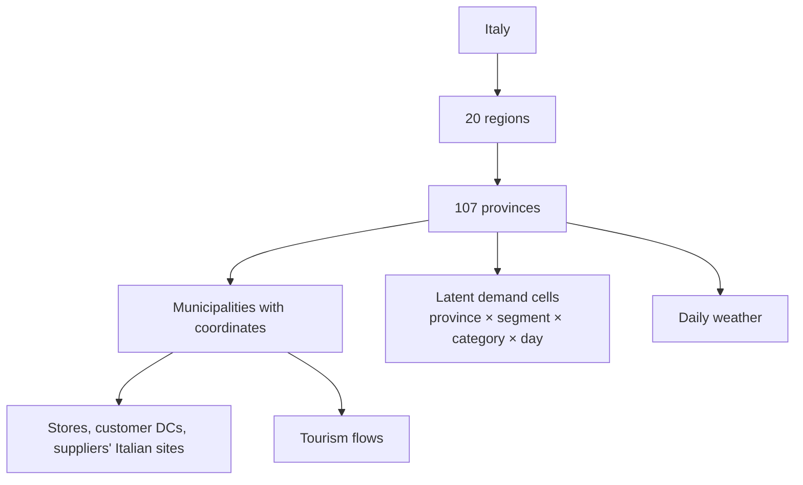
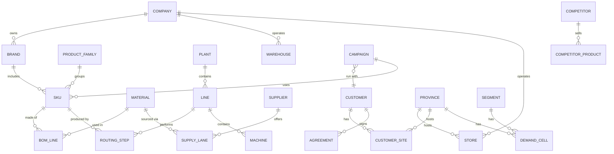

# 02 — The Universe: Domain Model

> This chapter describes **what exists** in the Giandoria universe: the company, its brands and products,
> its plants and warehouses, the territory, the stores, the customers, the suppliers and the competitors.
> Numbers describe the default **Profile M** universe and are tunable (§2.12).

---

## 2.1 The protagonist: Giandoria Cioccolato S.p.A.

| Attribute | Value (Profile M, tunable) |
|---|---|
| Legal name | Giandoria Cioccolato S.p.A. |
| Story | Founded in Turin in 1872 as a chocolate workshop. Today a mid-to-large Piedmontese group that combines a premium heritage line, a high-volume kids line, a professional line and contract manufacturing |
| Headquarters | Turin (Piedmont) |
| Net revenue | ≈ €300 M per year |
| Volume | ≈ 20,000 t of finished products per year (consistent with the line capacities in chapter 04) |
| Employees | ≈ 1,300 (plants ≈ 950, own retail ≈ 150, headquarters ≈ 200), plus seasonal temporary staff |
| Geography of sales | Italy ≈ 77%, export ≈ 23% |
| Business model | Make-to-stock for continuous products, **make-to-forecast with pre-build** for seasonal products, **make-to-order** for campaigns and corporate gifts |

### Channel mix (share of net sales)

| Channel | Share | Notes |
|---|---:|---|
| Modern trade (supermarkets, hypermarkets, discount) | 50% | In line with the market, where supermarkets and hypermarkets take about 65% of chocolate spend in Italy [M3] |
| Export distributors | 23% | Italian chocolate exports in 2024: €2.88 bn, mainly to Germany, France, the US, the UK, Spain and Poland [M1] |
| Own retail (flagship stores, outlets, e-shop) | 9% | Highest margin, richest data (receipt level) |
| Traditional trade via wholesalers and cash-and-carry | 7% | Bars, tobacconists, pastry shops, small grocers |
| Professional (pastry, gelato, HoReCa) | 5% | Couverture and pastes |
| Campaigns (charity and corporate gifts) | 4% | Fixed dates, custom packaging, made to order |
| Travel retail | 2% | Airport duty-free and travel stores |

---

## 2.2 Brands

| Brand | Positioning | Typical products | Main channels |
|---|---|---|---|
| **Giandoria 1872** | Premium Piedmontese heritage | Gianduja pralines (gianduiotti), filled pralines, premium tablets, premium Easter eggs, Christmas gift boxes, advent calendars | Flagship stores, premium modern trade, travel retail, export, corporate gifts |
| **Giandoria Junior** | Kids and families, mass market | Small surprise eggs with toy capsule (all year), large Easter eggs with licensed characters, snack bars, Christmas figures, Halloween minis | Modern trade, traditional trade, export |
| **Giandoria Professional** | Ingredients for professionals | Couverture drops (dark, milk, white), gianduja paste, hazelnut paste, cocoa powder | Professional distributors, HoReCa |
| **Private label** | Retailers' own brands | Tablets and Easter eggs made for retail chains | Discount and supermarket chains |
| **Campaign and co-branded** | Products made for one partner and one event | Charity packs (November, Easter, Christmas), custom corporate gift boxes | Charity foundations, companies |

---

## 2.3 Product portfolio

About **180 active SKUs** per year: about 110 continuous and about 70 seasonal or campaign SKUs that change every
season.

| Family | Brand(s) | Example SKUs | Technology | Where made | Seasonality | Shelf life (indicative) |
|---|---|---|---|---|---|---|
| Gianduiotti | 1872 | Bag 150 g, box 250 g, 1 kg loose for stores | Extrusion, cutting, fold wrapping | Torino Nord | All year; Christmas peak; summer shipping stop | 9–12 months (estimate) |
| Filled pralines and assortments | 1872 | Assorted box 200 g / 400 g, layered pralines | One-shot depositing, shell moulding, enrobing | Torino Nord | Christmas, Valentine's Day, Mother's Day | 6–9 months industrial (estimate) [P23] |
| Premium tablets | 1872 | Dark 70% 100 g, gianduja 100 g | Moulding | Langhe | All year, weaker in summer | Dark 18–24 months, milk 8–12 months [P23] |
| Mass tablets and snack bars | Junior, 1872 | Milk 100 g, filled bars multipack | Moulding, filled-bar line | Langhe | All year; back-to-school peak | 8–12 months [P23] |
| Small surprise eggs | Junior | 20 g egg with toy capsule, 3-pack | Hollow shell, capsule insertion, foil wrapping | Langhe | All year; Easter and Christmas boost | ≈ 6 months (estimate) |
| Easter eggs | 1872, Junior, private label, charity | Premium 350 g with designer surprise; kids licensed 150–320 g; private label 200 g; charity 300 g | Hollow spinning, joining, surprise insertion, wrapping | Langhe (volume), Torino Nord (premium cell) | Easter only | Industrial: milk ≈ 6–9 months, dark up to ≈ 12 months (estimate); artisan eggs only weeks [P23] |
| Christmas specialties | 1872, Junior | Advent calendars, hollow figures, gift tins | Moulding, hollow figures, packing | Langhe, Torino Nord | Christmas | 6–12 months |
| Other seasonal | 1872, Junior | Valentine's heart box, Halloween minis, Mother's Day box | Re-packing of pralines and minis | Torino Nord | Short windows | As content |
| Professional | Professional | Drops 2.5 kg dark/milk/white, gianduja paste 5 kg, cocoa powder 1 kg | Depositing of drops, bagging | Langhe | All year; pastry peaks before Christmas and Easter | 12–24 months |
| Private label | Retailer brands | Tablets, eggs | As mass products | Langhe | All year + Easter | As product |
| Campaign products | Co-branded | Charity 200 g dark box (November), charity 300 g egg (Easter), charity hearts box 220 g (Christmas), corporate custom boxes | Standard lines + custom packaging | Langhe, Torino Nord | Fixed dates | As product |

### Illustrative recipes (bill of materials)

Recipes are **illustrative** and live in master data. They drive material requirements (MRP) and costs.

| Mass | Main components (per 100 kg, indicative) |
|---|---|
| Dark chocolate 70% | Cocoa mass ≈ 62, cocoa butter ≈ 8, sugar ≈ 29.5, lecithin ≈ 0.4, vanilla ≈ 0.1 |
| Milk chocolate | Sugar ≈ 45, cocoa butter ≈ 20, whole milk powder ≈ 22, cocoa mass ≈ 12, lecithin ≈ 0.5, vanilla |
| Gianduja | Chocolate base + finely ground hazelnuts. EU rules require between 20 g and 40 g of hazelnuts per 100 g for "gianduja nut chocolate" [P38]; Giandoria uses ≈ 30 |
| White chocolate | Sugar ≈ 45, cocoa butter ≈ 30, milk powder ≈ 24.5, lecithin, vanilla |

A finished SKU has a **multi-level BOM**: beans → cocoa mass/butter/powder → chocolate mass → semi-finished
(shells, pralines, eggs) → packed unit → case → pallet. Packaging materials (foils, printed boxes, bags,
ribbons, toy capsules, cases) are part of the BOM. Seasonal packaging is **SKU-specific and printed per season**,
so it is the classic long-lead-time bottleneck.

### Routing example: a gianduiotto

```mermaid
flowchart LR
    A[Hazelnut roasting<br/>Langhe] --> B[Peeling + paste milling<br/>Langhe] --> C[Paste transfer<br/>to Torino Nord]
    C --> D[Mixing] --> E[Refining<br/>5-roll] --> F[Conching<br/>12–24 h premium] --> G[Tempering]
    G --> H[Extrusion + cutting] --> I[Cooling tunnel<br/>12–30 min] --> J[Fold wrapping] --> K[Bagging / boxing]
    K --> L[Case packing + palletising] --> M[Quality hold<br/>24–72 h] --> N[Release → central DC]
```

Process times and temperatures are detailed in chapter 04.

---

## 2.4 Sites

| Site | Code | Role | Key equipment (Profile M) | People |
|---|---|---|---|---|
| **Torino Nord plant** | TN | Premium plant: gianduja masses, gianduiotti, pralines, premium eggs, gift packing | Mixers, refiners, conches, extrusion line, 2 praline lines, enrobing line, premium egg cell, gift-packing cells | ≈ 330 |
| **Langhe plant** (province of Cuneo, hazelnut country) | LG | Volume plant: part of bean processing, hazelnut processing, chocolate masses, tablets, kids eggs, seasonal eggs and figures, couverture | Bean roasting/winnowing/grinding/pressing, hazelnut roasting/paste, refiners and conches, 2 tablet lines, kids egg line, 2 seasonal egg/figure lines, snack-bar line, couverture line, palletising robots | ≈ 620 |
| **Central DC** (next to the Langhe plant) | DC0 | Finished goods, temperature controlled (15–18 °C), cross-dock to customers | Racking, docks, pickers | via 3PL |
| **Regional platforms** (3PL) | DC-MI, DC-BO, DC-RM, DC-NA | Faster service to own stores, wholesalers and some chains | Shared 3PL warehouses | via 3PL |
| **Seasonal overflow warehouse** | DC-S | Easter and Christmas pre-build storage | Rented, temperature controlled | via 3PL |
| **Headquarters** | HQ | Turin, management and planning | — | ≈ 200 |

Making cocoa mass in-house is **partial**: about 40% of cocoa needs come from beans processed at Langhe and the
rest is bought as semi-finished cocoa (mass, butter, powder) from grinders in northern Europe. This make-or-buy
mix creates two distinct supply chains (ocean beans vs. trucked semi-finished goods) that planning must balance.
Hazelnut paste is made at Langhe and trucked to Torino Nord, which creates an **inter-plant dependency**.

---

## 2.5 Territory

* **Geography:** Italy with its 20 regions and 107 provinces. Municipal coordinates and population come from
  ISTAT open data [M34][M35].
* **Demand grid:** latent demand is computed per **province × consumer segment × product category × day**.
* **Territorial differences:** consumption is higher in the North, then the Centre, then the South. Lombardy and
  Piedmont lead, Rome is strong in the Centre, and the South spends less on premium products but grows around
  festivals [M2][M31].
* **Tourism:** ISTAT arrivals and nights by municipality drive the footfall of tourist stores. Venice and Florence
  have the steepest peaks (March–June ramp, July–August high, strong September, sharp winter drop). Rome is
  flatter with spring and autumn peaks. Milan has spikes in the fashion weeks. Turin is lower and event-driven
  [M32][M33].
* **Distances and travel times:** a route-time matrix between all sites, customer DCs and stores is computed once
  when the universe is created (genesis), optionally using Azure Maps, and then reused by the simulators.
* **Climate zones:** Alpine, Po Valley, Tyrrhenian, Adriatic, southern and islands. Daily weather per province
  drives demand and the cold chain.

---

## 2.6 Own retail: flagship stores, outlets, e-shop

### Stores ("Botteghe Giandoria")

| # | Store | Archetype | Footfall drivers |
|---:|---|---|---|
| 1 | Torino – Via Roma (heritage store with café) | City centre, heritage | Locals, tourists, Christmas |
| 2 | Torino – Porta Nuova station | Station | Commuters (weekdays) |
| 3 | Milano – Galleria | City centre, tourist | Tourists, fashion weeks, Christmas |
| 4 | Milano – Brera | High street | Locals, gifting |
| 5 | Milano – Malpensa T1 | Airport | Air traffic, summer, holidays |
| 6 | Roma – Via del Corso | City centre, tourist | Tourists, gifting |
| 7 | Roma – Termini station | Station | Commuters, tourists |
| 8 | Roma – Fiumicino T3 | Airport | Air traffic |
| 9 | Firenze – Duomo | City centre, tourist | Strong tourist seasonality |
| 10 | Venezia – Rialto | City centre, tourist | Steepest tourist seasonality |
| 11 | Bologna – Centro | High street | Locals, students, fairs |
| 12 | Genova – Porto Antico | Waterfront | Tourists, cruise days |
| 13 | Verona – Centro | City centre | Tourists, opera season, Christmas market |
| 14 | Napoli – Via Toledo | High street | Locals, Christmas |
| 15 | Bari – Centro | High street | Locals, gifting |
| 16 | Palermo – Centro | High street | Locals, tourists |
| 17 | Courmayeur | Mountain resort | Ski season, August |
| 18 | Alba – "Casa Giandoria" museum store | Chocolate tourism | Weekends, school trips, autumn food fairs |
| 19 | Langhe factory outlet | Outlet + visitor centre | Weekends, factory tours |
| 20 | Outlet Village Monferrato | Outlet village | Weekends, sales periods |

Each store has opening hours, an assortment, a stock, staff, a footfall model, a conversion model and a basket
model. Stores are air-conditioned, but **summer replenishment needs temperature-controlled vans**.

### E-shop (D2C)

National delivery with parcel carriers, Black Friday and Christmas peaks, corporate self-service orders and
summer restrictions (insulated packaging or a shipping stop above a temperature threshold).
A loyalty programme with synthetic members makes repeat purchases and customer lifetime value analysable.

---

## 2.7 B2B customers

### Modern trade chains

| Chain | Format | Stores | Footprint | Behaviour |
|---|---|---|---|---|
| **SpesaFacile** | Supermarkets | ≈ 1,100 | National, strong North | Shares daily sell-out by EDI; collaborative forecasting on Easter |
| **MercatoPiù** | Cooperative supermarkets and hypermarkets | ≈ 1,000 | North and Centre | Weekly sell-out data; strong promotion culture |
| **Ipermercati Aurora** | Hypermarkets | ≈ 120 | National | Large seasonal displays and big seasonal bookings |
| **Casa&Spesa** | Supermarkets and proximity stores | ≈ 700 | South and islands | Monthly data only; long payment terms |
| **Delizie Gourmet** | Premium urban supermarkets | ≈ 60 | Milan, Turin, Rome, Bologna | Premium assortment; low price sensitivity |
| **Risparmio Discount** | Discount | ≈ 650 | National | Private-label focus; buys private-label tablets and eggs |
| *Other modern trade* | Mixed | — | — | Modelled statistically as one aggregated account |

Chains are modelled as **store clusters per chain × province**, each with its own sell-out and stock.
Each chain has its own DC, ordering policy, payment terms, promotion calendar and negotiation profile.

### Other customers

| Customer type | Examples | Count | Notes |
|---|---|---:|---|
| Regional wholesalers | "Ingrosso Dolciario Lombardo", "Distribuzione Sud Dolci" | 12 | Serve bars, tobacconists, pastry shops; monthly buying with seasonal bookings |
| Cash-and-carry network | "IngroPiù Cash & Carry" | 1 (20 depots) | Weekly orders |
| Professional distributors | North-West, North-East, Centre, South | 4 | Serve ≈ 300 pastry shops and gelato makers (aggregated accounts) |
| Travel retail operator | "AeroDuty Italia" | 1 (5 airports) | Passenger-traffic driven; souvenir assortment |
| Export distributors | Germany, France, UK, USA, UAE, Poland | 6 | Container or truck shipments; own seasonality (e.g., Christmas abroad) |
| Charity foundations | See §2.8 | 3 | Fixed-date campaigns |
| Corporate gift clients | Banks, insurers, law firms, manufacturers | ≈ 150 per year | Quotes in September, orders October to mid-November, delivery by mid-December [M17] |

---

## 2.8 Campaigns: charity and corporate

Italy has well-established charity campaigns that sell chocolate in town squares on fixed dates
(for example AIRC in November, AIL at Easter and Telethon before Christmas, each with a €15 minimum donation in 2025)
[M18][M19][M21]. Giandoria uses the same **campaign pattern** with these partners:

| Partner | Cause | Product | Public date (pattern) | Points of distribution (pattern) |
|---|---|---|---|---|
| **Fondazione Orizzonte Ricerca** | Cancer research | 200 g dark chocolate pack + booklet | One Saturday in early or mid November | ≈ 2,400 squares and schools |
| **Associazione Luce per la Vita** | Blood cancers | 300 g milk or dark Easter egg | Weekend 2–3 weeks before Easter | ≈ 4,900 squares |
| **Fondazione Cuore Raro** | Rare genetic diseases | Box of 15 heart pralines, 220 g | Weekend before Christmas | > 3,000 points |

Every year each foundation runs a **tender**; Giandoria can win or lose it. A won tender becomes a fixed-quantity,
fixed-date, custom-packaging order with deliveries to dozens of provincial hubs, and unsold units return afterwards.
Corporate gifts work in a similar way but at a smaller scale: many clients, logo packaging and a hard deadline.

---

## 2.9 Consumers

Consumers are modelled as **segments**, not as millions of individuals (except e-shop and loyalty members).

| Segment | What they buy | Drivers | Price sensitivity |
|---|---|---|---|
| Families with children | Surprise eggs, snack bars, kids Easter eggs | Licences, toys, school calendar | High |
| Gift buyers | Premium boxes, premium eggs, advent calendars | Holidays, occasions | Low to medium |
| Everyday indulgence | Tablets, pralines | Habit, promotions | Medium to high |
| Dark and health-oriented | Dark ≥ 70%, low sugar | Wellness trends; the fastest-growing sub-segment [M3] | Low to medium |
| Tourists | Gianduiotti, souvenir boxes | Tourism flows, location | Low |
| Donors | Charity products | Cause, visibility in squares | Very low (the donation is fixed) |

Segment sizes come from province population and demographics; preferences differ by region.

---

## 2.10 Suppliers

| Category | Supplier | Origin | Typical lead time | Notes |
|---|---|---|---|---|
| Cocoa beans | Atlantic Cocoa Trading | Côte d'Ivoire | Contract months ahead + 15–22 days at sea [P28] | Bulk origin; main crop October–March [P26] |
| Cocoa beans | Gold Coast Beans Ltd | Ghana | As above | Quality premium |
| Cocoa beans (fine flavour) | Andes Fine Cacao | Ecuador | Contract + ≈ 4 weeks at sea | Premium line |
| Semi-finished cocoa | Rotterdam Cocoa Processing B.V. | Netherlands | 1–2 weeks by truck | Mass, butter, powder |
| Semi-finished cocoa | Hanseatic Kakao GmbH | Germany | 1–2 weeks by truck | Second source |
| Hazelnuts (Tonda Gentile) | Cooperativa Nocciole Langa | Piedmont | Harvest August–September | Premium, volatile crop [P30][P31] |
| Hazelnuts | Karadeniz Fındık A.Ş. | Turkey (Black Sea) | 2–3 weeks by truck/ship | Volume source |
| Milk powder | Latteria Alpina | Northern Italy | 1 week | Indexed to dairy markets [P32] |
| Sugar | Zuccherificio Padano | Northern Italy | Days | Beet sugar |
| Lecithin, vanilla, flavours | LeciPlus, Vanille de Madagascar SARL | EU, Madagascar | Weeks to months | Vanilla is highly volatile |
| Printed foils | AlluFoil Veneto | Veneto | 6–10 weeks for printed seasonal designs (estimate) | Seasonal bottleneck |
| Printed cartons and gift boxes | CartoTorino | Piedmont | 4–8 weeks (estimate) | Seasonal bottleneck |
| Shipping cases | Cartotecnica Ondulata | Lombardy | 1–2 weeks | Commodity |
| Egg capsules and plastic parts | PlastiPack Brianza | Lombardy | 3–5 weeks | — |
| Toy surprises | ShenTai Toys | Shantou, China | 9–15 weeks door to port (sampling + production + sea) [P33] | Critical for kids eggs |
| Premium surprises | Sorprese d'Autore | Italy | 6–8 weeks | Designer items for premium eggs |
| Temperature-controlled transport | FreddoTrasporti | Italy | — | Summer cold chain |
| 3PL warehousing | Logistica Padana 3PL | Italy | — | Regional platforms and overflow |
| Ocean carrier | MareNostrum Lines | — | — | Beans from Africa and Ecuador |
| Parcel carrier | PaccoVeloce | Italy | 24–72 h | E-shop |

Prices, lead times and reliability are detailed in chapter 05.

---

## 2.11 Competitors (archetypes)

| Archetype | Fictional name | Strengths | Typical moves |
|---|---|---|---|
| Swiss-style global premium | Alpenhaus Chocolatiers | Premium tablets and pralines, strong brand | Premium launches, gifting campaigns |
| Global mass confectionery | Global Sweets Group | Kids eggs, bars, licences, scale | Heavy promotions, licence deals |
| Italian mass brand | Dolceria Italiana | Tablets and eggs at lower prices | Price cuts, in-store displays |
| Private labels | Retailers' brands | Price | Shelf-space pressure, promotions |
| Artisan chocolatiers | Many local shops | Premium Easter eggs, authenticity | Local, Easter-focused |

Competitors are simple agents in sim-market. They react to the season, to prices and to Giandoria's moves.

---

## 2.12 Universe size profiles

| Element | Profile S (development) | **Profile M (default)** | Profile L (stress) |
|---|---|---|---|
| Plants | 1 | 2 | 3 (one abroad) |
| Production lines | 5 | ≈ 14 | ≈ 30 |
| SKUs | ≈ 50 | ≈ 180 | ≈ 400 |
| Own stores | 5 | 20 | 60 |
| Modern-trade chains | 3 | 6 + aggregated | 10 + aggregated |
| Export distributors | 1 | 6 | 15 + 2 subsidiaries |
| Suppliers | 10 | ≈ 25 | ≈ 60 |
| Provinces modelled | 20 (regions only) | 107 | 107 + export countries in detail |
| Events per sim day (indicative) | ≈ 5k | ≈ 30k | ≈ 150k |

Event volumes and costs per profile are discussed in chapter 10 and chapter 13.

---

## 2.13 Master-data model (simplified)

Master data is created once at **genesis** (chapter 12, chapter 14). It is stored as Lakehouse tables in Fabric
and as configuration in the simulators. Each run records the version of master data it started from.
