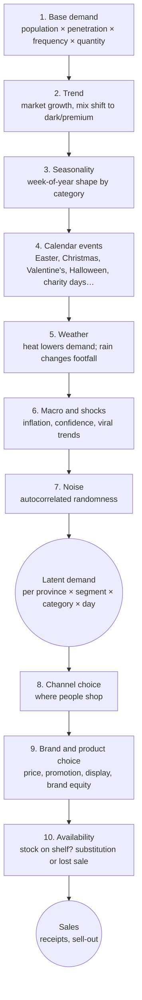
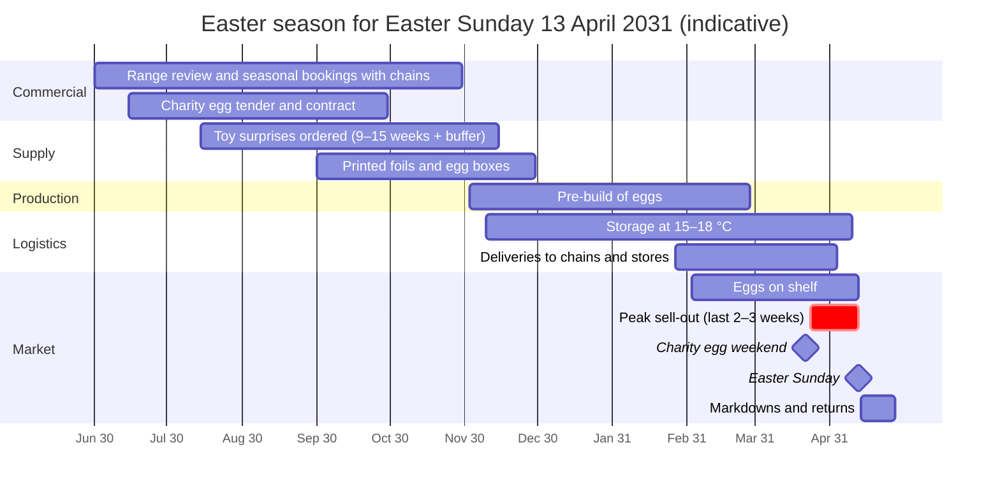
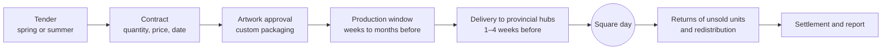

# 03 — Market, Demand and Seasonality

Demand starts with the people and occasions in each market, then varies with season, weather and price.
Product availability determines how much becomes observable sales; the model keeps latent demand as hidden truth.
This chapter defines those inputs and the Italian calendar used to calibrate them.

---

## 3.1 Market facts used for calibration

| Fact | Value | Source |
|---|---|---|
| Italian chocolate production for final consumption (2024) | 372,665 t, €6.607 bn, +6% year on year | [M1] |
| Italian chocolate exports (2024) | €2.88 bn (+17.2%), 414,940 t; top markets Germany, France, US, UK, Spain, Poland | [M1][M2] |
| Italian retail chocolate market | ≈ $2.89 bn (2025) → ≈ $3.94 bn (2031 forecast), CAGR ≈ 5.3% | [M3] |
| Mix (2025) | Milk and white ≈ 61% (dark fastest growing); tablets and bars ≈ 68% of forms (pralines fastest growing); mass tier ≈ 70% of value; supermarkets and hypermarkets ≈ 65% of spend (online fastest growing) | [M3] |
| Per-capita consumption | ≈ 4 kg per year (range 3–4.5 kg; no single authoritative figure) | [M4] |
| Cocoa price shock | ≈ $2,500/t for decades → peak above $11,500/t (London, June 2024) and ≈ $12,900/t (New York, December 2024) → ≈ $5,700/t (October 2026) | [M5][P27] |
| Consumer price reaction | Chocolate prices +15% to +32% in Europe in 2025; price elasticity in Europe observed at 0.7–0.8 instead of the 0.4–0.5 previously assumed | [M6] |
| Halloween | October candy sales +13% vs the monthly average (2024) | [M7] |
| Summer | Praline shipments usually suspended from mid-June to mid-September; factories close 2–3 weeks around 15 August | [M8][M9] |
| Easter eggs | Price points €5–15 (industrial) up to > €50 (artisan); category close to €1 bn per year including artisan (single source) | [M11] |
| Charity chocolate | Three national square campaigns with a €15 minimum donation (2025): ≈ 2,400 squares in November, ≈ 4,900 squares at Easter, > 3,000 points before Christmas | [M18][M19][M21] |

**Universe calibration.** The default universe lives mostly in the season that ends with Easter 2031 (scenario
`easter-2031-base`, epoch 1 June 2030; chapter 15, D2). The Italian retail market is therefore set to
≈ $3.9 bn (≈ €3.6 bn) per year, close to the forecast for 2031 [M3].
Giandoria's calibration target is a value share of **about 10% in Italy** (≈ €230 M of Italian net sales,
≈ €350 M at retail value), stronger in pralines and Easter eggs.

> **Known gaps.** No official Italian split of chocolate sales by month, channel or region was found. The
> seasonal shapes below are **design assumptions** for calibration, clearly marked and easy to change.

---

## 3.2 How demand is generated: the layer cake

Demand is generated in layers. Each layer is simple and explainable, and together they produce realistic and
surprising behaviour.

### The layers in plain words

| # | Layer | How it works | Main parameters |
|---:|---|---|---|
| 1 | Base demand | For each province and segment: people × share who buy the category × purchase frequency × quantity per purchase | Population (ISTAT), penetration by segment, frequency |
| 2 | Trend | Slow multiplicative drift: the market grows about 5% per year in value [M3]; dark and premium grow faster | Growth by category |
| 3 | Seasonality | A weekly shape per category (for example, tablets dip in summer) | Seasonal index table |
| 4 | Calendar events | Uplift curves aligned to each event date, including moving feasts (Easter) | Curve shape, peak, duration (§3.3) |
| 5 | Weather | Temperature above a comfort threshold reduces demand, more for pralines than for tablets; rain lowers store footfall but raises e-shop sessions | Threshold, slope by category [M10] |
| 6 | Macro and shocks | Consumer confidence, food inflation, viral flavour trends, scandals | Shock catalogue (chapter 08) |
| 7 | Noise | Log-normal noise with day-to-day memory | Volatility by category |
| 8 | Channel choice | Each segment has channel preferences that depend on region and occasion (gifts → specialist stores and e-shop; everyday → supermarkets) | Channel preference matrix |
| 9 | Brand and product choice | A choice model: the probability of buying a product grows with brand equity, display and promotion and falls with relative price. Price elasticity in the range 0.4–1.0 by category, with 0.7–0.8 as the European reference [M6] | Elasticities, promotion uplift, brand equity |
| 10 | Availability | If the chosen product is not on the shelf: switch to another product of the same brand, switch to a competitor, or give up (lost sale) | Substitution probabilities |

The output of layers 1–7 is **latent demand**: the truth. It is stored only in a restricted "truth" table and is
never shown to the company's agents. Layers 8–10 turn it into **sales**, which are observable.

---

## 3.3 The Italian seasonal calendar

| Occasion | Date rule | Products | Sell-in to retailers | Sell-out window | Notes |
|---|---|---|---|---|---|
| Epiphany (Befana) | 6 January (fixed) | Filled stockings, small figures | November–December | 26 Dec – 6 Jan | Strong in Central and Southern Italy |
| Valentine's Day | 14 February (fixed) | Heart boxes, premium pralines | January | 1–14 February | Gifting, e-shop |
| Father's Day | 19 March (fixed, St Joseph) | Small gift boxes | February | Early March | Minor |
| **Easter** | Moving: Easter Sunday 2029-04-01, 2030-04-21, **2031-04-13**, 2032-03-28, 2033-04-17 [M24] | Easter eggs (premium, kids, private label, charity), small eggs, hollow figures | Mainly from early February [M13] | ≈ 8–11 weeks before Easter, peak in the last 2–3 weeks | The most important event (§3.4) |
| Mother's Day | 2nd Sunday of May | Gift boxes | April | Early May | Minor, gifting |
| Summer | Mid-June – mid-September | Tablets, travel retail, souvenir | Restricted (heat) | Low season | Praline shipments stopped [M8]; factory closed around 15 August [M9] |
| Back to school | Mid-September | Snack bars, kids products | August–September | September | Kids segment |
| Chocolate festival | October | Pop-up store at a large chocolate fair | — | One week | Large festivals attract > 500,000 visitors [M3] |
| Halloween | 31 October | Minis, multipacks | September | Second half of October | October candy sales +13% [M7] |
| Charity day (November) | One Saturday in early or mid November | Charity 200 g dark pack | Delivery to hubs in October | One day + online weeks after | §3.6 |
| Black Friday | Friday after the 4th Thursday of November (2031-11-28) [M27] | E-shop promotions | — | Black week | E-shop only |
| **Christmas** | 25 December | Gift boxes, pralines, gianduiotti, advent calendars, figures, corporate gifts | September–November | Advent calendars from early November; gifts peak 10–24 December | The largest event in value (§3.5) |
| Charity weekend (Christmas) | Weekend before Christmas (2031: 20–21 December) | Charity hearts box | Delivery to hubs in early December | Two days | §3.6 |

The calendar uses the real rules for each year (moving feasts, public holidays, school terms, sales periods
[M26][M28][M29][M30]). This is why a run in 2032, with Easter on 28 March, behaves differently from 2031, with Easter
on 13 April.

### Indicative monthly shape of Giandoria sell-out (assumption for calibration)

| Month | Jan | Feb | Mar | Apr | May | Jun | Jul | Aug | Sep | Oct | Nov | Dec |
|---|---:|---:|---:|---:|---:|---:|---:|---:|---:|---:|---:|---:|
| Share of annual sell-out (Easter mid-April) | 6% | 8% | 13% | 9% | 5% | 3% | 2.5% | 2.5% | 5.5% | 9% | 15% | 21.5% |

An early Easter moves several points from April to March, while the total Easter volume changes only slightly.

---

## 3.4 Easter mechanics

Easter is the best example of why planning matters: almost everything must be decided **months before** the first
egg is sold, and unsold eggs lose most of their value the day after Easter.

| Phase | What happens | Sources |
|---|---|---|
| Range and bookings (June–October) | The company presents the Easter range; chains book quantities with weekly delivery splits | Pattern from industry practice |
| Packaging and surprises (summer–autumn) | Toy surprises from Asia need 9–15 weeks door to port; printed foils and boxes are SKU-specific | [P33] |
| Bulk production (November–February) | Industrial producers build eggs months in advance and store them | [M13] |
| Shelf (from early February) | Eggs appear in seasonal bays from early February | [M13] |
| Peak (last 2–3 weeks) | Most eggs are bought in the last 2–3 weeks before Easter; chains run aggressive promotions (spend-and-get vouchers, second-item discounts) | [M13][M14] |
| After Easter (1–2 weeks) | Markdowns and contractual returns of unsold eggs | Pattern; no public numbers [GAP] |

**Weekly sell-out curve before Easter (assumption):**

| Week before Easter | −9 | −8 | −7 | −6 | −5 | −4 | −3 | −2 | −1 | after |
|---|---:|---:|---:|---:|---:|---:|---:|---:|---:|---:|
| Share of season | 2% | 3% | 4% | 6% | 8% | 11% | 15% | 21% | 25% | 5% (markdown) |

**Early vs. late Easter.** An early Easter (28 March 2032) shortens the season, overlaps with Valentine's Day and
leaves less time for replenishment. A late Easter (21 April 2030) stretches the season and raises the risk of warm
weather. The model keeps the *total* close to the base and redistributes it over the available weeks.

---

## 3.5 Christmas mechanics

| Element | Timing | Notes |
|---|---|---|
| Range and bookings with chains | June–September | Seasonal bookings with delivery splits |
| Production of Christmas items | After the August shutdown, September–November (some long-shelf-life items earlier) | Capacity shared with continuous products |
| Advent calendars | Sell-in September–October, sell-out November 1 – December 1 | Online interest is growing quickly (+22% in 2024), though no official sales figure exists [M16] |
| Corporate gifts | Quotes from September, confirmations October – mid-November, last delivery mid-December | [M17] |
| Gift boxes and pralines | Peak 10–24 December | Gifting; flagship stores and e-shop |
| Charity hearts weekend | Weekend before Christmas | §3.6 |
| Befana stockings | 26 December – 6 January | Small items |
| After Christmas | Markdowns in January; returns per contract | — |

Festive bakery products (panettone, pandoro) are not made by Giandoria, but they compete for the same gifting
budget and the same shelf space. Italy accounts for about 40% of European consumption of these products [M15].

---

## 3.6 Charity and corporate campaigns

Campaigns are **B2B projects with a public date**. They are perfect for planning scenarios because the date never
moves.

| Campaign (fictional) | Real-world pattern | Volume knob (Profile M) | Planning challenge |
|---|---|---|---|
| Fondazione Orizzonte Ricerca — November | 200 g dark pack with booklet, ≈ 2,400 squares, min €15 [M18] | 250k–400k packs | Dark chocolate has a long shelf life, so production can be levelled over the summer and early autumn |
| Associazione Luce per la Vita — Easter | Egg (milk or dark), ≈ 4,900 squares, min €15; more than 16.7 M eggs over 30+ years [M19][M20] | 400k–600k eggs | Competes with Giandoria's own Easter eggs for the same egg lines and the same weeks |
| Fondazione Cuore Raro — Christmas | Box of 15 heart pralines (220 g), > 3,000 points, min €15 [M21] | 150k–250k boxes | Competes with Christmas pralines on the praline lines |

How money flows: the foundation buys from Giandoria at a negotiated unit price; the public **donates** to the
foundation. Giandoria records a B2B sale, the foundation records donations, and unsold units return under the
contract. Corporate gifts follow a similar life cycle with many small clients, logo packaging and a hard delivery
deadline.

---

## 3.7 Summer, heat and weather

* **Demand:** confectionery and chocolate are among the retail categories most hurt by high temperatures [M10].
  In the model, demand falls linearly above a temperature threshold (for example 24 °C), more for pralines and
  filled products than for tablets.
* **Supply chain:** the industry stops shipping pralines from mid-June to mid-September [M8], and shipments above
  ≈ 25–27 °C need temperature-controlled trucks (chapter 05). The e-shop uses insulated packaging or stops
  shipping during heatwaves.
* **Stores:** tourist stores (Venice, Florence, Rome) still peak in summer because of tourism; the stores are
  air-conditioned, but their replenishment needs cold-chain vans.
* **Factory:** collective closure of 2–3 weeks around 15 August, used for major maintenance [M9].

---

## 3.8 Territory and tourism effects

| Effect | Model |
|---|---|
| North–South gradient | Base demand and premium share higher in the North; festival-driven peaks in the South [M2][M31] |
| Urban gifting | Higher gift-buyer share in Milan, Rome, Turin and Bologna |
| Tourism | Store footfall follows ISTAT arrivals by municipality; Venice and Florence show the steepest seasonality [M32][M33] |
| Mountain resorts | Winter ski season and August peaks |
| Chocolate tourism | Museum store and factory outlet traffic peaks at weekends and during autumn food fairs |

---

## 3.9 Prices, promotions and competition

| Mechanism | Model |
|---|---|
| List prices | Set by Giandoria's pricing decisions (yearly, with possible mid-year changes after commodity shocks) |
| Retail prices | Each chain applies its own margin and price policy |
| Promotions | Agreed with chains weeks in advance. Mechanics: percentage off, second item at −50%, spend-and-get vouchers, display only [M14]. Effects: uplift during the promotion, dip afterwards, cannibalisation of sister products |
| Elasticity | 0.4–1.0 by category and segment; 0.7–0.8 as the European reference after recent price rises [M6]; stronger for low-income segments [M23] |
| Competitor moves | Competitors react to the season and to Giandoria's prices and promotions (chapter 08) |
| Inflation regime | A scenario setting: "calm", "post-crisis" (2025-like price rises) or "crisis" (new cocoa spike) |

---

## 3.10 Truth vs. observation

The company never sees the latent demand. It sees **delayed and partial observations**, like a real company.

| Information | Truth or observation | Who sees it | Delay |
|---|---|---|---|
| Latent demand by province, segment and category | Truth | Evaluation only | — |
| Lost sales caused by stock-outs | Truth | Evaluation only | — |
| Own-store receipts and e-shop orders | Observation | Giandoria | Immediate |
| Sell-out from chains that share EDI data | Observation | Giandoria | 1 day to 1 week, depending on the chain |
| Orders from customers (sell-in) | Observation | Giandoria | Immediate |
| Seasonal bookings and campaign contracts | Observation | Giandoria | Immediate (months ahead of delivery) |
| Retail panel data (market share, competitors) | Sampled observation with error | Giandoria | Monthly, ≈ 3–4 weeks late |
| Competitor prices and promotions | Observation (store checks, flyers) | Giandoria | Days |
| Weather and commodity prices | Observation | Everybody | Immediate |

This gap between truth and observation is what makes forecasting, planning and LLM agents interesting, and it
lets us **measure** them: forecast accuracy and lost sales are computed against the truth.
