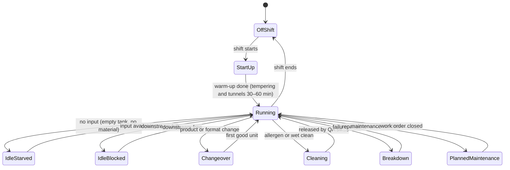
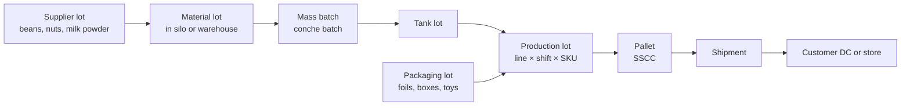

# 04 — The Factory: Processes, Lines and Machines

This chapter follows chocolate from raw materials through finishing and quality release, then defines the
plants, line capacities, reliability, changeovers, workforce, energy and telemetry used by sim-factory
(chapter 08). Values are ranges for parameterisation, not data from one real plant; *(estimate)* marks
figures without a strong public source.

---

## 4.1 From bean to box: the process chain

```mermaid
flowchart LR
    subgraph BEAN[Bean processing — Langhe, ≈ 40% of cocoa needs]
        B1[Reception<br/>and storage] --> B2[Cleaning] --> B3[Roasting<br/>100–150 °C, 15–45 min] --> B4[Winnowing<br/>shell out] --> B5[Grinding<br/>to liquor] --> B6[Pressing<br/>butter + cake]
        B6 --> B7[Powder line<br/>alkalising, milling]
    end
    subgraph HAZ[Hazelnuts — Langhe]
        H1[Roasting<br/>140–150 °C, 20–45 min] --> H2[Peeling] --> H3[Paste milling<br/>below 60 °C, 20–30 µm]
    end
    subgraph MASS[Chocolate mass — both plants]
        M1[Mixing<br/>kneading] --> M2[Refining<br/>5-roll, 15–25 µm] --> M3[Conching<br/>2–12 h or 16–72 h] --> M4[Storage tank<br/>30–55 °C, use within 8–24 h]
    end
    subgraph FIN[Finishing lines]
        F1[Tempering] --> F2[Forming<br/>moulding, one-shot, shell,<br/>enrobing, extrusion, spinning] --> F3[Cooling tunnel<br/>12–30 min, 0–18 °C] --> F4[Demoulding] --> F5[Wrapping] --> F6[Packing, case packing,<br/>palletising]
    end
    SEMI[Bought semi-finished cocoa<br/>mass, butter, powder] --> M1
    B5 --> M1
    B6 --> M1
    H3 --> M1
    M4 --> F1
    F6 --> QC[Quality hold<br/>24–72 h] --> DC[Central DC<br/>15–18 °C]
```

| Step | What happens | Typical time | Key parameters | Source |
|---|---|---|---|---|
| Bean reception and storage | Sampling, weighing, lot creation, EU deforestation documents checked (chapter 05) | Days to months in storage | Moisture 6–7.5% (max 8%), relative humidity ≤ 65%, 15–25 °C, FIFO | [P29] |
| Cleaning | Destoning, magnets, sieving and aspiration | Continuous | Removes stones, metal, fibres | [P1] |
| Roasting | Whole beans or nibs are roasted to develop flavour | 15–45 min | 100–150 °C (light 100–120, medium 120–135, dark 135–150) | [P1] |
| Winnowing | Air classification separates shell from nib | Continuous | Shell ≈ 10–15% of bean weight *(estimate)* | — |
| Grinding | Nibs become cocoa liquor (mass) | Continuous | ≈ 100–120 µm | [P2] |
| Alkalising (powder only) | Alkali solution raises pH for darker, milder powder | Batch | pH 5.0–5.8 → 6.8–8.1 | [P3] |
| Pressing | Liquor is split into cocoa butter and press cake | Batch cycles | Cake 10–12% fat (standard) or 20–24% (high-fat) | [P3] |
| Hazelnut roasting and paste | Roasting, skin removal by friction, fine milling | Roast 20–45 min | 120–170 °C (typically 140–150 °C); paste kept below 60 °C, 20–30 µm | [P14][P15] |
| Mixing | Sugar, milk powder, cocoa mass and part of the butter become a paste | 10–20 min per batch *(estimate)* | Recipe from master data | — |
| Refining | 5-roll refiners reduce particle size | Continuous | 100–120 µm → 15–25 µm (12–15 µm premium); 450–1,300 kg/h per refiner | [P2][P8] |
| Conching | Long mixing removes volatiles and moisture, develops flavour; lecithin and the last butter are added late | 2–12 h industrial, 16–72 h premium (up to 96 h) | Batch 1–6 t | [P1][P4][P5] |
| Storage tanks | Liquid mass waits for the finishing lines | Best used within 8–24 h; quality risk beyond 24–48 h | 30–55 °C, agitated | [P7] |
| Tempering | Controlled crystallisation (stable form V) | Continuous | Dark 45–55 → 27–29 → 31–32 °C; milk 45–50 → 26–28 → 29–30 °C; white 40–45 → 25–27 → 28–29 °C; 100–2,000 kg/h | [P6][P9] |
| Forming | See §4.2 | Seconds to minutes | Up to ≈ 2,000 kg/h for moulding lines | [P9] |
| Cooling tunnel | Multi-zone cooling | 12–30 min dwell | 0–18 °C, RH ≤ 45% | [P10] |
| Wrapping | Foil, flow-wrap or fold wrapping | Continuous | 250–900 pieces/min; bar flow-wrap 1,500–2,100/min; egg wrappers up to ≈ 400/min | [P16][P12] |
| Palletising | Robots build pallets | Continuous | 10–15 single picks/min (up to ≈ 23); 40–80 full-layer picks/min | [P17] |
| Quality hold | Lots wait for laboratory results | 24–72 h *(estimate)* | Microbiology, fat, moisture, sensory | — |
| Finished-goods storage | Climate-controlled warehouse | Weeks to months | 13–18 °C, 50–60% RH | [P23] |

---

## 4.2 Forming technologies

| Technology | Used for | How it works | Typical rate | Source |
|---|---|---|---|---|
| **Moulding** (depositing into moulds) | Tablets, filled bars, napolitains, couverture drops | Tempered mass is deposited, vibrated to remove air, cooled and demoulded | Up to ≈ 2,000 kg/h per line | [P9] |
| **One-shot depositing** | Filled pralines, hearts | Shell, filling and base are co-deposited by multi-nozzle heads in one cycle | Hundreds of kg/h | [P13] |
| **Shell moulding** | Premium pralines | Deposit shell, invert and drain, chill, fill, cap, demould | Slower than one-shot | [P13] |
| **Enrobing** | Pralines with nut or wafer centres, bars | Centres pass under a falling curtain of chocolate on a wire belt, then cool | Hundreds of kg/h | [P13] |
| **Extrusion** | Gianduiotti (the gianduja ingot shape) | Continuous screw or piston extrusion through a die, wire or guillotine cut, cooling, then fold wrapping at hundreds of pieces per minute | Wrapper-limited | [P13] |
| **Spinning / rotational moulding** | Easter eggs, hollow figures | Closed moulds rotate while chocolate coats the wall; halves are joined on a heated plate; the surprise is inserted before closing | Robotic lines ≈ 16–17 large eggs/min | [P11][P12] |
| **Cold stamping** | Egg shells at high speed | A frozen stamp presses the shell for faster cycles | Faster than spinning | [P11] |

---

## 4.3 Plants, departments and lines (Profile M)

Chapter 02 sizes Profile M at about 14 lines. In detail, that is **13 finishing lines, 4 process departments and one
palletising cell**. All capacities are nominal (rated speed). Real output = nominal × OEE (§4.4).

### Torino Nord (TN) — the premium plant

| ID | Line or department | Main products | Nominal capacity | Typical shift pattern |
|---|---|---|---|---|
| TN-MASS | Mass department: 2 refiners, 6 conches of 3 t, tanks | Gianduja and premium masses | Refiners ≈ 800 kg/h each; conching 12–24 h | 3 shifts, 5–6 days |
| TN-EXT | Gianduiotti extrusion line with 3 fold wrappers | Gianduiotti (≈ 5–6 g each) | Extruder ≈ 500 kg/h; wrappers 3 × ≈ 300 pieces/min, so ≈ 300 kg/h effective (wrapper-limited) | 3 shifts, 5 days |
| TN-PR1 | One-shot praline line | Filled pralines, Christmas hearts | ≈ 400 kg/h | 2 shifts, 3 in autumn |
| TN-PR2 | Shell-moulding praline line | Premium pralines, layered pralines | ≈ 300 kg/h | 2 shifts |
| TN-ENR | Enrobing line | Nut and wafer pralines | ≈ 500 kg/h | 2 shifts |
| TN-EGP | Premium egg cell (semi-automatic) | 1872 premium eggs (350 g standard, up to 500 g) with designer surprise | ≈ 400 eggs/h | 2 shifts (3 in peak weeks), October–February |
| TN-GFT | Gift-packing cells (manual) | Assortments, corporate boxes, charity hearts box, Valentine and Mother's Day packs | Measured in boxes/h per crew | 1–2 shifts, many temporary staff in Q4 |

### Langhe (LG) — the volume plant

| ID | Line or department | Main products | Nominal capacity | Typical shift pattern |
|---|---|---|---|---|
| LG-BEAN | Bean department: 2 roasters, winnower, liquor mills, 2 presses, powder line | Cocoa liquor, butter, powder | Roasting ≈ 2 t/h in total | 1–2 shifts, 5 days |
| LG-HAZ | Hazelnut department: roaster, peeler, paste mill | Roasted kernels, hazelnut paste (also trucked to TN) | Roasting ≈ 1.5 t/h; paste ≈ 1 t/h | 1–2 shifts, with an August–October peak after harvest |
| LG-MASS | Mass department: 4 refiners, 6 conches of 6 t, tanks | Dark, milk, white, gianduja and filling masses | Refiners ≈ 1,200 kg/h each; conching 6–12 h | 3 shifts, 5–6 days |
| LG-TAB1 | Tablet moulding line 1 | 1872 premium tablets, private-label tablets | ≈ 1,500 kg/h, wrappers ≈ 250–300 tablets/min | 3 shifts, 5 days |
| LG-TAB2 | Tablet moulding line 2 | Mass tablets, napolitains and advent-calendar pieces, charity November dark pack | ≈ 1,500 kg/h | 3 shifts, 5 days |
| LG-KID | Kids surprise-egg line | Junior 20 g egg with toy capsule | ≈ 400 eggs/min | 3 shifts, 5 days, all year |
| LG-EGG1 | Seasonal hollow line 1 | Christmas hollow figures (July–October), Easter eggs (November–February) | ≈ 1,200 eggs/h (≈ 0.3 t/h) | Figures: 2 shifts, 5 days. Eggs: 3 shifts, 6 days. March–June: idle, mould maintenance |
| LG-EGG2 | Seasonal hollow line 2 | As EGG1 (also charity and private-label eggs) | ≈ 1,200 eggs/h (≈ 0.3 t/h) | As EGG1 |
| LG-SNK | Snack-bar line (filled bars, multipacks) | Junior snack bars | ≈ 1,000 kg/h; 2 flow-wrappers × ≈ 400 bars/min | 2 shifts |
| LG-COUV | Couverture line (drops) and bagging | Professional drops 2.5 kg, gianduja paste 5 kg | ≈ 1,000 kg/h | 2 shifts |
| LG-PAL | End-of-line palletising cell (robots, stretch wrapping, labelling) | All LG lines | ≈ 12 picks/min per robot | Follows the lines |

About **120 machines** in total. With an average of about 6 sensor tags per machine, that gives about **700 tags**.

### Capacity sanity check (Profile M, ≈ 20,000 t per year)

The check below is how the size of the universe was calibrated. It uses OEE ≈ 65% [P24] and about 46 working weeks
per year (Ferragosto closure and holidays excluded). One shift on one line therefore gives about 1,840 hours per year
(46 weeks × 5 days × 8 h). **Rates and hours are per line** (line-hours). *All volumes are assumptions.*

| Product family | t per year | Line(s) | Nominal rate per line | Nominal line-hours | Line-hours needed at 65% OEE | Calendar used (available line-hours) | Load |
|---|---:|---|---|---:|---:|---|---:|
| Tablets (premium, mass, private label, charity dark pack, advent-calendar pieces) | 8,000 | TAB1, TAB2 | 1.5 t/h | 5,330 | 8,200 | 2 lines × 3 shifts × 5 days (11,040) | ≈ 74% |
| Snack bars | 1,800 | SNK | 1.0 t/h | 1,800 | 2,770 | 2 shifts × 5 days (3,680) | ≈ 75% |
| Kids surprise eggs (≈ 75 M eggs) | 1,500 | KID | 0.48 t/h (400 eggs/min) | 3,130 | 4,810 | 3 shifts × 5 days (5,520) | ≈ 87% |
| Easter eggs (≈ 3.2 M eggs: Junior ≈ 1.8 M, private label ≈ 0.9 M, charity ≈ 0.5 M) | 780 | EGG1, EGG2 | 1,200 eggs/h (≈ 0.3 t/h) | 2,670 | 4,100 | 2 lines × 3 shifts × 6 days, ≈ 16 working weeks from 3 November to 27 February (≈ 4,600) | ≈ 89% |
| Christmas hollow figures | 400 | EGG1, EGG2 | ≈ 0.3 t/h | 1,330 | 2,050 | 2 lines × 2 shifts × 5 days, ≈ 15 weeks July–October without Ferragosto (2,400) | ≈ 85% |
| Premium eggs (≈ 0.45 M eggs) | 160 | EGP | 400 eggs/h (≈ 0.14 t/h) | 1,130 | 1,730 | 2 shifts × 5 days, ≈ 20 weeks October–February (1,600) | **≈ 108% → 3rd shift in peak weeks** |
| Gianduiotti | 800 | EXT | ≈ 0.3 t/h (wrapper-limited) | 2,670 | 4,100 | 3 shifts × 5 days (5,520) | ≈ 74% on average; far higher in Q4 |
| Pralines (one-shot ≈ 900 t, shell ≈ 600 t, enrobed ≈ 900 t) | 2,400 | PR1, PR2, ENR | 0.4 / 0.3 / 0.5 t/h | 6,050 | 9,310 | 3 lines × 2 shifts × 5 days (11,040) | ≈ 84% on average; above 100% in Q4 |
| Couverture and professional | 2,500 | COUV | 1.0 t/h | 2,500 | 3,850 | 2 shifts × 5 days (3,680) | **≈ 105% → Saturday shifts in peaks** |
| Other: bulk liquid chocolate for food-industry customers (tankers), cocoa powder and hazelnut paste sales, outlet products | ≈ 1,650 | Mass, bean and hazelnut departments | — | — | — | — | — |
| **Total** | **≈ 20,000** | | | | | | |

**Masses.** About 90% of the weight of finished products is mass made in-house (chocolate, gianduja and filling
masses). Adding the bulk liquid chocolate sold in tankers gives **≈ 17,300 t of mass per year: ≈ 3,000 t at TN and
≈ 14,300 t at LG**. LG-MASS needs about 2,400 conche cycles of 6 t at about 10 h each (conching plus filling and
emptying), so ≈ 24,000 conche-hours. That is ≈ 60–70% of six conches on a 3-shift, 5–6-day calendar. TN-MASS needs
about 1,000 cycles of 3 t at about 19 h, so ≈ 19,000 conche-hours (≈ 50–60%).

**Cocoa.** About 7,300 t per year of cocoa ingredients (mass, butter, powder). Bean processing covers about 40%
(≈ 2,900 t of products from **≈ 3,600 t of beans**, about 12 containers per month). The rest, about 4,400 t, is bought
as semi-finished cocoa (chapter 05).

**Hazelnuts.** About 1,700 t of kernels per year for gianduja, fillings, inclusions and paste sales (chapter 05).

**Where the tension is.** Average loads hide the peaks. Premium eggs (≈ 108%) and couverture (≈ 105%) are above
capacity even on average. The Easter egg lines (≈ 89% across the whole build) and the kids egg line (≈ 87%) run close
to their limits. The praline and gianduiotti lines are overloaded in Q4, because Christmas demand is far above the
yearly average. The Easter build (November–February) also overlaps with the Christmas peak in November–December, so
the two compete for mass, people and warehouse space. Planning must therefore **pre-build, add shifts and decide what
to sacrifice** (chapter 06).

---

## 4.4 Machines and their states

Every machine follows the same state machine. sim-factory emits `mes.machine.state_changed` at the **exact sim
timestamp** of each transition, with a reason code.

| State | Counts as | Example reason codes |
|---|---|---|
| Running | Run time (with speed and quality losses) | `NORMAL`, `REDUCED_SPEED` |
| StartUp | Availability loss | `WARMUP`, `FIRST_RUN_REJECTS` |
| IdleStarved / IdleBlocked | Availability loss (attributed to the upstream or downstream cause) | `NO_MASS`, `NO_PACKAGING`, `NO_TOYS`, `PALLETISER_FULL` |
| Changeover | Availability loss | `FORMAT`, `FLAVOUR`, `FOIL_CHANGE` |
| Cleaning | Availability loss | `ALLERGEN_WET`, `DRY_CLEAN`, `HYGIENE_WEEKLY` |
| Breakdown | Availability loss | Failure mode codes (§4.5) |
| PlannedMaintenance | Planned downtime (excluded from OEE) | `PM_CALENDAR`, `PM_CONDITION`, `OVERHAUL` |
| OffShift | Not scheduled | `NO_SHIFT`, `HOLIDAY`, `FERRAGOSTO` |

**Minor stops** (jams shorter than 5 minutes) are not separate states. They are counted per machine and per
interval and they reduce *performance*.

**OEE** = availability × performance × quality. The universe targets **55–70%** for confectionery lines, while
world-class lines reach 75–85% [P24]. Each line has its own parameters, so OEE differs realistically between
lines and seasons. For example, seasonal egg lines are worse in their first weeks after conversion.

---

## 4.5 Reliability, degradation and maintenance

### Hidden health, visible symptoms

Each critical component (bearing, roll, scraper, sealing jaw, belt, compressor) has a hidden **health index**
that goes from 1 (new) to 0 (failed). Health falls with run hours, load, start/stop cycles and temperature
cycles, plus random shocks. The failure hazard rises as health falls (Weibull-like ageing). Health is **truth**:
it is never published except to the restricted truth table. What the world sees are **symptoms** in the sensor
tags: vibration rises, motor current drifts, temperature control oscillates, rejects increase. This gives Fabric
a genuine predictive-maintenance signal to detect.

| Parameter | Range used | Source |
|---|---|---|
| MTBF (mean time between failures) | 300–1,200 h by machine class (top-quartile plants > 1,000 h) | [P19] (general food and packaging proxy) |
| MTTR (mean time to repair) | 2–4 h per failure; long tail for parts not in stock | [P19] |
| Critical spare lead times | Bearings: days. Refiner rolls, gearboxes: 6–12 weeks *(estimate)* | — |

### Failure modes by machine class

| Machine class | Typical failure modes | Symptoms in telemetry | Source |
|---|---|---|---|
| Tempering machine | Sensor drift, heat-exchanger fouling, scraper wear | Temper index drifts, outlet temperature oscillates | [P18] |
| Refiner | Roll-bearing wear, roll-gap drift | Particle size rises, motor power changes, vibration | [P18] |
| Conche | Blade or bearing wear, motor overload at cold start | Motor current peaks, longer cycle times | [P18] |
| Cooling tunnel | Belt mistracking, condenser fouling | Zone temperatures rise, more bloom defects | [P18] |
| Wrapping machine | Film-splice jams, sealing-jaw drift | More minor stops, reject rate rises | [P18] |
| Roaster | Burner faults, airflow problems | Roast temperature deviation, moisture out of range | *(estimate)* |
| Palletiser robot | Gripper faults, vision errors | Pick failures, blocked conveyors | *(estimate)* |

### Maintenance types

| Type | Trigger | Who decides |
|---|---|---|
| Preventive (time or counter based) | Calendar or run hours | Maintenance plan in master data; scheduled by the production scheduler |
| Condition-based | Sensor rule or anomaly score crosses a limit | Maintenance manager (rule or LLM agent, chapter 09). In closed-loop demos the trigger can come from a Fabric Activator rule (chapter 10) |
| Corrective | Breakdown | Automatic work order; priority by line criticality |
| Annual overhaul | **Ferragosto closure**: 2–3 weeks around 15 August, typically about 10–22 August [M9][P34] | Planned in the annual plan |
| Seasonal conversion | Egg lines: idle → Christmas figures in early July; figures → Easter eggs in early November; eggs → idle and mould maintenance in March | Seasonal plan (chapter 06) |

Maintenance crews per shift are limited. Work orders queue, so two breakdowns at the same time take longer to fix.

---

## 4.6 Changeovers and sequencing

Shared lines run several masses and formats. The **sequence rule** is to go from least to most allergenic:
**dark → milk → nut-containing**, then clean [P20].

| Changeover type | Typical duration | Notes | Source |
|---|---|---|---|
| Format change (mould set, wrapper format) | 30–90 min *(estimate)* | Same mass | — |
| Flavour change in the allowed direction (dark → milk) | 15–30 min purge *(estimate)* | Purged mass goes to rework | — |
| Flavour change against the direction (milk → dark) | 45–90 min *(estimate)* | Longer purge | — |
| **Allergen changeover** (nut → non-nut) | 45–180 min: preparation 5–10, disassembly 10–20, wet clean 20–60, swab check 5–15, QA release 10–15 | Must be verified by ATP or allergen swab | [P18] |
| Foil or film change | 10–20 min *(estimate)* | Frequent with seasonal designs | — |
| Seasonal line conversion (figures → eggs) | 1–2 days *(estimate)* | Mould sets and spinning programmes change | — |

**Changeover matrix.** Master data holds a from → to matrix for each line. The scheduler (chapter 06) uses it to
build *campaign wheels*, for example "Monday dark, Tuesday and Wednesday milk, Thursday and Friday gianduja,
wet clean Friday night". Allergen cleaning time is pure lost capacity. This creates a real trade-off between
short campaigns (fresh, flexible) and long campaigns (efficient).

**Tank hold constraint.** Mass in a storage tank should be used within 8–24 h [P7]. The scheduler must therefore
align conching batches with the finishing lines. If a line breaks down, the mass ages. After the limit it is
downgraded to rework mass.

---

## 4.7 Quality, holds and genealogy

### Tests

| Test | Where | Method | Typical specification | Source |
|---|---|---|---|---|
| Viscosity | In-process | Rheometer (Casson model: yield value + plastic viscosity) | Per recipe | [P21] |
| Particle size | In-process | Laser diffraction or micrometer | < 35 µm finished; 12–15 µm premium | [P2] |
| Temper | In-process | Temper meter | Temper index ≈ 4–6 *(estimate)* | — |
| Weight | Line | Checkweigher | Legal minimum and average rules | — |
| Foreign bodies | Line | Metal detector or X-ray | Zero tolerance; reject and alarm | — |
| Moisture | Laboratory | Karl Fischer | < 1% for couverture *(estimate)* | — |
| Fat content | Laboratory | NMR or Soxhlet | Per recipe | — |
| *Salmonella* | Laboratory | ISO 6579 | Absent in 25 g *(typical specification, verify)* | — |
| Enterobacteriaceae | Laboratory | Plate count | < 10 CFU/g *(typical specification, verify)* | — |

### Lot disposition

Every finished lot starts **on hold** until the laboratory results arrive: 24–72 h of sim time *(estimate)*.
Results are drawn from distributions that depend on real drivers. Examples: a tempering machine with poor health
raises the risk of **fat bloom**, and a humid summer day in the warehouse raises the risk of **sugar bloom** [P22].

| Disposition | Meaning | Effect |
|---|---|---|
| Released | Within specification | Available to promise (chapter 06) |
| Held | Investigation | Stock blocked; may delay deliveries |
| Rework | Re-melt into rework mass | Mass reused within recipe limits |
| Downgraded | Cosmetic defect | Sold through the factory outlet or as an industrial product |
| Rejected | Safety issue | Destroyed; may trigger a recall investigation |

### Genealogy (lot traceability)

Each arrow is an event (`mes.batch.consumed`, `mes.batch.produced`, `wms.pallet.created`, `tms.shipment.loaded`).
Fabric can rebuild the full graph. A **recall drill** is a standard demo: "a hazelnut lot is contaminated — which
customers received products made from it, and how many units are still on shelves?"

**Yields and losses** are modelled explicitly: shell loss at winnowing (≈ 10–15%), purges at changeovers, wrapper
rejects (≈ 0.5–2% *(estimate)*), quality rejects and rework loops. Mass balance per day therefore closes like in a
real plant.

---

## 4.8 Workforce and shifts

| Aspect | Model |
|---|---|
| Shift patterns | 1×8, 2×8 and 3×8 hours, 5 or 6 days. Continuous working with weekend shifts in peak weeks |
| Crew per line | For example TAB ≈ 5–6 operators per shift, EGG ≈ 10–14 (manual surprise handling and packing), gift-packing cells 10–25 people *(estimates)* |
| Seasonal staff | Fixed-term hiring peaks in October–December (Christmas) and January–March (Easter) [P34]. New staff reach full productivity after about 2 weeks *(estimate)* |
| Absenteeism | Baseline 4–6% with a winter flu peak *(estimate)*; strikes and absence waves come from the shock catalogue (chapter 08) |
| Holidays | Italian public holidays from sim-world; collective closure around Ferragosto [M9] |
| Overtime | Limited by a per-person weekly cap *(scenario parameter)* |
| Skills | Each operator has qualified lines. Scarce skills (for example tempering technicians) constrain the schedule |

Workforce is modelled as **crews per shift with skills**, not as individual people. Exceptions are the roles played
by agents (chapter 09).

---

## 4.9 Energy and utilities

| Aspect | Model | Source |
|---|---|---|
| Energy intensity | ≈ 500–660 kWh per tonne of finished chocolate (rough order of magnitude, not Italy-specific) | [P25] |
| Main consumers | Glycol and water chillers (mills, tempering, enrobers, tunnels, cold rooms), heating of tanks and jackets, motors (refiners, conches), compressed air, warehouse climate control (13–18 °C) | [P37] |
| Weather effect | Hot days raise chiller load and lower chiller efficiency, so electricity per tonne rises in summer | — |
| Prices | Electricity and gas indices come from sim-world. Energy cost per kg is a KPI | — |
| Meters | Per plant and department: kWh, peak kW, gas m³, water m³, compressed air m³ | — |

---

## 4.10 Telemetry: tags and fidelity levels

### Tag catalogue (examples)

| Machine class | Tags (examples) |
|---|---|
| Roaster | Product temperature, air temperature, residence time, outlet moisture, burner power |
| Refiner | Roll temperatures, roll gap, motor power, vibration, estimated particle size |
| Conche | Mass temperature, motor current, torque, speed, cycle elapsed time |
| Storage tank | Temperature, level, agitator status, **age of mass since filling** |
| Tempering machine | Zone temperatures, outlet temperature, flow, temper index |
| Moulding or depositing | Depositor speed, mould temperature, vibration |
| Cooling tunnel | Zone temperatures, relative humidity, belt speed |
| Wrapper | Speed (pieces/min), minor stops, rejects, film splices |
| Checkweigher and metal detector | Mean weight, standard deviation, rejects, alarms |
| Palletiser | Picks per minute, faults |
| Utilities | Chiller supply and return temperature, power, compressed-air pressure |
| Warehouse | Temperature and humidity by zone |

### Fidelity levels

Real plants sample sensors every second. At 8,760× that would mean billions of rows per sim year. The universe
therefore offers **fidelity levels**, chosen per run and per line (decision D3, chapter 15):

| Level | What is emitted | Indicative volume (Profile M) | When to use |
|---|---|---|---|
| **L0 — states and counts** | State changes, production counts per order and interval, alarms | ≈ 3,000–5,000 events per sim day | Always on |
| **L1 — snapshots** (default) | One event per machine every 15 sim minutes with min, average, max and last value of each tag | ≈ 120 machines × 96 = ≈ 11,500 events per sim day | Default for all speeds |
| **L2 — high resolution** | One value per tag per sim minute on selected machines (a "showcase line") | ≈ 1,440 rows per tag per sim day (for example 40 tags ≈ 58,000 rows) | Only at low speed (S ≤ 168), for maintenance and anomaly demos |

**Alarms are exact at every level.** When a tag crosses a limit inside a 15-minute window, an alarm event with
the exact sim timestamp is emitted, even at L1. If Chronos falls behind (chapter 07), the scenario can
downgrade fidelity automatically, for example from L2 to L1.

---

## 4.11 Throughput times (through the plant)

| Product | Path | Manufacturing lead time (from first process step to released pallet) |
|---|---|---|
| Gianduiotto | Hazelnut roast and paste at LG (≈ 1 day) → truck to TN (≈ ½ day) → mixing, refining, conching 12–24 h → extrusion, wrapping, packing (hours) → quality hold (1–3 days) | ≈ 4–7 days |
| Milk tablet | Mass at LG (≈ 1 day) → moulding, wrapping, packing (hours) → hold (1–3 days) | ≈ 2–4 days |
| Kids surprise egg | Mass (≈ 1 day) → shells, capsule insertion, wrapping (hours) → hold | ≈ 2–4 days, but **toys need 9–15 weeks** to arrive [P33] |
| Easter egg | Mass (≈ 1 day) → spinning, joining, surprise, wrapping (hours) → hold → **storage for 1–4 months** | Produced November–February for sale February–April [M13] |
| Couverture drops | Mass (≈ 1 day) → depositing, cooling, bagging → hold | ≈ 2–4 days |

The **manufacturing** lead time is days. The **cumulative** lead time (including materials, packaging design and
toys) is months. Chapter 06 uses both.

---

## 4.12 What the factory emits

| Event family | Examples | Typical trigger |
|---|---|---|
| `mes.order.*` | `released`, `started`, `completed`, `cancelled` | Schedule execution |
| `mes.machine.*` | `state_changed`, `counter.interval` | Every transition; every 15 sim min |
| `mes.telemetry.*` | `snapshot` (L1), `sample` (L2), `alarm` | Fidelity level |
| `mes.batch.*` | `produced`, `consumed`, `transferred` | Genealogy |
| `qc.*` | `sample.taken`, `result.recorded`, `lot.released`, `lot.held`, `lot.rejected` | Quality plan, lab delays |
| `maint.*` | `workorder.created`, `started`, `closed`, `spare.consumed` | Maintenance |
| `energy.*` | `meter.interval` | Every 15 sim min |
| `hr.*` | `shift.started`, `crew.absent`, `temp.hired` | Shift calendar |
| `truth.factory.*` (restricted) | `health.snapshot` | Daily |

Chapter 10 defines the envelope, the streams and the tables.

---

## 4.13 Deliberate simplifications

* No physics: heat transfer, rheology and crystallisation are not simulated. Their *effects* (cycle times,
  defect risks, energy) are drawn from distributions with realistic drivers.
* Recipes are fixed ratios per mass. Fine recipe optimisation is out of scope.
* Workforce is crews with skills, not individual employees.
* Packaging materials are counted in units (foils, boxes, toys). Reels and sheets are not modelled.
* Inter-plant hazelnut-paste transport is a simple truck lane with a lead-time distribution.
* Each simplification can be refined later without changing the event contracts.
