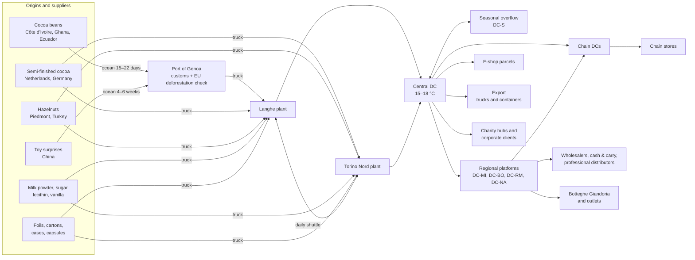
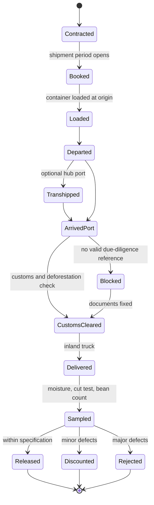
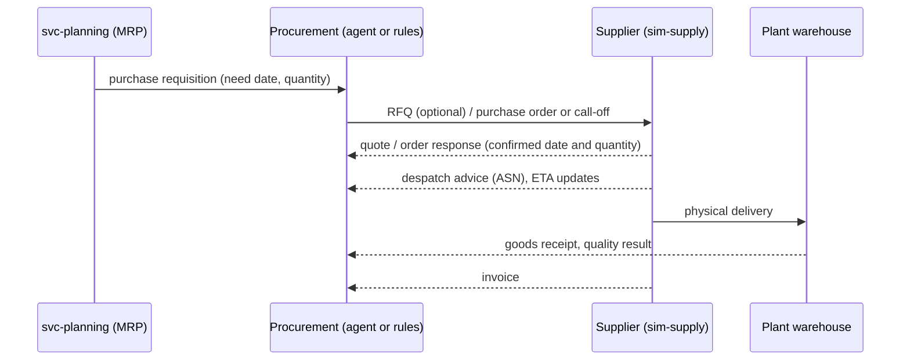
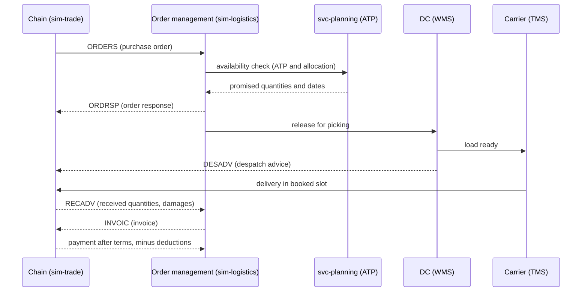

# 05 — Supply Chain and Logistics

This chapter traces materials from suppliers to plants and finished goods to customers. It covers supplier
behaviour, procurement, inventory, warehouses, transport, costs, order-to-cash and returns—the design basis
for **sim-supply** and **sim-logistics** (chapter 08). Values marked *(estimate)* are tunable assumptions
without a strong public source.

---

## 5.1 The network at a glance

Two inbound supply chains coexist: **ocean beans** (long, uncertain, contract-driven) and **trucked semi-finished
cocoa** (short, flexible, more expensive per tonne of cocoa). Hazelnut paste goes from Langhe to Torino Nord on a
daily shuttle, which creates an inter-plant dependency (chapter 02).

---

## 5.2 Materials: volumes, sources and lead times

Volumes are for Profile M (≈ 20,000 t of finished products, chapter 04). Supplier names follow chapter 02.

| Material | Volume per year | Suppliers | Lead time | Price reference | Storage | Source |
|---|---|---|---|---|---|---|
| Cocoa beans | ≈ 3,600 t (≈ 12 bulk containers of ≈ 25 t per month *(estimate)*) | Atlantic Cocoa Trading (Côte d'Ivoire), Gold Coast Beans (Ghana), Andes Fine Cacao (Ecuador) | Contracted months ahead. Ocean 15–22 days port to port from West Africa (20–28 days with buffer), ≈ 4 weeks from Ecuador. Port release and inland trucking 3–7 days *(estimate)* | Futures index + origin differential | 15–25 °C, relative humidity ≤ 65%, moisture ≤ 8%, FIFO | [P26][P27][P28][P29] |
| Semi-finished cocoa (mass, butter, powder) | ≈ 4,400 t | Rotterdam Cocoa Processing (NL), Hanseatic Kakao (DE) | 1–2 weeks (solid blocks, or liquid in heated tankers) | 2025 levels: butter ≈ €9,700/t, mass ≈ €7,200/t, powder ≈ €7,700/t | Blocks: months. Liquid: days in heated tanks | [M6] |
| Hazelnut kernels | ≈ 1,700 t | Cooperativa Nocciole Langa (Piedmont), Karadeniz Fındık (Turkey) | Piedmont: harvest August–September, then call-offs during the year. Turkey: 2–3 weeks | Driven by crop size | Cool and dry; rancidity risk; roast close to use | [P30][P31] |
| Milk powder | ≈ 2,000 t *(estimate)* | Latteria Alpina | ≈ 1 week | Skim milk powder ≈ €3,100–3,600/t (September–October 2026) | Dry, months | [P32] |
| Sugar | ≈ 6,500 t *(estimate)* | Zuccherificio Padano | Days | EU white sugar ≈ €600–750/t *(estimate)* | Silos | — |
| Lecithin, vanilla, flavours | Tens of tonnes | LeciPlus, Vanille de Madagascar SARL | Weeks to months | No public price found; a tunable parameter. Vanilla is very volatile (Madagascar weather) | — | — |
| Printed foils | Print runs per design | AlluFoil Veneto | 6–10 weeks for seasonal designs *(estimate)* | Per 1,000 pieces | Year-specific designs become obsolete after the season | — |
| Printed cartons and gift boxes | Print runs per design | CartoTorino | 4–8 weeks *(estimate)* | Per 1,000 pieces | As above | — |
| Shipping cases | Continuous | Cartotecnica Ondulata | 1–2 weeks | Commodity | — | — |
| Egg capsules | ≈ 75 M | PlastiPack Brianza | 3–5 weeks | Per 1,000 pieces | — | — |
| Toy surprises | ≈ 78 M (kids eggs, Junior Easter eggs, simpler surprises for charity and private-label eggs) | ShenTai Toys (Shantou) | **9–15 weeks door to port**: sampling 1–3 + production 3–6 + sea 4–6 weeks (air: 7–14 days instead of sea). Then ≈ 1 week inland | $0.03–0.40 per piece; minimum order 1,000–10,000 per design | Design-specific | [P33] |
| Premium surprises | ≈ 0.45 M | Sorprese d'Autore | 6–8 weeks | Per piece | Design-specific | — |

---

## 5.3 Commodity prices and buying strategies

### Price indices

sim-world publishes daily price indices (`world.price.tick`, chapter 08). Supplier prices are derived from them:
**price = index × FX + differential or premium + negotiated terms**.

| Index | Behaviour in the model | Calibration |
|---|---|---|
| Cocoa (futures-like, USD/t) | Mean-reverting process with jumps and **regimes**: calm, stressed, crisis | Steady around $2,500/t for decades, then a spike to $11,530/t (London, June 2024) [M5] and an all-time high of $12,906/t (New York, December 2024). About $5,700/t in October 2026, still 2–3× pre-2023 levels [P27] |
| Cocoa butter, mass, powder | Follow cocoa with their own spreads ("ratios") | 2025 levels in §5.2 [M6] |
| Hazelnuts | Set once a year by the crop outcome, then drift | Piedmont crop fell about 50% in 2024 and partly recovered in 2025 [P30][P31] |
| Milk powder | Monthly quotation, moderate volatility | [P32] |
| Sugar | Low volatility, yearly contracts | *(estimate)* |
| EUR/USD | Random walk | Converts cocoa into euros |
| Electricity and gas | Seasonal, with spikes | Feeds factory energy costs (chapter 04) |
| Container freight | Mean-reverting with shocks (canal closures, port strikes) | Feeds ocean costs and transit times |

The scenario chooses the starting regime (chapter 03 §3.9): **calm**, **post-crisis** (2025-like) or **crisis**
(a new cocoa spike).

### Buying strategies

| Material | Contract type | Price fixing | Default coverage (tunable) | Who decides |
|---|---|---|---|---|
| Cocoa beans | Forward contracts with traders, by monthly shipment period | Fixed price, or "price to be fixed" against the futures index + origin differential (industry practice) | 6–12 months ahead, with lower coverage further out | **Procurement agent** (LLM, chapter 09) within limits set by the controller; quantities come from MRP (chapter 06) |
| Semi-finished cocoa | Annual frame agreement with weekly call-offs | Quarterly fixing against the index *(estimate)* | 3–6 months | Procurement agent |
| Hazelnuts | Piedmont: annual contract after the harvest. Turkey: forward plus spot | Fixed per crop year (Piedmont) | Piedmont: full crop year. Turkey: 3–6 months | Procurement agent; the crop forecast matters |
| Milk powder | Monthly indexed contract | Index | 1–3 months | Rule-based |
| Sugar | Annual contract *(estimate)* | Fixed | 12 months | Rule-based |
| Continuous packaging | Frame agreements, reorder point | Annual price list | — | Rule-based |
| Seasonal packaging, toys, premium surprises | One order per season and design, plus an optional top-up if lead time allows | Per order | One season | Seasonal category manager and procurement agent |

Optional **hedging** (futures positions on cocoa) lives in svc-finance (chapter 08). It changes the cost of goods
sold but not the physical flows.

---

## 5.4 Cocoa: from contract to silo

| Aspect | Model | Source |
|---|---|---|
| Origins and crops | Côte d'Ivoire ≈ 40–45% of world supply (main crop October–March ≈ 70%, mid-crop April–September). Ghana ≈ 20% (main crop October–June). Ecuador ≈ 6–7% (March–June) | [P26] |
| Ocean transit | 15–22 days port to port West Africa → Genoa, Livorno or Trieste; 20–28 days with buffer | [P28] |
| ETA uncertainty | An ETA is published at booking and updated at departure, transhipment, mid-voyage and arrival. The error shrinks as arrival approaches. Shocks (port strike, canal closure, storms) add days | — |
| Receiving quality | Moisture (max 8%), cut test (mouldy, slaty, insect-damaged beans), bean count. Outcome: released, discounted or rejected | [P29] |
| Storage | 15–25 °C, RH ≤ 65%, FIFO, jute bags or bulk liners on pallets. Poor storage raises mould risk | [P29] |
| Milestone events | `supply.shipment.booked`, `loaded`, `departed`, `transhipped`, `arrived_port`, `customs_cleared`, `delivered`, plus `supply.shipment.eta_updated` and `supply.quality.certificate` | Chapter 08 |

### EU Deforestation Regulation (EUDR)

The universe starts in 2031, so the EUDR applies. Obligations for large and medium operators start on
**30 December 2026**; for micro and small operators on 30 June 2027 [P35][P36].

| Rule | Model |
|---|---|
| Due-diligence statement (DDS) | Filed once by the first operator that places the product on the EU market (here, the trader or grinder). Downstream companies such as Giandoria can reference its number instead of filing again [P35] |
| Geolocation | Plot-level geolocation travels with the DDS from origin [P35] |
| Release rule | A lot without a valid DDS reference **cannot be cleared or used**. It stays `Blocked` |
| Shock | "DDS invalidated for a supplier": lots blocked at customs, so production must switch to other lots or to semi-finished cocoa (chapter 08 shock catalogue) |
| Parameter | The regulation has already been amended and postponed, so the rule set is a scenario parameter [P36] |

---

## 5.5 Hazelnuts: one harvest a year

| Aspect | Model | Source |
|---|---|---|
| Piedmont crop | About 23,500–28,000 ha of Tonda Gentile. The 2024 crop collapsed by about 50% (≈ 8,000–10,000 t) because of climate stress and disease; 2025 partly recovered (≈ 12,000–15,000 t). Piedmont is about one third of Italian output. Harvest in August | [P30][P31] |
| Turkey | Dominant world supplier; the volume source for non-claim products | *(not re-verified)* |
| Crop model | Each year's crop is a hidden truth drawn in spring and shaped by weather (spring frost, summer drought). **Crop estimates** are published from June with errors that shrink until the harvest. The price is set after the harvest | — |
| Origin claim | Products that claim Piedmont hazelnuts (1872 gianduiotti and gianduja) **cannot** use Turkish nuts. This is a hard substitution constraint for planning | — |
| Quality | Aflatoxin and moisture tests on receipt; rejections are possible *(qualitative)* | — |
| Seasonal load | LG-HAZ peaks from August to October after the harvest (chapter 04) | — |

A poor Piedmont harvest forces choices: pay a much higher price, reduce gianduiotti volumes, or reformulate
non-claim products with Turkish nuts. That makes a good agent scenario (chapter 09).

---

## 5.6 Packaging and surprises: the seasonal bottleneck

Raw materials are rarely what stops a seasonal product. **Packaging and surprises are**, because they are
design-specific, have long lead times and become worthless after the season.

| Item | Why it is critical | Lead time | Risk |
|---|---|---|---|
| Toy surprises (kids eggs, Junior Easter eggs) | Licensed designs; Asian supply; minimum order quantities | 9–15 weeks door to port + ≈ 1 week inland [P33] | Sea delays; a design approval slip moves everything |
| Licensed artwork approvals | Licensor approves each design | 2–6 weeks *(estimate)* | Late approval delays foil printing |
| Printed seasonal foils | One design per SKU and year | 6–10 weeks *(estimate)* | Printer capacity is tight in autumn |
| Egg boxes and gift boxes | SKU-specific | 4–8 weeks *(estimate)* | As above |
| Charity packaging | The foundation must approve the artwork | Weeks; the contract is signed months ahead (chapter 03 §3.6) | Fixed public date |
| Corporate logo boxes | Many small runs | Weeks, orders October to mid-November [M17] | Hard deadline in mid-December |

**Decisions this creates** (chapter 06 and chapter 09):

* **When to commit.** Ordering early is safe for supply but blind to demand. Ordering late uses better
  information but risks missing the season. Seasonal packaging is a classic newsvendor decision with
  obsolescence cost.
* **How much to over-order.** Leftover foils and toys are written off. Missing foils mean lost egg sales.
* **Expediting.** Air freight cuts toy transit from 4–6 weeks to 7–14 days [P33] at a much higher cost
  *(cost multiplier is a parameter)*.
* **Route risk.** A canal closure can add about 10–14 days to Asia–Europe sailings *(estimate)*. It comes from the
  shock catalogue (chapter 08).

---

## 5.7 How suppliers behave

Each supplier in sim-supply is a small model with these parameters:

| Attribute | Model |
|---|---|
| Capacity | Units per week or month, with seasonal variation (printers are busy in autumn). Hidden truth: `truth.supplier.capacity` |
| Lead time | A distribution per lane (for example lognormal with a long tail), not a constant |
| Reliability | On-time and in-full probability. Partial deliveries and late deliveries are separate outcomes |
| Quality | Defect and rejection rates per material; certificates with each lot |
| Price | Index-linked or list price, quantity breaks, surcharges for rush orders |
| Order rules | Minimum order quantity, lot size, order cut-off days |
| Allocation under shortage | When demand exceeds capacity: pro rata, by contract priority, or by relationship. Giandoria may get less than ordered |
| Communication | Order confirmation delay (minutes by EDI, a day by email), promised date that may differ from the requested one, despatch advice, ETA updates |
| Behaviour | Rule-based by default. Optional **supplier sales agents** (LLM) negotiate prices, propose delays or offer allocations (chapter 09) |

**Procurement flow** (company side → supplier side):

Company-side procurement events use the `proc.*` family (`proc.requisition.created`, `proc.po.issued`,
`proc.contract.signed`, `proc.receipt.posted`). Supplier-side events use `supply.*` (chapter 10).

---

## 5.8 Inventory: locations, statuses and policies

### Where stock lives

| Location | What | Notes |
|---|---|---|
| Plant raw-material stores (LG, TN) | Beans, semi-finished cocoa, hazelnuts, milk powder, sugar silos, ingredients | Bean warehouse and nut cold store at LG |
| Packaging stores (LG, TN) | Foils, boxes, cases, capsules, toys | Seasonal items are booked per season and design |
| Work in progress | Mass in tanks, semi-finished shells, lots in quality hold | Tank-age limits (chapter 04) |
| Central DC (DC0) | Finished goods, 15–18 °C | ≈ 8,000 pallet positions *(estimate)* |
| Seasonal overflow (DC-S) | Easter and Christmas pre-build | ≈ 5,000–6,000 positions rented October–April *(estimate)*, paid per month |
| Regional platforms (3PL) | Fast-moving SKUs for stores, wholesalers and some chains | ≈ 500–1,500 positions each *(estimate)* |
| Own stores | Store stock and back room | Small; replenished 2–3 times a week |
| Customer stock | Chain DCs and stores | **Not owned**. Seen only by chains that share inventory reports |

### Stock statuses

`unrestricted` · `quality_hold` · `blocked` (for example no DDS, damaged) · `in_transit` · `allocated` (reserved
for an order or a campaign) · `returned` · `to_dispose`.

### Policies by item class (defaults, tunable)

| Item class | Policy | Notes |
|---|---|---|
| Cocoa beans | Coverage policy: physical stock of 8–12 weeks *(estimate)*, plus forward contracts | Long ocean lead time, high value |
| Semi-finished cocoa | Min/max with weekly call-offs | Short lead time |
| Hazelnuts | Annual contract with monthly call-offs; safety stock to bridge to the next harvest | One harvest a year |
| Milk powder, sugar | (s, S) reorder point and order-up-to level | Days to a week of lead time |
| Continuous packaging | Reorder point with minimum order quantity | — |
| Seasonal packaging and toys | One order per season (newsvendor) plus an optional top-up | Obsolete after the season |
| Continuous finished goods | Safety stock = z × σ(demand) × √(lead time + review period) per DC, with DRP pushing stock to platforms | z from a service-level target per customer class |
| Seasonal finished goods | Pre-build profile, then allocation; no replenishment after a cut-off date | Chapter 06 |

**Dispatch rule: FEFO** (first expired, first out). Chains require a **minimum remaining shelf life** at delivery,
typically about two thirds of the total shelf life *(estimate)*. Old stock therefore loses chain eligibility and
must go to outlets, wholesalers or donation before it expires. Seasonal goods follow a different rule: the
best-before date must fall at least about 3 months after the event (for example after Easter Sunday)
*(assumption)*. This is what makes the November–February pre-build of Easter eggs possible. Shelf lives per
product are in chapter 02.

---

## 5.9 Warehouses (WMS)

| Process | Model |
|---|---|
| Inbound | Despatch advice received → dock slot → unloading → quantity and quality check → put-away. Plant output arrives as SSCC-labelled pallets (chapter 04) |
| Storage | Locations with capacity in pallet positions; temperature zones; FEFO |
| Picking | Full pallet, full layer, case (chains and wholesalers), single units (stores and e-shop). Pick rates per person-hour by pick type *(estimate)* |
| Seasonal displays | Mixed display pallets for Easter and Christmas built at DC0 (co-packing) weeks before dispatch |
| Shipping | Load building, labels, despatch advice, dock departure |
| Capacity | Dock doors and staff per shift. Seasonal peaks need overtime and temporary staff. A full DC slows inbound and outbound flows |
| Inventory accuracy | Cycle counts and adjustments (damage, shrinkage) |

Events: `wms.receipt.posted`, `wms.putaway.done`, `wms.pick.completed`, `wms.shipment.dispatched`,
`wms.inventory.adjusted`, and a daily `wms.stock_snapshot` per location and SKU (chapter 08).

---

## 5.10 Transport (TMS) and the summer cold chain

### Lanes

| Lane | Mode | Typical transit | Frequency | Notes |
|---|---|---|---|---|
| Origin port → Genoa, Livorno or Trieste | Ocean containers | 15–22 days from West Africa, ≈ 4 weeks from Ecuador [P28] | By shipment period | §5.4 |
| Asia → Genoa (toys) | Ocean containers (air for expediting) | 4–6 weeks by sea, 7–14 days by air [P33] | By purchase order | §5.6 |
| Port → Langhe | Truck | 1–2 days after release *(estimate)* | Per container | Customs and EUDR checks before release |
| Northern European grinders → plants | Truck (heated tanker or ambient) | 2–3 days *(estimate)* | Weekly call-offs | — |
| Langhe ↔ Torino Nord | Shuttle truck | ≈ 1.5 h *(estimate)* | Daily | Hazelnut paste to TN; TN finished goods to DC0 |
| DC0 → regional platforms | Full truck | Same or next day | Daily, more in peaks | — |
| DC0 or platforms → chain DCs | Full truck or groupage with **delivery slots** | 24–72 h by region *(estimate)* | Per order | A late truck misses its slot, is refused and is delivered the next day |
| Platforms → wholesalers and distributors | Groupage | 24–72 h | Weekly | — |
| Platforms → Botteghe | Vans; temperature-controlled in summer | Same or next day | 2–3 times a week | — |
| DC0 → e-shop customers | Parcel carrier | 24–72 h | Daily | Insulated packaging, or a shipping stop in heatwaves (chapter 02) |
| DC0 → export | Truck (EU, UK) or container via Genoa (USA, UAE) | Days in Europe; 3–5 weeks by sea *(estimate)* | Container plan | Non-EU customs documents |
| DC0 → charity hubs | Groupage to dozens of provincial hubs | Arrival 1–4 weeks before the public date (chapter 03) | Per campaign | Returns afterwards |
| DC0 → corporate clients | Parcel or groupage | Last delivery by mid-December [M17] | Per campaign | Many small shipments |

A standard 13.6 m trailer carries 33 euro pallets. Chocolate is light for its volume, and Easter eggs are very
bulky, so trucks often fill up by volume before they reach their weight limit. On average the company ships about
**5–7 full-truck equivalents per working day**, with 2–3× more in seasonal peaks *(estimate)*.

### Cold-chain rules

| Rule | Model | Source |
|---|---|---|
| Ambient or refrigerated | If the forecast maximum temperature on the lane is above ≈ 25–27 °C, chocolate travels in temperature-controlled trucks at 15–18 °C | General cold-chain practice *(estimate)* |
| Summer stop for pralines | No praline shipments to the trade from mid-June to mid-September; stock is shipped before | [M8] |
| Own stores in summer | Replenished all summer with temperature-controlled vans | Chapter 02 |
| Heat damage | Exposure above the cocoa-butter melting range (≈ 30–34 °C) for hours raises the probability of bloom or melting. Damage shows up at the receiving check as a claim | [P37] |
| Cost | Temperature-controlled transport costs more (§5.13) | *(estimate)* |

Weather comes from sim-world, so a heatwave changes transport mode, cost and damage risk in the affected
regions. That is exactly what Fabric should detect (chapter 08 shock catalogue).

Events: `tms.shipment.planned`, `tendered`, `accepted`, `loaded`, `departed`, `position` (sparse, for maps),
`delivered`, `pod_received`, `exception` (delay, refusal, damage, temperature excursion).

---

## 5.11 Order-to-cash and EDI documents

### Order types

| Order type | From | Typical pattern |
|---|---|---|
| Replenishment order | Chains, wholesalers, cash & carry | Daily or weekly, by EDI |
| Seasonal booking | Chains, wholesalers, export distributors | Months ahead, with weekly delivery splits (chapter 03) |
| Promotional order | Chains | Extra volume before an agreed promotion |
| Campaign order | Charity foundations | Fixed quantity, fixed date, many delivery points |
| Corporate gift order | Companies | Quote, confirmation, logo packaging, deadline |
| Store replenishment | Botteghe (internal transfer orders) | 2–3 times a week |
| E-shop order | Consumers | Continuous, with Black Friday and Christmas peaks |
| Export order | Distributors | Container or truck plans |

### The order-to-cash flow with a chain

### Documents and events

EANCOM (GS1) message names are used for readability. Payloads are JSON, not EDIFACT syntax.

| Document | In-universe message (chapter 08) | Fabric event | Direction | Typical delay |
|---|---|---|---|---|
| ORDERS | `SalesOrder` / `PurchaseOrder` | `trade.order`, `o2c.order.received`; `proc.po.issued` | Customer → Giandoria; Giandoria → supplier | Minutes |
| ORDRSP | `OrderResponse` | `o2c.order.confirmed`; `supply.po.confirmed` | Seller → buyer | Minutes to a day |
| DESADV | `DespatchAdvice` | `o2c.order.shipped`; `supply.asn` | Shipper → receiver | At dispatch |
| RECADV | `ReceivingAdvice` | `o2c.order.delivered` (with received quantities and damages) | Receiver → shipper | Hours after delivery |
| INVOIC | `Invoice` | `o2c.order.invoiced`; `supply.invoice` | Seller → buyer | At dispatch or delivery |
| SLSRPT | `ForecastShare` / sell-out report | `trade.sellout.daily` | Chain → Giandoria | 1 day to 1 week by chain (chapter 03) |
| INVRPT | Inventory report | `trade.inventory_report` (optional) | Chain → Giandoria | Daily or weekly, only some chains |
| Payment and remittance | Payment | `trade.payment` | Customer → Giandoria | Payment terms, minus deductions |

### Service rules

| Rule | Default |
|---|---|
| Order cut-off | Orders received by 12:00 are picked the same day and shipped the next working day *(estimate)* |
| Unfilled lines | Chains cancel unfilled lines (no backorders). Wholesalers accept backorders *(assumption)* |
| Delivery slots | Chain DCs give fixed slots. Missing a slot means refusal and redelivery |
| Service KPIs | OTIF (on time in full), case fill rate, order fill rate, order-to-delivery lead time |
| Penalties | Some chains charge OTIF penalties as invoice deductions *(assumption)* |
| Payment terms | Per customer (chapter 02). Deductions for promotions, shortages and damages are reconciled later |

---

## 5.12 Returns, recalls and write-offs

| Flow | Trigger | Handling | Default |
|---|---|---|---|
| Post-Easter returns | Contractual returns of unsold eggs 1–2 weeks after Easter | Back to DC0, then outlet, discount channels, donation or destruction | Return rate is a scenario parameter. No public numbers exist [GAP] (chapter 03) |
| Post-Christmas returns | Unsold seasonal goods per contract | As above | Parameter |
| Charity returns | Unsold units from hubs after the public date | Redistributed to other channels under the contract | Parameter |
| Transport damage and heat claims | Receiving check (RECADV) | Credit note; goods written off | From the damage model (§5.10) |
| Short-dated stock | Below the minimum remaining shelf life for chains | Outlets, wholesalers or donation | FEFO failures show up here |
| Recall | Quality incident (chapter 04) | Genealogy finds affected lots; shipments stop; customers are notified; stock is retrieved | `o2c.return.*` with reason `RECALL` |

---

## 5.13 Cost parameters (indicative, tunable)

These values only feed the internal P&L and KPI calculations. They are **assumptions** and should be tuned.

| Cost | Indicative default |
|---|---|
| Full truck, ambient | ≈ €1.6–2.0 per km *(estimate)* |
| Temperature-controlled surcharge | +20–40% *(estimate)* |
| Parcel (e-shop) | ≈ €5–9 per parcel; insulated packaging extra in summer *(estimate)* |
| 3PL storage | ≈ €3–6 per pallet per week *(estimate)* |
| Handling in or out | ≈ €3–6 per pallet *(estimate)* |
| Inventory carrying cost | 15–25% of value per year *(estimate)* |
| Seasonal overflow (DC-S) | Monthly rent per block of positions *(estimate)* |
| Air freight for toys | Several times the sea cost *(parameter)* |
| Obsolescence | 100% of the value of leftover seasonal packaging and surprises |
| Write-off of returned seasonal goods | Value minus recovery (outlet or discount sale) |

---

## 5.14 Forward-looking information for planning

Planners and agents (chapters 06 and 09) receive information **before** it materialises, as in a real company:

| Information | From | Horizon | Uncertainty |
|---|---|---|---|
| Order confirmations with promised dates | Suppliers | Weeks to months | Promises can slip |
| Despatch advice and ETA updates | Suppliers, ocean carrier | Days to weeks | Error shrinks as arrival approaches |
| Supplier capacity notices ("80% of your order in week 42") | Suppliers | Weeks | Truth can be worse |
| Hazelnut crop estimates | Market (sim-world) | June to harvest | Error shrinks until August |
| Seasonal bookings with delivery splits | Chains, wholesalers, export | Months | Bookings are revised (chapter 03) |
| Export container plans | Export distributors | 1–3 months | Moderate |
| Campaign delivery schedules | Foundations, corporate clients | Months | Low (fixed dates) |
| Carrier capacity in peaks | Carriers | Weeks | Refusals in December and March |
| DC and overflow capacity | Own and 3PL warehouses | Months | Overflow must be rented ahead |

---

## 5.15 What sim-supply and sim-logistics emit

| Family | Examples | Emitted by |
|---|---|---|
| `proc.*` | `requisition.created`, `po.issued`, `contract.signed`, `receipt.posted` | svc-planning and the procurement agent (company side) |
| `supply.*` | `quote`, `po.confirmed`, `asn`, `shipment.*` (milestones and `eta_updated`), `quality.certificate`, `invoice` | sim-supply (supplier side) |
| `truth.supplier.*` (restricted) | `capacity` | sim-supply |
| `wms.*` | `receipt.posted`, `putaway.done`, `pick.completed`, `shipment.dispatched`, `inventory.adjusted`, `stock_snapshot` | sim-logistics |
| `tms.*` | `shipment.planned/tendered/accepted/loaded/departed/position/delivered/pod_received`, `shipment.exception` | sim-logistics |
| `o2c.*` | `order.received/confirmed/shipped/delivered/invoiced`, `return.*` | sim-logistics |
| `trade.*` | `order`, `seasonal_booking`, `promo_agreement`, `sellout.daily`, `inventory_report`, `return`, `payment` | sim-trade (customer side) |

Chapter 10 defines the envelope, schemas and tables.

---

## 5.16 Deliberate simplifications

* No vehicle routing: transit times come from the route-time matrix computed at genesis (chapter 02) plus
  random delays. Multi-stop routes are not optimised.
* Customs is a delay and a document check, not a tariff calculation (except for export costs).
* Customer stock (chain DCs and stores) is modelled by sim-trade at cluster level, not per shelf.
* Pallets are standardised per SKU (cases per layer, layers per pallet). Mixed pallets exist only for displays
  and small orders.
* Payment terms, deductions and credit risk are simple per-customer parameters.
* All of these can be refined later without changing the event contracts.
