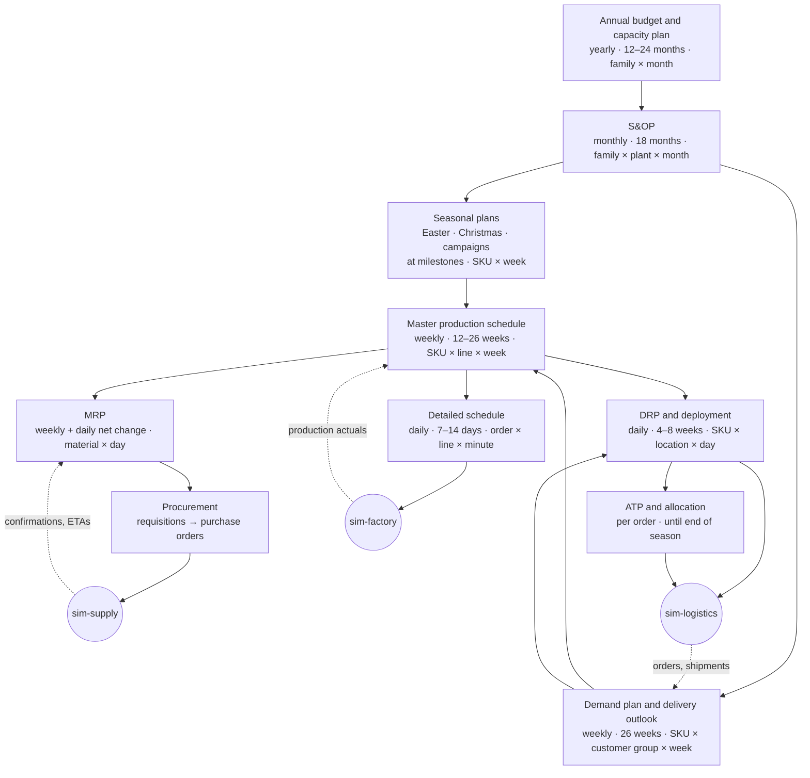
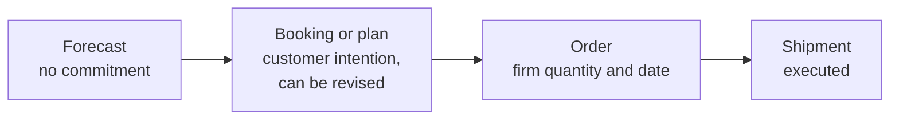
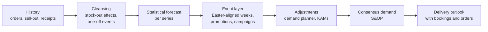
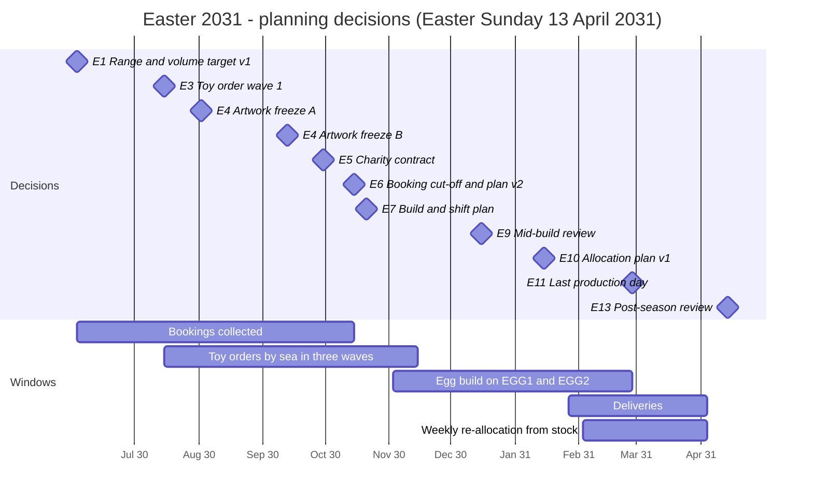

# 06 — Planning: how the virtual company looks ahead

> Chocolate is sold in weeks but planned in months. An Easter egg sits on the shelf for about ten weeks, yet the
> first decision about it (which toy goes inside) is taken about nine months before Easter Sunday. This chapter
> explains how Giandoria plans:
>
> * the planning levels and their rhythm in sim time
> * the information planners receive, and when
> * how production is planned ahead of delivery, using real production and lead times
> * what happens when there is not enough for everybody
> * how every plan becomes data in Fabric
>
> The planning engines are deterministic and explainable. LLM agents (chapter 09) use them as tools.

---

## 6.1 Why planning is the heart of Giandoria

Three clocks run at very different speeds in this business:

| Clock | Typical length | Example |
|---|---|---|
| Selling window | Days to weeks | Easter eggs sell over ≈ 10 weeks, most of them in the last 3 (chapter 03) |
| Manufacturing lead time | Days | A milk tablet takes ≈ 2–4 days from mass to released pallet (chapter 04 §4.11) |
| Cumulative lead time | Months | Toy surprises, licensed artwork and printed foils push the first Easter decision ≈ 9–10 months before Easter (chapter 05) |

When the cumulative lead time is much longer than the selling window, the company must **commit before it
knows**. Every interesting planning problem in Giandoria comes from this gap:

* **Commit early or wait?** Early commitments are safe for supply but blind to demand.
* **Build ahead or chase demand?** Pre-building uses capacity that would otherwise sit idle, but it ties up cash and
  warehouse space and ages the stock.
* **Who gets what when there is not enough?** Allocation decides which customers are served, and it affects
  relationships.
* **How much should a plan change?** Each re-plan reacts to new information. Too many changes create chaos on
  the shop floor and at suppliers.

Planning is also where the **truth vs observation** gap (chapter 03 §3.10) matters most. Planners see orders,
bookings, sell-out and ETAs. They never see latent demand, hidden machine health or true supplier capacity.
Afterwards, the quality of their plans is measured against the truth.

---

## 6.2 The planning hierarchy

Plans are nested. Higher levels decide volumes and capacity for product families and months. Lower levels
decide exact items, lines, hours and customers. Each level works inside the limits set by the level above.



| Level | Question it answers | Horizon | Bucket and granularity | Cadence (sim time) | Owner (agent role, chapter 09) | Engine in svc-planning |
|---|---|---|---|---|---|---|
| Annual budget | How much will we sell, make and spend next year? Which capacity changes? | 12–24 months | Family × channel × month | Yearly (September–October) | CEO, controller | Last year + trend + pricing assumptions |
| S&OP (sales and operations planning) | Do demand and supply balance over 18 months? Which levers do we pull? | 18 months | Family × plant × month | Monthly cycle | S&OP chair | Rough-cut capacity check in line-hours (chapter 04 §4.3), linear programme for pre-build and shifts |
| Seasonal plans | How many Easter eggs, Christmas items and campaign units? When do we commit materials? | One season (6–12 months) | SKU × week | At seasonal milestones (§6.9) | Seasonal category manager | Newsvendor sizing (§6.12), reverse-time simulation (chapter 17) |
| Demand plan | What will each customer group take, week by week? | 26 weeks (monthly up to 18 months) | SKU × customer group × week | Weekly (published Monday 06:00) | Demand planner, key account managers | Statistical forecast + bookings + adjustments (§6.5, §6.6) |
| MPS (master production schedule) | What do we make, on which line, in which week? | 12–26 weeks | SKU × line × week | Weekly (Tuesday) | Production planner | Heuristics + mixed-integer model |
| MRP (material requirements planning) | Which materials do we need, when? What must be ordered, expedited or postponed? | MPS horizon + material lead times (up to 12 months for cocoa contracts) | Material × day | Weekly regeneration (Wednesday) + daily net change | Procurement | Bill-of-materials explosion, lead-time offsetting, lot sizing, pegging; capacity-aware need dates (chapter 17) |
| Detailed schedule | In which order do jobs run on each line? | 7–14 days, rolling | Production order × line × minute | Daily (14:00) + on disruption | Production planner, maintenance manager | Constraint programming with a time limit |
| DRP (distribution requirements planning) | Where should finished goods be, and which transfers move them? | 4–8 weeks | SKU × location × day | Daily | Logistics allocator | Time-phased netting per location |
| ATP (available to promise) and allocation | What can we promise to this order? Who gets the scarce stock? | Until the end of the season | Order line; SKU × customer × week | Per order; allocation daily or on shortage | Logistics allocator, key account managers | Allocated ATP tables (§6.11) |
| Supporting plans | When are machines maintained? How many crews and temporary staff? | 4–26 weeks | Line × shift | Weekly and monthly | Maintenance manager, production planner | Calendars and rules |

Every plan is a **versioned, bi-temporal object** (chapter 07 §7.8). For example, version 23 of the demand plan
was *known* on 2031-02-03 at 06:00 and is *about* weeks 2031-W06 to 2031-W31.

---

## 6.3 The planning rhythm in sim time

Real companies plan in weekly and monthly cycles. Giandoria keeps the same rhythm in sim time and uses the
**decision lookahead** from chapter 07 §7.9: a decision is *requested* before it is *due*, with a fixed data cut-off.

### The weekly cycle

| When (sim time, Europe/Rome) | What happens | Data cut-off | Decision due |
|---|---|---|---|
| Friday 18:00 | Weekly data cut-off. svc-planning computes the statistical forecast and the delivery outlook | Friday 18:00 | — |
| Friday 18:00 → Monday 06:00 | Demand planner and key account managers review and adjust | Friday 18:00 | Monday 06:00: **demand plan published** |
| Monday 06:00 → Tuesday 12:00 | MPS run; the production planner reviews exceptions (overloads, missing materials) | Monday 06:00 | Tuesday 12:00: **MPS published** (weeks 1–2 frozen) |
| Tuesday 12:00 → Wednesday 12:00 | MRP regeneration; procurement turns planned orders into purchase orders and call-offs | Tuesday 12:00 | Wednesday 12:00: **requisitions and purchase orders** |
| Every day 06:00 | MRP net change (ETA changes, quality rejections, breakdowns, large orders) | 06:00 | 08:00 |
| Every day 14:00 | The schedule for the next day is locked; the rolling schedule covers 7–14 days | 14:00 | 22:00 (start of the night shift) |
| Every day 16:00 | DRP and deployment; transfer orders for the next day | 16:00 | 20:00 |
| Continuous | ATP on every incoming order; engines raise exceptions | — | Immediate (rules) |

### The monthly S&OP cycle

| Week of the month | Step | Who |
|---|---|---|
| 1 | Data gathering, statistical forecast at family level, KPI review of the previous month | svc-planning |
| 2 | Demand review: consensus demand for 18 months, including bookings, promotions and campaigns | Demand planner, key account managers, marketing |
| 3 | Supply review: rough-cut capacity, materials, pre-build, shifts, warehouse overflow | Production planner, procurement, logistics |
| 4 | Pre-S&OP (options and trade-offs), then the executive S&OP meeting. Decisions are recorded | S&OP chair, CEO, controller |

### What this means in wall time

| Sim period | S = 24 (1 day per hour) | S = 730 (1 month per hour) | S = 8,760 (1 year per hour) |
|---|---|---|---|
| One sim day | 1 h | ≈ 2 min | ≈ 10 s |
| One sim week | 7 h | ≈ 14 min | ≈ 69 s |
| One sim month | ≈ 30 h | ≈ 1 h | ≈ 5 min |
| Weekly lookahead (Friday 18:00 → Monday 06:00, 60 sim hours) | 2.5 h | ≈ 5 min | ≈ 25 s |
| Daily schedule window (14:00 → 22:00, 8 sim hours) | 20 min | ≈ 40 s | ≈ 3 s |

At S = 8,760 the daily schedule is due every few wall seconds, which rules out an LLM in the daily loop.
The design rules are therefore:

* **Engines run every cycle.** svc-planning is fast and deterministic, and it always produces a valid plan.
* **Agents review, adjust and decide on the weekly, monthly and seasonal cycles**, and they handle exceptions.
  Each agent decision uses its lookahead window.
* **If an agent is late, the engine's plan stands**, and the fallback is logged (chapter 07 §7.9, chapter 09).

---

## 6.4 Time fences: what may still change

Plans change all the time, but not everywhere. Time fences protect the near future.

| Zone | Position in the MPS horizon | What may change | Who approves | Typical cost of a change |
|---|---|---|---|---|
| **Frozen** | Weeks 1–2 (plus the locked next-day schedule) | Only emergencies: breakdown, quality hold, material shortage, safety | Production planner and plant manager, and only if the engine shows the change is feasible | Changeovers, overtime, wasted mass, missed delivery slots |
| **Slushy** | Weeks 3–8 | Mix changes inside a family, ± 15% volume per family *(estimate)*, if materials are available | Production planner | Expediting, re-sequencing |
| **Liquid** | Week 9 onwards | Anything within the S&OP limits | Engine, reviewed weekly | Low |

**Material fences** are separate, because they follow supplier lead times (chapter 05):

| Material | Point of no return | Why |
|---|---|---|
| Toy surprises by sea | ≈ 12–18 weeks before the first production week that needs them: 9–15 weeks door to port, ≈ 1 week inland, plus a buffer | After that, only air freight helps (7–14 days, much more expensive) [P33] |
| Printed seasonal foils and boxes | Artwork freeze, then 6–10 weeks of printing for foils and 4–8 weeks for boxes *(estimates)* | Designs are specific to one SKU and one year |
| Cocoa beans | Shipment period of the forward contract (6–12 months ahead) | Physical contracts cannot be cancelled; surplus can only be resold |
| Hazelnuts | Annual contract after the harvest (August–September) | One harvest a year |
| Temporary staff | 2–4 weeks to hire, plus ≈ 2 weeks to reach full productivity *(estimates)* | Crews cannot be added overnight |
| Seasonal warehouse (DC-S) | Rental decided ≈ 2–3 months before October *(estimate)* | Positions are rented in blocks for the whole season |

**Nervousness** measures how much a plan changes between versions inside the slushy zone (§6.16). High nervousness
sends constantly changing signals to suppliers and to the factory, which amplifies the bullwhip effect.

---

## 6.5 The delivery outlook: what customers tell us, and when

Before planning production, Giandoria must predict **what it will deliver, to whom and when**. We call this the
**delivery outlook**. It combines information with different levels of firmness:



### What agents receive

All of this information reaches the company as in-universe messages (chapter 08 §8.3) and as events in Fabric.
Each item carries the time it became known (`sim_ts`) and the period it is about (chapter 07 §7.8).

| Information | From | Message / event | How far ahead | Firmness and typical behaviour | Feeds |
|---|---|---|---|---|---|
| Seasonal bookings with weekly delivery splits | Chains, wholesalers, export distributors (sim-trade) | `SeasonalBooking` (versioned) / `trade.seasonal_booking` | 3–8 months: Easter bookings June–October, Christmas bookings June–September | Revised several times. Final call-offs are typically 85–105% of the booking, lower when sell-out is weak *(estimate)* | Seasonal plan, delivery outlook |
| Promotion agreements | Chains | `PromoAgreement` / `trade.promo_agreement` | 6–12 weeks *(estimate)* | Date is firm; volume is uncertain (uplift) | Demand plan |
| Collaborative forecasts | Some chains | `ForecastShare` | Weekly, 13-week horizon *(estimate)* | Biased in a chain-specific way; quality varies by chain | Demand plan, demand sensing |
| Firm orders | All customers | `SalesOrder` / `trade.order`, `o2c.order.received` | 1–10 days (requested delivery date) | Firm, but chains cancel unfilled lines (chapter 05 §5.11) | ATP, DRP, schedule |
| Campaign contracts | Charity foundations | `SalesOrder` with a delivery schedule | 4–9 months (signed between spring and the end of September, depending on the campaign) | Quantity and date are fixed; the list of hubs can change slightly | Seasonal plan, MPS (ring-fenced) |
| Corporate gift pipeline | Companies | Quotes, then `SalesOrder` | Quotes from September; confirmations October – mid-November | Probability-weighted pipeline; hard deadline in mid-December | Christmas plan, gift-packing crews |
| Export container plans | Export distributors | `ForecastShare` (container plan) | 1–3 months | Moderate; dates slip with shipping | Demand plan, MPS |
| Own stores and e-shop | Giandoria's own channels (sim-retail) | Receipts, e-shop orders, store-event plans | No orders in advance; marketing and store-event calendars are known months ahead | Forecast only | Demand plan, DRP |
| Sell-out and customer stock | Chains that share data | `trade.sellout.daily`, `trade.inventory_report` | 1 day to 1 week late (chapter 03) | Shows the consumer demand behind the orders | Demand sensing; predicting booking revisions |
| Retail panel | Panel provider (sim-market) | `market.panel.monthly` | Monthly, 3–4 weeks late | Sampled, with error | S&OP, market share |

### How the delivery outlook is computed

For each customer × SKU × week:

```text
expected delivery = firm orders
                  + open booking × booking-conversion factor (learned per customer and lag)
                  + forecast for the part that is neither ordered nor booked
```

* The **booking-conversion factor** is learned from past seasons. For example: "this chain takes on average 93% of
  its Easter booking, and cuts the late weeks more". Fabric is a natural place to compute it.
* The forecast part comes from the demand plan (§6.6). It excludes what orders and bookings already cover, to avoid
  double counting.
* The outlook carries **quantiles (P10 / P50 / P90)**, not only one number. Seasonal sizing and safety stocks need
  the spread, not only the average.

The delivery outlook is published every week, and whenever a booking changes by more than a threshold, as
`plan.delivery_outlook.published` (§6.15). It is the main briefing input for agents who must "see the future
deliveries" before they plan production.

---

## 6.6 Demand planning



| Step | Method | Notes |
|---|---|---|
| Cleansing | Replace stock-out days with an estimate; flag one-off events | Sales are **censored** demand: when the shelf was empty, demand was higher than sales |
| Statistical baseline | Exponential smoothing with seasonality for regular series; Croston-type methods for intermittent series (slow SKUs, small stores) | Thousands of series per sim week, so methods must be fast (chapter 08 §8.9) |
| Event layer | Regression on calendar features: weeks *relative to Easter* (not calendar weeks), Christmas weeks, promotions, heat | An early Easter shifts the curve, but the season total changes little (chapter 03 §3.4) |
| Hierarchy | Forecasts at several levels (total → category → family → SKU; region → channel → customer), reconciled so they add up | Top-down for new SKUs, bottom-up for stable ones |
| New items and campaigns | Analogues: "like last year's design, adjusted for the popularity of the licence" | About 70 seasonal SKUs change every year (chapter 02 §2.3) |
| Demand sensing (1–2 weeks) | Latest orders, sell-out and the weather forecast | The weather forecast is good for 1–3 days, fair for 7–10 days and weak beyond that |
| Adjustments | Agents adjust with reasons ("chain X agreed an extra display", "competitor price cut") | Each adjustment is logged with its author and reason |
| Consensus | The S&OP chair accepts or overrides the numbers per family | The decision is recorded in the S&OP minutes |

### Forecast value added

Each step is stored as a separate **stage** of the same forecast version: `naive`, `statistical`, `adjusted` and
`consensus`. Comparing each stage with actual orders, and with the truth (latent demand), shows **which step adds
value**. For example, it shows whether the LLM agents improve the statistical forecast or only add noise. This is
one of the most useful analyses in Fabric, and a fair way to evaluate agents (chapter 09).

---

## 6.7 Supply planning: from the delivery outlook to a production plan

### Planning backwards from the need date

Production is planned **backwards from the date goods must be available**. It uses the manufacturing lead times
from chapter 04 and the transport times from chapter 05:

```text
latest production end   = need date at the customer − transport − DC handling − quality hold
latest production start = production end − run time on the line (at planned OEE) − mass preparation
latest material arrival = production start − receiving and incoming inspection
latest order date       = material arrival − supplier lead time (including transit and a buffer)
```

Example: milk tablets for a chain DC delivery slot on Monday of week 12.

| Step | Duration | Must be done by |
|---|---|---|
| Delivery slot at the chain DC | — | Monday W12, 08:00 |
| Transport DC0 → chain DC | ≤ 1 day | Departure Friday W11 |
| Picking and loading at DC0 | ≈ 1 day | Thursday W11 |
| Quality hold (up to 3 days) | 1–3 days | Packed by Monday W11 |
| Moulding, wrapping, packing | Hours | Monday W11 |
| Mass preparation at LG (conching 6–12 h) | ≈ 1 day | Friday W10 |
| Milk powder on site (≈ 1 week lead time) | ≈ 1 week | Ordered by Thursday W9 |

> **Backward, with finite capacity.** The formulas above subtract fixed lead times, as if every line were free when
> it is needed. Giandoria plans backwards with finite capacity through **reverse-time simulation**, the project
> owner's own method (chapter 17): a simulation whose clock runs from the due dates towards the past, so that every
> step lands as late as possible on a line that is really free. A forward pass from today then gives the slack of
> each step and the latest order date of each material.

### Cumulative lead time by product

| Product | Manufacturing lead time | Critical long-lead item | Cumulative lead time | Planning consequence |
|---|---|---|---|---|
| Milk tablet | 2–4 days | Milk powder (≈ 1 week), semi-finished cocoa (1–2 weeks) | ≈ 2–4 weeks (cocoa contracts aside) | Make to stock with the weekly MPS; easy to react |
| Gianduiotto | 4–7 days | Hazelnuts (one harvest a year) | Weeks for production; hazelnut coverage until the next harvest | Make to stock; pre-build for Q4 |
| Kids surprise egg | 2–4 days | Toys: 9–15 weeks door to port + ≈ 1 week inland [P33] | ≈ 4–5 months including design | Make to stock, but toys are ordered months ahead on a rolling forecast |
| Easter egg | Days, then **1–4 months in storage** | Toys, licensed artwork, printed foils | ≈ 9–10 months from the range decision | Make to forecast and bookings; build ahead; allocate |
| Charity pack | Days | Artwork approval by the foundation, printed packs | ≈ 4–6 months from the contract | Make to order (contract); level the production |
| Corporate gift box | Days (manual packing) | Logo boxes (weeks) | ≈ 4–8 weeks | Make to order; limited by crews in December |
| Couverture drops | 2–4 days | Semi-finished cocoa (1–2 weeks) | ≈ 2–3 weeks | Make to stock; capacity-limited (≈ 105% load, chapter 04) |

### Master production schedule (weekly)

1. **Net requirements** per SKU = delivery outlook + safety-stock target − projected stock − production already
   scheduled.
2. **Campaign lot sizing** per mass and format, following the production wheel (dark → milk → nut, chapter 04 §4.6).
   Longer campaigns save changeovers; shorter ones keep stock fresh and flexible.
3. **Load the lines** in line-hours at planned OEE (chapter 04 §4.3) and compare with the shift calendar of each line.
4. **Resolve overloads** in this order:
   * move production earlier (pre-build), if shelf life allows
   * add a shift, if crews are available
   * move to another line, if the routing allows it
   * otherwise raise an exception for the production planner, or for S&OP if it is large
5. **Check mass capacity** (conches, tank-hold limits) and **key materials** (MRP pegging).
6. **Publish** a new MPS version with weeks 1–2 frozen.

**Shelf life limits pre-building.** Continuous goods must arrive at chains with about two thirds of their shelf
life left. Seasonal goods must keep a best-before date at least about 3 months after the event (chapter 05 §5.8).
Dark tablets (18–24 months) can therefore be built far ahead. Pralines (6–9 months) can only be built a few weeks
ahead without hurting freshness.

### Material requirements planning (weekly, plus daily net change)

* **Explosion:** the multi-level bill of materials (chapter 02) turns the MPS into material needs per day.
* **Offsetting and lot sizing:** supplier lead times, minimum order quantities, order multiples and full pallets.
* **Pegging:** every planned material order is linked to the demand that needs it. When foils run short,
  planners can see exactly which eggs, for which customers, are at risk.
* **Frame contracts:** cocoa forward contracts and the annual hazelnut contract are frames. MRP creates
  **call-offs** against them, not new contracts.
* **Outputs:**
  * planned orders, sent as `PurchaseRequisition` messages to procurement (rules or the procurement agent)
  * exception messages: expedite, postpone, cancel, or a **shortage forecast** such as "with current ETAs, foil X
    runs out on 12 December, so 18,000 eggs are at risk"
* **Daily net change** is triggered by ETA updates, rejected material lots, breakdowns and large orders.

### Detailed scheduling (daily, rolling 7–14 days)

| Constraint | Source |
|---|---|
| Shift calendar and crews with skills | Chapter 04 §4.8 |
| Changeover matrix and allergen sequence (dark → milk → nut; 45–180 min for allergen cleaning) | Chapter 04 §4.6 |
| Mass availability: conche cycles (6–12 h at LG, 12–24 h at TN), tank-hold limit of 8–24 h | Chapter 04 §4.1, §4.6 |
| Maintenance windows (preventive and condition-based) | Chapter 04 §4.5 |
| Materials actually on site (WMS), not only planned | Chapter 05 §5.9 |
| Quality hold before release (24–72 h) | Chapter 04 §4.7 |

* **Objective:** minimise weighted lateness, changeover time and stock, in that order of priority.
* **Solver:** constraint programming (OR-Tools CP-SAT, chapter 08 §8.9) with a time limit of a few wall seconds.
  The fallback is the plain production wheel with dispatching rules.
* **Starting point:** release and due dates per production order, and a starting solution for the solver, come from
  the reverse-time plan (chapter 17 §17.7).
* **Output:** a `ProductionSchedule` message to sim-factory, delivered at the next tick (chapter 07 §7.5), plus a
  `plan.schedule.published` event.
* **Execution:** sim-factory executes the schedule with real-world randomness (breakdowns, speed losses,
  absences). Deviations show up as `mes.*` events and in the schedule-adherence KPI.
* **Rescheduling:** triggered by a breakdown on a bottleneck, a quality hold, a material shortage or a rush order.

### Maintenance and workforce plans

* **Preventive maintenance** windows are reserved in the MPS as lost capacity. Condition-based work orders come
  from rules or from the maintenance agent (chapter 04 §4.5) and are slotted by the scheduler.
* **The annual overhaul** in the Ferragosto closure (about 10–22 August [M9]) requires building stock of
  continuous products in July.
* **Seasonal conversions** of the egg lines are fixed in the seasonal plans:
  * Christmas figures from early July
  * Easter eggs from early November
  * idle and mould maintenance from March
* **Crews per line and shift** are planned weekly. Temporary staff peak in October–December and January–March
  (chapter 04 §4.8). Hiring takes 2–4 weeks, plus about 2 weeks to reach full productivity *(estimate)*.

---

## 6.8 Capacity tension and the S&OP levers

Chapter 04 §4.3 shows where capacity is tight. S&OP decides which levers to pull.

| Tension | When | Levers | Trade-offs |
|---|---|---|---|
| Premium eggs (TN-EGP) ≈ 108% | October–February | Start in October; 3rd shift in peak weeks; fewer premium SKUs; accept lost sales on the least profitable items | Overtime cost; quality risk with temporary staff; brand risk if premium eggs run out |
| Couverture (LG-COUV) ≈ 105% | All year; pastry peaks before Christmas and Easter | Saturday shifts; build ahead (shelf life 12–24 months); price increase for professional customers; allocation | Stock and cash; customer relationships |
| Pralines and gianduiotti > 100% in Q4 | September–December | Pre-build from late August within shelf life (pralines 6–9 months, gianduiotti 9–12 months); 3rd shift on PR1 in autumn; temporary staff in gift packing; smaller assortments | Freshness of premium pralines; warehouse space |
| Christmas and Easter overlap | November–December | Masses: sequence LG-MASS campaigns, buy more semi-finished cocoa instead of processing beans. Space: rent DC-S from October. People: temporary staff | Higher material cost; rent; training |
| Easter egg lines ≈ 89% over the build | November–February | 3 shifts × 6 days from the first week; maintenance done before November; protect the charity contract first | No slack for breakdowns: one lost week costs ≈ 6% of the season's egg capacity |
| Kids surprise egg line ≈ 87% | All year | Preventive maintenance in low weeks; toy coverage | Toy supply, not the line, is often the real limit |
| Summer heat | Mid-June – mid-September | Stop praline shipments [M8]; build stock before the Ferragosto closure; schedule the November charity pack around the closure | Storage at 15–18 °C; energy |

**How S&OP decides.** The engine proposes options with their costs. It uses a small linear programme over months,
with production, stock, overtime, temporary staff and lost sales as variables. The S&OP chair agent picks one
option and explains why (chapter 09). The decision becomes `plan.sop.published`, and its levers become inputs
for the MPS, the workforce plan and procurement.

---

## 6.9 Worked example: Easter 2031, planned backwards

Easter Sunday is **13 April 2031**. The first decision falls about 45 weeks earlier. The commercial and physical
windows are in chapter 03 §3.4; this section shows the **decisions**. The build plans behind E6 and E7 come from
reverse-time simulation (chapter 17 §17.7): it places every batch as late as the lines, crews and calendars allow,
and so shows how early the build must start and by when toys, foils and boxes must arrive.



| # | Sim date | Decision | Owner (chapter 09) | Known at that time | Still unknown | Commitment created |
|---|---|---|---|---|---|---|
| E1 | Mon 2030-06-03 | Easter range (≈ 25 SKUs *(assumption)*) and volume target v1 | Seasonal category manager, S&OP | The last two Easter seasons (sell-in, shared sell-out, returns), trend, licence calendar | Bookings, competitor ranges, the charity tender | Range list; design briefs to the licensor and the printers |
| E2 | June → 15 October 2030 | Range presentations; bookings collected | Key account managers; chain buyers (sim-trade) | A growing share of booked volume | Final call-offs, sell-out | Bookings (can still be revised) |
| E3 | Mon 2030-07-15 | Toy order, wave 1 (≈ 60% of the planned toy quantity) | Procurement, category manager | ≈ 20–30% of the booked channels' volume *(assumption)* | Most bookings; the charity contract | Purchase order to ShenTai Toys (cannot be cancelled once production starts) |
| E4 | Fri 2030-08-02 and Fri 2030-09-13 | Artwork freeze. Wave A: eggs built in November–December. Wave B: eggs built in January–February | Category manager, marketing | Licensor approvals (2–6 weeks) | Final volumes per SKU | Foil and box print orders (6–10 and 4–8 weeks) |
| E5 | Mon 2030-09-30 | Charity contract signed with Associazione Luce per la Vita (400k–600k eggs) | Key account manager, CEO | Tender result, hub list, square weekend 22–23 March 2031 | Returns after the weekend | Ring-fenced volume; artwork approved by the foundation |
| E6 | Tue 2030-10-15 | Booking cut-off; seasonal plan v2 (volume per SKU and week); toy wave 3 sized | S&OP chair, category manager | ≈ 85–95% of the booked channels' volume *(assumption)* | Sell-out, weather, competitor promotions | Seasonal plan v2; toy top-up order |
| E7 | Mon 2030-10-21 | Build and shift plan: EGG1 and EGG2 on 3 shifts × 6 days from 3 November; temporary hires | Production planner | Toy and foil ETAs, crews, progress of the Christmas figures | Breakdowns, absenteeism | Shift calendar; hiring (2–4 weeks + 2 weeks ramp-up) |
| E8 | Sun 2030-11-03 (night shift) | Build starts, after the 1–2 day conversion from Christmas figures | — | — | — | — |
| E9 | Mon 2030-12-16 | Mid-build review (December S&OP): air freight for late toys? Mix change for January–February? | S&OP chair, procurement | Build attainment, actual toy arrivals, booking revisions, early weather outlook | Sell-out | Air-freight orders; MPS changes |
| E10 | Wed 2031-01-15 | Allocation plan v1, only if projected supply is below expected deliveries | Logistics allocator, key account managers | Projected build, bookings, priorities | Sell-out | Allocation quotas (§6.11) |
| E11 | Thu 2031-02-27 | Last production day; final mix re-balance | Production planner | Stock per SKU, first sell-out weeks | The peak weeks | No more Easter eggs can be made. The lines go to mould maintenance in March |
| E12 | Weekly, 3 February → 4 April 2031 | Re-allocation of the remaining stock and top-ups. Last delivery on Friday 4 April | Logistics allocator | Weekly sell-out (where shared), store stock | The last two weeks (≈ 46% of the season, chapter 03 §3.4) | Transfer orders and deliveries |
| E13 | Mon 2031-04-14 | Post-season: returns, markdowns, write-offs, lessons learned | Category manager, controller | Final sell-through, returns | — | Inputs to E1 of Easter 2032 |

**Volumes and space (Profile M).**
* The build makes ≈ 3.2 M eggs on EGG1 and EGG2: Junior ≈ 1.8 M, private label ≈ 0.9 M, charity ≈ 0.5 M.
* TN-EGP makes ≈ 0.45 M premium eggs.
* That gives ≈ 3.65 M eggs, ≈ 940 t (chapter 04 §4.3), or about 200,000 eggs per week on the two egg lines.
* Stock peaks around the end of January at ≈ 2.5–3 M eggs. At about 350–400 eggs per pallet *(estimate)*, that is
  ≈ 7,000–8,000 pallet positions. This is why the seasonal overflow warehouse DC-S is rented from October
  (chapter 05 §5.8).

**What makes it hard.**
* The first toy wave is ordered when only a quarter of the volume is booked.
* The charity contract is signed after wave 1. The planner must therefore pre-order simple surprises for a
  contract it has not yet won.
* The build ends six weeks before Easter, so the peak weeks can only be served from stock.

**Seasons overlap.** E1 for Easter 2032 is due in June 2031, while the 2031 returns are still being processed.
Easter 2032 is early (28 March), which shortens the season (chapter 03 §3.4). The company always plans several
seasons at once.

---

## 6.10 Other seasonal and campaign plans

| Plan | Key dates (2031) | Production window | Long-lead items | Main risk |
|---|---|---|---|---|
| Christmas | Bookings June–September; sell-in September–November; peak sell-out 10–24 December (chapter 03 §3.5) | Hollow figures on EGG1/EGG2 July–October. Pralines and gianduiotti pre-built from late August. Gift packing October–December | Gift boxes, tins, advent calendar boards (4–8 weeks of printing); corporate logo boxes | Q4 overload at TN; hard deadline for corporate gifts |
| November charity pack (Fondazione Orizzonte Ricerca) | Square day on a Saturday in early or mid November (scenario parameter, for example 8 November 2031); delivery to hubs in October | Levelled on LG-TAB2 in June–July and September, around the Ferragosto closure. Dark chocolate keeps 18–24 months | Booklet and packs (approved by the foundation) | Late artwork approval; on-time delivery to many hubs |
| Christmas charity hearts (Fondazione Cuore Raro) | Square weekend 20–21 December 2031; hubs supplied in early December | TN-PR1 in October–November; packing in TN-GFT | Heart box | Competes with Christmas pralines for PR1 and the gift-packing crews |
| Easter charity eggs (Associazione Luce per la Vita) | Square weekend 22–23 March 2031; hubs supplied 1–4 weeks before | EGG1/EGG2 in January–February | Foil approved by the foundation | Ring-fenced in allocation (§6.11) |
| Valentine's Day | 14 February | Pralines at TN in December–January | Heart boxes | Overlaps with the Easter build and the post-Christmas reset |
| Halloween | 31 October | Minis in September | Multipack film | Small; competes with the Christmas ramp-up |
| Summer and Ferragosto | Closure ≈ 10–22 August | Stock of continuous products built in July | — | Heat; praline shipping stop from mid-June to mid-September [M8] |

---

## 6.11 ATP, allocation and the shortage game

### Available to promise

**ATP** = released stock + planned receipts (after quality release) − quantities already promised, per day.

* Stock in quality hold is not promised until it is released (chapter 04 §4.7).
* For seasonal goods, ATP is **allocated**: each customer or customer group has a quota per SKU and week, and
  its orders use their own quota first.
* **Where ATP runs.** ATP runs inside sim-logistics (order management), against the ATP and allocation tables
  that svc-planning publishes every day and after every allocation change. No synchronous call crosses
  simulators, so the tick protocol of chapter 07 §7.5 stays intact.
* **The answer to the customer.** The order response (`o2c.order.confirmed`) carries the promised quantity and date.

**CTP (capable to promise)** is used for corporate gifts and export orders. Before quoting a date, the key account
manager asks svc-planning whether a new order can be made in time, given capacity and materials. For the agent,
this is a tool call. The engine behind it is reverse-time simulation, run with the new order added (chapter 17).

### Allocation when supply is short

Default priority classes for Easter (tunable per scenario):

| Priority | Who | Rule | Why |
|---|---|---|---|
| 1 — Ring-fenced | Charity contract; signed private-label contracts | Full quantity, reserved at build time | Public date and reputation; contract penalties |
| 2 — Booked | Seasonal bookings of chains, wholesalers and export | **Fair share**: available ÷ booked, per SKU and delivery week, with a minimum display quantity per store | Protects relationships; easy to explain |
| 3 — Own channels | Botteghe and e-shop | Presentation stock + forecast share | Brand showcase; must not run out before Easter week |
| 4 — Spot | Unbooked orders | Whatever is left | Opportunistic sales |

The logistics allocator agent may deviate from fair share within limits, and must explain why. For example, it may
favour a chain that agreed a large in-store display. Key account managers negotiate with the chain buyers.
Consequences flow back into the universe:

* lower fill rates and OTIF penalties (chains cancel unfilled lines, chapter 05 §5.11)
* the relationship score of the chain buyer agents (chapter 09)
* lost sales, visible only in the truth tables

### A typical shortage scenario

> **Toy wave 2 arrives three weeks late** (shock from chapter 08 §8.6). About 300,000 Junior eggs cannot be made in
> January as planned.

| Option | Effect | Cost |
|---|---|---|
| A. Air-freight part of the toys | Arrives in 7–14 days instead of 4–6 weeks [P33] | Several times the sea cost *(parameter)* |
| B. Re-sequence | Build private-label and charity eggs first (their materials are on site), Junior later | Needs extra shifts at the end of the build; risk of missing early deliveries |
| C. Cut Junior volume | Fair-share allocation on chain bookings | Lost sales, OTIF penalties, relationship damage |
| D. A mix of A–C | Usually the best | Requires a well-argued decision |

The engines compute the consequences of each option. The agents choose and justify the decision. A fork of the
universe (chapter 07 §7.11) can later replay the same shock with a different decision, to measure the value of the
choice.

---

## 6.12 Planning under uncertainty

### Sizing seasonal commitments: the newsvendor rule

For a one-shot seasonal decision, the best quantity is the quantile of the demand distribution given by the
**critical ratio**:

```text
critical ratio = Cu / (Cu + Co)
Cu = cost of one unit too few  (lost margin, penalties)
Co = cost of one unit too many (unit cost − recovery value after the season)
```

Illustrative numbers for a Junior Easter egg *(all estimates)*:

| Item | Cu (one too few) | Co (one too many) | Critical ratio | Plan at |
|---|---|---|---|---|
| The finished egg: net price to the chain €4.00, variable cost €2.20, recovery after Easter €0.60 | €1.80 lost margin | €1.60 | ≈ 0.53 | ≈ P53 of season demand |
| Its toy surprise: ≈ €0.15 per piece (within $0.03–0.40 [P33]), worthless after the season | €1.80 (no toy, no egg) | €0.15 | ≈ 0.92 | ≈ P92 of the egg demand known at the toy order |

The lesson is classic **postponement**: over-order the cheap long-lead component, and commit the expensive
finished good as late as possible. The return clauses in chain contracts change Co. If chains keep their unsold
eggs, Giandoria's Co falls, but the buyers will book less the next year.

### Safety stocks for continuous products

Safety stock = z × σ(demand) × √(lead time + review period), per location (chapter 05 §5.8). The service-level
target behind z depends on the customer class. DRP pushes stock from DC0 to the regional platforms.

### What-if analysis: planning sandboxes vs universe forks

| Tool | What it does | Speed | Used for |
|---|---|---|---|
| **Planning sandbox** | svc-planning re-runs its engines on a *copy of the enterprise state*, with a changed assumption ("toys three weeks late") | Wall seconds | Agents and humans compare options *before* deciding |
| **Universe fork** | Chronos restarts the whole world from a snapshot with a different policy (chapter 07 §7.11) | Minutes to hours | Evaluating strategies *after the fact* (LLM planner vs rules, decision A vs decision B) |

A sandbox never sees the truth tables. It knows only what the company knows.

### Re-planning triggers

| Trigger | Default threshold *(estimates)* | What is re-planned |
|---|---|---|
| ETA slip of a critical material | > 3 days, or past the need date | MRP net change, schedule, possibly allocation |
| Booking revision | > 10% for a customer × family | Delivery outlook, seasonal plan |
| Breakdown on a bottleneck line | > 4 h expected | Schedule; MPS if more than one day is lost |
| Quality hold | > 1 day of output of an SKU | ATP, DRP, schedule |
| Forecast tracking signal | Absolute value > 4 for 2 weeks | Demand plan review |
| Commodity price move | > 10% in one week (cocoa, hazelnuts) | Procurement review; pricing at S&OP |
| Heatwave forecast | ≥ 3 days above the threshold in a region | DRP (cold chain), demand plan |
| Absenteeism | > 10% of a crew | Schedule |

Each trigger emits `plan.exception.raised`. If the exception exceeds the engine's authority, it also becomes an
agent decision request (chapter 09).

---

## 6.13 Who plans: engines, agents and humans

| Decision | Engine default (svc-planning) | Agent role (chapter 09) | Human option | Fallback if no decision arrives in time |
|---|---|---|---|---|
| Statistical forecast | Smoothing, Croston, event regression | — | — | Always runs |
| Forecast adjustments | — | Demand planner, key account managers | Optional | The statistical forecast stands |
| Consensus demand and S&OP levers | Linear programme with costed options | S&OP chair (CEO for large trade-offs) | Optional (see below) | The engine's lowest-cost option |
| Seasonal volumes and material commitments | Newsvendor sizing, reverse-time simulation (chapter 17) | Seasonal category manager, procurement | Optional approval | P50 for finished goods, P90 for toys and seasonal packaging |
| MPS exceptions | Heuristic + mixed-integer model | Production planner | — | The engine's MPS |
| Purchase orders, supplier split, air freight | MRP planned orders | Procurement | — | Planned orders converted as they are, with the preferred supplier |
| Daily schedule | Constraint programming with a time limit | Exceptions only | — | Production wheel with dispatching rules |
| Maintenance windows | Preventive maintenance calendar | Maintenance manager | — | Calendar-based maintenance only |
| Deployment and allocation | DRP and fair share | Logistics allocator, key account managers | Optional | Fair share on bookings |
| Prices and promotions | Last year's calendar | Marketing and pricing | Optional | Last year's calendar |
| Budget | Last year + trend | CEO, controller | Optional | The engine's budget |

**Human in the loop** is optional and works best at low speed (S ≤ 730) or with a *pause at decision* option:
the clock stops at an S&OP milestone until a human approves. Two front ends are possible:

* a small web form in Lab Control
* the **Fabric IQ planning item** (*Plan*, preview), which supports planning sheets, scenarios and writeback to
  Fabric SQL or OneLake [F65]

With the Fabric option, svc-planning reads the written-back numbers at the decision cut-off, behind a data
barrier (chapter 07 §7.9). The choice is open (decision D13, chapter 15).

---

## 6.14 Starting a run: plans in flight

A company is never "empty". On the first day of a run (the epoch), there are already:

* open purchase orders and contracts
* bookings
* pre-built stock
* forecast history, needed for accuracy-by-lag analyses
* MPS versions
* a maintenance plan

There are two ways to create this state (decision D11, chapter 15):

| Option | How | Pros and cons |
|---|---|---|
| Synthetic warm start | Genesis creates consistent in-flight objects from rules ("toy orders cover 80% of next season") | Fast, but approximate. Decisions taken before the epoch have no history |
| **Backfill and fork** (recommended) | A backfill run (chapter 08 §8.8, mode C) starts 12–18 sim months earlier from a simple state. The live run forks from its snapshot | Consistent history, forecast versions and decision logs. Costs one unpaced batch run |

**Living a whole Easter live.** A run that starts on 1 January 2031 inherits the Easter 2031 commitments and only
lives the late decisions (E10–E13). To live the full cycle, use the scenario "Easter 2031 end to end", with its
epoch on 1 June 2030. That is about 11 sim months, or about 55 wall minutes at S = 8,760.

---

## 6.15 Plans as data in Fabric

Every plan publication produces **one header event** on the stream and a **set of plan lines**.

### Plan header

| Field | Meaning |
|---|---|
| `plan_id`, `plan_type` | For example `mps-LG-2031-W06`, `mps` |
| `version`, `parent_version` | Increasing version number; the version it revises |
| `stage` | Forecasts: `naive`, `statistical`, `adjusted`, `consensus`. Other plans: `draft`, `approved`, `superseded` |
| `sim_ts` (as-of) and `data_cut_off` | When the plan was published, and the data cut-off it used |
| `horizon_start`, `horizon_end`, `bucket` | The target period and the bucket (day, week, month) |
| `author_type`, `author_id` | `engine`, `agent` or `human`, plus the identity |
| `decision_id` | Link to the agent decision that approved or changed the plan (chapter 09) |
| `line_count`, `lines_ref` | How many lines, and where they are stored |
| `summary` | Small totals per family and the top exceptions, so dashboards need no join |
| `run_id`, `scenario` | As on every event (chapter 10) |

### Plan types and events

| Plan type | Header event | Lines (granularity) | Cadence |
|---|---|---|---|
| Forecast (by stage) | `plan.forecast.published` | SKU × customer group × week | Weekly |
| Delivery outlook | `plan.delivery_outlook.published` | SKU × customer × week, with P10/P50/P90 | Weekly + on booking change |
| S&OP | `plan.sop.published` | Family × plant × month + chosen levers | Monthly |
| Seasonal plan | `plan.season.published` | SKU × week, material commitments | At milestones |
| MPS | `plan.mps.published` | SKU × line × week | Weekly |
| MRP | `plan.mrp.completed` | Planned orders and exceptions | Weekly + daily net change |
| Schedule | `plan.schedule.published` | Operation × line × start/end | Daily + on disruption |
| DRP | `plan.drp.published` | Planned transfers | Daily |
| Allocation | `plan.allocation.published` | SKU × customer × week quotas | On shortage, then daily |
| Maintenance, workforce | `plan.maintenance.published`, `plan.workforce.published` | Windows; crews per line and shift | Weekly |
| Budget | `plan.budget.published` | Family × channel × month | Yearly |
| Exceptions | `plan.exception.raised`, `plan.exception.closed` | — | Any time |

ATP results do not need their own events: `o2c.order.confirmed` carries the promised quantity and date.

### Where the lines go

Plan lines are **batch artefacts**: a forecast version can hold tens of thousands of lines. The default proposal is:

* **Headers and exceptions go on the stream** (Eventstream → Eventhouse), so plans appear in real time.
* **Lines are written by svc-planning as Delta tables in the Lakehouse**, append-only and partitioned by `run_id`
  and `plan_type`. Power BI reads them directly, and KQL can reach them through OneLake shortcuts if needed.

This keeps the operational streams light. Profile M produces in the order of **5 M plan lines per sim year**
*(estimate)*, mostly forecast lines. The path is confirmed in chapter 10 and listed as decision D12 in chapter 15.

### Standard planning analyses

| Analysis | Question |
|---|---|
| Forecast waterfall | How did the forecast for week X evolve, version by version? |
| Accuracy by lag and stage | How good was the forecast 1, 4 and 13 weeks ahead? Which stage added value? |
| Plan vs actual | Did we make what the MPS said? Was the schedule followed? |
| Plan stability | How nervous were the plans inside the slushy zone? |
| Allocation fairness | Did each customer get its fair share of its booking? |
| "What did we know when we decided?" | A bi-temporal join between decision time and information arrival (chapter 07 §7.8) |
| Truth gap (evaluation only) | How much demand was lost to stock-outs? How far was the forecast from latent demand? |

---

## 6.16 Planning KPIs

| KPI | Definition | Notes |
|---|---|---|
| WAPE by lag | Σ \|actual − forecast\| ÷ Σ actual, at lags of 1, 4 and 13 weeks | Per stage and level |
| Bias | Σ (forecast − actual) ÷ Σ actual | Positive means over-forecasting |
| Forecast value added | Accuracy of a stage − accuracy of the previous stage | Shows whether agents help |
| Nervousness | Σ \|version n − version n−1\| ÷ Σ version n−1, inside the slushy zone | Lower is calmer |
| MPS attainment | Produced in the week ÷ planned, per SKU, capped at 100% | — |
| Schedule adherence | Share of operations started within ± 2 h of plan and in planned sequence | — |
| OTIF, case fill rate | From order-to-cash (chapter 05 §5.11) | Per customer and season |
| Days of cover, pre-build peak | Stock ÷ forward demand; peak pallet positions used | Includes DC-S use |
| Seasonal sell-through | Sold to consumers ÷ delivered | Uses shared sell-out |
| Post-season leftovers and returns | Returned or unsold ÷ delivered | Per season and customer |
| Obsolescence | Written-off seasonal packaging and toys (€) | Measures over-ordering |
| Capacity use | Planned vs actual line-hours; overtime and temporary staff hours | Per line and month |
| Allocation fairness | Spread of fill rate across customers relative to their bookings | Only in shortages |
| Lost sales (truth) | Latent demand not served, by cause | Evaluation only |
| Decision value (agents) | Outcome vs the fallback counterfactual, measured with forks | Chapter 09 |

---

## 6.17 Deliberate simplifications

* No commercial planning suite. The engines are small, transparent heuristics and optimisation models.
* One bucket size per level (week for the MPS, minute for scheduling, day for DRP). No mixed buckets.
* Safety stocks use simple formulas. There is no multi-echelon inventory optimisation.
* Lot sizing uses fixed campaign lengths and minimum order quantities, not full dynamic lot sizing.
* Backward planning with finite capacity is a greedy reverse-time simulation, not an optimiser. Only the next one to
  two weeks are optimised, by CP-SAT (chapter 17 §17.11).
* Cocoa hedging is a procurement decision with limits, not a financial optimisation.
* Bookings and contracts are versioned messages. Contract law (penalties, return clauses) is reduced to parameters.
* Planning sandboxes reuse the same engines on a copy of the enterprise state, and never see the truth.
