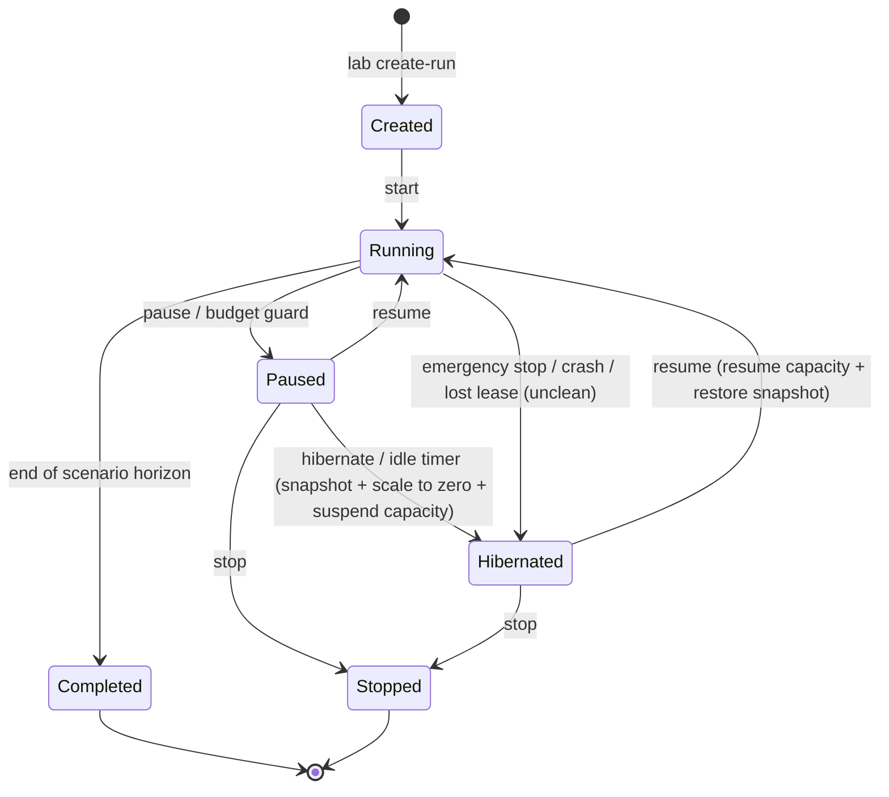
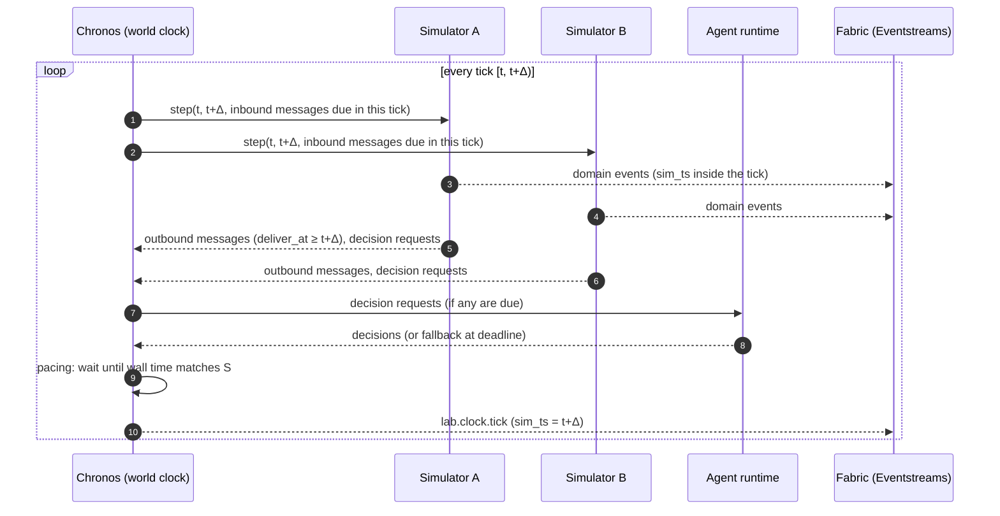

# 07 — The Time Model

The universe runs on **sim time**, which can advance faster than wall time, pause, resume or fork.
Business meaning always uses sim time; wall and ingestion time describe operations. This chapter defines
the clocks and the rules that keep them separate.

---

## 7.1 Two clocks, never mixed

| Clock | Name in data | Who owns it | What it means |
|---|---|---|---|
| **Sim time** (virtual time) | `sim_ts` | Chronos (the world clock) | *When the fact happened inside the universe.* All business logic, aggregations, KPIs, plans and forecasts use this clock only. |
| **Wall time** (real time) | `wall_ts` | The physical machine (UTC) | *When the lab emitted the record.* Used only for lab operations, cost tracking and troubleshooting. |
| **Ingestion time** | `ingestion_time()` in KQL, `EventEnqueuedUtcTime` in Eventstream | Fabric | *When Fabric stored the record.* Used only to measure pipeline latency. |

**Golden rule:** business meaning always comes from `sim_ts`. Wall time and ingestion time are only
technical metadata. A query, rule or dashboard that uses `now()`, `ago()` or "last N minutes" and does not
translate that window to sim time is a bug.

> **A third clock, internal to planning.** The reverse-time simulation of chapter 17 plans backwards on its own
> clock, s, which runs from a plan's last due date towards the past. That clock lives only inside one call of the
> planning engine: it is never emitted, stored or shown, and every date the engine produces is converted to `sim_ts`
> (chapter 17 §17.2).

---

## 7.2 Vocabulary

| Term | Definition |
|---|---|
| **Universe / Run** | One continuous simulated history, identified by `run_id`. It is created from a *scenario* and a *seed*. It can also start from a *snapshot* of another run (a fork). |
| **Epoch** | The sim time at which a run starts (for example `2031-01-01T00:00 Europe/Rome`). Each scenario sets its own epoch. |
| **Speed factor (S)** | How many sim seconds pass per wall second while the run is running. `S = 8,760` means *one sim year per wall hour*. |
| **Tick** | The basic synchronisation step of the world. It is the interval `[t, t + Δ)`, and every simulator must process it before any simulator moves on. |
| **Tick size (Δ)** | The length of a tick in sim time (for example 1 sim hour). Inside a tick, events keep their exact timestamps, down to the millisecond. |
| **Pacing** | Waiting in wall time so that the universe does not run faster than S. |
| **Lag** | The simulators cannot keep up with S, so the effective speed drops below the target speed. Lag is always measured and reported, never hidden. |
| **Pause** | The clock is frozen. No tick is processed, no event is produced and no sim time passes. |
| **Hibernate** | A pause that also takes a state snapshot, scales compute to zero and suspends the Fabric capacity. Only storage costs remain. |
| **Time ledger** | An append-only list of *segments*. Each segment maps a wall interval to a sim interval and records the speed in force. The ledger is the only place where the two clocks meet. |
| **Watermark** | For a given data store and source, the latest `sim_ts` up to which the data is known to be complete. |
| **Decision point** | A sim time at which an actor (rule-based or LLM agent) must decide something. Example: "weekly production plan, due Monday 06:00". |
| **Barrier** | A condition that stops the clock from moving past a given sim time. Example: "wait for the planner's decision". |
| **Fork** | A new run created from a snapshot of an existing run at sim time T. A fork usually changes the policy or the scenario ("what-if", or the multiverse). |

---

## 7.3 Speed profiles

The speed is a run-time parameter. It can change at any tick boundary.

| Profile | S | 1 wall second = | 1 sim hour takes | 1 sim day takes | 1 sim week takes | 1 sim year takes |
|---|---:|---|---|---|---|---|
| Real time | 1 | 1 s | 1 h | 24 h | 7 days | 365 days |
| Day per hour | 24 | 24 s | 2.5 min | 1 h | 7 h | ≈ 15.2 days |
| Week per hour | 168 | 2.8 min | 21.4 s | 8.6 min | 1 h | ≈ 2.2 days |
| Month per hour | 730 | 12.2 min | 4.9 s | ≈ 2 min | 13.8 min | 12 h |
| **Year per hour** | **8,760** | **2.43 h** | **0.41 s** | **9.9 s** | **69 s** | **1 h** |
| Backfill (unpaced) | "as fast as possible" | — | — | — | — | limited by compute and ingestion |

What this means in practice at **S = 8,760**:

* A sim month lasts about **5 wall minutes**. The Easter season (January to April) lasts about **20 wall minutes**.
* Any real latency, expressed in sim time, gets multiplied by 8,760 (see §7.9).
* High-frequency telemetry must be aggregated, or event volumes explode (see chapter 10).

---

## 7.4 Clock state machine



| State | Sim time | Events produced | Compute (simulators) | Fabric capacity | LLM calls | Typical cost |
|---|---|---|---|---|---|---|
| Running | advances at S | yes | running | active | yes | full |
| Paused | frozen | **none** | idle (min replicas) | active (data still queryable) | none | Fabric + idle containers |
| Hibernated | frozen | **none** | scaled to zero | **suspended** | none | storage only |
| Stopped / Completed | frozen forever | none | removed | suspended (an analysis session can reopen it) | none | storage only (archive) |

A run can also go straight from *Running* to *Hibernated*, after an emergency stop, a crash or a lost lease. The run
is then flagged `unclean`: there is no fresh snapshot, and on resume the universe first rebuilds the sim time since
its last snapshot without sending events twice (chapter 13, OP-06).

Pausing needs no special handling inside the simulators. Chronos simply does not ask them to process
the next tick. Every internal timer of every simulator uses sim time, so nothing ages while the lab is paused:
no chocolate cools, no truck moves and no order expires.

---

## 7.5 The tick protocol (how many simulators stay in sync)

Giandoria uses **conservative, time-stepped co-simulation**. **Chronos** orchestrates it:



These rules keep the protocol deterministic and free of rollbacks:

1. **Lookahead rule.** A message produced during tick *k* is delivered at the start of tick *k+1* at the earliest.
   So every interaction between simulators has a minimum latency of one tick (at most 1 sim hour).
   This is realistic, because an EDI order, a phone call or a truck arrival notice all take time. It also removes
   the need for optimistic "time-warp" rollbacks.
2. **Tight coupling stays inside one simulator.** Two things that must interact within minutes belong to the
   same simulator. An example is a tempering machine and the moulding line it feeds.
3. **Deterministic delivery order.** Messages are sorted by `(deliver_at, source, sequence)` before delivery.
4. **Exact timestamps inside a tick.** Inside a tick, a simulator uses next-event logic (discrete-event simulation).
   An alarm at 10:17:23.412 keeps that exact timestamp even when the tick is one hour long.
5. **Atomic ticks.** Pause, speed changes, snapshots and forks happen only at tick boundaries.

### Tick size

The tick size adapts to the speed so that each tick lasts about half a wall second:

```text
Δ = clamp( S × 0.5 s , 1 sim second , 1 sim hour )
```

| S | Δ (sim) | Wall time per tick |
|---:|---|---|
| 1 | 1 s | 1 s |
| 24 | 12 s | 0.5 s |
| 730 | 6 min 5 s | 0.5 s |
| 8,760 | 1 h (cap) | 0.41 s |

Thanks to the 1-hour cap, simulators react to each other at hourly resolution even at maximum speed.

### Pacing and lag

After each tick, Chronos computes the wall time at which the tick *should* end:
`segment_wall_start + (t_end − segment_sim_start) / S`.

* **Ahead:** Chronos waits.
* **Behind:** Chronos does not wait. It records the lag and emits `lab.clock.lagging` when the lag passes a
  threshold. It can also apply an automatic **fidelity downgrade** defined in the scenario (for example,
  coarser telemetry).

The *effective* speed is always published. Nobody should believe the universe ran at 8,760× when it really
ran at 6,000×.

---

## 7.6 The time ledger

Each change of state or speed closes the current segment and opens a new one:

| run_id | segment | wall_start (UTC) | wall_end (UTC) | sim_start | sim_end | speed | reason |
|---|---:|---|---|---|---|---:|---|
| r-0007 | 1 | 2026-10-20 09:00:00 | 2026-10-20 09:42:10 | 2031-01-01 00:00 | 2031-09-15 06:00 | 8,760 | start |
| r-0007 | 2 | 2026-10-20 09:42:10 | 2026-10-20 13:05:00 | 2031-09-15 06:00 | 2031-09-15 06:00 | 0 | paused |
| r-0007 | 3 | 2026-10-20 13:05:00 | 2026-10-20 13:30:00 | 2031-09-15 06:00 | 2031-10-01 04:00 | 730 | resume at lower speed |

The ledger answers questions such as "which wall hour produced sim week 12?" and "how long was the lab paused?".
It is also the basis for cost attribution per sim year.
**The sim timeline has no gaps. Only the wall timeline does.**

---

## 7.7 Calendar and time zones inside the universe

* `sim_ts` is stored in **UTC** (ISO 8601, millisecond precision).
* The universe uses the **real Gregorian calendar and real Italian rules** for the epoch years. That covers
  moving feasts (Easter, Carnival), public holidays, daylight-saving changes (Europe/Rome), weekends and the
  school calendar. Seasonality therefore shifts realistically from year to year: an early Easter compresses
  the egg season and a late Easter stretches it.
* Events tied to a local business day also carry `sim_local_date` (Europe/Rome), which avoids DST mistakes.
* Export markets use their own time zones.
* **Recommended epoch:** a clearly virtual future year, so nobody mistakes synthetic data for real data. The default
  scenario starts on 1 June 2030 and ends after Easter 2031 (chapter 15, D2). A historical backfill (for example
  2029–2030) can be generated before the live run.

---

## 7.8 Bi-temporal data: "when it was known" vs "what period it is about"

Planning data is naturally bi-temporal, and it must be stored that way:

| Example | `sim_ts` (as-of: when it was produced/known) | Target period (what it is about) |
|---|---|---|
| Demand forecast v23 | 2031-02-03 06:00 | weeks 2031-W06 … 2031-W31 |
| Retailer Easter booking | 2030-10-15 | delivery weeks 2031-W03 … W10 |
| Weekly production plan | 2031-02-02 18:00 | 2031-02-03 … 2031-02-09 |
| Supplier ETA update | 2031-01-20 11:00 | arrival 2031-02-11 |

Storing both times enables the classic planning analyses in Fabric: forecast accuracy by lag,
plan stability, and "what did we know when we decided?".

---

## 7.9 Freshness, latency and barriers

A latency in wall time becomes a latency in sim time multiplied by S:

```text
lag_sim = lag_wall × S
```

| Wall latency | S = 24 | S = 730 | S = 8,760 |
|---|---|---|---|
| 5 s (fast streaming) | 2 min | 1 h | 12 h |
| 10 s (typical LLM call) | 4 min | 2 h | 24 h |
| 30 s | 12 min | 6 h | 3 days |
| 60 s (LLM with reasoning/tools) | 24 min | 12 h | 6 days |

What follows, and how the design handles it:

1. **At high speed, Fabric dashboards show "now" slightly behind the sim clock.** This is fine for
   analytics. The dashboards show both `SimNow()` (taken from Chronos ticks) and the watermark of each source.
2. **By default, agents never read operational truth from Fabric.** Instead they receive *briefings* built from
   the simulators' state at a fixed cut-off time (see chapter 09). Briefings are consistent and immediate.
3. **Optional "Fabric-in-the-loop" mode.** Some demos have the virtual company use Fabric as its decision
   support system. For those, a **data barrier** makes Chronos wait until the Eventhouse watermark reaches the
   decision cut-off.
4. **Decision barrier.** When a decision is due, the clock does not pass the due time until the decision
   arrives or a deadline expires. At the deadline, a rule-based fallback is applied and logged.
5. **Decision lookahead.** To hide LLM latency, decisions are *requested* before they are due. For example,
   the Monday plan is requested on Friday at 18:00, using Friday's data cut-off. Real companies work exactly
   like this, so the simulation becomes more realistic and the clock rarely has to wait.

---

## 7.10 Wall-clock traps in Fabric and how we avoid them

| Trap | Why it breaks | Mitigation |
|---|---|---|
| KQL `now()` / `ago()` | They refer to wall time | Stored functions `SimNow(run)` and `SimAgo(run, span)`, computed from `lab.clock.tick` |
| Real-Time Dashboard default time range | It is relative to wall time | Dashboard parameters based on sim time (`_simStart`, `_simEnd`), fed by a query on `SimNow()` |
| Eventstream windowed operators | Arrival/processing time drives the windows | Run business aggregations in KQL on `sim_ts` (update policies, materialized views). Use Eventstream only for routing and filtering |
| Activator "no event for X minutes" and time-window rules | They are based on arrival time | Prefer value/state rules (threshold, state change). Compute time conditions in KQL on `sim_ts` |
| Eventhouse retention and caching policies | They are based on ingestion (wall) time | Size retention in wall time (for example "keep raw data 60 real days"). Long sim histories are fine |
| Power BI relative date filters ("last 7 days") | They are relative to today | A sim calendar table with flags (`IsCurrentSimWeek`) computed from `SimNow()` |
| Arrival order ≠ sim order | Sources run in parallel and the network adds jitter | Always order by `sim_ts`, and never infer causality from arrival order |

---

## 7.11 Reproducibility, replay and forks

* **Seeds.** Each run has one root seed. Each simulator and each entity stream derives its own seed from it
  (for example `hash(root, simulator, entity)`). Adding a store therefore does not change the random history
  of a machine.
* **Idempotent identifiers.** `event_id` is derived from `(run_id, source, sequence)`. A re-sent batch carries the
  same identifiers, so its duplicates are recognised and counted, and gold views keyed by business key ignore them
  (chapter 10 §10.12).
* **Recorded LLM decisions.** LLMs are not deterministic, so every decision is stored with its inputs digest,
  prompt version, model, output and cost. A **replay run** reuses the recorded decisions instead of calling
  the model. The result is an identical universe at zero LLM cost.
* **Snapshots.** Chronos asks all simulators for a snapshot of their state at a configurable sim interval
  (for example every sim month) and on every hibernate.
* **Forks (multiverse).** A new run starts from a snapshot and records `parent_run_id` and `fork_sim_ts`.
  Typical uses are "LLM planner vs rule-based planner on the same year" and "what if cocoa doubles in March?".
  All runs coexist in Fabric, partitioned by `run_id`, so comparing them takes a single query.
