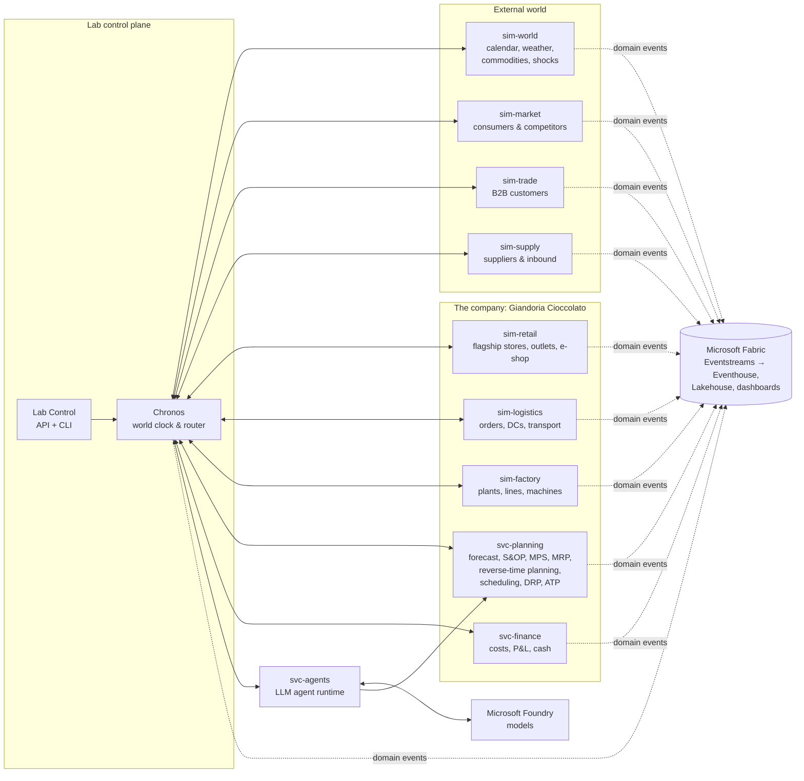

# 08 — Simulators and Services

> This chapter explains **which programs make the universe live**: what each one owns, what it receives,
> what it produces, and how they talk to each other without breaking the virtual clock.
> It describes behaviour and contracts, not code.

---

## 8.1 Design principles

1. **One owner per piece of reality.** Each simulator owns one bounded part of the world: its entities,
   its state and its random streams. No other component changes that state directly.
2. **Talk only through in-universe messages.** Simulators never share a database. Purchase orders,
   delivery notes, invoices and EDI orders are *messages* routed by Chronos (chapter 07), each with a send
   time and a delivery time in sim time.
3. **Publish facts to Fabric.** Every meaningful fact also becomes a *domain event* on a Fabric
   Eventstream (chapter 10). Fabric observes the universe; by default it does not drive it.
4. **Truth and observation are different.** A simulator knows the *truth* (the real latent demand, the real
   wear of a bearing, the real capacity of a supplier). Other actors only see *observations* (sales,
   vibration readings, confirmed dates). Both are emitted, and truth goes to a restricted table that is used
   only to evaluate forecasts and decisions.
5. **Same contract everywhere.** Every simulator implements the same step contract, so it can run
   in-process or as a separate container without changing its logic.
6. **Rules first, LLM where it adds value.** Every decision point has a deterministic default policy.
   An LLM agent can replace it role by role (chapter 09).

---

## 8.2 Landscape

Chronos is the only router of in-universe messages. Simulators publish domain events to Fabric directly
through a shared emitter library (§8.7).

---

## 8.3 The step contract

Every simulator, and every service that takes part in the timeline, exposes the same operations:

| Operation | Called by | Purpose |
|---|---|---|
| `init(scenario, seed, snapshot?)` | Chronos | Load master data (genesis) or restore a snapshot, then derive the random streams from the seed. |
| `step(t_from, t_to, inbound_messages)` | Chronos, once per tick | Advance the internal state from `t_from` to `t_to` and process the messages due in that interval. Returns **outbound messages**, **decision requests** and **step metrics**. Domain events go straight to Fabric. |
| `observe(cut_off, scope)` | svc-agents (briefings) and svc-planning | Returns the **enterprise-visible** state at a cut-off time (stock records, open orders, plans), never the hidden truth. |
| `snapshot()` / `restore(blob)` | Chronos | Serialise or restore the full state at a tick boundary. |
| `health()` | Lab Control | Liveness, lag and backlog. |

### In-universe messages

| Field | Meaning |
|---|---|
| `message_id` | Unique and deterministic |
| `type` | For example `PurchaseOrder`, `OrderResponse`, `DespatchAdvice`, `Invoice`, `SalesOrder`, `SeasonalBooking`, `ForecastShare`, `PromoAgreement`, `ReturnRequest`, `ProductionSchedule`, `MaintenanceOrder` |
| `from`, `to` | Actor identifiers (for example `customer:gdo:spesafacile`, `supplier:cocoa:atlantic`) |
| `sent_at` | Sim time when it was sent |
| `deliver_at` | Sim time when the recipient sees it. Always at least the next tick; realistic channel delays are added (EDI minutes, email hours, postal days) |
| `correlation_id` | Links a conversation (RFQ → offer → PO → confirmation → delivery → invoice) |
| `payload` | Business content |

Most messages are also published to Fabric as events. This lets Fabric reconstruct the document flows
(for example order-to-cash) exactly as a process-mining tool would.

---

## 8.4 The simulators

Each card follows the same structure: **owns**, **inputs**, **outputs**, **decisions**, **internal model**,
**main scenario knobs**.

### 8.4.1 sim-world — the environment

| Aspect | Description |
|---|---|
| Owns | Calendar (holidays, moving feasts, school terms, daylight saving), weather by region, commodity and energy prices, FX, freight indices, macro indicators (inflation, consumer confidence), tourism flows, news and shocks |
| Inputs | Scenario shock schedule; Lab Control injections ("heatwave in the North from next Monday") |
| Outputs | `world.weather.daily`, `world.price.tick` (cocoa, hazelnuts, sugar, milk powder, electricity, gas, EUR/USD, container freight), `world.calendar.day`, `world.news.published`, `world.shock.started/ended` |
| Decisions | None (it is nature and the global economy) |
| Internal model | Seasonal profiles plus autocorrelated noise for weather. Mean-reverting processes with jumps for prices. Scheduled and random shocks drawn from a catalogue (§8.6) |
| Knobs | Volatility, shock frequency, climate profile (normal or hot year), commodity regime (calm, stressed, crisis) |

### 8.4.2 sim-market — consumers and competitors

| Aspect | Description |
|---|---|
| Owns | **Latent demand**: the truth of how much people *want* to buy. It is computed by territory × consumer segment × product category × day. Also owns brand equity, price perception and competitor archetypes |
| Inputs | Calendar, weather, prices on shelf, promotions, availability by channel (from sim-retail and sim-trade), marketing activities, news |
| Outputs | Purchase intents passed to the channels; `market.panel.monthly` (a delayed, sampled view similar to retail panel data); `truth.market.latent_demand` (restricted) |
| Decisions | Competitor moves (price cuts, promotions, launches): rule-based by default, optional "game master" LLM |
| Internal model | Layered multiplicative demand model (chapter 03): base × seasonality × calendar events × weather × price elasticity × promotion uplift × distribution × brand × trend × noise. Out-of-stock substitution: same brand → other brand → lost sale |
| Knobs | Elasticities, segment sizes, trend strength, competitor aggressiveness |

### 8.4.3 sim-retail — the company's own channels

| Aspect | Description |
|---|---|
| Owns | Flagship stores ("Botteghe Giandoria"), factory outlets, airport kiosks, the D2C e-shop. Also owns store stock, opening hours, staff, footfall, conversion and baskets |
| Inputs | Purchase intents from sim-market; replenishment deliveries from sim-logistics; prices and promotions; store-event plans (tastings, seasonal windows) |
| Outputs | `retail.pos.receipt` (per receipt and line), `retail.store.footfall`, `retail.store.stock_snapshot`, `retail.eshop.order`, replenishment orders to sim-logistics |
| Decisions | Store replenishment: rule-based (min/max) by default. Optional store-manager agent for local events |
| Internal model | Footfall = territory baseline × tourism × weather × calendar. Conversion and basket depend on season and assortment. E-shop sessions, conversion, and summer heat shipping restrictions |
| Knobs | Number and location of stores, opening hours, assortment, service level targets |

### 8.4.4 sim-trade — B2B customers

| Aspect | Description |
|---|---|
| Owns | Modern trade chains (GDO), wholesalers and cash & carry, traditional trade (bars, tobacconists, pastry shops through wholesalers), HoReCa and pastry professionals, travel retail operators, export distributors, **campaign partners** (charity foundations, corporate gift clients) |
| Inputs | Consumer purchase intents (for the shelves they own); deliveries, invoices and confirmations from sim-logistics; offers and agreements from the company's key account managers |
| Outputs | `trade.sellout.daily` (aggregated by chain × region × SKU, delayed like real EDI sell-out data), `trade.order` (EDI-like), `trade.seasonal_booking`, `trade.promo_agreement`, `trade.return`, `trade.payment` |
| Decisions | Retail buyer decisions (orders, seasonal bookings, listing/delisting, promotion acceptance), campaign partner orders. Rule-based by default, LLM buyer agents optional per chain |
| Internal model | Each chain has stores by region, a DC, an ordering policy, payment terms and a negotiation profile. Seasonal goods are **booked months ahead** and unsold seasonal stock follows contractual return/markdown rules |
| Knobs | Number of chains and their regional footprint, buyer personas, payment terms, return policy |

### 8.4.5 sim-logistics — orders, warehouses, transport

| Aspect | Description |
|---|---|
| Owns | Order management (sales orders, confirmations, ATP check execution), distribution centres (central DC near the plants, regional DCs, overflow seasonal warehouses), WMS operations (receive, put away, pick, pack, ship), transport (full truck, groupage, parcel, temperature-controlled), invoicing, returns |
| Inputs | Orders from sim-trade and sim-retail; finished goods from sim-factory; allocation rules and DRP plans from svc-planning |
| Outputs | `o2c.order.received/confirmed/shipped/delivered/invoiced`, `wms.stock_snapshot`, `tms.shipment.*` (with positions for maps), `o2c.return.*` |
| Decisions | Allocation in shortage (who gets the scarce Easter eggs?), expediting, carrier choice. Rule-based by default, optional logistics allocator agent |
| Internal model | Queue and capacity model for DC docks and pickers. Lead times from a route-time matrix computed once at genesis. Temperature limits for chocolate in transit (summer) |
| Knobs | DC capacities, carrier reliability, delivery lead times by region, cut-off times |

### 8.4.6 sim-factory — plants, lines, machines

| Aspect | Description |
|---|---|
| Owns | Two plants with departments (bean processing, mass preparation, moulding, enrobing, hollow-figure spinning, wrapping, packing), machines, tanks and silos, workforce and shifts, quality lab, maintenance, energy |
| Inputs | Production schedule from svc-planning; raw and packaging material receipts from sim-supply; maintenance orders; labour availability |
| Outputs | `mes.order.started/completed`, `mes.machine.state_changed`, `mes.telemetry.snapshot` (sensor tags), `mes.batch.*` (genealogy), `qc.sample.*`, `qc.lot.released/held/rejected`, `maint.*`, `energy.meter.*`, finished goods transfers |
| Decisions | Reaction to disruptions (re-sequence, overtime, outsource), maintenance timing, quality dispositions. Rule-based by default, escalation to the production planner and maintenance agents |
| Internal model | Discrete-event simulation inside each tick. Machine state machine (running, idle starved/blocked, changeover, cleaning, planned maintenance, breakdown, off-shift). Hidden degradation drives failures and is visible only through sensors. Quality results arrive with lab delays and can put lots on hold |
| Knobs | Number of lines, OEE drivers (failure rates, changeover times), telemetry fidelity, shift patterns |

### 8.4.7 sim-supply — suppliers and inbound flows

| Aspect | Description |
|---|---|
| Owns | Suppliers of cocoa beans and semi-finished cocoa (liquor, butter, powder), hazelnuts, sugar, milk powder, other ingredients, packaging (foils, printed cartons, egg packaging), toy surprises, and services. Also owns their capacity, reliability and quality, plus ocean and road shipments, customs and EU deforestation-regulation due diligence |
| Inputs | Requests for quotation, purchase orders, call-offs and contracts from the company's procurement role |
| Outputs | `supply.quote`, `supply.po.confirmed`, `supply.asn` (despatch advice), `supply.shipment.*` (milestones: departed, transhipped, arrived port, customs cleared, delivered), `supply.quality.certificate`, `supply.invoice`, `truth.supplier.capacity` (restricted) |
| Decisions | Supplier-side negotiation and allocation in shortage. Rule-based by default, optional supplier agents |
| Internal model | Lead time distributions per lane. Capacity and allocation when demand exceeds supply. Prices = commodity index + premium + negotiated terms. Disruptions from sim-world shocks |
| Knobs | Supplier base (single or multi-sourcing), reliability, lane lead times, contract types |

---

## 8.5 The services

| Service | Role | Runs on the timeline? | Key outputs |
|---|---|---|---|
| **Chronos** | World clock, tick orchestration, message routing, barriers, time ledger, snapshots | It *is* the timeline | `lab.clock.*`, `lab.segment.*`, snapshots |
| **Lab Control** | Control plane: create/start/pause/hibernate/resume/stop/fork runs; change speed; inject scenario events; enforce budgets; pause/resume Fabric and Azure resources | Wall time only | `lab.run.*`, `lab.budget.*`, `lab.action.*` |
| **svc-planning** | The company's planning engines: statistical forecast, demand consensus, S&OP balancing, master production schedule, MRP, backward planning with finite capacity by reverse-time simulation (chapter 17), finite-capacity scheduling, distribution requirements planning, ATP and allocation, inventory policy | Yes (it acts at decision points) | `plan.*` versions (bi-temporal), purchase requisitions, production schedules, transfer orders |
| **svc-agents** | LLM agent runtime: roster, briefings, tool calls (to svc-planning and to `observe`), structured outputs, validation, fallback, decision log, budgets | Yes (decision requests and replies) | `agent.decision.*`, `agent.conversation.*`, token and cost metrics |
| **svc-finance** (optional) | Standard and actual costs, margins, price lists, P&L, working capital, cash and commodity hedges | Yes | `fin.*` postings and KPIs |

svc-planning is **deterministic and explainable**. LLM agents use it as a toolbox: they ask for a forecast,
an MRP run or a schedule, then choose, adjust and justify (chapter 06 and chapter 09).

---

## 8.6 Shock catalogue (first version)

| Shock | Origin | Main effects | What Fabric should detect |
|---|---|---|---|
| Cocoa crop failure in West Africa | sim-world | Cocoa price jump, supplier allocation, longer lead times | Price anomaly, margin erosion, supply risk |
| Hazelnut frost or poor harvest | sim-world | Hazelnut price and quality issues | Cost increase, quality deviations |
| Shipping disruption (strike, canal closure) | sim-world | Longer ocean lead times, missed arrivals | ETA drift, inbound shortages |
| Heatwave | sim-world | Lower demand for some products, shipping restrictions, higher cooling energy | Demand drop by region, cold-chain alerts |
| Major line breakdown | sim-factory | Capacity loss for days | OEE drop, schedule adherence, backlog |
| Quality incident (contamination, foreign body) | sim-factory | Lots on hold, possible recall through genealogy | Hold rate, traceability of affected customers |
| Packaging or toy supplier delay | sim-supply | Easter egg production at risk | Material shortage forecast vs plan |
| Retailer promotion war or delisting | sim-trade | Volume shift between brands and channels | Sell-out vs sell-in divergence |
| Viral flavour trend on social media | sim-world → sim-market | Sudden demand for a new flavour | Demand anomaly, forecast error |
| Energy price spike | sim-world | Higher conversion cost | Cost per kg alert |
| Absenteeism wave or strike | sim-factory | Fewer crews | Labour shortfall vs plan |
| EU deforestation-regulation non-compliance | sim-supply | Shipment blocked at customs | Compliance exceptions |
| EDI or IT outage | sim-logistics | Orders delayed or duplicated | Order intake anomaly |

Shocks can be **scheduled** in the scenario (reproducible demos), **random** (from the catalogue, with
frequencies), or **injected live** from Lab Control.

---

## 8.7 The shared emitter library

All simulators publish to Fabric through the same library, so behaviour is consistent:

| Feature | Why |
|---|---|
| CloudEvents envelope with sim and wall time (chapter 10) | One format for all events |
| Schema validation before sending | Bad events never reach Fabric |
| Batching and compression | Fewer calls and lower cost at high speed |
| Retries with idempotent `event_id` | No duplicates after network errors |
| Routing to the right Eventstream (operations, commerce, control, truth) | Separate streams by domain, volume and visibility |
| Fidelity downsampling | At high speed, telemetry is aggregated at the source (for example 15-minute snapshots instead of per-second values) |
| Backpressure signal to Chronos | When Fabric slows down, the clock slows down instead of losing data |
| Outbox | When the endpoint is unavailable, batches are kept in Azure Storage and sent before the clock restarts |
| Checkpoints | At the end of each tick, a checkpoint event per source lets Fabric compute completeness watermarks (chapter 10 §10.12) |
| Backfill writer | In unpaced backfill mode, writes files in bulk to OneLake instead of streaming |

---

## 8.8 Deployment modes

| Mode | How it runs | When to use it |
|---|---|---|
| **A — Modular monolith** (recommended first) | One container runs Chronos and all simulators in-process; svc-agents can be in the same process or separate | First implementation, demos, the highest speeds (no network between simulators) |
| **B — Distributed** | One Azure Container App per simulator; Chronos calls `step` over the internal network | When teams work on simulators independently, or one simulator needs much more compute |
| **C — Backfill** | A batch job runs unpaced and writes historical years as files | Creating 1–3 years of history before a live demo |

The step contract is identical in all modes, so moving from A to B is a packaging change, not a rewrite. The choice of
mode is decision D5 (chapter 15).

---

## 8.9 Proposed technology (for the implementation phase)

| Concern | Proposal | Reason |
|---|---|---|
| Language | Python | Rich ecosystem for simulation, optimisation, forecasting and LLM agents |
| Discrete-event logic | SimPy-style processes inside the tick | Mature, readable, well known |
| Backward planning | Reverse-time simulation on unmodified SimPy, the method introduced in chapter 17 (chapter 17) | Finite-capacity plans as late as possible, with slack and pegging; deterministic; the same library as the factory model |
| Optimisation | OR-Tools (scheduling), HiGHS (linear and mixed-integer planning) | Open source, fast, no licence cost |
| Forecasting | Lightweight statistical libraries (exponential smoothing, ARIMA, intermittent demand) | Fast enough for thousands of series per sim week |
| Event publishing | Azure Event Hubs protocol (or Kafka protocol) to Eventstream custom endpoints | Native, no extra broker needed |
| Lab API and CLI | Small web API and command-line tool | Scriptable control without any GUI |
| LLM agents | Microsoft Agent Framework with Microsoft Foundry models | Native Azure, structured outputs, tool calling |
| Observability of the lab | OpenTelemetry to Application Insights | Standard tracing and metrics |
| Packaging | Container images in Azure Container Registry, run on Azure Container Apps | Scale to zero, jobs, simple operations |

These are proposals for discussion (decision D20, chapter 15). No code is written in this phase.
