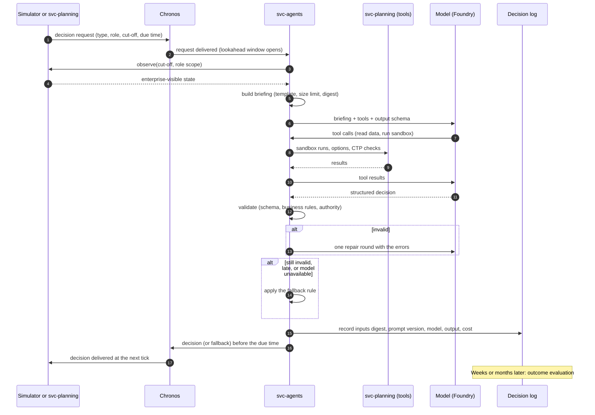
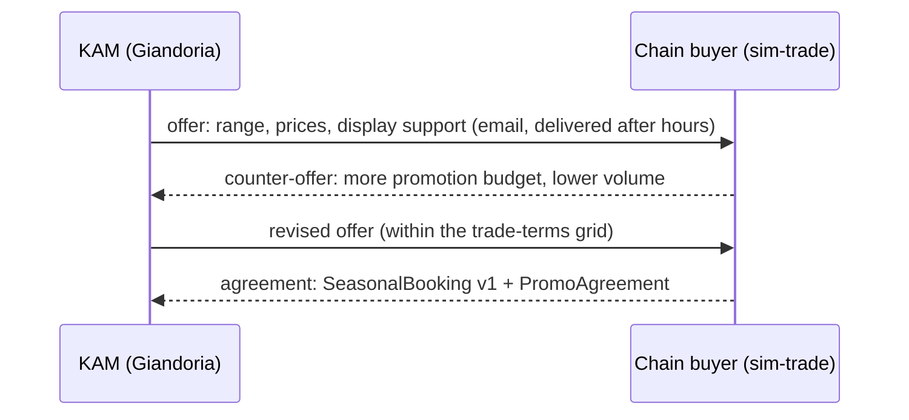

# 09 — LLM agents: who decides, with what, and how we keep it safe and cheap

> The simulators make the world move; the agents make it *decide*. This chapter defines:
>
> * which roles inside and outside Giandoria are played by LLM agents
> * what each role may see and do
> * how a decision travels from request to outcome
> * how agents talk to each other, and how they are kept within limits and within budget
> * how we measure whether they are any good
>
> Agents never control the clock. They answer decision requests, using the deterministic planning engines of
> chapter 06 as tools.

---

## 9.1 Principles

| # | Principle | What it means in practice |
|---:|---|---|
| 1 | **Agents decide, engines compute** | Forecasts, MRP, schedules and allocations are computed by svc-planning. Agents choose between options, adjust and explain |
| 2 | **Role-based visibility** | An agent sees only what its role would see in a real company, at the decision cut-off. Nobody sees the truth tables (chapter 03 §3.10) |
| 3 | **Structured, validated, logged** | Every decision is a JSON object that matches a schema. It is checked against business rules and stored in the decision log |
| 4 | **Always a fallback** | Every decision type has a rule-based default. If the model is late, wrong or unavailable, the universe still moves |
| 5 | **Replayable** | Recorded decisions can be replayed without calling any model, at zero LLM cost (chapter 07 §7.11) |
| 6 | **Budgeted** | Each run has a token and cost budget, per role and in total. When it runs out, roles degrade to their fallback rules |
| 7 | **Agents propose, the runtime acts** | Agents never write to simulators or to Fabric directly. Their outputs become in-universe messages only after validation |

There are **two kinds of agents**, and they must not be confused:

| Kind | Lives | Examples | This chapter |
|---|---|---|---|
| **In-universe agents** | Inside the simulation, on sim time | Giandoria's S&OP chair, a chain buyer, a toy supplier's sales rep | Yes |
| **Lab agents** | Outside the universe, on wall time | A Fabric data agent that answers human questions about the data; a Fabric operations agent that watches ingestion lag | Only §9.9 (they are tools for humans, not actors) |

---

## 9.2 The roster

### Company roles (Giandoria)

| Role | Decides | When (sim time) | Main tools | Authority limits *(defaults, tunable)* | Fallback rule |
|---|---|---|---|---|---|
| **CEO** | Strategic trade-offs; S&OP options above a threshold; crisis response; annual budget | Monthly S&OP; escalations | KPI summary, S&OP options, finance summary | None inside the company | Lowest-cost S&OP option |
| **S&OP chair** | Monthly consensus and levers (pre-build, shifts, overflow, sourcing) | S&OP week 4; seasonal reviews (chapter 06 §6.9) | S&OP options, capacity check, sandbox | Volume changes up to ± 15% per family; larger changes go to the CEO | Engine's lowest-cost option |
| **Demand planner** | Weekly forecast adjustments | Friday 18:00 → Monday 06:00 | Forecast stages, bookings, sell-out, promotions, news | Adjustments up to ± 30% per series; larger ones need a reason code | Statistical forecast |
| **Seasonal category manager** | Easter and Christmas range, volume targets, seasonal commitments | Seasonal milestones (E1, E3, E6 …) | Newsvendor calculator, history, bookings, licence calendar | Seasonal commitment within the budget envelope | P50 for finished goods, P90 for toys and packaging |
| **Key account manager** (one agent, one persona per chain group) | Booking negotiation, promotion offers, CTP quotes, allocation talks | Season negotiation windows; promotion cycles; orders that need CTP | Customer history, CTP check, promotion calendar, allocation table | Discounts within the trade-terms grid | Standard trade terms |
| **Procurement manager** | Purchase orders and call-offs, supplier split, cocoa cover, air freight | Wednesday 12:00; MRP exceptions; supplier offers | MRP results, supplier scorecards, price indices, ETAs | One order ≤ €500k; air freight ≤ €100k per decision; cocoa cover within a 3–9 month corridor | MRP planned orders as they are, with the preferred supplier |
| **Production planner** | MPS exceptions, extra shifts, overtime, temporary staff requests | Tuesday 12:00; disruptions | MPS, line loads, crews, sandbox | Extra shifts within the overtime cap | Engine MPS |
| **Maintenance manager** | Condition-based work orders, timing of preventive maintenance | Alarms and anomaly flags; weekly maintenance plan | Telemetry summaries, work-order backlog, spare parts | Stopping a bottleneck line > 8 h needs the production planner's agreement | Calendar-based maintenance; corrective work only on breakdown |
| **Quality manager** | Release or hold of borderline lots; recall scope | Lab results out of tolerance; incidents | Quality results, genealogy, complaints | A recall needs the CEO | Hold everything out of specification |
| **Logistics allocator** | Allocation in shortage, deployment exceptions, carrier choice at peaks, expediting | Daily in shortage; DRP exceptions | Allocation options, ATP, carrier capacity | Deviation from fair share ≤ ± 10% per customer | Fair share on bookings |
| **Retail operations manager** | Store assortment, store events, replenishment exceptions | Weekly | Store sales, footfall, stock | Within the store budget | Min/max replenishment, standard assortment |
| **Marketing and pricing manager** | List prices, promotion calendar, e-shop campaigns | Monthly; commodity shocks | Elasticities (estimated), competitor prices, margins | Price changes ≤ ± 5% without the CEO | Last year's calendar and prices |
| **Controller** | Budget, approval of spending above limits, cost alerts | Monthly; on request | Finance summary, cost meter | — | Approve within budget, reject above |

### External roles (other actors in the universe)

| Role | Played for | Decides | Notes |
|---|---|---|---|
| **Chain buyer** (one persona per chain: SpesaFacile, MercatoPiù, Ipermercati Aurora, Casa&Spesa, Delizie Gourmet, Risparmio Discount) | sim-trade | Seasonal bookings and revisions, promotion acceptance, listing and delisting, reactions to allocation | Has a **relationship score** with Giandoria that changes with service level, fairness and negotiation history |
| **Charity tender committee** (one per foundation) | sim-trade | Choice of supplier, quantity, terms, artwork approval | Annual cycle (chapter 03 §3.6) |
| **Corporate gift client** (an aggregated persona) | sim-trade | Accepting quotes; quantity; deadline | Many small decisions; a cheap model is enough |
| **Supplier sales rep** (cocoa trader, toy supplier, printer) | sim-supply | Price offers, allocation under shortage, how to communicate a delay | The hidden truth (true capacity) is in sim-supply; the rep decides what to say |
| **Competitor game master** (optional) | sim-market | Competitor moves: price cuts, promotions, launches | Rule-based by default |
| **News writer** | sim-world | Writes short news items from shocks and market events (`world.news.published`) | Adds unstructured text that other agents read; good for text analytics in Fabric |

### Recommended starting set

Not every role needs an LLM from the first day. The recommended order is:

1. **S&OP chair, demand planner, procurement manager, logistics allocator.** These have the largest effect on
   outcomes.
2. **Seasonal category manager, two chain buyers (the others stay rule-based), news writer.** These add the
   interesting negotiations and texture.
3. **Everything else**, once the decision log, replay and evaluation work.

---

## 9.3 Anatomy of a decision

### The decision request

| Field | Meaning |
|---|---|
| `decision_id` | Deterministic identifier: run, role, type and sim time |
| `role`, `decision_type` | For example `procurement`, `toy_order_wave` |
| `requested_at`, `cut_off`, `due_at` | Sim times: when it was asked, the data cut-off, the deadline |
| `scope` | What the decision is about (season, family, supplier, customer) |
| `options` | Optional engine-computed options with their costs (for example three S&OP plans) |
| `constraints` | Authority limits and hard business rules for this decision |
| `barrier` | `wait`, `lookahead` or `async` (§9.4) |
| `fallback` | The rule that applies if no valid decision arrives |

### The briefing

The briefing is what the agent "knows". It is built from `observe(cut_off, scope)` with a fixed template per role:

* **Situation:** KPIs, plan versions, exceptions and open orders
* **Inbox:** messages received since the last decision, such as a buyer's email, a supplier's delay notice or a news
  item
* **Memory:** commitments made, relationship notes, lessons from past outcomes (§9.5)
* **Task:** the question, the options, the constraints and the output schema

Briefings are capped at a few thousand tokens. The rest is reachable through tools. Each briefing has a
**digest** (a hash of its content), so a replay can prove the agent saw the same information.

### Tools

| Category | Examples | Notes |
|---|---|---|
| Read | `get_kpis`, `get_plan`, `get_orders`, `get_bookings`, `get_stock`, `get_etas`, `get_history`, `search_news`, `get_contract` | Always at the cut-off, always filtered by role |
| Compute (sandbox) | `run_forecast_scenario`, `run_mps_whatif`, `run_mrp_whatif`, `allocation_options`, `newsvendor`, `ctp_check` | svc-planning on a copy of the enterprise state (chapter 06 §6.12) |
| Propose (returned in the output, not executed by the model) | `purchase_order`, `price_change`, `allocation`, `shift_plan`, `message_to` (buyer, supplier), `escalate_to` (another role) | Executed by the runtime after validation |

Each role has an **allow-list of tools**. A chain buyer cannot call `get_stock` on Giandoria's warehouses, and a
supplier rep cannot see Giandoria's forecast unless Giandoria shares it.

### The output

Every decision type has a JSON schema with the same core:

| Field | Meaning |
|---|---|
| `decision` | The chosen option or the action list (typed by decision type) |
| `parameters` | Quantities, dates, prices, suppliers, customers |
| `rationale` | A short explanation in plain language (stored, and shown in Fabric) |
| `assumptions` | What the agent assumed about the unknowns |
| `confidence` | Low, medium or high |
| `evidence` | References to the data used (plan versions, messages, KPIs) |
| `escalate` | Whether a higher role must approve |

Structured outputs are not supported together with **parallel tool calls** [F54]. The runtime therefore runs
the tool phase first, with parallel calls if useful, and then requests the final answer with the strict schema.

### Validation, repair and fallback

1. **Schema check.** The output must match the schema.
2. **Business rules.** Quantities must be non-negative, allocations must not exceed availability, dates must be
   feasible and suppliers must exist.
3. **Authority limits.** Anything above the role's limit becomes an escalation, not an action.
4. **Consistency.** The decision must refer to the state at the cut-off (no invented orders).
5. **One repair round.** The errors are sent back to the model once.
6. **Fallback.** If the output is still invalid, the rule-based default applies, and the event
   `agent.decision.fallback` records why.

### After the decision

* **The decision log** stores the full record:
  * the request and the briefing digest
  * the prompt version and the model deployment
  * the tool calls, the output and the validation result
  * latency, tokens and estimated cost
* **Delivery.** The decision becomes in-universe messages (for example a `PurchaseOrder`) delivered at the next
  tick (chapter 07 §7.5).
* **Outcome evaluation.** Once the outcome is known (end of season, delivery, next forecast), the decision is
  scored (§9.8) and the score is written back as `agent.decision.evaluated`.

---

## 9.4 Time, barriers and determinism

At S = 8,760 one wall second is about 2.4 sim hours, so a 10–60 s LLM call lasts **1–6 sim days**. Three barrier
modes handle this (chapter 07 §7.9):

| Mode | What happens | Used for |
|---|---|---|
| **Lookahead** (default) | The request is sent before the due time, with a fixed cut-off. The clock keeps running. The decision is applied at the due time | Weekly, monthly and seasonal decisions (chapter 06 §6.3) |
| **Wait** | The clock does not pass the due time until the decision arrives or a wall-time deadline expires | Critical decisions in demos (recall scope, S&OP choice at low speed) and human approvals |
| **Async** | Applied whenever it arrives, at the next tick | Non-critical texture: news items, store events |

Rules that keep runs reproducible:

* **Decisions are applied at tick boundaries in a deterministic order** (by due time, then role, then decision
  identifier). The order in which models happen to reply does not matter.
* **Late answers are logged but never applied.** If the fallback already applied at the due time, a late model
  answer is stored for analysis only. Otherwise the same run could produce two different histories.
* **Replay** uses the log: the runtime returns the recorded decision instead of calling the model.
* **Replay with substitution** replays everything except one role, which is re-decided by another model, prompt
  or rule. This is the cleanest A/B test.

**Concurrency.** Decisions from different roles run in parallel, up to a configurable limit. Weekly peaks happen
when several roles share the same window (Friday to Monday). The limit is sized so that the model deployment's
tokens-per-minute quota is not exceeded (§9.7).

---

## 9.5 Conversations, negotiation and memory

Some decisions are conversations between agents:

* a key account manager and a chain buyer negotiating an Easter booking or a promotion
* procurement and a supplier rep discussing a shortage
* the allocator and a key account manager arguing about priorities

| Rule | Default |
|---|---|
| Turns are in-universe messages | Delivered at the next tick plus a channel delay (an email takes hours, a meeting is scheduled days ahead) |
| Turn limit | 3–6 turns per conversation, then "no deal" or the fallback terms |
| Outcome | A structured agreement (`SeasonalBooking`, `PromoAgreement`, `PurchaseOrder`) or a recorded failure |
| Events | `agent.conversation.started`, `agent.conversation.turn`, `agent.conversation.closed` (turn summaries, not full prompts) |

### Personas

Each external agent has a **persona card**, stored in master data and versioned. It holds the agent's goals,
constraints, negotiation style, sensitivity to price and service, and the relationship score. For example, a
discount chain is hard on price and indifferent to premium. A gourmet chain is soft on price, strict on quality,
and punishes late deliveries.

### Memory

Each agent keeps a small memory: commitments made, relationship notes and lessons from evaluated decisions. It
is stored in the Lab state (Azure Storage), summarised to a fixed size, and included in the briefing. Memory never
contains truth.

### Language

Prompts, schemas and rationales are in **English** by default, which makes them easier to analyse and compare.
Free-text messages between Italian actors may be generated in Italian for realism. This is an open choice (decision
D14, chapter 15).

---

## 9.6 Guardrails

| Risk | Guardrail |
|---|---|
| An agent commits too much money | Authority limits per role (§9.2); escalation to a higher role; the controller approves above the limits |
| An agent sees what it should not | Role-scoped `observe` and tool allow-lists. Truth tables are never reachable. Buyers cannot see Giandoria's costs; supplier reps cannot see Giandoria's stock |
| Prompt injection between agents | Messages from other agents are untrusted data, quoted inside the briefing and never treated as instructions. Tools are allow-listed. Outputs are validated |
| Hallucinated facts | Decisions must cite evidence from the briefing or tool results; validation rejects references to non-existent orders, suppliers or plans |
| Model outage or throttling | Retries with backoff, then a circuit breaker; affected roles switch to fallback rules and the run continues |
| Cost overrun | Per-run and per-role budgets in tokens and money (USD). The run's cost meter (chapter 13 §13.6) checks them every wall minute. Above the token budget, roles degrade to rules; above the money budget, the run pauses (`lab.budget.*` events) |
| Inappropriate content | Content filters stay on in Foundry. All names are fictional; prompts never mention real brands |
| Silent drift after a prompt change | Prompts are versioned. A change is first evaluated with replay with substitution (§9.4) |

---

## 9.7 Models and cost

### Model tiers

| Tier | Example deployments (Global Standard) | Price per 1 M tokens, input / output *(verify)* | Use |
|---|---|---|---|
| Small | gpt-5-nano | $0.05 / $0.40 | News writer, corporate gift clients, store events |
| **Medium (default)** | gpt-5-mini; gpt-4.1-mini | $0.25 / $2.00; $0.40 / $1.60 | Most roles |
| Large (optional) | gpt-4.1 | $2.00 / $8.00 | S&OP chair or CEO in showcase demos |

Prices come from the Azure OpenAI pricing page and secondary sources and must be checked before the
implementation [F52][F63]. For the gpt-5 family, **reasoning tokens are billed as output tokens**. Reasoning effort
should therefore be set to the minimum that gives good decisions.

### Workload per sim year (Profile M)

| Decision group | Decisions per sim year *(estimate)* |
|---|---:|
| Weekly cycle: demand planner, production planner, procurement | ≈ 160 |
| Monthly S&OP: chair, CEO, controller, pricing | ≈ 50 |
| Seasonal milestones (Easter, Christmas, campaigns) | ≈ 40 |
| Negotiations: key account managers and chain buyers (turns on both sides) | ≈ 400 |
| Supplier conversations | ≈ 100 |
| Allocation and deployment exceptions | ≈ 100 |
| Maintenance and quality decisions | ≈ 200 |
| News items, store events, corporate gift clients | ≈ 500 |
| Other exceptions | ≈ 300–450 |
| **Total** | **≈ 2,000** |

With ≈ 6,000 input tokens and ≈ 800 output tokens per decision, a sim year needs ≈ 12 M input and ≈ 1.6 M output
tokens:

| Model for all roles | Cost per sim year | With tool calls (× 1.5–2) |
|---|---:|---:|
| gpt-5-nano | ≈ $1.2 | ≈ $2–3 |
| **gpt-5-mini** | **≈ $6** | **≈ $9–12** |
| gpt-4.1-mini | ≈ $7 | ≈ $11–15 |
| gpt-4.1 | ≈ $37 | ≈ $55–75 |

A one-hour run with S = 8,760 therefore costs **about $10 in LLM tokens** with the default tier. That is the same
order of magnitude as the Fabric capacity for that hour (chapter 13). **Replay runs cost nothing.**

### Other cost notes

* **Batch API.** It is 50% cheaper but has a 24-hour turnaround [F53], so it cannot serve live decisions. It suits
  offline work: scoring decisions, generating news archives for backfills, large evaluation sets. Batch
  availability varies by model (verify).
* **Quotas.** The busiest window is the weekly cycle. About 10 decisions × 8k tokens in a 25-second window means
  ≈ 200k tokens per minute (TPM). The deployment quota should be ≥ 300k TPM for S = 8,760, and much less at lower
  speeds.
* **No provisioned throughput** is needed at this scale.

---

## 9.8 Evaluating agents

| Level | Measures |
|---|---|
| Per decision | Valid at first try, repaired, or fallback; latency; tokens; cost |
| Per role | The KPIs the role owns (table below) |
| Per run | Business outcome: margin, OTIF, lost sales, write-offs, stability |
| Against counterfactuals | The same scenario and seed with rules instead of the LLM, or another model or prompt, run as **forks** or **replays with substitution** (chapter 07 §7.11) |

| Role | KPIs it is judged on (chapter 06 §6.16) |
|---|---|
| Demand planner | Forecast value added at lags 1, 4 and 13 weeks; bias |
| Seasonal category manager | Sell-through, leftovers and returns, lost sales (truth), obsolescence |
| Procurement | Material availability, obsolescence, purchase price vs index, air-freight cost |
| Production planner | MPS attainment, overtime, changeover hours |
| Logistics allocator | OTIF, allocation fairness, buyer relationship scores |
| Marketing and pricing | Margin, volume, price-elasticity mistakes |
| Maintenance manager | Breakdown hours avoided, maintenance cost |

### Standard scenario suite

Each agent configuration (model, prompts, roster) runs on the same set of scenarios. Results become a scorecard
in Fabric.

| Scenario | What happens | What it tests |
|---|---|---|
| Calm year | No major shocks | Baseline: do agents beat the rules at all? |
| **Poor hazelnut harvest** | Crop estimates fall from June to August; hazelnut prices +40% | Coverage and Turkey vs Piedmont split (the Piedmont origin claim forbids substitution for some products); pricing; mix |
| **Toy delay** | Toy wave 2 for Easter arrives three weeks late (chapter 06 §6.11) | Air freight vs re-sequencing vs allocation; negotiation with buyers |
| **Cocoa spike** | Cocoa futures double in three months (as in 2024 [M5]) | Cover strategy within limits; price increases; private-label renegotiation |
| Heatwave in June | Two weeks above the threshold in the North | Cold-chain deployment; demand plan; e-shop restrictions |
| Quality incident | Foreign-body complaint on a gianduiotti lot | Hold, genealogy and recall scope; customer communication |

---

## 9.9 Runtime on Azure

| Concern | Choice | Notes |
|---|---|---|
| Agent runtime | **svc-agents** on Azure Container Apps, built with Microsoft Agent Framework [F51] | In-process control of latency, determinism, budgets and replay |
| Models | Microsoft Foundry model deployments (Global Standard) [F49] | Managed identity with the "Foundry User" role [F85]; no keys |
| Hosted agents | Foundry Agent Service (GA) [F50] is optional | Useful for exposing lab agents to humans; not needed for the in-universe loop |
| Decision log | Azure Storage (part of the Lab state), plus `agent.*` events to Fabric | Storage keeps full prompts; Fabric gets rationales, digests and metrics |
| Observability | OpenTelemetry traces to Application Insights | One trace per decision, with tool calls and model calls |

### Optional: Fabric in the loop

In this mode the virtual company uses Fabric as its decision-support system: agents query Fabric instead of
`observe`. This needs:

* a **data barrier**, so the Eventhouse is up to date at the cut-off (chapter 07 §7.9)
* a Fabric data agent [F36], reachable from Foundry through the Fabric IQ tool (preview) [F38]. The classic
  Fabric data-agent tool in Foundry is being replaced [F37].

It makes demos more impressive but runs slower and costs more. It is off by default (decision D15, chapter 15).

The implemented [Data Agent showcase](./24-data-agent-showcase.md) is a separate, bounded experiment:
an actual published agent queries the shared enterprise semantic snapshot over MCP, then supplies evidence
to the existing S&OP manager and a local replay ledger. No decision is applied to the live runtime.
Direct managed-identity access is not supported by Fabric Data Agent. The
[secretless application path](./25-data-agent-authentication.md) now federates the runtime identity to a
dedicated service principal and has been verified in Azure. A proper live data barrier and runtime provider
remain necessary; an operator's user token is never reused.

### Lab agents (outside the universe)

* The implemented **Fabric Data Agent** answers human questions about the shared enterprise snapshot.
  It must decline unmeasured OTIF/OEE/margin rather than fabricate them. The wider target can later expose
  appropriately governed gold/silver sources.
* A **Fabric operations agent** [F66] watches the lab (ingestion lag, budget, idle capacity) and notifies a Teams
  channel or a person.
* Their interactions are scheduled outside the universe and never influence it. Business analysis still uses
  **virtual time**; wall time is only for interaction timing, latency and operational monitoring.

---

## 9.10 What the agent runtime emits

| Event | When | Main fields |
|---|---|---|
| `agent.decision.requested` | A request reaches svc-agents | Request fields (§9.3) |
| `agent.decision.completed` | A valid decision is produced | Output, rationale, confidence, tokens, cost, latency, model, prompt version |
| `agent.decision.fallback` | The rule applies | Reason: late, invalid, budget, outage |
| `agent.decision.escalated` | Above authority | Target role |
| `agent.decision.evaluated` | The outcome is known | Score, KPI deltas, counterfactual reference |
| `agent.conversation.started` / `turn` / `closed` | Negotiations | Participants, turn summary, outcome |
| `agent.memory.updated` | After evaluation | Memory size, changed items (summaries only) |

`sim_ts` is the sim time of the step (request, completion and so on). Wall time and latency are also stored, which
makes the cost of "thinking" visible against the sim clock. Chapter 10 defines the schemas.

---

## 9.11 Deliberate simplifications

* One agent per role, not one per employee. Key account managers use personas instead of separate agents.
* Agents do not learn by fine-tuning. They improve through memory and through prompt versions that are tested
  with replay.
* Negotiations have a turn limit and a structured result. There is no open-ended chat.
* Lab agents never act inside the universe.
