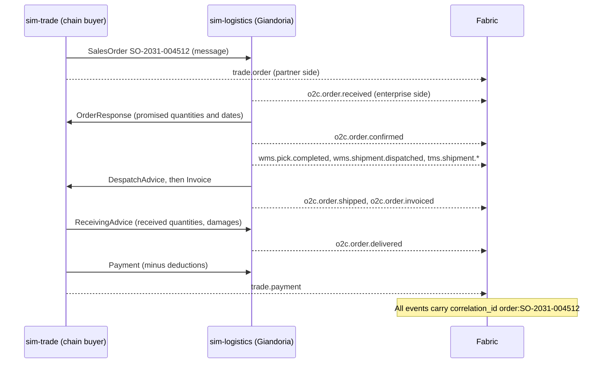
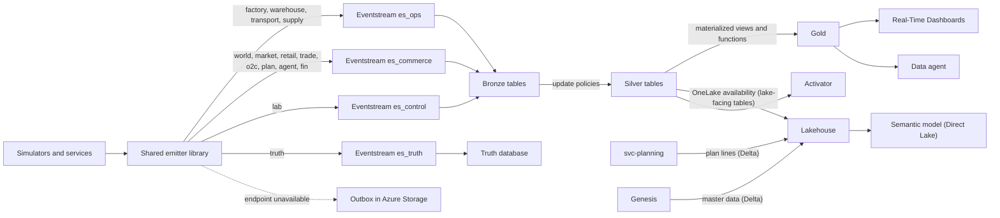

# 10 — Data model and events: what flows into Fabric

This chapter defines how events, run history and hidden truth are represented and delivered to Microsoft
Fabric. Business meaning comes from `sim_ts` (chapter 07); the sections below specify the envelope, storage,
quality rules and schema.

---

## 10.1 Principles

| # | Principle | Consequence |
|---:|---|---|
| 1 | **One envelope for everything** | Every event uses the same CloudEvents 1.0 envelope with sim time, wall time and run metadata. One bronze schema fits all |
| 2 | **Events are facts** | Events are immutable. Corrections are new events (for example `inventory.adjusted`, or a new plan version), never updates |
| 3 | **Sim time first** | `time` in the envelope is the sim time. Wall time is a separate field. Arrival order means nothing (chapter 07 §7.10) |
| 4 | **One event per business document** | An order, a receipt or a booking is one event with a `lines` array. Silver tables split the lines. This keeps event counts and costs low |
| 5 | **Every key is scoped by run** | All tables carry `run_id`, and all joins include it. Many runs and forks coexist in the same tables |
| 6 | **Deterministic and idempotent** | `event_id` and every business identifier are derived from the run, the source and a sequence. Re-sending never creates new facts |
| 7 | **Truth is separated** | Hidden truth (latent demand, machine health, supplier capacity) travels on its own stream into its own database |
| 8 | **Big batch artefacts are not streamed** | Plan lines and master data go to the Lakehouse as Delta tables. Only headers and exceptions go on the stream (chapter 06 §6.15) |
| 9 | **Everything can be regenerated** | Scenario, seed and decision log reproduce a run exactly (chapter 07 §7.11). Fabric retention can therefore stay short |

---

## 10.2 The event envelope

The envelope follows **CloudEvents 1.0** in *structured mode*: the whole envelope is the JSON body of the message,
because that is what the Eventhouse JSON mapping reads. Giandoria adds a few extension attributes. CloudEvents
extension names must be lowercase letters and digits, so the envelope names differ slightly from the column names.

| Envelope attribute | CloudEvents role | Eventhouse column | Example | Meaning |
|---|---|---|---|---|
| `specversion` | Required | — | `1.0` | CloudEvents version |
| `id` | Required | `event_id` | name-based UUID | Derived deterministically from `runid`, `source` and `seq` |
| `source` | Required | `source` | `/sim-factory/LG` | Emitting simulator or service, and its partition (plant, store cluster). Each source has its own sequence counter |
| `type` | Required | `event_type` | `mes.machine.state_changed` | Event type (§10.3) |
| `subject` | Optional | `subject` | `machine:LG-EGG1-WRP01` | Main business entity of the event |
| `time` | Optional in CloudEvents, **mandatory here** | `sim_ts` | `2031-02-12T08:17:23.412Z` | **Sim time**, UTC, millisecond precision |
| `datacontenttype` | Optional | — | `application/json` | Always JSON |
| `dataschema` | Optional | `schema` | `urn:giandoria:schema:mes.machine.state_changed:1` | Schema identifier and major version (§10.14) |
| `runid` | Extension | `run_id` | `r-0012` | Run (universe) identifier |
| `scenario` | Extension | `scenario` | `easter-2031-base` | Scenario name and version |
| `seq` | Extension | `seq` | `184523` | Contiguous sequence per run and source. Used for gap detection and watermarks (§10.12) |
| `tick` | Extension | `tick` | `6154` | Tick number in which the event happened |
| `simlocaldate` | Extension | `sim_local_date` | `2031-02-12` | Business date in Europe/Rome (avoids daylight-saving mistakes) |
| `walltime` | Extension | `wall_ts` | `2026-11-05T14:42:09.380Z` | When the emitter created the event (UTC) |
| `speed` | Extension | `speed` | `8760` | Target speed factor S in force |
| `fidelity` | Extension | `fidelity` | `L1` | Telemetry fidelity in force (factory events only, chapter 04 §4.10) |
| `visibility` | Extension | `visibility` | `enterprise` | `enterprise`, `partner`, `truth` or `lab` (§10.11) |
| `actor` | Extension | `actor` | `agent:procurement`, `engine:mrp`, `engine:reverse-time`, `rule:minmax`, `sim:factory` | Who or what caused the fact. Separates agent, engine and rule decisions in analysis |
| `correlationid` | Extension | `correlation_id` | `order:SO-2031-004512` | Business conversation or document flow (§10.5) |
| `causationid` | Extension | `causation_id` | event or decision identifier | The event or decision that directly caused this one |
| `data` | Payload | `data` (dynamic) | object | Business content (§10.6) |
| — | Added in Fabric | `ingest_ts` | — | `ingestion_time()`, stored in silver tables to measure pipeline latency |

### An example event

The example below is illustrative and shows the shape of a record. It is not code. It records a wrapper on Easter
egg line 1 jamming on a Wednesday morning in February 2031, during run `r-0012`, which started at the Easter
scenario epoch (1 June 2030).

```json
{
  "specversion": "1.0",
  "id": "8b6f2c1e-5d1a-5c3e-9a4f-2f1e7d0c9b11",
  "source": "/sim-factory/LG",
  "type": "mes.machine.state_changed",
  "subject": "machine:LG-EGG1-WRP01",
  "time": "2031-02-12T08:17:23.412Z",
  "datacontenttype": "application/json",
  "dataschema": "urn:giandoria:schema:mes.machine.state_changed:1",
  "runid": "r-0012",
  "scenario": "easter-2031-base",
  "seq": 184523,
  "tick": 6154,
  "simlocaldate": "2031-02-12",
  "walltime": "2026-11-05T14:42:09.380Z",
  "speed": 8760,
  "fidelity": "L1",
  "visibility": "enterprise",
  "actor": "sim:factory",
  "correlationid": "mo:MO-2031-LG-01822",
  "data": {
    "plant": "LG",
    "line": "LG-EGG1",
    "machine": "LG-EGG1-WRP01",
    "from_state": "running",
    "to_state": "breakdown",
    "reason_code": "FILM_JAM",
    "production_order": "MO-2031-LG-01822",
    "sku": "JR-EGG-150"
  }
}
```

The sim time (`time`) and the wall time (`walltime`) are more than four years apart. The run reached that sim moment
about 42 wall minutes after it started at S = 8,760.

### Identifier conventions

| Entity | Pattern | Examples |
|---|---|---|
| Run | `r-NNNN` | `r-0012` |
| Plant, line, machine | Plant code, then line, then machine and number | `LG`, `LG-EGG1`, `LG-EGG1-WRP01` (chapter 04 §4.3) |
| SKU | Brand, type, size and variant | `1872-GIA-250` (1872 gianduiotti 250 g), `JR-EGG-150` (Junior Easter egg 150 g), `PL-RD-TAB-100` (private-label tablet for Risparmio Discount), `CH-EGG-300` (charity egg 300 g) |
| Material | `MAT-` + group + number | `MAT-TOY-0042`, `MAT-FOIL-0107` |
| Customer, supplier | Kind, channel or category, then name (chapter 08 §8.3) | `customer:gdo:spesafacile`, `supplier:cocoa:atlantic` |
| Store, warehouse | Store number; site code (chapter 02 §2.4) | `store:BV-01`, `DC0`, `DC-S` |
| Lot | Plant, year and day of year, line and batch | `L-LG-31043-EGG1-07` |
| Documents | Type, sim year and number | `SO-2031-004512` (sales order), `PO-2031-000812` (purchase order), `MO-2031-LG-01822` (manufacturing order) |
| Plans | Plan type, scope and period (chapter 06 §6.15) | `mps-LG-2031-W06` |
| Decisions | Run, role, decision type and sim date | `dec-r-0012-procurement-toy_order_wave-2030-07-15` |

`subject` and `correlationid` use the form `{entity}:{id}`, for example `machine:LG-EGG1-WRP01`. Payload fields use
plain identifiers named after the entity: `machine`, `line`, `sku`, `customer`. Identifiers are unique **within a
run**, and a fork may reuse its parent's numbers after the fork point. That is why every join includes `run_id`.

---

## 10.3 Naming and kinds of events

**Naming rule:** `family.entity.action`, in lowercase snake_case. The family says which domain and system the
fact belongs to (chapter 08). There are three kinds of events:

| Kind | Naming | Examples | Notes |
|---|---|---|---|
| **Facts** (something happened) | Past tense | `o2c.order.confirmed`, `mes.machine.state_changed`, `qc.lot.held` | Most events |
| **Documents** (a business document was sent) | Document noun | `trade.order`, `trade.seasonal_booking`, `supply.asn`, `supply.invoice` | The partner side of a document flow (§10.5) |
| **Measurements and snapshots** (a state at a moment, or an interval) | `snapshot`, `interval`, `daily`, `tick` | `mes.telemetry.snapshot`, `energy.meter.interval`, `trade.sellout.daily`, `world.price.tick`, `wms.stock_snapshot` | Regular, high volume. Fidelity rules apply |

### The two sides of a document

Real document flows are recorded twice: once by the sender, once by the receiver. Giandoria keeps that.

* **Customer to Giandoria:** a chain's order is `trade.order` on the customer side (sim-trade, visibility `partner`)
  and `o2c.order.received` on Giandoria's side (sim-logistics, visibility `enterprise`).
* **Giandoria to supplier:** a purchase order is `proc.po.issued` on Giandoria's side and `supply.po.confirmed` on the
  supplier's side.

Both sides share the same `correlation_id`, so Fabric can:

* reconstruct each flow end to end, as a process-mining tool would
* show where documents were lost, duplicated or delayed (for example during an EDI outage, chapter 08 §8.6)



---

## 10.4 The event catalogue

Volumes are indicative for **Profile M** at telemetry fidelity L1, in events per sim day (chapter 02 §2.12). Streams
are described in §10.7.

| Family | Event types | Emitted by | Stream | Visibility | ≈ Events per sim day |
|---|---|---|---|---|---:|
| `world.*` | `calendar.day`, `weather.daily`, `price.tick`, `news.published`, `shock.started`, `shock.ended` | sim-world | commerce | enterprise (public information) | 100 |
| `market.*` | `panel.monthly`, `competitor.observed` | sim-market | commerce | enterprise | < 10 |
| `retail.*` | `pos.receipt`, `eshop.order`, `store.footfall`, `store.stock_snapshot` | sim-retail | commerce | enterprise | 5,600 |
| `trade.*` | `order`, `seasonal_booking`, `promo_agreement`, `campaign_contract`, `sellout.daily`, `inventory_report`, `return`, `payment` | sim-trade | commerce | partner | 500 |
| `o2c.*` | `order.received`, `order.confirmed`, `order.shipped`, `order.delivered`, `order.invoiced`, `return.*` | sim-logistics | commerce | enterprise | 1,500 |
| `wms.*` | `receipt.posted`, `putaway.done`, `pallet.created`, `pick.completed`, `shipment.dispatched`, `inventory.adjusted`, `stock_snapshot` | sim-logistics; sim-factory for `pallet.created` at end of line | ops | enterprise | 2,000 |
| `tms.*` | `shipment.planned`, `tendered`, `accepted`, `loaded`, `departed`, `position`, `delivered`, `pod_received`, `exception` | sim-logistics | ops | enterprise | 2,000 |
| `proc.*` | `requisition.created`, `rfq.sent`, `po.issued`, `po.changed`, `contract.signed`, `receipt.posted` | svc-planning and the procurement role | ops | enterprise | 100 |
| `supply.*` | `quote`, `capacity_notice`, `po.confirmed`, `asn`, `shipment.booked`, `loaded`, `departed`, `transhipped`, `arrived_port`, `customs_cleared`, `delivered`, `eta_updated`, `quality.certificate`, `invoice` | sim-supply | ops | partner | 100 |
| `mes.*` | `order.released`, `started`, `completed`, `cancelled`; `machine.state_changed`, `machine.counter.interval`; `telemetry.snapshot`, `sample`, `alarm`; `batch.produced`, `consumed`, `transferred` | sim-factory | ops | enterprise | 16,000 |
| `qc.*` | `sample.taken`, `result.recorded`, `lot.released`, `lot.held`, `lot.rejected`, `complaint.received` | sim-factory; sim-retail and sim-trade for complaints | ops | enterprise | 600 |
| `maint.*` | `workorder.created`, `started`, `closed`, `spare.consumed` | sim-factory | ops | enterprise | 100 |
| `energy.*` | `meter.interval` | sim-factory | ops | enterprise | 1,000 |
| `hr.*` | `shift.started`, `crew.absent`, `temp.hired` | sim-factory | ops | enterprise | 100 |
| `plan.*` | `forecast`, `delivery_outlook`, `sop`, `season`, `mps`, `schedule`, `drp`, `allocation`, `maintenance`, `workforce`, `budget` + `.published`; `mrp.completed`; `exception.raised`, `exception.closed` | svc-planning | commerce | enterprise | 20 |
| `agent.*` | `decision.requested`, `completed`, `fallback`, `escalated`, `evaluated`; `conversation.started`, `turn`, `closed`; `memory.updated` | svc-agents | commerce | enterprise | 30 |
| `fin.*` | `journal.posted`, `price_list.published`, `standard_cost.updated`, `period.closed`, `hedge.executed` | svc-finance | commerce | enterprise | 50 |
| `lab.*` | `run.*` (created, started, paused, resumed, hibernated, stopped, completed, forked); `segment.opened`, `closed`; `clock.tick`, `lagging`, `speed_changed`; `snapshot.created`; `emitter.checkpoint`; `scenario.injected`; `budget.threshold_reached`, `exhausted`; `cost.metered`, `cost.reconciled`; `action.requested`, `completed`, `failed` | Chronos, Lab Control, emitters | control | lab | 300 |
| `truth.*` | `market.latent_demand`, `market.lost_sales`, `factory.health.snapshot`, `supplier.capacity` | sim-market, sim-factory, sim-supply | truth | truth | 350 |
| **Total** | | | | | **≈ 30,000** |

Some notes on the catalogue:

* **Telemetry dominates.** `mes.*` is more than half of all events: ≈ 11,500 L1 snapshots plus state changes,
  counters, alarms, orders and batches (chapter 04 §4.10). At L0 the total drops to ≈ 20,000 events per sim day.
  Turning L2 on for a showcase line adds ≈ 58,000 rows per sim day, so L2 is only allowed at low speed.
* **New names introduced here:**
  * `trade.campaign_contract`: the charity tender award and its delivery plan (chapter 06 decision E5)
  * `supply.capacity_notice`: chapter 05 §5.14
  * `market.competitor.observed`: store checks and flyers (chapter 03 §3.10)
  * `qc.complaint.received`: consumer complaints (chapter 09 scenarios)
  * `proc.rfq.sent`, `proc.po.changed`, `truth.market.lost_sales`
  * the `fin.*` and `lab.*` details
* **Lab events use sim time too.** `lab.run.paused` carries the sim time at which the clock froze, and `walltime` says
  when it happened in reality. `lab.cost.metered` records the run's metered spending once per wall minute while it
  runs, and every 10 wall minutes while it is paused. `lab.cost.reconciled` adds the billed cost of past days
  (chapter 13 §13.6).

---

## 10.5 The in-universe message catalogue

Messages travel between actors through Chronos (chapter 08 §8.3). Each message is delivered at the next tick at the
earliest, plus a channel delay. Most messages also produce events on both sides.

| Message | From → to | Real-world equivalent | Typical channel delay | Events |
|---|---|---|---|---|
| `SalesOrder` | Customer (sim-trade, sim-retail e-shop) → order management (sim-logistics) | ORDERS | Minutes (EDI) | `trade.order`, `o2c.order.received` |
| `OrderResponse` | Seller → buyer | ORDRSP | Minutes to a day | `o2c.order.confirmed`, `supply.po.confirmed` |
| `DespatchAdvice` | Shipper → receiver | DESADV | At dispatch | `o2c.order.shipped`, `supply.asn` |
| `ReceivingAdvice` | Receiver → shipper | RECADV | Hours after delivery | `o2c.order.delivered`, `proc.receipt.posted` |
| `Invoice` | Seller → buyer | INVOIC | At dispatch or delivery | `o2c.order.invoiced`, `supply.invoice` |
| `Payment` | Buyer → seller | Remittance | Payment terms | `trade.payment`, `fin.journal.posted` |
| `SeasonalBooking` | Chain, wholesaler, export distributor → key account manager | Seasonal pre-order with delivery splits | At the end of the negotiation | `trade.seasonal_booking` (versioned) |
| `PromoAgreement` | Key account manager ↔ chain | Promotion contract | At agreement | `trade.promo_agreement` |
| `CampaignContract` | Foundation or corporate client ↔ Giandoria | Tender award, gift contract | At award | `trade.campaign_contract` |
| `ForecastShare` | Chain → Giandoria | SLSRPT (sell-out report, shared forecast) | 1 day to 1 week by chain | `trade.sellout.daily` |
| `InventoryReport` | Chain → Giandoria | INVRPT | Daily or weekly | `trade.inventory_report` |
| `ReturnRequest` | Customer → Giandoria | Return authorisation | After the season | `trade.return`, `o2c.return.*` |
| `RequestForQuotation` | Procurement → supplier | RFQ | Hours | `proc.rfq.sent` |
| `Quote` | Supplier → procurement | Quotation | Days | `supply.quote` |
| `PurchaseRequisition` | svc-planning (MRP) → procurement role | Purchase requisition | Next tick | `proc.requisition.created` |
| `PurchaseOrder` | Procurement → supplier | ORDERS (buying side) | Minutes to hours | `proc.po.issued` |
| `CapacityNotice` | Supplier → procurement | Allocation or shortage notice | Weeks ahead | `supply.capacity_notice` |
| `ProductionSchedule` | svc-planning → sim-factory | Released schedule | Next tick | `plan.schedule.published` |
| `MaintenanceOrder` | Maintenance role → sim-factory | Work order | Next tick | `maint.workorder.created` |
| `ShiftPlan` | Production planner → sim-factory | Roster, temporary-staff request | Next tick; temporary staff after 2–4 weeks | `plan.workforce.published`, `hr.temp.hired` |
| `TransferOrder` | svc-planning (DRP), store replenishment → sim-logistics | Stock transfer order | Next tick | `plan.drp.published`, `wms.*` |
| `AllocationUpdate` | svc-planning → sim-logistics | ATP and allocation tables | Next tick | `plan.allocation.published` |
| `PriceList` | Pricing role → sim-retail, sim-trade | Price list, promotion calendar | Days (chains need notice) | `fin.price_list.published` |
| `Correspondence` | Any actor ↔ any actor | Email, call, meeting | Hours to days | `agent.conversation.turn` |

Decision requests and decisions are **control messages** between Chronos and svc-agents, not in-universe messages.
Fabric sees them as `agent.decision.*` events (chapter 09 §9.10). When a decision is accepted, it is turned into the
business messages above.

---

## 10.6 Payload conventions

| Topic | Rule |
|---|---|
| Field names | snake_case; units in the name when it helps (`temp_c`, `duration_s`) |
| Quantities | `qty` plus `uom` (`EA` pieces, `CS` cases, `PAL` pallets, `KG`, `T`). Conversions come from master data |
| Money in the universe | Euro, net of VAT unless the field ends in `_gross`. `currency` appears only for export prices and commodities in USD |
| Money of the lab | Cloud and LLM costs in `lab.*` and `agent.*` events use the billing currency (`cost_usd`), never mixed with in-universe euros |
| Times in payloads | Sim time, UTC, suffix `_ts` (`promised_ts`, `eta_ts`). Local business dates use the suffix `_date`. Payloads never contain wall time |
| Documents | One event per document with a `lines` array (`line_no`, `sku`, `qty`, …). Revisions carry `version` and `parent_version` |
| References | Plain identifiers. Master data stays in master data: payloads carry only the identifiers that are needed and are never denormalised |
| Enumerations | Defined in the schemas: machine states, reason codes, order types, lot statuses |
| Size | Target < 64 KB per event (the transport limit is about 1 MB per message, verify). Large snapshots, such as DC0 stock, are split into parts (`part`, `parts`) |
| Personal data | None. Consumers are synthetic and aggregated. A receipt can carry a synthetic loyalty segment, never a person |

### Core payload fields of key events

| Event | Core payload fields |
|---|---|
| `mes.machine.state_changed` | `plant`, `line`, `machine`, `from_state`, `to_state`, `reason_code`, `production_order`, `sku` |
| `mes.machine.counter.interval` | `line`, `window_start_ts`, `window_end_ts`, `good_qty`, `reject_qty`, `uom`, `planned_time_s`, `run_time_s`, `state_durations` |
| `mes.telemetry.snapshot` | `machine`, `window_start_ts`, `window_end_ts`, `tags` (`tag`, `min`, `avg`, `max`, `last`, `uom`) |
| `mes.batch.produced` / `consumed` | `lot`, `item`, `qty`, `uom`, `inputs` (lots and quantities), `production_order`, `best_before_date` |
| `retail.pos.receipt` | `store`, `receipt_id`, `lines` (`sku`, `qty`, `unit_price`, `discount`), `total`, `payment_type`, `loyalty_segment` |
| `trade.order` / `o2c.order.received` | `order_id`, `customer`, `ship_to`, `order_type`, `requested_delivery_date`, `lines` (`line_no`, `sku`, `qty`, `uom`) |
| `o2c.order.confirmed` | `order_id`, `lines` (`line_no`, `promised_qty`, `promised_ts`, `allocation_rule`, `shortfall_reason`) |
| `trade.seasonal_booking` | `booking_id`, `customer`, `season`, `version`, `lines` (`sku`, `delivery_week`, `qty`), `return_terms` |
| `wms.stock_snapshot` | `location`, `part`, `parts`, `items` (`item`, `lot`, `status`, `qty`, `uom`, `best_before_date`) |
| `tms.shipment.position` | `shipment`, `vehicle`, `lat`, `lon`, `speed_kmh`, `temp_c` (temperature-controlled trucks) |
| `supply.shipment.eta_updated` | `shipment`, `po`, `material`, `eta_ts`, `previous_eta_ts`, `reason` |
| `plan.*.published` | The plan header of chapter 06 §6.15 |
| `agent.decision.completed` | `decision_id`, `role`, `decision_type`, `output`, `rationale`, `confidence`, `model`, `prompt_version`, `tokens_in`, `tokens_out`, `cost_usd`, `latency_ms` |
| `lab.clock.tick` | `tick`, `sim_from_ts`, `sim_to_ts`, `speed_target`, `speed_effective`, `lag_ms` |
| `truth.market.latent_demand` | `province`, `date`, `cells` (`segment`, `category`, `units`) |

---

## 10.7 From the emitter to Fabric: streams and ingestion



### The four Eventstreams

| Eventstream | Families | Volume at S = 8,760 (Profile M) | Destination | Why separate |
|---|---|---|---|---|
| `es_ops` | `mes`, `qc`, `maint`, `energy`, `hr`, `wms`, `tms`, `proc`, `supply` | ≈ 22,000 events per sim day ≈ **2,200 events/s** | `bronze_ops` | Highest volume. Telemetry sources can be paused on their own |
| `es_commerce` | `world`, `market`, `retail`, `trade`, `o2c`, `plan`, `agent`, `fin` | ≈ 7,800 per sim day ≈ **800 events/s** | `bronze_commerce` | Business flows; most dashboards and Activator rules |
| `es_control` | `lab` | ≈ 300 per sim day ≈ 30 events/s | `bronze_control` | Clock, ledger, budgets and checkpoints must arrive even when other streams are paused |
| `es_truth` | `truth` | ≈ 350 per sim day ≈ 35 events/s | `bronze_truth` in the truth database | Separation and access control (§10.11) |

An optional fifth Eventstream, `es_capacity`, carries the Fabric capacity's own utilization events into the table
`CapacityUsage`. Those events carry wall time, not sim time, and serve cost control only (chapter 13 §13.6).

Each Eventstream has one **custom endpoint source**. The emitter uses the Event Hubs protocol (or Kafka) with
Microsoft Entra authentication through the container's managed identity [F15][F16]. The partition key is the event
`source`, which keeps each source's events in order within a partition. Business logic still never relies on
arrival order.

### Rules for the ingestion path

1. **Direct ingestion.** Each Eventstream sends events unchanged to its Eventhouse table [F29]. There are no
   windowed operators in the Eventstream, and **never `TIMESTAMP BY` on sim time**: the Stream Analytics time
   policies would drop or reorder accelerated events (chapter 07 §7.10) [F18][F19]. Typing, splitting and aggregation
   happen in the Eventhouse, on `sim_ts`.
2. **Ingestion latency matters more than usual.** Queued ingestion with the default batching waits up to 5 minutes
   [F30]. At S = 8,760 that is **about 30 sim days** of delay on dashboards. The bronze tables therefore use:
   * **streaming ingestion**, which an Eventhouse turns on for every table by default [F67], or
   * a batching policy of **10–30 s**, which means 1–3 sim days at S = 8,760 and 2–6 sim hours at S = 730.

   Two facts shape the choice. Microsoft suggests queued ingestion when one table receives more than about 4 GB per
   hour [F81], and at S = 8,760 Profile M sends ≈ 7–11 GB per hour into the bronze tables. With streaming, an update
   policy can read only the newly ingested rows, and a policy with a `join` needs streaming turned off on every
   upstream table [F67][F81]. The expansion functions only filter and project, so they work on both paths.
   The real end-to-end latency is measured in the phase-0 spike (chapter 14). The setting is decision D10
   (chapter 15).
3. **Throughput tier.** Profile M produces ≈ 2–3 MB/s at S = 8,760, well inside the Eventstream *low* tier
   (< 10 MB/s). Profile L (≈ 9–15 MB/s) needs the *medium* tier [F14].
4. **Backpressure, not loss.** When the endpoint throttles or is unavailable (for example, the capacity was suspended
   by a budget guard), the emitter writes batches to an **outbox in Azure Storage** and signals Chronos to slow down
   or pause. On resume, the outbox is drained before the clock restarts (chapter 13).

### Ingestion path options (decision D6, chapter 15)

| Option | Path | Advantages | Drawbacks |
|---|---|---|---|
| **A — Direct (default)** | Emitter → Eventstream custom endpoint → Eventhouse | Fewest resources; native Real-Time hub experience; Entra authentication | Availability tied to the Fabric capacity; the outbox covers outages |
| B — Event Hubs buffer | Emitter → Azure Event Hubs (Standard) → Eventstream → Eventhouse | Durable buffer independent of the capacity; other consumers can read the same events | One more resource (≈ $0.03 per throughput unit per hour [F58]) and more moving parts |
| C — Straight to Eventhouse | Emitter → Eventhouse ingestion endpoint | Lowest latency, no Eventstream meters | Loses Eventstream routing and stream-level Activator rules; more custom code |

### Backfill (deployment mode C)

Backfill runs unpaced (chapter 08 §8.8). Instead of streaming, it writes the **same envelopes** as compressed
JSON-lines files to `Files/backfill/{run_id}/{stream}/` in the Lakehouse. A bulk ingestion job then loads them into
the same bronze tables, so the update policies and views behave exactly as in live runs. Retention is based on
ingestion time [F31], so backfilled history from "two sim years ago" is not deleted early.

---

## 10.8 The Eventhouse: bronze, silver, gold

One Eventhouse, `eh_giandoria`, holds two KQL databases:

| Database | Content | Access |
|---|---|---|
| `kqldb_giandoria` | Bronze, silver and gold for `enterprise`, `partner` and `lab` events | Lab team; reports; data agent |
| `kqldb_truth` | Truth events and evaluation views | Evaluation only (§10.11) |

### Bronze

The three bronze tables (`bronze_ops`, `bronze_commerce`, `bronze_control`) and `bronze_truth` share **one schema**,
the envelope of §10.2:

`event_id`, `event_type`, `source`, `subject`, `sim_ts`, `sim_local_date`, `wall_ts`, `run_id`, `scenario`, `seq`,
`tick`, `speed`, `fidelity`, `visibility`, `actor`, `correlation_id`, `causation_id`, `schema`, `data`.

Bronze is raw and short-lived. It is the input of the update policies and the source for re-processing.

### Silver (typed tables, filled by update policies)

Every silver table carries the common columns `run_id`, `sim_ts`, `sim_local_date`, `event_id`, `seq`, `source`,
`actor`, `correlation_id` and `ingest_ts`, plus typed business columns. Documents are split into one row per line.

| Domain | Silver tables (grain) |
|---|---|
| Factory | `MachineStateChange` (transition), `LineCounter` (line × 15 sim min), `TelemetrySnapshot` (machine × tag × 15 sim min), `TelemetrySample` (tag × sim minute, L2 only), `Alarm` (alarm), `ProductionOrderEvent` (order × status), `BatchGenealogy` (input lot → output lot), `QualityResult` (sample × test), `LotStatus` (lot × status change), `Complaint`, `WorkOrder` (work order × status), `EnergyInterval` (meter × 15 sim min), `ShiftEvent` |
| Own retail | `PosReceiptLine` (receipt line), `EshopOrderLine`, `StoreFootfall` (store × sim hour), `StoreStock` (store × SKU × day) |
| Trade and order-to-cash | `CustomerOrderLine` (order line × version; customer and enterprise side), `OrderLineStatus` (order line × status), `SeasonalBookingLine` (booking × SKU × week × version), `PromoAgreement`, `CampaignContract`, `SellOut` (chain × region × SKU × day), `CustomerInventory`, `ReturnLine`, `Payment` |
| Supply and logistics | `PurchaseOrderLine` (both sides), `Requisition`, `InboundShipmentEvent` (milestone and ETA updates), `WarehouseMovement`, `StockSnapshot` (location × item × lot × status × day), `OutboundShipmentEvent`, `ShipmentPosition` (for maps) |
| World and market | `CalendarDay`, `Weather` (region × day), `PriceTick` (index × time), `News`, `Shock`, `MarketPanel`, `CompetitorObservation` |
| Planning, agents and finance | `PlanHeader` (plan version), `PlanException`, `AgentDecision` (decision × step), `AgentConversationTurn`, `FinPosting`, `PriceList` |
| Lab | `ClockTick`, `TimeLedger` (segment), `RunRegistry` (run × state change), `EmitterCheckpoint`, `LabAction`, `BudgetEvent`, `CostMeter` (run × wall minute, metered; environment × day, billed), `ScenarioInjection`; optional `CapacityUsage` (chapter 13 §13.6) |
| Truth (`kqldb_truth`) | `LatentDemand` (province × segment × category × day), `LostSales` (location × SKU × day × cause), `MachineHealth` (machine × day), `SupplierCapacity` (supplier × material × week) |

### Gold (materialized views and stored functions)

| Gold object | Kind | Purpose |
|---|---|---|
| `MachineStateLatest` | Materialized view (latest per run and machine) | Live factory map and line status |
| `LineHourly` | Materialized view (line × sim hour) | Output, rejects, run time, stop time. Base for OEE |
| `SellOutDaily`, `SellInDaily` | Materialized views (day × channel × province × SKU) | Sales dashboards; sell-in vs sell-out |
| `OrderLineLatest` | Materialized view (latest status per order line) | OTIF, fill rate, backlog |
| `StockLatest` | Materialized view (latest per location × item × status) | Stock, days of cover, pre-build peak |
| `InboundLatest` | Materialized view (latest ETA per inbound shipment) | ETA drift, shortage risk |
| `PlanLatest` | Materialized view (latest version per plan type and scope) | Current plans in dashboards |
| `PriceDaily`, `WeatherDaily` | Materialized views | Context for analysis |
| `AgentDecisionDaily` | Materialized view (role × day) | Decisions, fallbacks, tokens, cost |
| `SimNow(run)`, `SimAgo(run, span)`, `SimWindow(run, span)` | Functions | The sim "now", taken from the last `ClockTick` (chapter 07 §7.10) |
| `RunLineage(run)`, `RunEvents(run, family)` | Functions | Fork-aware history: the parent's events before the fork point, then the run's own events (§10.10) |
| `Watermark(run, source)` | Function | Sim time up to which a source's data is complete (§10.12) |
| `Oee(run, line, from, to)`, `Otif(run, from, to)`, `Genealogy(run, lot)` | Functions | Standard KPIs and traceability (forward and backward) |
| `ForecastAccuracy(run, lag)` | Function | Joins plan lines (Lakehouse, through a OneLake shortcut) with actuals; also available in the semantic model |

### Table policies

| Policy | Default | Notes |
|---|---|---|
| Ingestion | Streaming, or batching at 10–30 s on bronze | §10.7 [F30][F67] |
| Update policies | One per silver table; transactional, so bronze and silver never diverge *(verify in the spike)* | They filter by `event_type` and project typed columns |
| Retention (wall time) | Bronze 30 days; silver 180 days; gold 2 years; truth 180 days | Retention follows ingestion time, not sim time [F31]. Runs can be regenerated by replay |
| Caching (hot) | Bronze 3 days; silver 30 days; gold 90 days | Smaller hot cache means lower storage cost |
| Partitioning | Hash on `run_id` for large silver tables (optional) | Useful when many runs and forks coexist |
| OneLake availability | **Lake-facing silver tables and the truth tables only** (see below) | A table policy (mirroring policy): materialized views cannot be exposed this way, so gold views stay in KQL. It blocks renames, deletes and purges on the table. The OneLake copy follows the table's retention and adds no storage cost [F28][F71] |

**Lake-facing silver tables.** Power BI reads the Eventhouse through OneLake, as Delta tables. Only the facts that the
analytical reports need are exposed. Examples:

* `SellOut`, `CustomerOrderLine`, `OrderLineStatus`, `SeasonalBookingLine`
* `StockSnapshot`, `LineCounter`, `ProductionOrderEvent`, `InboundShipmentEvent`
* `PlanHeader`, `PlanException`, `AgentDecision`, `FinPosting`
* `PriceTick`, `Weather`, `RunRegistry`, `TimeLedger`, `CostMeter`

Two details matter:

* **Write delay.** OneLake availability writes in batches. The default delay is up to 3 hours, and it can be lowered
  to 5 minutes [F28]. At S = 8,760, 5 wall minutes are about 30 sim days. Power BI over OneLake is therefore for
  **retrospective analysis** (S&OP packs, season reviews, forecast accuracy, run comparisons). Live views use KQL:
  Real-Time Dashboards, Activator and the gold views.
* **Truth stays out of the main lake.** The four truth tables also get OneLake availability, but only so that the
  evaluation model can read them without credentials to manage. Their shortcuts live in a separate Lakehouse,
  `lh_evaluation`, which only the evaluation semantic model `sm_evaluation` uses. Nothing in `lh_giandoria` or
  `sm_giandoria` points to truth (chapter 12).

**Keeping a showcase run.** OneLake availability does not outlive retention, so a run worth keeping is archived by
copying its lake-facing tables and gold views to Lakehouse Delta tables (`Files/archive/{run_id}/` or `archive_*`
tables).

---

## 10.9 The Lakehouse: master data, plan lines and history

`lh_giandoria` holds everything that is batch-shaped:

| Area | Tables or folders | Written by | Notes |
|---|---|---|---|
| Master data | `dim_brand`, `dim_product_family`, `dim_sku`, `dim_material`, `dim_bom_line`, `dim_routing_step`, `dim_plant`, `dim_line`, `dim_machine`, `dim_tag`, `dim_supplier`, `dim_supply_lane`, `dim_warehouse`, `dim_store`, `dim_customer`, `dim_customer_site`, `dim_agreement`, `dim_campaign`, `dim_region`, `dim_province`, `dim_segment`, `dim_competitor`, `dim_agent_role`, `dim_persona` | Genesis job (chapter 14) | Versioned with `md_version`. Each run records the version it started from (chapter 02 §2.13) |
| Sim calendar | `sim_calendar` | Genesis job | One row per sim date: holidays, Easter and Carnival dates, seasons, school terms, ISO week. Flags such as `is_current_sim_week` are computed in the semantic model from `SimNow` |
| Plan lines | `plan_lines` | svc-planning | Append-only. Partitioned by `run_id` and `plan_type`. Common core columns (plan, version, item, location, customer, bucket, quantity, P10/P50/P90) plus an attributes column. Per-type views on top (chapter 06 §6.15). Lines from reverse-time simulation add the latest and earliest start and finish, the slack in hours, the resource and the pegged order to the attributes (chapter 17 §17.8) |
| Eventhouse shortcuts | Shortcuts to the lake-facing silver tables of `kqldb_giandoria` (§10.8) | Provisioning (chapter 12) | Gives Direct Lake access to Eventhouse facts without copies |
| Backfill | `Files/backfill/{run_id}/{stream}/` | Backfill job | Same envelopes as live (§10.7) |
| Archives | `Files/archive/{run_id}/`, `archive_*` tables | Archive job | Kept runs |

* **Writing from outside Fabric.** svc-planning writes Delta files through OneLake's ADLS-compatible endpoint with a
  managed identity. A periodic table-maintenance job compacts small files: weekly in wall time, or at hibernate.
* **The evaluation Lakehouse.** A second, small Lakehouse, `lh_evaluation`, holds only the shortcuts to the four truth
  tables (§10.8). It keeps truth out of `lh_giandoria` and can move to an evaluation workspace in the strict option
  (§10.11).
* **Optional SQL database.** A Fabric SQL database [F39] can hold an ERP-like relational copy, for example open
  orders and stock, if a demo needs transactional queries or an app. It is not required by the design (decision D12,
  chapter 15).

---

## 10.10 Runs, forks and the multiverse in the data

`RunRegistry` (from `lab.run.*` events) describes every universe:

| Field | Meaning |
|---|---|
| `run_id`, `scenario`, `seed`, `epoch`, `horizon_end` | Identity and scope |
| `profile`, `md_version` | Universe size and master-data version |
| `mode` | `live`, `replay` or `backfill` |
| `parent_run_id`, `fork_sim_ts` | Fork lineage (empty for root runs) |
| `replay_of`, `substituted_roles` | Replay source, and the roles re-decided in a replay with substitution (chapter 09 §9.4) |
| `agent_config` | Roster, models and prompt versions |
| `status`, `keep` | Current state; whether to archive |

**Forks share history.** A fork does not copy its parent's events. `RunEvents(run, family)` returns the parent's
events up to `fork_sim_ts` and the fork's own events after it. Each source's `seq` continues from the snapshot, so
completeness checks still work across the fork.

**Comparing universes** is one query: same scenario, different `run_id`. Typical uses:

* LLM planner vs rule-based planner
* a cocoa shock vs no shock
* model A vs model B

---

## 10.11 Truth, visibility and access

| Visibility | Meaning | Examples | Who may see it |
|---|---|---|---|
| `enterprise` | What Giandoria's own systems record (MES, WMS, ERP, POS, plans, decisions) | `mes.*`, `o2c.*`, `plan.*` | Everyone; agents through `observe` and their role |
| `partner` | What customers', suppliers' and carriers' systems record | `trade.*`, `supply.*` | Analysts ("god view"). Agents see only what partners send them as messages |
| `truth` | The hidden state of nature | `truth.*` | Evaluation only: forecast error vs latent demand, lost sales, decision value |
| `lab` | The laboratory itself | `lab.*` | Lab operators; cost and lag dashboards |

* **The company view vs the god view.** Dashboards about the company filter `visibility = enterprise`. The god view
  adds `partner` and, in evaluation reports, `truth`.
* **Agents never query Fabric for truth.** By default they do not query Fabric at all (chapter 09 §9.9). In the
  optional Fabric-in-the-loop mode, the data agent is configured only on enterprise tables.
* **How strict the isolation is** is a choice (decision D8, chapter 15):
  * *Default:* truth sits in its own KQL database, `kqldb_truth`, and is used only by evaluation reports.
  * *Strict:* truth sits in a separate workspace that only evaluators can open, together with `lh_evaluation`,
    `sm_evaluation` and the evaluation reports. Workspace members can see every item in a workspace.

---

## 10.12 Data quality and completeness

| Check | How | Output |
|---|---|---|
| **Completeness (watermark)** | At the end of every tick, each emitter sends `lab.emitter.checkpoint` (source, stream, last `seq`, tick end). A source is complete up to that tick when all its sequence numbers up to `last seq` are present | `Watermark(run, source)`; dashboard "data complete up to …" next to `SimNow` |
| Gaps | Missing `seq` values per run and source | Data-quality table; alert |
| Duplicates | Repeated `event_id` (emitter retries) | Counted. Gold views are keyed by business key and are not affected |
| Schema errors | The emitter validates before sending; rejects are counted in its metrics | Application Insights |
| Pipeline latency | `ingest_ts − wall_ts` per stream, also shown in sim time (× S) | Lab dashboard (chapter 07 §7.9) |
| Clock health | `speed_effective` vs `speed_target`; `lab.clock.lagging` | Lab dashboard; optional fidelity downgrade |
| Business sanity | Negative stock, shipments without orders, lots without genealogy | Daily checks in KQL; exceptions listed |

The **data barrier** of the Fabric-in-the-loop mode (chapter 07 §7.9) uses `Watermark`: Chronos waits until every
relevant source is complete up to the decision cut-off.

---

## 10.13 Volumes and sizing

Rate in events per second = events per sim day × S ÷ 86,400. Event sizes are ≈ 0.6–1 KB of JSON *(estimate)*.

| Profile | Events per sim day | Events per sim year | Events/s at S = 8,760 | JSON per sim year | MB/s at S = 8,760 | Eventstream tier |
|---|---:|---:|---:|---:|---:|---|
| S | ≈ 5,000 | ≈ 1.8 M | ≈ 500 | ≈ 1–2 GB | ≈ 0.3–0.5 | Low |
| **M** | **≈ 30,000** | **≈ 11 M** | **≈ 3,000** | **≈ 7–11 GB** | **≈ 2–3** | **Low** |
| L | ≈ 150,000 | ≈ 55 M | ≈ 15,000 | ≈ 33–55 GB | ≈ 9–15 | Medium |

* **At lower speeds the rates fall proportionally.** Profile M at S = 730 is ≈ 250 events/s.
* **Compressed size in the Eventhouse** is typically 5–10 times smaller than JSON *(estimate)*: ≈ 1–2 GB per sim year
  for Profile M.
* **Plan lines** add ≈ 5 M rows per sim year in the Lakehouse (chapter 06 §6.15).
* **L2 telemetry** adds ≈ 58,000 rows per showcase line per sim day (chapter 04 §4.10), only at S ≤ 168.
* **Costs** (Eventstream data traffic, Eventhouse uptime, storage) are estimated in chapter 13.

---

## 10.14 Schema management and versioning

| Topic | Rule |
|---|---|
| Source of truth | One JSON Schema per event type and major version, kept in the repository next to the message schemas |
| Reference | `dataschema` = `urn:giandoria:schema:{type}:{major}` |
| Compatible changes | New optional fields only, within the same major version |
| Breaking changes | A new major version. During the transition the silver update policy reads both versions |
| Validation | The emitter validates before sending. Contract tests in CI validate every simulator's sample events |
| Documentation | The event catalogue (§10.4) is generated from the schemas once implementation starts |
| Fabric registration (optional) | Schemas can also be registered in Fabric for discovery in the Real-Time hub *(preview at the time of writing, verify)* |

---

## 10.15 Where everything lives

| Data | Store | Why |
|---|---|---|
| Domain events: bronze, silver, gold | Eventhouse `eh_giandoria` → `kqldb_giandoria` | Real-time analytics, time series, KQL |
| Truth events | Eventhouse → `kqldb_truth`; shortcuts in `lh_evaluation` for the evaluation model | Separation of truth |
| Master data and sim calendar | Lakehouse `lh_giandoria` (Delta) | Reference data for Power BI, notebooks and the ontology (chapter 11) |
| Plan lines | Lakehouse (Delta) | Large batch artefacts |
| Facts for Power BI | Lake-facing silver tables with OneLake availability, as shortcuts in the Lakehouse | Direct Lake without copies, for retrospective analysis |
| Live aggregates | Gold materialized views and functions in `kqldb_giandoria` | Dashboards, Activator and the data agent need sim-time freshness |
| Backfill files and archives | Lakehouse Files | Bulk history and kept runs |
| Lab state: run registry (master copy), time ledger, snapshots, agent memory, full decision log, outbox, command queues | Azure Storage (Blob, Table and Queue) | Must stay readable and writable while the Fabric capacity is suspended |
| Lab traces and metrics | Application Insights | Operations of the lab, not of the universe |
| Secrets | None: managed identities everywhere. Key Vault only if a key-based endpoint cannot be avoided | Security and simplicity |

---

## 10.16 Deliberate simplifications

* JSON everywhere. Avro or Protobuf would be smaller, but JSON is readable and natively mapped by the Eventhouse.
* No exactly-once guarantee end to end. Delivery is at least once, with deterministic identifiers and duplicate
  monitoring.
* One bronze schema for all events. Typing happens only in silver.
* No change-data-capture of simulator state. State is visible through events and snapshots only.
* No real personal data. Consumers are synthetic and aggregated.
