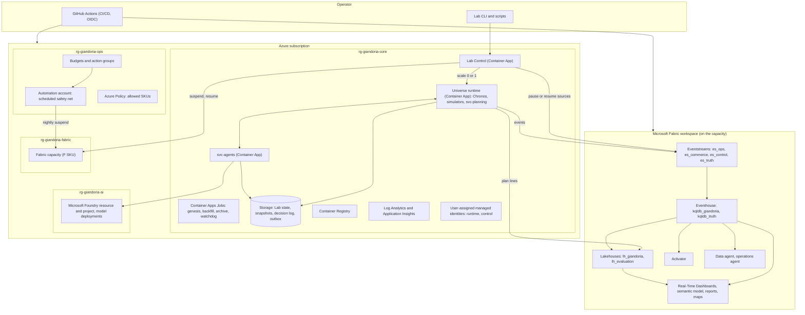
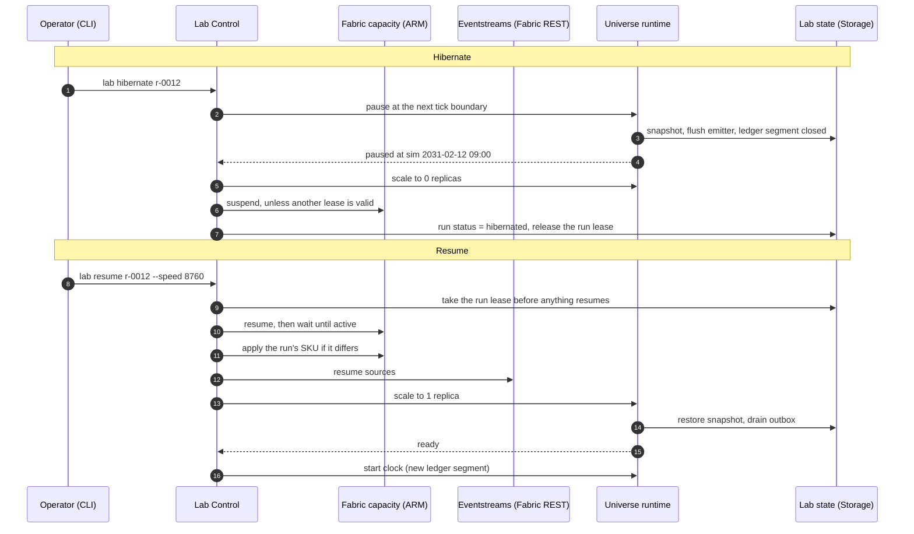

# 11 — Azure and Fabric architecture

This chapter shows how Azure resources and Fabric items fit together, how identities connect them, and how
the control plane operates the universe. Chapter 12 inventories what must be created; chapter 13 covers costs
and runbooks.

---

## 11.1 The big picture

The architecture has three planes:

| Plane | What it contains | Clock |
|---|---|---|
| **Universe plane** | Chronos, simulators, svc-planning, svc-agents and Foundry models | Sim time |
| **Data plane** | Eventstreams, Eventhouse, Lakehouse, dashboards, reports, Activator, data agents | Stores sim time, runs on wall time |
| **Control plane** | Lab Control, CLI, CI/CD, budgets, policy, safety-net automation | Wall time |

---

## 11.2 Azure resources

### Resource groups

| Resource group | Content | Why separate |
|---|---|---|
| `rg-giandoria-core-{env}` | Container Apps environment and apps, Container Apps Jobs, Container Registry, Storage account, Log Analytics and Application Insights, user-assigned managed identities (runtime and control) | The universe runtime and its state |
| `rg-giandoria-ai-{env}` | Microsoft Foundry resource and project, model deployments | Separate quotas, region and permissions for models |
| `rg-giandoria-fabric-{env}` | Fabric capacity | The most expensive resource. It gets its own budget, policy and operator role |
| `rg-giandoria-ops-{env}` | Automation account, action group, retained exports. Budgets and policy assignments are created next to it | Guardrails and retained data survive application rebuilds; no Terraform state |

### Compute: Azure Container Apps

| Component | Container App or Job | Scaling | Notes |
|---|---|---|---|
| **Lab Control** | App with an HTTP API | 0 to 1 replica on HTTP requests | Small. Holds no state; reads and writes Lab state in Storage |
| **Universe runtime** (deployment mode A, chapter 08 §8.8) | App | **Lab Control sets it to 1 replica** on start or resume and **to 0** on hibernate | Chronos, all simulators and svc-planning in one process. Indicative size for Profile M at S = 8,760: 2–4 vCPU, 4–8 GiB *(to measure)* |
| **svc-agents** | App | 0 to N replicas, with concurrency limits | Separate from the universe so that slow LLM calls never block a tick |
| Genesis | Job (manual trigger) | Runs once per master-data version | Creates master data, the sim calendar and the Lakehouse tables |
| Backfill | Job (manual trigger) | Runs unpaced until done | Deployment mode C; writes files to OneLake (chapter 10 §10.7) |
| Archive and maintenance | Job (scheduled) | Weekly in wall time, and at the hibernate of a kept run | Copies kept runs to archive tables; compacts plan-line Delta files; cleans up old runs that are not kept (chapter 13, OP-08) |
| Watchdog | Job (scheduled, every 10 wall minutes) | Short runs | Idle timer, lease and capacity checks, scale to zero, metering outside runs, daily cost reconciliation (chapter 13) |

Container Apps scale to zero, and Jobs are billed only while they run [F55][F56][F57]. **Deployment mode B**
(distributed) adds one app per simulator inside the same environment. The step contract does not change.

### State, images and observability

| Resource | Use |
|---|---|
| **Storage account** (Blob, Table and Queue) | The Lab state: run registry master copy, time ledger, leases, snapshots, agent memory, full decision log, emitter outbox, scenario files, and the command queues of Lab Control. It stays readable and writable **while the Fabric capacity is suspended**, which is why the Lab state does not live in OneLake |
| **Container Registry** (Basic) | Images for all apps and jobs |
| **Log Analytics and Application Insights** | Traces and metrics of the lab: tick durations, lag, emitter throughput, LLM latency and tokens. It is not used for universe data |

### Models: Microsoft Foundry

| Resource | Configuration |
|---|---|
| Foundry resource and project [F49] | In a region that offers the chosen models as Global Standard deployments (it can differ from the Fabric region) |
| Model deployments | Medium tier (for example gpt-5-mini) as the default; small tier (gpt-5-nano) for texture roles; optional large tier (chapter 09 §9.7) |
| Quotas | Tokens per minute sized for the weekly decision peak: ≥ 300k TPM at S = 8,760 (chapter 09 §9.7) |
| Access | Managed identity with the *Foundry User* role [F85]. Local keys disabled |
| Content safety | Default content filters on |

The Foundry Agent Service [F50] is not needed for the in-universe loop. svc-agents runs Microsoft Agent Framework
in-process [F51]. The Agent Service becomes useful if lab agents are exposed to people (chapter 09 §9.9).

### Guardrail resources

The guardrails are created by the **bootstrap** (chapter 12), not by CI/CD. The deploy identity cannot change or
remove them, so a faulty pipeline cannot raise the SKU cap or switch off the safety net.

| Resource | Role |
|---|---|
| **Budgets with action groups** | Monthly budgets on the subscription and on the Fabric resource group, both created at subscription scope so that CI cannot change them. Above a threshold they call the safety-net runbook [F11][F12]. Cost data lags 8–24 hours, so this is the **last** line of defence, not the first (chapter 13) |
| **Automation account** | Runs the safety-net runbook: suspend the capacity and scale the universe to zero. It runs on a nightly schedule and on budget alerts. It finds its targets by tag (`project = giandoria`), so it does not depend on names deployed later. Microsoft publishes a Fabric pause and resume runbook in the gallery [F7] |
| **Azure Policy** | Denies Fabric capacity SKUs above an allowed maximum (for example F32) and enforces tags such as `project`, `env`, `owner` and `cost-center` |

---

## 11.3 Fabric items

| Item | Name | Purpose | Status at the time of writing |
|---|---|---|---|
| Capacity | `fcgiandoria{env}` (an Azure resource) | Compute for all Fabric items | GA |
| Workspace | `ws-giandoria-{env}` | Container for all items, assigned to the capacity | GA |
| Eventstreams (4) | `es_ops`, `es_commerce`, `es_control`, `es_truth` | Custom endpoint sources with direct ingestion into the Eventhouse (chapter 10 §10.7) | GA |
| Eventhouse | `eh_giandoria` | Hosts the KQL databases | GA |
| KQL databases (2) | `kqldb_giandoria`, `kqldb_truth` | Bronze, silver and gold; truth (chapter 10 §10.8) | GA |
| Lakehouse | `lh_giandoria` | Master data, sim calendar, plan lines, shortcuts to Eventhouse tables, backfill and archives (chapter 10 §10.9) | GA |
| Lakehouse (evaluation) | `lh_evaluation` | Only the shortcuts to the four truth tables (chapter 10 §10.8) | GA |
| Semantic models | `sm_giandoria`, `sm_evaluation` | Direct Lake models. `sm_giandoria` reads `lh_giandoria`: master data, plan lines and the shortcuts to the lake-facing silver tables (chapter 10 §10.8). `sm_evaluation` adds the truth shortcuts for evaluation reports | GA |
| Real-Time Dashboards | `rtd_lab`, `rtd_factory`, `rtd_commerce`, `rtd_supply`, `rtd_planning` | Live views on sim time (§11.6) | GA *(inferred)* [F40] |
| Power BI reports | `rpt_sop`, `rpt_season_review`, `rpt_forecast_accuracy`, `rpt_multiverse` | Analytical views | GA |
| Activator | `act_operations`, `act_lab` | Business rules and lab alerts (§11.6) | GA [F23] |
| Data agent | `da_giandoria` | Questions in natural language over gold and the Lakehouse | GA [F36] |
| Map | `map_giandoria` | Stores, warehouses, shipments and provinces | Verify [F33] |
| Operations agent (optional) | `oa_lab` | Watches lab KPIs and recommends actions | Verify [F66] |
| Ontology or digital twin builder (optional) | `ont_giandoria` | Business model of plants, lines, machines, products and customers, bound to Lakehouse and Eventhouse tables | Preview [F32][F35] |
| Plan item (optional) | `plan_giandoria` | Human-in-the-loop planning with write-back (chapter 06 §6.13) | Preview [F65] |
| Notebooks (few) | `nb_*` | Ad-hoc analysis and table maintenance. Simulation code does not run here | GA |

*(inferred)* means that the documentation shows no preview label but does not state general availability either
(chapter 16 §16.5). Such items are checked again before the phase that uses them (chapter 14 §14.3).

Item definitions and create/update API coverage must be checked individually [F62][F44]. D7 uses `fabric-cicd`
where supported and targeted REST where necessary; optional unsupported items remain deferred. Two examples:

* The KQL database definition carries its schema script: tables, mappings, policies, functions and materialized views.
* The Eventstream definition carries its topology: sources and destinations.

### Workspace topology

| Option | Description | When |
|---|---|---|
| **One workspace per environment** (default) | Everything in `ws-giandoria-{env}` | Lab, demos, a single team |
| Two workspaces | Add `ws-giandoria-eval-{env}` for truth and evaluation | Strict truth isolation in front of an audience (chapter 10 §10.11) |
| Three workspaces | Data, analytics and evaluation separated | Larger teams; more governance |

This is decision D8 in chapter 15.

---

## 11.4 Identity and permissions

There are **no keys and no secrets** in the steady state. Every component authenticates with Microsoft Entra ID.

| Identity | Kind | Used by | Azure permissions | Fabric permissions |
|---|---|---|---|---|
| `id-giandoria-runtime` | User-assigned managed identity | Universe runtime, svc-agents, jobs | Storage Blob, Table and Queue Data Contributor (Lab state); AcrPull; Foundry User (Foundry) [F85]; Monitoring Metrics Publisher (telemetry) | Workspace **Contributor**: send to Eventstream custom endpoints [F15], write Delta to OneLake, read KQL for watermarks |
| `id-giandoria-control` | User-assigned managed identity | Lab Control, watchdog | Storage Blob, Table and Queue Data Contributor (Lab state); AcrPull; Monitoring Metrics Publisher; custom role **Giandoria Lab Operator**: read, suspend and resume the capacity and change its SKU within policy; update the universe Container App; start jobs; **Cost Management Reader** on the core, AI, Fabric and ops resource groups (daily cost reconciliation, chapter 13 §13.6) | Workspace Contributor: pause and resume Eventstream sources [F17]; read KQL |
| `sp-giandoria-deploy` | Entra application with GitHub OIDC | CI/CD | Contributor on core, AI and Fabric resource groups; AcrPush; required state/lease data roles in core; Blob Data Contributor on the retained ops export container. No Terraform state; **no role-assignment rights** | Capacity administrator; workspace Admin; workspace creation subject to tenant settings |
| Automation account identity | System-assigned managed identity | Safety-net runbook | Giandoria Lab Operator; Storage Table Data Reader (run leases); Reader on the subscription (to find tagged resources) | — |
| `app-giandoria-labcontrol` | Entra application registration (no secret) | Protects the Lab Control API. The CLI signs in as the operator | — | — |
| Lab users | Entra users or groups | People | Reader | Workspace Viewer (audience), Contributor (analysts). App role `Lab.Operator` or `Lab.Viewer` on the Lab Control API |

### Tenant settings that matter

| Tenant setting (API name, verify) | Default | Needed for | Scope |
|---|---|---|---|
| Service principals can call Fabric public APIs (`ServicePrincipalAccessPermissionAPIs`) | Enabled [F46] | Runtime and deploy identities calling Fabric APIs and custom endpoints | A security group with the Giandoria identities |
| Service principals can create workspaces, connections and deployment pipelines (`ServicePrincipalAccessGlobalAPIs`) | **Disabled** [F46] | The deploy identity creating the workspace. Not needed if the bootstrap creates the workspace (chapter 12) | The same security group |
| Service principals can access admin APIs used for updates | Disabled [F48] | Only if a service principal must change tenant settings. **Not needed:** a human Fabric administrator changes them once through the admin API [F47][F64] | — |

The **bootstrap** (chapter 12) is the only step that needs a human with high privileges: an Azure owner, an Entra
administrator for app registrations and groups, and a Fabric administrator. It is a script, not a portal session. The
person signs in on the command line and the script:

* creates the deploy identity, its federated credentials, the two managed identities and the Lab Control API
  registration
* creates the security groups
* grants every Azure role in the table above at resource-group scope, so CI never assigns roles and never calls
  Microsoft Graph
* creates the guardrails (policy, budgets, safety net)
* updates the tenant settings through the Fabric admin REST API [F64]

### Networking

Default: **public endpoints with Entra authentication**, which is enough for synthetic data. Private networking
(a virtual-network-integrated Container Apps environment, private endpoints for Storage and Foundry, Fabric private
links) is possible but adds cost and complexity. This is decision D19 in chapter 15.

---

## 11.5 The control plane: start, pause, hibernate, resume

Lab Control turns lab commands into resource actions. The order matters: data must be safe before compute stops,
and Fabric must be ready before events flow.

| Command | Resource actions | Remaining cost |
|---|---|---|
| `lab start` | Take the run lease → resume the capacity if needed → apply the run's SKU → resume the Eventstream sources → start the Activator rules → scale the universe and agents up → start the clock | Full |
| `lab pause` | Freeze the clock. Containers stay up and Fabric stays queryable. The idle timer starts | Capacity + idle containers |
| `lab hibernate` | Pause → snapshot and flush → scale to 0 → stop the Activator rules and pause the sources → suspend the capacity, unless another lease is valid → release the run lease | Storage only |
| `lab resume` | As `lab start`, but the universe restores its snapshot and drains the outbox before the clock starts | Full |
| End of the scenario horizon (automatic) | As `lab hibernate`; the run is marked completed | Storage only |
| `lab stop` | Hibernate, then mark the run as stopped (it cannot resume, but it can be forked) | Storage only |
| `lab emergency-stop` | Suspend the capacity and scale everything to 0 immediately; the outbox keeps in-flight events. The run is flagged `unclean` (chapter 13, OP-06) | Storage only |
| `lab speed 730` | New ledger segment at the next tick boundary | Changes the event rate |
| `--sku F16` (option of `lab start` and `lab resume`) | Applied right after the capacity resumes, before the clock starts, within the environment limits and the policy cap | Changes the capacity price |
| `lab fork r-0012 --at 2031-02-01` | New run from the nearest snapshot (chapter 07 §7.11) | — |
| `lab keep r-0012` | Marks the run as kept: the archive job copies it at its next hibernate, and cleanup skips it | — |
| `lab open --hours 2`, `lab close` | Analysis session: a lease with a fixed expiry; the capacity resumes at its default SKU, and nothing else starts. `lab close` releases the lease and suspends the capacity, unless another lease is valid | Capacity + queries |
| `lab status`, `lab cost` | Read-only: the idle checklist; metered and billed cost per run, day and month (chapter 13) | — |

* **Suspending the capacity** stops all Fabric items, and smoothed consumption is billed at that moment [F7].
* **Pausing the Eventstream sources** before suspending is optional, but it makes the resume order explicit [F17].
* **The Eventhouse** is billed on uptime and suspends itself when idle, with a cold start of a few seconds. Leave its
  minimum consumption ("always on", the `minimumConsumptionUnits` property) unset for the lab [F26][F27].

---

## 11.6 What people see in Fabric

| Experience | Item | Content |
|---|---|---|
| **Lab cockpit** | `rtd_lab` | `SimNow` per run, target and effective speed, lag, watermarks per source, ingestion latency in sim time, events per stream, cost meter, budget status, agent fallbacks |
| **Factory floor** | `rtd_factory` | Line status (`MachineStateLatest`), hourly output and OEE, alarms, quality holds, energy per kg, the Easter build progress vs the MPS |
| **Commerce and seasons** | `rtd_commerce` | Sell-out and sell-in by province, channel and SKU; own stores; e-shop; the Easter sell-out curve vs plan; charity campaign weekends |
| **Supply chain** | `rtd_supply` and `map_giandoria` | Inbound ETAs and drift, toy-wave status, stock and days of cover, DC-S use, outbound shipments on the map, OTIF |
| **Planning and agents** | `rtd_planning` | Plan versions and exceptions, S&OP decisions, agent decisions with rationales, fallbacks, cost per decision |
| **S&OP pack** | `rpt_sop` | Monthly S&OP: demand vs supply vs budget, capacity tension, levers chosen |
| **Season review** | `rpt_season_review` | Easter and Christmas post-mortem: sell-through, leftovers, returns, lost sales (truth, evaluation only) |
| **Forecast accuracy** | `rpt_forecast_accuracy` | Waterfall and accuracy by lag and stage, forecast value added, bias |
| **Multiverse** | `rpt_multiverse` | Runs and forks side by side: LLM vs rules, model A vs model B, shock vs no shock |
| **Alerts** | `act_operations`, `act_lab` | Bottleneck breakdown longer than X sim hours; ETA slip > 3 sim days; OTIF below target; quality hold on a seasonal lot; budget at 80%; lag above threshold |
| **Ask the data** | `da_giandoria` | "Why did OTIF drop in March 2031?" "Which customers were short on Junior eggs?" |

### Rules for these experiences (from chapter 07 §7.10)

* Dashboards take their time range from **sim-time parameters** fed by `SimNow`, never from the default "last hour".
* Activator rules use **state and threshold conditions** computed in KQL on `sim_ts`. Rules such as "no event for 10
  minutes" are only used for lab health, where wall time is the right clock [F20][F21].
* Activator actions can notify Teams or email, or run Fabric items (notebook, pipeline, user data function) [F22].
  Activator never calls the simulators. When a rule should change the universe (for example "inject a shock"), it runs
  a small bridge notebook that puts a request on the Lab Control queue in Azure Storage. Lab Control then applies its
  own checks (budgets, authority, run state) before acting (chapter 12). Lab safety itself (budgets, idle runs, lag)
  does not depend on Activator or on the Eventhouse: Chronos meters the run and measures its own lag, and the
  watchdog reads the Lab state in Storage (chapter 13).
* Reports use the sim calendar table, and their "current week" flags come from `SimNow`.
* Reports read Eventhouse facts through OneLake, which lags by at least 5 wall minutes: about 30 sim days at
  S = 8,760 (chapter 10 §10.8). Reports are for retrospective analysis, such as S&OP packs, season reviews and run
  comparisons. Anything live belongs in a Real-Time Dashboard.

---

## 11.7 Environments, regions and sizing

### Environments

| Environment | Capacity | Universe profile | Typical speed | Use |
|---|---|---|---|---|
| `demo` | **F4, fixed** | Start with S; measure M before enabling it | Measured to fit F4 | Development, retained history, verification and demonstrations |

This is a demo only. There are no separate `dev`, `stress` or sandbox environments.
Local tests and isolated spike resources do not add a second capacity. Existing shared Foundry is not renamed.

Fabric trial capacities [F10] are started from the user interface and are therefore outside the code-only path. They
can still be used for a first exploration.

### Region

| Region | Fabric price per CU-hour (pay-as-you-go, USD) [F3] | Notes |
|---|---:|---|
| Italy North | $0.21 | Matches the Italian setting. F8 ≈ $1.68/h, F32 ≈ $6.72/h |
| West Europe | $0.22 | Broadest service availability; denied by policy in the reference tenant (chapter 18 §18.3) |
| Sweden Central | $0.19 | Cheapest of the three; often first to get new models |

**Chosen region: Sweden Central (`swedencentral`) for all new resources, including Foundry** (D4). The table is a
price comparison, not a regional fallback policy. Confirm current prices before spending; report missing service
availability or quota rather than silently selecting another region. The business timezone stays Europe/Rome.

### Sizing approach

The required SKU depends on the Eventhouse load (ingestion, update policies, materialized views), the dashboards and
the Eventstreams. Public numbers are not enough to size this precisely, so the plan is to **measure**:

1. Measure Profile S on F4 at controlled speeds. Record capacity use, throttling, lag and suspension settlement.
2. Try Profile M only within the same F4 and agreed spending limits. Reduce speed, telemetry or profile on overload.
3. Never upscale automatically. A larger SKU requires a new owner decision and cost approval (D17).

---

## 11.8 Infrastructure as code and tooling

| Layer | Recommended tool | Alternative | Notes |
|---|---|---|---|
| Azure resources, including the Fabric capacity | **Bicep** with Azure Verified Modules (`avm/res/fabric/capacity`) [F45] | Terraform `azurerm` / `azapi` | The Terraform Fabric provider exposes the capacity only as a data source [F42] |
| Fabric workspace, roles and capacity assignment | **Idempotent `fab`/REST scripts** [F43][F47] | Terraform after a new decision | Check actual configuration and ownership before changes |
| Fabric item definitions | **`fabric-cicd`** [F44] | Targeted REST where an API exists | Git definitions, environment parameters and supported reference rebinding; not data migration |
| Tenant settings (one-off) | Fabric admin REST API, called through **`fab` CLI** (v1.7) after `fab auth login` [F43][F47][F64] | Terraform `fabric_tenant_setting` | Run by the human Fabric administrator during bootstrap |
| Post-deploy wiring | `fab api` calls in the pipeline | REST calls in a script | For example, reading the Eventstream source connections [F17][F69] and writing them, with the other endpoints and IDs, to the wiring document `lab-state/config/wiring.json` that the apps read at start (chapter 12 §12.10) |
| Container images and apps | GitHub Actions → Container Registry → Container Apps | Azure Developer CLI | Images are built in CI |
| Run-time operations | Lab CLI → Lab Control API | `az` and `fab` commands | No portal |

This is the agreed D7 in chapter 15. No Terraform state backend is needed. Missing API coverage is an explicit
blocker or documented fallback, not a successful no-op. Only one tool owns each object.

### Repository layout (proposal)

| Folder | Content |
|---|---|
| `infra/bootstrap/` | Bootstrap scripts and Bicep for identities, roles, tenant settings, guardrails and retained exports; no Terraform state |
| `infra/azure/` | Bicep for the resources inside the core, AI and Fabric resource groups: Storage, Container Registry, monitoring, Container Apps, Foundry and the capacity. It contains no identities and no role assignments |
| `infra/fabric/` | Idempotent `fab`/REST workspace configuration and `fabric-cicd` publishing |
| `fabric/items/` | Item definitions: KQL schema scripts, Eventstream topologies, dashboards, Activator rules, semantic model, reports, data agent |
| `schemas/` | Event and message JSON Schemas (chapter 10 §10.14) |
| `scenarios/` | Scenario files: epoch, profile, shocks, roster |
| `src/` | Simulators, Chronos, services, emitter, Lab Control (implementation phase) |
| `ops/` | Runbooks (including the safety-net runbook source), Lab CLI scripts, smoke test |
| `docs/` | These documents |

---

## 11.9 Deliberate simplifications

* One environment, `demo`, in Sweden Central. This is not a production/DR platform. Keep datasets and restart state
  across hibernation; deleting them is an explicit operation, never part of stop.
* Public Entra-authenticated endpoints with resource-scoped, non-expiring network Waivers for Storage, ACR and
  shared experimental Foundry ([chapter 19](./19-policy-exemption-experiment.md)).
  Perimeter/private access remains the fallback if governance rejects or revokes them.
* One universe-runtime container in deployment mode A. Mode B is a packaging change.
* No Fabric deployment pipelines between environments. Each environment is deployed from Git by CI/CD.
