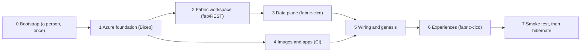

# 12 — Elements to create

> This chapter is the **complete inventory** of what must exist for Giandoria to run, and the **order** in which it
> is created.
>
> * Everything is created by code. A person runs one bootstrap script per tenant and environment. CI/CD pipelines
>   create everything else. Lab Control creates the run-level artefacts.
> * Nobody opens the Azure portal or the Fabric user interface to create a resource. The only exception is optional
>   visual design of dashboards and reports in the stopped `demo`, which is exported to Git (§12.11).
> * Every element has an ID, so that the implementation plan (chapter 14) and the open decisions (chapter 15) can
>   point to it.
>
> Chapter 11 explains why the architecture looks like this. Chapter 13 covers costs and runbooks.

---

## 12.1 How to read this chapter

**Implementation scope.** Only `{env}=demo` is deployed, in Sweden Central, with one F4.
This inventory remains the target catalogue, not a claim that every item is implemented or supported on F4.
Workspace/configuration uses idempotent `fab`/REST; supported Git item definitions use `fabric-cicd`; API gaps stay
explicit. Retained demo datasets and restart state are not temporary spike resources and survive hibernation.
We use authenticated public endpoints with resource-scoped, non-expiring network Waivers for Storage, ACR and
shared experimental Foundry. [Chapter 19](./19-policy-exemption-experiment.md) records exact scope, retained
controls and verification; non-network controls are not exempted. The full inventory remains a target catalogue.

### Element groups

| Prefix | Group | Created by | Section |
|---|---|---|---|
| **BS** | Bootstrap: tenant and environment foundations (groups, identities, roles, tenant settings) | Bootstrap script, run by a person with high privileges | §12.3 |
| **GR** | Guardrails: policy, budgets, safety net | Bootstrap script | §12.4 |
| **AZ** | Azure resources | CI: Bicep | §12.5 |
| **FB** | Fabric workspace and items | CI: `fab`/REST configuration and `fabric-cicd` item definitions | §12.6 |
| **KQ** | Objects inside the KQL databases | CI: the schema script of the KQL database definitions | §12.7 |
| **LH** | Objects inside the Lakehouses | CI (shortcuts) and jobs (tables) | §12.8 |
| **VZ** | Experiences: semantic models, reports, dashboards, alerts, agents, map | CI: item definitions | §12.9 |
| **RT** | Run-time configuration and run-level artefacts | CI (configuration) and Lab Control (runs) | §12.10 |
| **CI** | Repository, environments and pipelines | A person once, then maintained as code | §12.11 |

### Lifecycle classes

| Class | Created | Removed | Examples |
|---|---|---|---|
| **Tenant** | Once per Microsoft Entra tenant | Only by an explicit decommission | Security groups, tenant settings, Lab Control API registration |
| **Environment** | Once for `demo` by the bootstrap | Only by an explicit decommission | Resource groups, identities, role assignments, guardrails |
| **Deployment** | By every CI release; idempotent | Teardown (§12.13) | Storage, Container Apps, capacity, workspace, items |
| **Run** | By Lab Control, for each run | Archive or cleanup (chapter 13) | Run registry entry, lease, snapshots, events, plan lines |

### Conventions

* `{env}` is always `demo`. `{suffix}` is four lowercase characters derived from the
  subscription and the environment (`uniqueString` in Bicep). It makes globally unique names unique.
* Azure resource names carry the environment. Fabric item names do not, because every environment has its own
  workspace.
* Counts follow the design of chapters 10 and 11.
* Markers: *(optional)*, *(assumption)*, *(estimate)*, *(verify)*. Every *verify* item is checked in phase 0
  (chapter 14). The checks that could change the design are listed in §12.16.

---

## 12.2 Provisioning stages

| Stage | What it creates | Tools | Run by | Capacity active? |
|---|---|---|---|---|
| **0 Bootstrap** | Groups, tenant settings, Lab Control API registration; resource groups, identities, custom role, role assignments, ops storage; guardrails; GitHub environment variables | `az`, Bicep, `fab`, `gh` | A person (§12.3) | No capacity yet |
| **1 Azure foundation** | Monitoring, Storage, Container Registry, Container Apps environment, Foundry and model deployments, Fabric capacity | Bicep | Workflow `deploy-infra` | Created active |
| **2 Fabric workspace** | Workspace on the capacity, role assignments, folders | Idempotent `fab`/REST | `deploy-fabric` | Yes |
| **3 Data plane** | Eventhouse, two KQL databases with their schema, two Lakehouses, four Eventstreams, notebooks | `fabric-cicd` with Git definitions | `deploy-fabric` | Yes |
| **4 Images and apps** | Four container images; apps and jobs, all at zero replicas | Docker build, Bicep | `build-images`, `deploy-apps` | Not needed |
| **5 Wiring and genesis** | Wiring document; master data, calendar and plan-lines table; KQL commands and shortcuts | `fab`/REST and a genesis job | `wire-and-genesis` | Yes |
| **6 Experiences** | Semantic models, reports, Real-Time Dashboards, Activators, data agent, map | `fabric-cicd`; REST gaps only where supported | `deploy-fabric-content` | Yes |
| **7 Smoke test** | A two-sim-day run from end to end, then hibernate | Lab CLI against Lab Control | `smoke-test` | Yes, then suspended |

Rules:

* **Stages 2–3 and stage 4 run in parallel** after stage 1. Stage 5 needs both.
* **Every stage is idempotent.** Running a stage again repairs drift and never creates anything twice.
* **The capacity must be active for stages 2, 3, 5, 6 and 7.** A workflow that touches Fabric first takes a CI lease
  and then resumes the capacity, so that neither the watchdog nor the nightly safety net can suspend it underneath
  (chapter 13 §13.7). Its last step runs even after a failure (`if: always()`): it releases the CI lease and
  suspends the capacity again, unless another lease is still valid (§12.10).
* **A deployment never disturbs a running universe.** The `release` workflow checks the run leases first and stops
  with a message if a run is active. A redeployment would otherwise reset the capacity SKU or the replica count of
  the universe.
* **Order inside stage 3.** The bronze tables and the `map_envelope` mapping exist before an Eventstream destination
  points to them. Deployment stages and supported item-reference rebinding enforce this order.
* **Order inside stage 5.** Genesis creates the Lakehouse tables before the shortcuts that point to them. The
  shortcuts exist before stage 6 binds the semantic models to them.

---

## 12.3 Stage 0 — Bootstrap (BS)

The bootstrap is a script in `infra/bootstrap/` plus the Bicep files it deploys. It is the **only step that needs
high privileges**:

| Privilege | Needed for |
|---|---|
| Azure **Owner** on the subscription (or Contributor plus User Access Administrator) | Resource groups, custom role, role assignments, policy, budgets |
| Microsoft Entra **Application Administrator**, plus the right to create security groups | App registrations, federated credentials, groups, app-role assignments |
| **Fabric administrator** | Tenant settings; the workspace in workspace option B (BS-20) |

* The person signs in with `az login` and `fab auth login`. There is no portal session.
* The script is idempotent. It reads the current state, changes only what differs and prints a report.
* It has three parts (tenant, environment, guardrails), so three different people can run their own part.
* Entra objects are created with Microsoft Graph, through `az ad` commands or the Microsoft Graph Bicep extension.

### Tenant elements (once per tenant)

| ID | Element | Name | Notes |
|---|---|---|---|
| BS-01 | Security group for Fabric service principals | `sg-giandoria-fabric-sp` | Members: the runtime, control and deploy identities of every environment. The service-principal tenant settings are scoped to this group |
| BS-02 | Operator group | `sg-giandoria-operators` | Workspace Member; app role `Lab.Operator` |
| BS-03 | Analyst group | `sg-giandoria-analysts` | Workspace Contributor |
| BS-04 | Viewer group | `sg-giandoria-viewers` | Workspace Viewer; app role `Lab.Viewer` |
| BS-05 | Evaluator group *(optional)* | `sg-giandoria-evaluators` | Only for the strict truth option (chapter 10 §10.11) |
| BS-06 | Lab Control API registration | `app-giandoria-labcontrol` | Application ID URI `api://giandoria-labcontrol`; app roles `Lab.Operator` and `Lab.Viewer`; assignment required; **no secret**. The Azure CLI is pre-authorised as a client, so operators get tokens with `az account get-access-token` *(assumption)* |
| BS-07 | App-role assignments | — | `Lab.Operator` → BS-02 and the deploy identities (the smoke test calls Lab Control); `Lab.Viewer` → BS-04 |
| BS-08 | Tenant settings | — | Set through the Fabric admin REST API with `fab api` [F47][F64]. The desired state lives in `infra/bootstrap/tenant-settings.json` (table below) |

**Tenant settings (BS-08).** Confirm the API names with `GET /v1/admin/tenantsettings` before the first run
*(verify)*.

| Setting | API name | Desired state | Why |
|---|---|---|---|
| Service principals can call Fabric public APIs | `ServicePrincipalAccessPermissionAPIs` | Enabled for BS-01 (enabled for the whole tenant by default [F46]) | Every Giandoria identity calls Fabric APIs or endpoints |
| Service principals can create workspaces, connections and deployment pipelines | `ServicePrincipalAccessGlobalAPIs` | Enabled for BS-01 in workspace option A. Left disabled in workspace option B | The deploy identity creates the workspace (workspace option A) |
| Users can access data stored in OneLake with apps external to Fabric | *(verify)* | Enabled, at least for BS-01 | svc-planning, genesis and the archive job write Delta through the OneLake ADLS endpoint |
| Copilot and Azure OpenAI features; data agent creation | *(verify)* | Enabled for BS-02 and BS-03 | `da_giandoria` (§12.9) |
| Semantic models can be queried with DAX through the Execute Queries REST API | *(verify)* | Enabled, at least for BS-01 | Smoke test, step 8 (§12.12) |
| Processing outside the capacity's geography for Azure OpenAI | *(verify)* | Enabled only if the capacity region requires it | The data agent, in regions without local model processing |
| Preview items: map, ontology, operations agent | *(verify)* | Enabled only for the items in use | Optional items of §12.9 |

### Environment elements (once per environment)

| ID | Element | Name | Notes |
|---|---|---|---|
| BS-10 | Resource-provider registrations | `Microsoft.Fabric`, `Microsoft.App`, `Microsoft.ContainerRegistry`, `Microsoft.CognitiveServices`, `Microsoft.Storage`, `Microsoft.OperationalInsights`, `Microsoft.Insights`, `Microsoft.ManagedIdentity`, `Microsoft.Automation`, `Microsoft.Consumption` | Once per subscription |
| BS-11 | Resource groups | `rg-giandoria-core-{env}`, `rg-giandoria-ai-{env}`, `rg-giandoria-fabric-{env}`, `rg-giandoria-ops-{env}` | With tags (§12.15) |
| BS-12 | User-assigned managed identities | `id-giandoria-runtime-{env}`, `id-giandoria-control-{env}` | In the core resource group. Created here so that roles exist before CI runs |
| BS-13 | Deploy identity | `sp-giandoria-deploy-{env}` | App registration and service principal, one per environment, no secret. Federated credential for GitHub OIDC with subject `repo:{org}/{repo}:environment:{env}` |
| BS-14 | Group memberships | — | BS-12 and BS-13 → BS-01 |
| BS-15 | Custom role | `Giandoria Lab Operator` | Defined at subscription scope. Actions below |
| BS-16 | Role assignments | — | Table below. **CI never assigns roles** |
| BS-17 | Ops storage account | `stgiandoriaops{env}{suffix}` | Container `exports-{env}` retains kept runs across application teardown (§12.13). No Terraform state container. Shared key disabled; versioning and soft delete on; networking as AZ-03 |
| BS-18 | Quota checks | — | Foundry tokens-per-minute quota for the chosen models and region; Container Apps cores. The script stops with a clear message when a quota is too low |
| BS-19 | GitHub environment and variables | Environment `{env}` | Variables only, no secrets (§12.11) |
| BS-20 | Workspace *(workspace option B only)* | `ws-giandoria-{env}` | Created with `fab` by the administrator; deploy identity becomes Admin; scripts adopt only after explicit ownership checks |

**Workspace options** (decision D9, chapter 15). In **option A** (the default *(assumption)*), the deploy identity
creates the workspace in stage 2, which needs `ServicePrincipalAccessGlobalAPIs` for BS-01. In **option B**, the
Fabric administrator creates it during the bootstrap (BS-20), and that tenant setting can stay disabled.

**Custom role Giandoria Lab Operator (BS-15).** The minimum action list is confirmed in phase 0 *(verify)*.
Indicative actions:

| Resource | Actions |
|---|---|
| Fabric capacity [F70] | `Microsoft.Fabric/capacities/read`, `suspend/action`, `resume/action` and `write`. The pause-and-resume guide lists `write` as a prerequisite [F7], and SKU changes need it (within the policy cap) |
| Container Apps | `Microsoft.App/containerApps/read` and `write`; `Microsoft.App/managedEnvironments/join/action` |
| Container Apps jobs | `Microsoft.App/jobs/read`, `start/action` and `stop/action` |
| Managed identities | `Microsoft.ManagedIdentity/userAssignedIdentities/assign/action`, because an app update attaches its identity again |

**Role assignments (BS-16).** Most are made at resource-group scope (or narrower), so they work before the resources
exist. The only subscription-scope assignment is the Reader role of the Automation account, which the safety net needs
to find resources by tag.

| Principal | Role | Scope |
|---|---|---|
| Runtime identity | Storage Blob Data Contributor, Storage Table Data Contributor, Storage Queue Data Contributor | Core resource group |
| Runtime identity | AcrPull; Monitoring Metrics Publisher | Core resource group |
| Runtime identity | Foundry User [F85] | AI resource group |
| Control identity | Storage Blob, Table and Queue Data Contributor; AcrPull; Monitoring Metrics Publisher | Core resource group |
| Control identity | Giandoria Lab Operator | Core and Fabric resource groups |
| Control identity | Cost Management Reader (daily cost reconciliation, chapter 13 §13.6) | Core, AI, Fabric and ops resource groups |
| Deploy identity | Contributor | Core, AI and Fabric resource groups |
| Deploy identity | AcrPush; Storage Blob Data Contributor; Storage Table Data Contributor (CI leases, §12.10) | Core resource group |
| Deploy identity | Storage Blob Data Contributor | The `exports-{env}` container; no Terraform state access |
| Automation account identity (GR-08) | Giandoria Lab Operator | Core and Fabric resource groups |
| Automation account identity | Storage Table Data Reader | Core resource group (run leases) |
| Automation account identity | Reader | Subscription (to find resources by tag) |

Fabric permissions are not Azure roles. CI sets the capacity administrators in stage 1 and the workspace roles in
stage 2, using the object IDs that the bootstrap stores as GitHub variables. CI never queries Microsoft Graph.

---

## 12.4 Guardrails (GR)

The bootstrap creates the guardrails, so the deploy identity cannot weaken them. It has no rights at subscription
scope, and in the ops resource group it can only use its retained export container. Chapter 13 explains how the layers
work together.

| ID | Element | Name | Scope | Configuration |
|---|---|---|---|---|
| GR-01 | Policy: allowed capacity SKUs | `pa-giandoria-fabric-sku-{env}` | Fabric resource group | F4 only; policy alias pending check 20. No automatic upscale; enforce in control code if the alias is unavailable |
| GR-02 | Policy: allowed locations | `pa-giandoria-locations-{env}` | The four resource groups | Sweden Central for project-controlled resources; never modify inherited governance |
| GR-03 | Policy: required tags | `pa-giandoria-tags-{env}` | The four resource groups | Built-in definitions for `project`, `env`, `owner` and `cost-center`. The safety net finds its targets through `project` and `env`, together with the `lab-managed` tag, which only three resources carry and the policy does not require (§12.15) |
| GR-04 | Policy: no provisioned model throughput *(optional)* | `pa-giandoria-no-ptu-{env}` | AI resource group | Denies provisioned-throughput deployments, which bill every hour whether used or not. Alias *(verify)*. Some tenants already deny the regional provisioned type (chapter 18 §18.3); GR-04 also blocks the global and data-zone types |
| GR-05 | Subscription budget | `bud-giandoria-{env}` | Subscription | Monthly. 50% of actual cost → email; 80% of forecast → email; 100% of actual cost → action group [F11] |
| GR-06 | Fabric budget | `bud-giandoria-fabric-{env}` | Subscription, filtered on the Fabric resource group | Same thresholds. It is created at subscription scope because Contributor on the resource group could delete a budget defined there |
| GR-07 | Action group | `ag-giandoria-{env}` | Ops resource group | Email to the owners, and a runbook action that starts `rb-safety-net` in budget mode [F12] |
| GR-08 | Automation account | `aa-giandoria-{env}` | Ops resource group | System-assigned identity; PowerShell 7 runtime |
| GR-09 | Safety-net runbook | `rb-safety-net` | GR-08 | Source in `ops/runbooks/`. Calls Azure Resource Manager with `Invoke-AzRestMethod` [F4][F5]. Microsoft's gallery runbook for pausing Fabric capacities is the starting point [F7] |
| GR-10 | Nightly schedule | `sch-safety-net-nightly` | GR-08 | Every night at 01:00 Europe/Rome, mode `nightly` |
| GR-11 | Delete lock | `lock-giandoria-ops-{env}` | Ops resource group | `CanNotDelete`. Contributor cannot remove locks |
| GR-12 | Activity-log alert *(optional)* | `alert-giandoria-capacity-{env}` | Fabric resource group | Fires on every capacity resume and write (SKU change) and emails the owners through GR-07 |

Budget amounts for the single demo must be agreed under D16 before billable execution. Cost targets in euros
must not be silently copied into USD billing guardrails.

### What the safety net does

| Mode | Trigger | Behaviour |
|---|---|---|
| `nightly` | GR-10 | Finds the resources tagged `project = giandoria`, `env = {env}` and `lab-managed = true`: the capacity and the universe and agents apps (§12.15). If **any valid lease** exists (§12.10), it does nothing. Otherwise it suspends the capacity and sets the apps to zero replicas. **If it cannot read the leases, it acts anyway** |
| `budget` | GR-07 | Always acts, whatever the leases say |

* A lease is valid until its expiry, and never after the run's `max_wall_end`. A forgotten keep-alive therefore
  cannot keep the environment awake for ever.
* The runbook only reads the Lab state. On its next pass, the Lab Control watchdog sees what changed and records it
  in the run registry (chapter 13).
* Run-level guardrails (speed caps, token and money budgets per run, idle timeouts) are configuration, not resources.
  They are listed in §12.10.

---

## 12.5 Azure resources (AZ)

CI creates these with Bicep, using Azure Verified Modules where they exist [F45]. Every deployment is a Bicep
**deployment stack** at resource-group scope, because the deploy identity has no rights at subscription scope:

* stage 1 deploys three stacks, `stack-giandoria-core-{env}`, `stack-giandoria-ai-{env}` and
  `stack-giandoria-fabric-{env}`
* stage 4 deploys `stack-giandoria-apps-{env}`, in the core resource group.

The stacks have no deny settings, which Contributor cannot manage. A teardown deletes the stacks, and with them
exactly what CI created, never what the bootstrap created *(assumption)*.

### Monitoring, state and container platform (stage 1)

| ID | Element | Name | Resource group | Key settings |
|---|---|---|---|---|
| AZ-01 | Log Analytics workspace | `log-giandoria-{env}` | Core | Pay per GB; 30-day retention; daily cap to be agreed under D16 |
| AZ-02 | Application Insights | `appi-giandoria-{env}` | Core | Based on AZ-01. **Local authentication disabled**: apps send telemetry with their managed identity (Monitoring Metrics Publisher) |
| AZ-03 | Storage account (Lab state) | `stgiandoria{env}{suffix}` | Core | StorageV2, LRS, hot; shared key and anonymous blobs disabled; TLS 1.2; 7-day soft delete. D19 PoC uses `Enabled` with an individual networking waiver (chapter 19); perimeter/private access is fallback. Lifecycle rules remain target implementation. Content below |
| AZ-04 | Container Registry | `crgiandoria{env}{suffix}` | Core | Basic tier; admin user disabled; images are pulled with managed identities |
| AZ-05 | Container Apps environment | `cae-giandoria-{env}` | Core | Consumption plan only, no dedicated workload profiles. Logs go to Azure Monitor and reach AZ-01 through a diagnostic setting, which avoids a shared key |

**Storage content (AZ-03)**

| Kind | Name | Content | Written by |
|---|---|---|---|
| Container | `lab-state` | `config/wiring.json` (RT-01), Lab Control settings, run manifests | CI, Lab Control |
| Container | `snapshots` | `{run_id}/{sim_ts}/`: universe state snapshots (chapter 07 §7.11) | Universe runtime |
| Container | `decisions` | Full agent decision records: prompts, tool calls, outputs (chapter 09) | svc-agents |
| Container | `outbox` | Event batches waiting for an endpoint (chapter 10 §10.7) | Emitter |
| Container | `scenarios` | Scenario files (RT-04) | CI |
| Container | `genesis` | Master-data versions `{md_version}/`, `geo/provinces.geojson`, and source notes (ISTAT data, licence check) | Genesis job |
| Table | `runs` | Run registry, master copy | Lab Control |
| Table | `ledger` | Time-ledger segments (chapter 07 §7.6) | Universe runtime |
| Table | `leases` | One lease per active run, job, workflow or analysis session that needs the capacity: holder, expiry, `max_wall_end` (§12.10) | Lab Control, universe runtime, jobs, CI |
| Table | `agentmemory` | Agent memory per run and role | svc-agents |
| Table | `budgets` | Cost counters: per run (`run-{run_id}`: wall hours, tokens, money by component) and per month (`month-{yyyy-mm}`: billed days, month-to-date) (chapter 13 §13.6) | Universe runtime (cost meter), Lab Control, watchdog |
| Queue | `lab-requests` | Requests to Lab Control from Activator, through the bridge notebook. People and CI call the Lab Control API directly | Bridge notebook |
| Queue | `universe-commands` | Commands from Lab Control to the universe runtime: pause at the next tick, change speed, inject a shock, take a snapshot | Lab Control |

* Every queue message carries a command ID, the `run_id` and a short wall-time expiry. A repeated message is applied
  once, and an old command is never applied to a later run *(assumption)*.
* Lifecycle rules move decision records and snapshots to the cool tier after 30 days and delete outbox blobs after
  30 days. The cleanup step of the archive job (AZ-11) removes the artefacts of runs that are not kept (chapter 13,
  OP-08).

### Apps and jobs (stage 4)

| ID | Name | Image | Identity | Ingress | Scale or trigger | Size *(estimate)* |
|---|---|---|---|---|---|---|
| AZ-06 | `ca-labcontrol-{env}` | labcontrol | Control | External, HTTPS, Entra token required | 0–1 replicas, on HTTP requests and on the `lab-requests` queue | 0.25 vCPU, 0.5 GiB |
| AZ-07 | `ca-universe-{env}` | universe | Runtime | None | Minimum 0 or 1, maximum 1: Lab Control switches the minimum | 2–4 vCPU, 4–8 GiB (Profile M at S = 8,760) |
| AZ-08 | `ca-agents-{env}` | agents | Runtime | Internal (called by the universe) | 0–5 replicas, on concurrent requests | 0.5 vCPU, 1 GiB |
| AZ-09 | `caj-genesis-{env}` | jobs | Runtime | — | Manual: stage 5, or a new master-data version | 1 vCPU, 2 GiB |
| AZ-10 | `caj-backfill-{env}` | universe | Runtime | — | Manual (deployment mode C) | As AZ-07 |
| AZ-11 | `caj-archive-{env}` | jobs | Runtime | — | Weekly, and at the hibernate of a kept run, through Lab Control | 0.5 vCPU, 1 GiB |
| AZ-12 | `caj-watchdog-{env}` | labcontrol | Control | — | Every 10 minutes | 0.25 vCPU, 0.5 GiB |

* **Nothing runs after a deployment.** `ca-universe` is deployed with zero replicas. Lab Control scales it up only
  when a run starts.
* **Lab Control authentication.** Either Container Apps built-in authentication validates tokens issued for
  `app-giandoria-labcontrol` (no client secret is needed just to validate bearer tokens *(verify)*), or the code
  validates them. Either way, the API checks the app role on every call.
* **Queue scaling.** The `lab-requests` scale rule should authenticate with the control identity *(verify)*.
  Otherwise `ca-labcontrol` scales on HTTP only, and the watchdog drains the queue every 10 minutes.
* **Graceful stop.** `ca-universe` gets the longest termination grace period available *(verify)*, so that an
  unexpected stop can still flush the emitter to the outbox.
* **Jobs that need Fabric check the capacity first.** OneLake data cannot be read while the capacity is suspended. The
  archive job then exits without work; it never resumes the capacity.
* **The watchdog is almost free.** 144 runs a day of about 30 seconds at 0.25 vCPU make ≈ 32,000 vCPU-seconds a month,
  well inside the monthly free grant of Container Apps [F57] *(estimate)*.

**Images** (built in stage 4 and tagged with the Git commit, never `latest`)

| Image | Used by | Content |
|---|---|---|
| `giandoria/labcontrol` | AZ-06, AZ-12 | Lab Control API and the watchdog entry point |
| `giandoria/universe` | AZ-07, AZ-10 | Chronos, the simulators, svc-planning, the emitter |
| `giandoria/agents` | AZ-08 | svc-agents, prompts and role cards. Prompt versions travel with the image |
| `giandoria/jobs` | AZ-09, AZ-11 | Genesis, archive and table maintenance |

### Models, capacity and extras (stage 1)

| ID | Element | Name | Resource group | Key settings |
|---|---|---|---|---|
| AZ-13 | Foundry resource | `aif-giandoria-{env}-{suffix}` | AI | AI Services kind; custom subdomain; **local authentication disabled**; region per decision D4 [F49]. With the shared Foundry resource of chapter 18 §18.11 (D4), AZ-13 and AZ-15 are not created: AZ-14 is a project in the shared account and the aliases point at its deployments |
| AZ-14 | Foundry project | `proj-giandoria-{env}` | AI | Groups deployments, evaluations and traces |
| AZ-15 | Model deployments | `chat-medium`, `chat-small`, `chat-large` *(optional)* | AI | Table below |
| AZ-16 | Fabric capacity | `fcgiandoriademo` | Fabric | One F4 in Sweden Central, fixed. Administrators: deploy identity/operators (check 12). Creation may be active; suspend immediately after approved setup and always on failure [F45] |
| AZ-17 | Diagnostic settings | — | Core, AI | Container Apps environment and Foundry → AZ-01. Where tenant policy already sends Foundry logs to a governance workspace, only the Container Apps environment (chapter 18 §18.5) |
| AZ-18 | Event Hubs namespace *(optional)* | `evhns-giandoria-{env}` | Core | Only for ingestion option B (chapter 10 §10.7, decision D6) [F58] |
| AZ-19 | Watchdog alert *(optional)* | `alert-giandoria-watchdog-{env}` | Core | Log alert when the watchdog fails or has not run for 30 minutes. It notifies the operators through its own small action group |

**Model deployments (AZ-15)**

| Deployment (alias) | Model | Deployment type | Capacity | Use |
|---|---|---|---|---|
| `chat-medium` | gpt-5-mini | Global Standard | ≥ 300k tokens per minute in `demo`; less in `dev` | Default for decision roles (chapter 09 §9.7) |
| `chat-small` | gpt-5-nano | Global Standard | Small | Texture roles: news writer, corporate gift clients, store events (chapter 09 §9.7) |
| `chat-large` *(optional)* | A larger model | Global Standard | Small | Rare high-stakes decisions; A/B comparisons |

* Code uses the **alias**, never the model name, so changing a model is a configuration change.
* Model versions are pinned and automatic upgrades are off (`NoAutoUpgrade`), so a run can be replayed with the same
  model.
* Data Zone (EU) deployments are the alternative when data residency matters more than price (decision D4).

---

## 12.6 Fabric workspace and items (FB)

CI reconciles workspace configuration with `fab`/REST and publishes supported Git item definitions with
`fabric-cicd` [F44][F62] (D7). API types/routes below are not proof of complete library support; verify the selected
library version and properties in phase 0, and defer unsupported optional items explicitly.

### Workspace (stage 2)

| ID | Element | Name | API item type / route | Notes |
|---|---|---|---|---|
| FB-01 | Workspace | `ws-giandoria-{env}` | `fab`/REST | Assigned to AZ-16; in option B adopt BS-20 only after ownership checks |
| FB-02 | Workspace role assignments | — | `fab`/REST roles | Deploy identity: Admin. Runtime and control identities: Contributor. Operators (BS-02): Member. Analysts (BS-03): Contributor. Viewers (BS-04): Viewer |
| FB-03 | Folders | `ingest`, `store`, `analyse`, `act`, `lab` *(names indicative)* | `fab`/REST folders | Keep the item list readable |
| FB-04 | Variable library *(optional)* | `vl_giandoria` | `VariableLibrary` | Item IDs and URIs for notebooks |

### Data plane (stage 3)

| ID | Element | Name | API item type / route | Definition parts | Notes |
|---|---|---|---|---|---|
| FB-05 | Eventhouse | `eh_giandoria` | `Eventhouse` | — | Minimum consumption (`minimumConsumptionUnits`) left unset, so the Eventhouse can suspend when idle [F26][F27]. Whether the API also creates a default database is checked in phase 0 *(verify)* |
| FB-06 | KQL database | `kqldb_giandoria` | `KQLDatabase` | `DatabaseProperties.json` (read-write, parent Eventhouse), `DatabaseSchema.kql` | The schema script carries the KQ elements (§12.7) |
| FB-07 | KQL database | `kqldb_truth` | `KQLDatabase` | As FB-06 | Truth tables and evaluation functions |
| FB-08 | Lakehouse | `lh_giandoria` | `Lakehouse` | — | Without schemas, which keeps shortcut and Direct Lake paths simple |
| FB-09 | Lakehouse | `lh_evaluation` | `Lakehouse` | — | Only the truth shortcuts (LH-05) |
| FB-10 | Eventstream | `es_ops` | `Eventstream` | `eventstream.json`, `eventstreamProperties.json` | Topology below |
| FB-11 | Eventstream | `es_commerce` | `Eventstream` | As FB-10 | |
| FB-12 | Eventstream | `es_control` | `Eventstream` | As FB-10 | |
| FB-13 | Eventstream | `es_truth` | `Eventstream` | As FB-10 | Destination in `kqldb_truth` (see the open question below) |
| FB-14 | Notebook | `nb_lab_bridge` | `Notebook` | Notebook content | Run by Activator. It puts a request on the `lab-requests` queue (chapter 11 §11.6) |
| FB-15 | Notebook | `nb_explore` | `Notebook` | Notebook content | Examples for ad-hoc analysis |
| FB-16 | KQL querysets *(optional)* | `kqs_lab`, `kqs_analysis` | `KQLQueryset` | Queryset definition | Saved queries for operators and analysts |
| FB-17 | Eventstream *(optional)* | `es_capacity` | `Eventstream` | As FB-10 | Capacity events of AZ-16 [F78] into `CapacityUsage` (KQ-15), for cost control (chapter 13 §13.6). A separate Eventstream, so that `es_control` needs no filter operator |

**Eventstream topology** (one source and one destination each)

| Eventstream | Source (custom endpoint) | Destination | Target table | Mapping | Connection name |
|---|---|---|---|---|---|
| `es_ops` | `src_ops` | `dst_ops` | `kqldb_giandoria.bronze_ops` | `map_envelope` | `cn_ops` |
| `es_commerce` | `src_commerce` | `dst_commerce` | `kqldb_giandoria.bronze_commerce` | `map_envelope` | `cn_commerce` |
| `es_control` | `src_control` | `dst_control` | `kqldb_giandoria.bronze_control` | `map_envelope` | `cn_control` |
| `es_truth` | `src_truth` | `dst_truth` | `kqldb_truth.bronze_truth` | `map_envelope` | `cn_truth` |
| `es_capacity` *(optional)* | `src_capacity` (capacity events, not a custom endpoint) | `dst_capacity` | `kqldb_giandoria.CapacityUsage` | `map_capacity` | `cn_capacity` |

* **Throughput level** *Low*. Profile L needs *Medium* [F14].
* **Retention** 1 day, the minimum *(assumption)*. The outbox, not the Eventstream, is the replay buffer.

Three things to know about the Eventhouse destination:

* **Direct ingestion settings** [F68]. The destination is defined by the workspace ID, the **Eventhouse** item ID, the
  table name, a connection name (at most 40 characters, unique) and the mapping name. There is no database field.
* **A wrong property set fails silently.** A destination defined with the wrong set of properties is accepted, stays
  in a *Warning* state and ingests nothing, without any error. The smoke test therefore checks that every bronze table
  receives rows (§12.12, step 3).
* **Two databases in one Eventhouse.** The destination names the Eventhouse, not the database, so it is not yet clear
  how `es_truth` reaches `kqldb_truth` *(verify)*. The fallbacks are a second Eventhouse, `eh_truth`, for truth, or
  processed ingestion for `es_truth` only, because that mode does name the database.

**Connection details for the emitter.** After stage 3, CI reads each source's connection (namespace host and event
hub name) through the Eventstream REST API [F17][F69] and writes it to the wiring document (RT-01). The same response
contains access keys. The pipeline never logs or stores them, because the emitter authenticates with Microsoft Entra
ID [F15].

---

## 12.7 Inside the KQL databases (KQ)

The schema script `DatabaseSchema.kql` in the database definitions (FB-06, FB-07) creates every KQ element except the
shortcuts (KQ-14). The script is **generated** from the JSON Schemas in `schemas/` (chapter 10 §10.14), not written by
hand, so that bronze, silver and the event catalogue never drift apart.

| ID | Element | Count | Database | Notes |
|---|---|---:|---|---|
| KQ-01 | Bronze tables: `bronze_ops`, `bronze_commerce`, `bronze_control`, `bronze_truth` | 4 | Both | The 19 envelope columns (chapter 10 §10.8); `data` is `dynamic` |
| KQ-02 | Ingestion mapping `map_envelope` (JSON) | 4 | Both | One per bronze table, same content |
| KQ-03 | Ingestion policy on bronze | 4 | Both | Batching at 10–30 seconds, with streaming ingestion (on by default in an Eventhouse) turned off on the table; or streaming kept on. Decision D10 (chapter 10 §10.7) [F30][F67] |
| KQ-04 | Silver tables | 54 + 4 | Both | Factory 13, own retail 4, trade and order-to-cash 9, supply and logistics 7, world and market 7, planning, agents and finance 6, lab 8; truth 4 |
| KQ-05 | Expansion functions `Expand_{Table}` | 58 | Both | Filter bronze by `event_type` and project typed columns |
| KQ-06 | Update policies | 58 | Both | One per silver table. Source: its bronze table. Query: its expansion function. Transactional |
| KQ-07 | Materialized views | 11 | `kqldb_giandoria` | `MachineStateLatest`, `LineHourly`, `SellOutDaily`, `SellInDaily`, `OrderLineLatest`, `StockLatest`, `InboundLatest`, `PlanLatest`, `PriceDaily`, `WeatherDaily`, `AgentDecisionDaily`. Created without backfill, because the tables are empty |
| KQ-08 | Stored functions | 10 | `kqldb_giandoria` | `SimNow`, `SimAgo`, `SimWindow`, `RunLineage`, `RunEvents`, `Watermark`, `Oee`, `Otif`, `Genealogy`, `ForecastAccuracy` |
| KQ-09 | Data-quality functions | 4 | `kqldb_giandoria` | `DqGaps`, `DqDuplicates`, `DqLatency`, `DqSanity` (chapter 10 §10.12) |
| KQ-10 | Evaluation functions | ≈ 4 | `kqldb_truth` | For example: forecast error against latent demand; lost sales by cause; maintenance decisions against true machine health; supplier risk against true capacity. They read enterprise data from `kqldb_giandoria` with cross-database queries |
| KQ-11 | Retention and caching policies | Per layer | Both | Retention and hot cache: bronze 30 and 3 days; silver 180 and 30 days; gold 2 years and 90 days; truth 180 and 30 days [F31] |
| KQ-12 | Mirroring policies (OneLake availability) | 17 + 4 | Both | The lake-facing silver tables and the truth tables, with a write delay of 5 minutes [F28][F71] |
| KQ-13 | Partitioning policies *(optional)* | Few | `kqldb_giandoria` | Hash on `run_id` for the largest silver tables |
| KQ-14 | Shortcuts to the Lakehouse | ≈ 12 | `kqldb_giandoria` | `plan_lines`, `sim_calendar` and about 10 dimensions, used by `ForecastAccuracy`, the map and dashboards. Created in stage 5, after genesis |
| KQ-15 | Table `CapacityUsage` and mapping `map_capacity` *(optional)* | 1 + 1 | `kqldb_giandoria` | Target of `es_capacity` (FB-17). The events carry wall time, so they are ingested straight into the table, with no bronze table and no update policy. Retention 30 days *(assumption)* |

**Order inside the script.** Tables → mappings → functions → update policies → materialized views → table policies
(retention, caching, ingestion, partitioning, mirroring). Functions that read Lakehouse shortcuts, such as
`ForecastAccuracy`, are created with validation skipped, because the shortcuts appear only in stage 5.

**If the definition rejects some commands.** The definition accepts tables, mappings, functions and materialized
views. Whether it accepts every policy command is checked in phase 0 *(verify)*. Any rejected command runs in stage 5
from a post-deploy script, through the Eventhouse management endpoint (its query URI), with the deploy identity.

**KQL-side shortcuts (KQ-14)** are OneLake shortcuts created inside the KQL database, with the OneLake shortcuts API
or `fab`/REST shortcut API *(verify for KQL databases)*. The fallback is external Delta tables that point to the
Lakehouse paths, declared in the post-deploy script.

**Transactional update policies need contract tests.** With a transactional policy, one failure rejects the whole
bronze ingestion batch, including events of other types. Before every deployment, CI runs the sample events of every
event type through the generated expansion functions (chapter 14). Phase 0 checks that transactional policies keep up
with Profile M rates.

**Mirroring limits schema changes.** A table with OneLake availability cannot be renamed, dropped, truncated or
purged [F71]. Lake-facing tables can therefore only gain columns. A breaking change needs a new table, or dropping the
mirroring policy first, which deletes the OneLake copy. This matches the schema rules of chapter 10 §10.14.

---

## 12.8 Inside the Lakehouses (LH)

| ID | Element | Name | Lakehouse | Created by | Notes |
|---|---|---|---|---|---|
| LH-01 | Master-data tables | 24 `dim_*` tables (chapter 10 §10.9) | `lh_giandoria` | Genesis job (stage 5) | Delta, written through the OneLake ADLS endpoint. Genesis writes the same version to Storage (`genesis/{md_version}/`), which the universe reads at start |
| LH-02 | Sim calendar | `sim_calendar` | `lh_giandoria` | Genesis job | One row per sim date, covering the run horizons |
| LH-03 | Plan lines | `plan_lines` | `lh_giandoria` | Genesis creates it empty; svc-planning appends | Partitioned by `run_id` and `plan_type` (chapter 06 §6.15). It exists from the start so that the semantic model and the KQL shortcut can bind to it |
| LH-04 | Eventhouse shortcuts | 17 `ev_*` shortcuts | `lh_giandoria` | `fab`/REST shortcut API (stage 5) | Point to the OneLake copies of the lake-facing silver tables (table below) |
| LH-05 | Truth shortcuts | `truth_latent_demand`, `truth_lost_sales`, `truth_machine_health`, `truth_supplier_capacity` | `lh_evaluation` | `fab`/REST shortcut API (stage 5) | The only place where truth is visible outside the Eventhouse |
| LH-06 | File folders | `Files/backfill/`, `Files/archive/`, `Files/lab-bridge/` | `lh_giandoria` | Genesis job | `lab-bridge` is the fallback drop folder of the Activator bridge (§12.16) |
| LH-07 | Archive tables | `archive_*` | `lh_giandoria` | Archive job, on demand | Kept runs (chapter 10 §10.8) |
| LH-08 | Table maintenance | — | `lh_giandoria` | Archive job | Compaction and clean-up of `plan_lines` and the dimensions through the Lakehouse table-maintenance job API *(verify)*. Fallback: compaction with a Delta library inside the job |
| LH-09 | SQL views *(optional)* | `vw_plan_*` | `lh_giandoria` (SQL analytics endpoint) | Post-deploy T-SQL script (stage 5) | One view per plan type over `plan_lines` (chapter 06 §6.15) |

**Shortcut names (LH-04).** Each shortcut takes the table name in snake case, with the `ev_` prefix:

| Domain | Shortcuts |
|---|---|
| Trade and order-to-cash | `ev_sell_out`, `ev_customer_order_line`, `ev_order_line_status`, `ev_seasonal_booking_line` |
| Supply and factory | `ev_stock_snapshot`, `ev_line_counter`, `ev_production_order_event`, `ev_inbound_shipment_event` |
| Planning, agents and finance | `ev_plan_header`, `ev_plan_exception`, `ev_agent_decision`, `ev_fin_posting` |
| World and lab | `ev_price_tick`, `ev_weather`, `ev_run_registry`, `ev_time_ledger`, `ev_cost_meter` |

* A shortcut to a mirrored table shows data only after the first OneLake write, up to 5 wall minutes after ingestion.
  Whether the shortcut can be created while the table is still empty is checked in phase 0 *(verify)*.
* Each Lakehouse gets its SQL analytics endpoint automatically. The endpoint is not a separate element.

---

## 12.9 Experiences (VZ)

Stage 6 creates these from item definitions in Git. IDs inside the definitions are placeholders that CI replaces at
deployment (§12.11).

| ID | Element | Name | API item type / route | Reads | Notes |
|---|---|---|---|---|---|
| VZ-01 | Semantic model | `sm_giandoria` | `SemanticModel` (TMDL) | `lh_giandoria`: dimensions, `sim_calendar`, `plan_lines`, `ev_*` | Direct Lake on OneLake; fallback Direct Lake on the SQL endpoint *(verify)*. Measures such as OTIF, fill rate, forecast accuracy, sell-through and margin |
| VZ-02 | Semantic model | `sm_evaluation` | `SemanticModel` | The tables of `sm_giandoria` plus `lh_evaluation` | Combines two Lakehouses, which Direct Lake on OneLake allows *(verify)*. With the SQL-endpoint fallback, `lh_evaluation` would also need shortcuts to the tables it joins |
| VZ-03 | Report | `rpt_sop` | `Report` (PBIR) | VZ-01 | Monthly S&OP pack |
| VZ-04 | Report | `rpt_forecast_accuracy` | `Report` | VZ-01 | Forecast waterfall and accuracy |
| VZ-05 | Report | `rpt_multiverse` | `Report` | VZ-01 | Runs and forks side by side |
| VZ-06 | Report | `rpt_season_review` | `Report` | **VZ-02** | The only report that sees truth |
| VZ-07 | Real-Time Dashboard | `rtd_lab` | `KQLDashboard` | `kqldb_giandoria` | Lab cockpit (chapter 11 §11.6) |
| VZ-08 | Real-Time Dashboard | `rtd_factory` | `KQLDashboard` | `kqldb_giandoria` | Factory floor |
| VZ-09 | Real-Time Dashboard | `rtd_commerce` | `KQLDashboard` | `kqldb_giandoria` | Commerce and seasons |
| VZ-10 | Real-Time Dashboard | `rtd_supply` | `KQLDashboard` | `kqldb_giandoria` | Supply chain |
| VZ-11 | Real-Time Dashboard | `rtd_planning` | `KQLDashboard` | `kqldb_giandoria` | Planning and agents |
| VZ-12 | Activator | `act_operations` | `Reflex` | Gold views and functions | Business rules on sim time (chapter 11 §11.6) [F20][F22] |
| VZ-13 | Activator | `act_lab` | `Reflex` | Lab tables of `kqldb_giandoria` | Lab health, and the smoke-test rule that runs `nb_lab_bridge` |
| VZ-14 | Data agent | `da_giandoria` | `DataAgent` | Gold views and functions; `lh_giandoria` | Never `kqldb_truth` or `lh_evaluation` [F36] |
| VZ-15 | Map | `map_giandoria` | `Map` | Dimensions (stores, plants, warehouses), `ShipmentPosition`, the provinces GeoJSON | One KQL query per layer [F33] *(verify)* |
| VZ-16 | Operations agent *(optional)* | `oa_lab` | API coverage pending | Lab tables | Recommends lab actions [F66] |
| VZ-17 | Ontology or digital twin builder *(optional)* | `ont_giandoria` | `Ontology` or API coverage pending | Lakehouse and Eventhouse | Preview [F32][F35] |
| VZ-18 | Anomaly detector *(optional)* | `ad_lines` | API coverage pending | `LineHourly` | Preview |
| VZ-19 | Plan item *(deferred)* | `plan_giandoria` | None yet | — | No API or API item type / route at the time of writing [F65]. Creating it by hand would break the code-only rule |

**Points that affect cost and behaviour**

* **Activator polls KQL on a wall-time interval.** At 60 seconds, each evaluation covers about 6 sim days at
  S = 8,760, and about 2 sim hours at S = 168. Business alerts are therefore meant for slow-moving conditions or
  slower runs. The shortest supported interval is checked in phase 0 *(verify)* [F21][F23].
* **Activator and dashboards keep the Eventhouse awake.** Every poll and every auto-refresh is a query, so the
  Eventhouse never idles while they run. Rules are stopped and dashboards closed when no run is active (chapter 13).
* **Who can open what.** Below F64, people need a Power BI Pro licence to open reports and semantic models [F1].
  Real-Time Dashboards and other Fabric items need only workspace access *(verify)*.
* **Report bindings.** Each report definition points to its semantic model by item ID. CI replaces the placeholder
  with the ID of `sm_giandoria` or `sm_evaluation`.

---

## 12.10 Run-time configuration and run artefacts (RT)

### Configuration (written by CI, read by the apps at start)

| ID | Element | Where | Written by | Content |
|---|---|---|---|---|
| RT-01 | Wiring document | `lab-state/config/wiring.json` | `wire-and-genesis` (stage 5) | For each Eventstream source, the namespace host and event hub name [F69]. Eventhouse query and ingestion URIs, and the database names. Workspace ID, Lakehouse IDs and OneLake paths. Foundry endpoint and model aliases. Storage endpoints. Capacity resource ID and app names, for Lab Control. Version and Git commit. **No keys** |
| RT-02 | Lab Control settings | `lab-state/config/labcontrol.json` | CI, from the environment parameters | Environment limits (RT-03); default speed, profile and capacity SKU per profile; model alias per role (RT-07); the Activator rules to start and stop with runs; the **price card** of the cost meter (chapter 13 §13.6); owner emails |
| RT-03 | Environment limits | Inside RT-02 | CI | Table below |
| RT-04 | Scenario files | `scenarios/` in Git, copied to the `scenarios` container | CI | `calm-year`, `hazelnut-harvest`, `toy-delay`, `cocoa-spike`, `heatwave-june`, `quality-incident` (chapter 09 §9.8); `easter-2031-base` (chapter 10); `smoke` (§12.12). Each file sets the epoch, horizon, profile, seed, shock schedule (chapter 08 §8.6), agent roster and optional lab directives such as "pause at" |
| RT-05 | Master-data version | `genesis/{md_version}/` and the `dim_*` tables | Genesis job | Every run records the version it starts from (chapter 10 §10.9) |
| RT-06 | Agent roster, role cards and prompts | Inside the `agents` image | CI (image build) | Versioned with the image (chapter 09). Every decision records its prompt version |
| RT-07 | Model alias per role | Inside RT-02 | CI | `chat-small`, `chat-medium` or `chat-large` for each role (chapter 09 §9.7) |

**Environment limits (RT-03).** Lab Control refuses any command that would exceed them. The policy cap (GR-01) and the
budgets (GR-05, GR-06) are the hard limits behind them.

| Limit | Single `demo` | Notes |
|---|---|---|
| Maximum speed | Provisional target 8,760; measure on F4 | Not a throughput guarantee |
| Capacity SKU | F4 only | No automatic upscale |
| Money, tokens, active wall hours and monthly allowance | Pending D16 | Cloud execution blocked until enforceable limits are agreed |
| Idle timeout and analysis-session expiry | Pending D16 | No unbounded active session |
| Live runs | One | Other histories are retained, not simultaneously active |
| Lease TTL and renewal | Proposed 15 and 5 minutes | Verify in control-plane implementation |

**Leases.** A lease says "the capacity is needed now". The safety net (GR-09) and the CI workflows never suspend the
capacity while a valid lease exists.

| Holder | Taken by | Renewed by | Released |
|---|---|---|---|
| `run:{run_id}` | Lab Control, at start or resume, before the capacity resumes | The universe runtime, while the run is running or paused | At hibernate, stop or completion |
| `user:{upn}` | Lab Control, for `lab open --hours N` (an analysis session) | Never: it has a fixed expiry | `lab close`, or expiry |
| `job:{name}` | The genesis, backfill and archive jobs | The job | When the job ends |
| `ci:{workflow run}` | A workflow, before it resumes the capacity | The workflow | In its last step |

Every lease has an expiry and a `max_wall_end`, and it is invalid after either of them. For a run, `max_wall_end` is
the segment start plus the remaining active wall hours, the idle timeout and one watchdog interval, so that a run
stopped by a limit can still be hibernated cleanly (chapter 13 §13.6). For an analysis session, it is the expiry. For
a job or a workflow, it is the start plus its timeout.

**Ordering rule.** Every actor takes its lease before it resumes the capacity, and before the lease it continues is
released: for example, the archive job started at the hibernate of a kept run. The watchdog can then suspend any
active capacity that has no valid lease, without a grace period (chapter 13 §13.7).

### Run artefacts (created by Lab Control and the runtime, for each run)

| Artefact | Where | Created | Removed |
|---|---|---|---|
| Run registry entry | Table `runs`; `lab.run.*` events → `RunRegistry` | `lab start`, `lab fork` | Never: it is the history of the multiverse |
| Lease | Table `leases` | Start and resume | Hibernate, stop, completion or expiry |
| Time-ledger segments | Table `ledger`; `lab.segment.*` events → `TimeLedger` | Every running segment (chapter 07 §7.6) | Kept with the run registry |
| Snapshots | `snapshots/{run_id}/` | Every sim month and every hibernate (chapter 07 §7.11) | Cleanup, unless the run is marked `keep` |
| Decision records | `decisions/{run_id}/`; `agent.decision.*` events → `AgentDecision` | Every agent decision (chapter 09) | Cleanup, unless `keep` |
| Agent memory | Table `agentmemory` | During the run | Cleanup |
| Budget counters | Table `budgets` | At run creation | Cleanup |
| Outbox batches | `outbox/{run_id}/` | When an endpoint is unavailable | After the drain; lifecycle rule after 30 days |
| Events | Bronze and silver tables, by `run_id` | During the run | Retention policies only (KQ-11). Mirrored tables cannot be purged (§12.7) |
| Plan lines | `plan_lines`, partition `run_id` | svc-planning | Cleanup deletes the partition, unless `keep` |
| Archive tables | `archive_*` | Archive job, for kept runs | By hand |

Cleanup is a step of the archive job (AZ-11), described in chapter 13 (OP-08).

---

## 12.11 Repository and pipelines (CI)

| ID | Element | Notes |
|---|---|---|
| CI-01 | GitHub repository `giandoria` *(assumption)* | Layout in chapter 11 §11.8. Branch protection on `main`: pull request with review, and `validate` must pass |
| CI-02 | One GitHub environment `demo` | Created by bootstrap with variables only and approval before cloud deployment |
| CI-03 | Workflows | Table below |
| CI-04 | Fabric deployment scripts | Separate workspace/configuration, data-plane, links and content stages; no Fabric configuration/publishing scripts or state files |
| CI-05 | Parameterized item definitions | Git definitions use supported `fabric-cicd` rebinding and `parameter.yml`; wiring supplies remaining IDs/URIs explicitly; no guessed global text replacement |
| CI-06 | Export from the stopped `demo` | Visual authoring is exported through the supported item export/definition API [F43], versioned and redeployed. Never overwrite unexported edits |

**Workflows (CI-03)**

| Workflow | Trigger | What it does | Cloud access |
|---|---|---|---|
| `validate` | Pull request | Python tests; Bicep build; script/configuration checks; generated KQL contract checks in the emulator if supported | None |
| `deploy-infra` | Called by `release`; manual | Stage 1: the three foundation deployment stacks (§12.5) | Azure |
| `build-images` | Called by `release`; manual | Stage 4: builds the four images and pushes them to AZ-04 | Azure (registry) |
| `deploy-apps` | Called by `release`; manual | Stage 4: the apps deployment stack, with the new image tags | Azure |
| `deploy-fabric` | Called by `release`; manual | Stages 2–3: `fab`/REST configuration and `fabric-cicd` definitions | Azure (capacity), Fabric |
| `wire-and-genesis` | Called by `release`; manual | Stage 5: wiring, genesis, KQL and `fab`/REST links | Azure, Fabric |
| `deploy-fabric-content` | Called by `release`; manual | Stage 6: `fabric-cicd` and explicit supported REST gaps | Azure (capacity), Fabric |
| `smoke-test` | Called by `release`; manual | Stage 7 (§12.12) | Lab Control, Fabric |
| `release` | Manual, approved `demo` deployment | Stops if a run lease or unexported authoring exists; calls stage workflows in order | — |
| `hibernate` | Every night at 00:30 Europe/Rome; manual | Asks Lab Control to hibernate paused runs, then suspends the capacity if no lease is valid. The Lab Control watchdog is the first line of defence, this workflow the second, the safety net (GR-09) the third | Lab Control, Azure |
| `teardown` | Manual; protected environment | §12.13 | Azure, Fabric |

**Variables (GitHub environment variables, set by the bootstrap; no secrets)**

| Variable | Content |
|---|---|
| `AZURE_TENANT_ID`, `AZURE_SUBSCRIPTION_ID` | Tenant and subscription |
| `AZURE_CLIENT_ID` | Application ID of the deploy identity (BS-13), for the OIDC sign-in |
| `ENV_NAME`, `NAME_SUFFIX` | Always `demo`; the four-character suffix |
| `LOCATION`, `FOUNDRY_LOCATION` | Both `swedencentral` (D4) |
| `RUNTIME_IDENTITY_ID`, `CONTROL_IDENTITY_ID` | Resource IDs of the managed identities (BS-12), to attach them to apps |
| `RUNTIME_PRINCIPAL_ID`, `CONTROL_PRINCIPAL_ID`, `DEPLOY_PRINCIPAL_ID` | Object IDs, for workspace roles |
| `OPERATORS_GROUP_ID`, `ANALYSTS_GROUP_ID`, `VIEWERS_GROUP_ID` | Object IDs of BS-02 to BS-04 |
| `CAPACITY_ADMINS` | Capacity administrators: the deploy identity and the operators *(format: verify)* |
| `LABCONTROL_APP_ID` | Application ID of BS-06, the token audience of Lab Control |
| `TFSTATE_ACCOUNT`, `TFSTATE_CONTAINER`, `EXPORTS_CONTAINER` | Ops storage (BS-17) |
| `CAPACITY_SKU` | Always F4 for the single `demo`; changes require owner approval |
| `WORKSPACE_ID` | Workspace option B only (BS-20) |

* Workflows sign in with GitHub OIDC through the federated credential of BS-13. There is no client secret anywhere.
* Logs never print tokens, nor the Eventstream connection responses, which contain keys (§12.6).

---

## 12.12 Smoke test (stage 7)

The smoke test proves that every link of the chain works. It takes about 30 wall minutes *(estimate)*, most of it
spent waiting for OneLake and for a hibernate-and-resume cycle.

Settings: scenario `smoke`, Profile S, S = 730, horizon 2 sim days. At S = 730, one sim day lasts about 2 wall
minutes. The workflow holds a CI lease from start to end (§12.10).

| Step | Action | Pass condition | A failure usually means |
|---:|---|---|---|
| 1 | The workflow, signed in as the deploy identity with the `Lab.Operator` role, creates a run of scenario `smoke` | `lab.run.created` | Lab Control authentication or Storage roles |
| 2 | It starts the run. The scenario pauses itself at the end of sim day 1 | `lab.run.paused` | Universe app, image or wiring document |
| 3 | It counts rows in the four bronze tables | Rows in all four within 5 wall minutes | The silent *Warning* state of a destination, a missing role, or the two-database question (§12.6) |
| 4 | It checks the silver tables and the ingestion failures | Rows in the expected silver tables; no ingestion or update-policy failures | A mismatch between schemas and generated functions |
| 5 | It checks views and functions | Materialized views healthy; `SimNow` returns the paused sim time; `DqLatency` within limits | — |
| 6 | It checks the agents | At least one `AgentDecision` row, and the matching record in `decisions/` | Foundry role, model alias or quota |
| 7 | It reads the Lakehouse through the SQL analytics endpoint | Dimensions and `plan_lines` have rows for the run; one `ev_*` shortcut returns rows within 10 wall minutes | OneLake external-apps setting, mirroring policy or shortcut |
| 8 | It queries `sm_giandoria` with the `executeQueries` REST API, and checks the Activator path | A DAX query returns rows. A marker injected by the scenario made `act_lab` run `nb_lab_bridge`, and Lab Control recorded `lab.action.completed` with action `smoke.ack` | Direct Lake binding, or the identity of the bridge notebook (§12.16) |
| 9 | It hibernates the run | Capacity *Paused*; universe at 0 replicas | The custom role of the control identity |
| 10 | It resumes the run, which completes sim day 2 | `lab.run.completed`; `DqGaps` is empty across the hibernate; two time-ledger segments | Snapshot, outbox or ledger logic |
| 11 | It releases its lease and suspends the capacity | Capacity *Paused*; no lease left | — |

After the test, the environment stays hibernated: capacity suspended and apps at zero replicas. The smoke data stays
in the Eventhouse, because mirrored tables cannot be purged (§12.7). Every event carries its `scenario`, so dashboards
and reports filter out `smoke` by default, and retention removes the data over time.

---

## 12.13 Hibernate and teardown

**What each element does in each state**

| Element | Running (a run is active) | Hibernated (no run active) | After teardown |
|---|---|---|---|
| Fabric capacity (AZ-16) | Active, billed per second | Suspended, not billed | Deleted |
| Workspace and items (FB, KQ, LH, VZ) | In use | Kept; unusable while the capacity is suspended | Deleted |
| OneLake data | Readable | Kept and billed as storage; unreadable while the capacity is suspended | Deleted with the workspace |
| Universe and agents apps (AZ-07, AZ-08) | 1 replica; 0–5 replicas | 0 replicas | Deleted |
| Lab Control (AZ-06) | 0–1 replicas | Scales to zero | Deleted |
| Watchdog and archive jobs | On schedule | On schedule; a few seconds per run | Deleted |
| Model deployments (AZ-15) | Billed per token | Not billed: no calls | Deleted and purged |
| Storage, registry, Log Analytics | Billed (small) | Billed (small) | Deleted, after the export below |
| Bootstrap elements and guardrails (BS, GR) | — | — | **Kept** |

**Teardown order** (workflow `teardown`, manual and protected)

1. Hibernate every run, so that all state is in snapshots.
2. Resume the capacity and take a CI lease.
3. Export the kept runs to `exports-{env}` (BS-17): registry rows, decision records, scenario files, snapshots and
   the master-data version. With these, a kept run can be rebuilt by replay at zero LLM cost (chapter 07 §7.11).
   Copying the `archive_*` tables as Delta files is optional.
4. With explicit destructive approval, remove only project-owned experiences, links and data-plane items, then the
   owned workspace. Verify export completeness first; never use unrestricted orphan deletion.
5. Delete the deployment stacks: apps first, then fabric, AI and core. This deletes the capacity, Foundry, Storage,
   the registry and monitoring.
6. Purge the Foundry resource. Otherwise it stays soft-deleted for 48 hours and keeps its name *(verify)*. If the
   deploy identity lacks the right to purge, a rebuild within 48 hours restores the deleted resource instead.

* **What remains:** resource groups, identities, role assignments, guardrails and ops exports. There is no Terraform
  state. Teardown is not hibernation and is never the normal way to end a demonstration.
* Whether a deleted workspace name can be reused at once is checked in phase 0 *(verify)*. If not, the workspace
  name gets a suffix.
* Removing the bootstrap elements (decommission) is a separate script in `infra/bootstrap/`. It needs the same
  privileges as the bootstrap.

---

## 12.14 Not created, on purpose

| Not created | Why |
|---|---|
| Azure Key Vault | There are no secrets. Every identity uses Entra ID tokens, and workflows use OIDC |
| Event Hubs | Only with ingestion option B (AZ-18, decision D6) |
| Azure Data Explorer cluster | The Eventhouse is the KQL engine |
| Stream Analytics, Functions, Logic Apps | Simulators, Lab Control and jobs run in Container Apps. The Eventstreams need no processing (chapter 10 §10.7) |
| Fabric pipelines and dataflows | Nothing to orchestrate inside Fabric: genesis and archive are Container Apps jobs |
| Warehouse | The SQL analytics endpoints of the Lakehouses cover the T-SQL needs |
| SQL database in Fabric | Optional, if a relational planning store is preferred (decision D12, chapter 15) [F39] |
| Fabric deployment pipelines | Each environment is deployed from Git (chapter 11 §11.9) |
| Fabric trial capacity | It can only be started from the user interface [F10] |
| Virtual network, private endpoints | Public endpoints with Entra ID by default (decision D19) |
| Dedicated Container Apps workload profiles | The Consumption plan is enough and scales to zero |
| Custom Spark environments | The two notebooks need only the default runtime |
| Power BI licences | Bought, not deployed: below F64, people who open reports need Pro [F1] |
| Fabric Git integration | Optional in the stopped `demo` only. Every environment is deployed by CI from the repository (CI-06) |

---

## 12.15 Naming and tags

### Azure names

| Resource | Pattern | Example (`demo`) | Rules |
|---|---|---|---|
| Resource group | `rg-giandoria-{area}-{env}` | `rg-giandoria-core-demo` | Areas: `core`, `ai`, `fabric`, `ops` |
| Managed identity | `id-giandoria-{role}-{env}` | `id-giandoria-runtime-demo` | |
| App registration and service principal | `app-giandoria-{name}`, `sp-giandoria-{name}-{env}` | `sp-giandoria-deploy-demo` | |
| Security group | `sg-giandoria-{name}` | `sg-giandoria-operators` | One set per tenant |
| Storage account | `stgiandoria{env}{suffix}`, `stgiandoriaops{env}{suffix}` | `stgiandoriademo7k2q` | 3–24 lowercase letters and digits; globally unique |
| Container registry | `crgiandoria{env}{suffix}` | `crgiandoriademo7k2q` | 5–50 letters and digits; globally unique |
| Log Analytics, Application Insights | `log-giandoria-{env}`, `appi-giandoria-{env}` | `log-giandoria-demo` | |
| Container Apps environment, apps, jobs | `cae-giandoria-{env}`, `ca-{name}-{env}`, `caj-{name}-{env}` | `ca-labcontrol-demo` | At most 32 characters: lowercase letters, digits and hyphens |
| Foundry resource and project | `aif-giandoria-{env}-{suffix}`, `proj-giandoria-{env}` | `aif-giandoria-demo-7k2q` | The custom subdomain is globally unique |
| Fabric capacity | `fcgiandoria{env}` | `fcgiandoriademo` | Lowercase letters and digits, starting with a letter. Uniqueness scope *(verify)* |
| Automation account, action group, budget, policy assignment | `aa-`, `ag-`, `bud-`, `pa-` + `giandoria-{env}` | `aa-giandoria-demo` | |
| Deployment stacks | `stack-giandoria-{area}-{env}` | `stack-giandoria-apps-demo` | |
| Fabric workspace | `ws-giandoria-{env}` | `ws-giandoria-demo` | |

### Fabric item names

Item names have a type prefix, use snake case and carry no environment:

| Prefix | Item type | Prefix | Item type |
|---|---|---|---|
| `eh_` | Eventhouse | `rtd_` | Real-Time Dashboard |
| `kqldb_` | KQL database | `act_` | Activator |
| `es_` | Eventstream | `da_` | Data agent |
| `lh_` | Lakehouse | `map_` | Map |
| `nb_` | Notebook | `oa_` | Operations agent |
| `kqs_` | KQL queryset | `ont_` | Ontology |
| `sm_` | Semantic model | `ad_` | Anomaly detector |
| `rpt_` | Report | `vl_` | Variable library |

Inside the data stores, KQL tables, views and functions use PascalCase (`MachineStateLatest`, `SimNow`), except the
bronze tables (`bronze_ops`). Lakehouse tables and shortcuts use snake case (`dim_sku`, `ev_sell_out`). Columns use
snake case everywhere (`sim_ts`, `run_id`).

### Tags

| Tag | Value | Used by |
|---|---|---|
| `project` | `giandoria` | Policy GR-03, cost analysis, the safety net |
| `env` | `demo` only | The same |
| `owner` | An email address | People: who to ask |
| `cost-center` | A cost-centre code | Cost reports |
| `lab-managed` | `true`, only on the capacity, the universe app and the agents app | The resources that Lab Control and the safety net may scale or suspend |

Fabric items have no tags. The workspace name identifies the environment.

---

## 12.16 Counts and open checks

### Counts

| Group | Elements | Optional or conditional |
|---|---|---|
| BS | 19 | BS-05; BS-20 in workspace option B |
| GR | 12 | GR-04, GR-12 |
| AZ | 19, including 7 apps and jobs and 2–3 model deployments | AZ-18, AZ-19 |
| FB | 17, including 4 Eventstreams and an optional fifth | FB-04, FB-16, FB-17 |
| KQ | About 270 commands in two generated scripts: 62 tables, 76 functions, 58 update policies, 11 materialized views, and their policies | KQ-13, KQ-15 |
| LH | 24 dimensions, 2 tables, 21 shortcuts, archive tables | LH-09 |
| VZ | 15 | VZ-16 to VZ-18; VZ-19 deferred |
| RT | 7 configuration elements, plus the artefacts of each run | — |
| CI | 6, including 11 workflows | — |

### Open checks

Adopted decisions do not verify the platform: checks 3, 15, 21, 24 and 28 test `fabric-cicd`/REST coverage;
check 29 is the networking fallback if waivers are unavailable. The table records verified scope and open cases,
with supporting conclusions in [chapter 20](./20-fabric-walking-skeleton.md). Local tests do not close cloud checks.

These checks become the phase-0 spikes of chapter 14. **Design** means that a negative answer changes the design;
**minor** means that it only changes a parameter or a step.

| # | Check | Affects | Impact | If the answer is no |
|---:|---|---|---|---|
| 1 | Can a direct-ingestion destination write to the second KQL database of the same Eventhouse? | FB-13, KQ | **Design** | A second Eventhouse `eh_truth`, or processed ingestion for `es_truth` |
| 2 | Does API creation also create a default KQL database? Observed: no, in the walking-skeleton API path (chapter 20) | FB-05 | Verified for current API path | `kqldb_giandoria` is explicitly created by fabric-cicd |
| 3 | Which schema commands are accepted? `.create-merge table`, including additive column changes, verified; policies/mirroring/views still open | KQ | Partially verified (chapter 20) | Targeted management endpoint (§12.7) |
| 4 | End-to-end ingestion latency with streaming and with batching | KQ-03, dashboards | Minor | Tune batching; accept a larger sim-time lag at S = 8,760 (chapter 10 §10.7) |
| 5 | Do transactional update policies keep up with Profile M? | KQ-06 | **Design** | Non-transactional policies plus data-quality checks, or more bronze tables per stream |
| 6 | Can a shortcut point to a mirrored table that has no OneLake data yet? | LH-04, LH-05 | Minor | Create the shortcuts after the smoke run (the shortcut step runs again after stage 7) |
| 7 | Direct Lake on OneLake: availability, two Lakehouses in one model, access for viewers | VZ-01, VZ-02 | **Design** | Direct Lake on the SQL endpoint, with extra shortcuts in `lh_evaluation` |
| 8 | Which identity runs `nb_lab_bridge` when Activator starts it, and can it write to the queue? | FB-14, VZ-13 | Minor | Grant that identity Storage Queue Data Message Sender in the bootstrap, or let the notebook drop a file in `Files/lab-bridge/` for the watchdog to pick up |
| 9 | Can the Container Apps queue scale rule authenticate with a managed identity? | AZ-06 | Minor | HTTP scaling only; the watchdog drains the queue |
| 10 | Minimum action list of the custom role | BS-15 | Minor | Add the missing actions |
| 11 | API names of the tenant settings | BS-08 | Minor | Adjust `tenant-settings.json` |
| 12 | Format of capacity administrators (users and service principals) | AZ-16 | Minor | Adjust `CAPACITY_ADMINS` |
| 13 | Uniqueness scope of capacity names | AZ-16 | Minor | Add `{suffix}` to the name |
| 14 | Can a deleted workspace name be reused at once? | FB-01, §12.13 | Minor | A suffix on rebuild |
| 15 | Is there a supported create/update definition API for the Plan item? | VZ-19 | Minor | It stays deferred |
| 16 | Do Eventstreams consume capacity while no events flow, and does pausing the sources stop it? [F13] | FB-10 to FB-13, chapter 13 | Minor | Lab Control pauses the sources whenever no run is active |
| 17 | Minimum SKU, tenant settings and region for the data agent [F36] | VZ-14, BS-08 | Minor | Defer the data agent; use the Fabric tool of Foundry Agent Service later [F37] |
| 18 | Can a job identity call the Lakehouse table-maintenance API? | LH-08 | Minor | Compaction with a Delta library inside the job |
| 19 | Name and scope of the OneLake external-apps tenant setting | BS-08 | **Design** | If it cannot be enabled, genesis, plan writes and the archive move into Fabric notebooks |
| 20 | Policy alias for the capacity SKU | GR-01 | Minor | Activity-log alert (GR-12) plus the Lab Control limit (RT-03) instead of *Deny* |
| 21 | Shortcuts inside a KQL database through a supported API | KQ-14 | Minor | External Delta tables in the post-deploy script |
| 22 | Shortest evaluation interval of Activator rules on KQL sources | VZ-12, VZ-13 | Minor | Business alerts only at lower speeds. Lab safety does not depend on Activator |
| 23 | Container Apps built-in authentication without a client secret | AZ-06 | Minor | Token validation in code |
| 24 | Starting and stopping Activator rules through their definition or the API | VZ-12, VZ-13, chapter 13 | Minor | Rules stay on, which keeps the Eventhouse awake whenever the capacity is active |
| 25 | Does the Kusto emulator run the generated functions and update policies like the Eventhouse? | CI-03 (`validate`) | Minor | Isolated test database in `demo`, with explicit cost approval |
| 26 | Can the Bicep deployment of stage 1 update the capacity while it is suspended, without resuming it? | AZ-16, `deploy-infra` | Minor | `deploy-infra` resumes the capacity first and holds a CI lease, like the Fabric stages (§12.2) |
| 27 | Capacity overage and surge protection: what are the defaults for a new capacity, and can they be read and set through an API? [F73][F76] | AZ-16, chapter 13 (CM-04) | Minor | The bootstrap guide records a one-time administrator check that overage is off, the only portal step (decision D18, chapter 15). The daily reconciliation watches the overage meter. No surge protection |
| 28 | Can the capacity-events source of an Eventstream be created from a definition or the API, and which permission does it need? [F78] | FB-17, KQ-15, chapter 13 (CM-09) | Minor | Leave FB-17 and KQ-15 out; rely on the cost meter and the daily reconciliation |
| 29 | If the agreed Storage network waivers (chapter 19) are unavailable/revoked: does a perimeter subscription rule admit the required identities, CI and the bridge notebook? [F90] | AZ-03, BS-17, D19 | **Fallback design; open**, not closed by public-endpoint probes | Scoped private Storage access with suitable runners and the OneLake fallback of check 8 |
