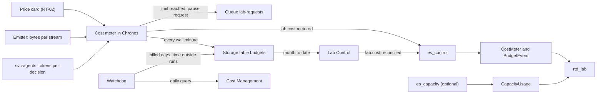

# 13 — Cost Control and Operations

> This chapter covers four things: what the lab costs and why; how that cost is measured and capped while the
> universe runs; what happens when something is forgotten or breaks; and the procedures for running the lab day to
> day. All amounts are in US dollars, at pay-as-you-go retail prices for Italy North, before taxes and negotiated
> discounts [F3]. Values marked *(estimate)* come from the cost model in §13.2 and the volumes in chapter 10. The
> measurements in §13.12 replace them during phases 0 to 5 (chapter 14).

---

## 13.1 Where the money goes

**Current demo scope and objectives.** One F4 in Sweden Central, no automatic upscale, no separate
`dev` or `stress`. We allow approximately EUR 200 initially if needed for a useful retained dataset, then
targets a few tens of euros per active demo day and low recurring cost at rest. Numeric D16 operating limits and
the current Sweden Central price card still need agreement/measurement. The original Italy North USD tables and
larger-SKU scenarios in this chapter are historical sizing comparisons, not the chosen deployment or budgets.

**Subscription ceiling:** EUR 500 per month for the whole subscription, not a consumption
target and not a Giandoria-only budget. Account for other projects, shared Foundry and governance before assigning
any run allowance. Necessary private endpoints and other small fixed costs are acceptable, but not a reason to
privatize every endpoint. Minimize standing infrastructure and keep heavy work on demand.

**Our PoC deployment.** D19 now selects public Entra-authenticated Storage with individual,
non-expiring network-policy waivers; no private endpoints are deployed. See
[chapter 19](./19-policy-exemption-experiment.md) for waiver scope and access controls, and the
[infra guide](../infra/demo/README.md) for deployed infrastructure and cost-inspection commands.
The retained-private-endpoint prices below are fallback comparisons, not costs incurred by this PoC.

**Retention comes first.** Hibernation flushes/snapshots and retains datasets, then suspends capacity and scales
compute to zero. It does not delete OneLake data or restart state. Some dashboards are unavailable while suspended.
Idle cost includes storage/registry and the tenant Defender/governance baseline (§13.3 and chapter 18 §18.6);
the older "$7-10" storage-only baseline must not be presented as the full subscription bill.

### What can stay deployed while the demo is off

| Resource | In hibernation | Residual costs / conditions |
|---|---|---|
| Fabric F4, pay-as-you-go | Suspend the capacity; keep workspace and item definitions | Retained OneLake/storage charges remain. Suspension settles pending smoothed operations and cumulative excess; it does not erase work already done [F2][F7] |
| Universe and Lab Control on Container Apps Consumption | Zero replicas; control endpoint may wake on an authenticated request | No replica consumption charge at zero. Stop background triggers/revisions from waking the runtime; a larger minimum or Dedicated profile defeats this property [F94] |
| Backfill/genesis/archive Container Apps jobs | No running executions; disable unnecessary schedules/triggers | Pay for executions, not a continuously allocated job worker [F94] |
| Foundry model deployments, Standard pay-per-token | No calls; keep deployments | No token charge without requests. Avoid provisioned throughput, hosted always-on compute and optional metered tools |
| Managed identities, role assignments, resource groups, VNet/subnets/NSGs | Keep configuration | No ordinary hourly compute fee for these objects themselves; attached paid services are separate |
| Automation shutdown runbook | No idle worker; short scheduled executions | Metered execution/allowances and monitoring remain; do not deploy an always-on VM to run it |
| Storage/OneLake and container images | Keep data, snapshots and restart state | Storage, operations, protection, retention and registry costs remain; never delete datasets as a shutdown step |
| Private endpoints and DNS | Keep connectivity provisioned | Endpoint hours, data processing and DNS continue; private endpoints have no pause switch |
| Log Analytics/Application Insights and tenant Defender | Stop avoidable telemetry, retain required logs | Ingestion/retention and policy-required protection can still cost; do not modify tenant governance |

**Networking distinction.** Outbound VNet integration to reach a Storage private endpoint is not the same as a
private endpoint on the Container Apps environment's ingress. The latter incurs an additional Dedicated Plan
Management charge even with Consumption apps [F94][F95]. Prefer authenticated public ingress for Lab Control
where permitted and private access only to Storage subresources actually needed. Blob, Queue, Table and DFS can
require separate endpoints; some ADLS operations need both Blob and DFS. CI and operators also need a tested access
path; a private endpoint alone does not give a GitHub-hosted runner access.

**Public retail price checks, 18 October 2026 [F3].** EUR list prices, excluding tax/contract discounts: standard
private endpoint EUR 0.0088/hour (Global meter), approximately EUR 6.42 per 730-hour month, plus data processing.
Three endpoints are approximately EUR 19.27/month; four EUR 25.70/month. Container Registry Basic in Sweden Central
is EUR 0.1466/day, approximately EUR 4.40 per 30 days for the base registry, plus excess storage/builds/egress.
Private Link on the registry would require Premium [F96], so do not add it speculatively. DNS, retained data and
Defender are additional; this is not a total fixed-cost quotation. Confirm F4 billing separately rather than using
an individual workload-consumption CU meter as if it were the capacity's full price.

**Actual-cost checks.** Use the read-only inspection in the [infra guide](../infra/demo/README.md) for current
subscription-wide MTD costs and local evidence. Reporting lags, Defender trials can hide future fixed charges,
and USD billing must be handled explicitly against the EUR ceiling. A reported zero is not proof of no spend;
budget alerts do not suspend resources [F11]. Do not use a transient billing snapshot as a forecast or price quote.

| Component | How it is billed | Share of a 1-hour showcase run *(estimate)* | Main control |
|---|---|---:|---|
| Fabric capacity | Per second while the capacity is active, whatever the load [F2] | ≈ 10–13% | Suspend it; use the smallest SKU that does not throttle |
| Fabric consumption | Capacity units (CU) used by the Eventhouse, Eventstreams, notebooks and reports. They are smoothed, then settled when the capacity is suspended [F7][F9] | ≈ 15–22% | Speed, profile, telemetry fidelity, open dashboards |
| LLM tokens | Per token, input and output [F52] | ≈ 65–70% | Model tier per role, token limit per run, replay |
| Container Apps | Per vCPU-second and GiB-second while replicas run, after a monthly free grant [F57] | ≈ 3–5% | Scale to zero |
| Small fixed costs | Container registry per day; logs and storage per GB [F60][F61] | ≈ $7–10 per month | — |
| Outside Azure | Power BI Pro licences for report viewers, below F64 [F1][F80] | ≈ $14 per user per month | Show reports on a presenter's screen |

The rest of the chapter builds on three ideas:

1. **Only active time costs real money.** When the capacity is suspended, the apps are at zero replicas and no model
   is called, the bill is storage and the registry: about one cent per hour.
2. **Fast runs are cheap per sim year; slow runs are cheap per hour.** Fabric cost follows wall hours. LLM cost
   follows sim years. A sim year at S = 8,760 costs about a third of the same year at S = 730 (§13.4).
3. **Money leaks in three ways:** a capacity left active, replicas left running, and an agent stuck in a loop. Each
   has its own guards (§13.7).

---

## 13.2 How Fabric bills a lab

### Capacity, consumption and smoothing

A capacity of size F*n* provides *n* capacity units (CU). While it is active, it is billed per second at *n* times
the CU-hour price, which is $0.21 in Italy North [F2][F3]:

| SKU | F2 | F4 | F8 | F16 | F32 | F64 |
|---|---:|---:|---:|---:|---:|---:|
| Price per hour | $0.42 | $0.84 | $1.68 | $3.36 | $6.72 | $13.44 |

A suspended capacity costs nothing. OneLake storage is billed separately, whether the capacity is active or not.

Every Fabric item consumes CU-seconds, and Fabric classifies each operation [F77]:

* **Background** operations are spread ("smoothed") over the next 24 hours. The Eventhouse uptime and all the
  Eventstream meters are background operations.
* **Interactive** operations, such as Power BI queries, are smoothed over 5 to 64 minutes.

While the smoothed load stays below the SKU size, the SKU price covers it. Above that, the excess is carried forward
as capacity borrowed from the future, and Fabric throttles in stages [F9]:

| Carry-forward (future capacity already used) | Effect |
|---|---|
| Up to 10 minutes | None (overage protection) |
| 10 to 60 minutes | Interactive operations are delayed |
| 60 minutes to 24 hours | Interactive operations are rejected |
| More than 24 hours | Background operations are rejected too, so ingestion stops |

### What the lab's items consume

| Item | How it consumes | Notes |
|---|---|---|
| Eventhouse | **Uptime**: vCores × active seconds [F26] | Suspends itself when idle, after a time that is not documented. Wakes up in 5–10 seconds [F27]. Any ingestion or query keeps it awake. The minimum-consumption option ("always on", 2–48 CU) is not used |
| Eventstream, flat charge | 0.222 CU-hours per hour for each Eventstream that had traffic in the last 2 hours [F13] | Four Eventstreams ≈ 0.9 CU ≈ $0.19 per hour |
| Eventstream, data traffic | 0.342 CU-hours per GB, counted in and out [F13] | Each GB emitted counts twice: in, and out to the Eventhouse. Profile M: ≈ 7–11 GB of JSON per sim year ≈ $1.0–1.6 per sim year |
| Eventstream, processor | 0.778 CU-hours per hour while operators run [F13] | Giandoria uses no operators, so this should be zero *(verify, CM-03)* |
| Eventstream, connectors | 0.611 CU-hours per vCore-hour [F13] | Not used: the sources are custom endpoints |
| Power BI reports, Direct Lake | CU per query; interactive [F77] | Reports belong to analysis sessions (§13.3) |
| Notebooks | Spark vCore-seconds while a session lives | Only `nb_lab_bridge` and ad-hoc exploration |
| OneLake storage and OneLake Cache | ≈ $0.02 and ≈ $0.26 per GB-month [F3][F74] | The Eventhouse hot cache is billed as OneLake Cache |

### Suspending settles the bill

When a capacity is suspended, the smoothed consumption that the SKU has not yet covered is billed at that moment,
together with any overage [F7]. This has two side effects:

* The Capacity Metrics app shows a spike at the moment of the suspend, and utilization alerts can fire even though
  nothing is wrong [F75].
* Suspending clears the carry-forward. A suspend followed by a resume therefore ends throttling at once (OP-05).

The documentation does not say clearly whether this settlement is billed at the normal CU price or at the overage
price. CM-01 measures it.

### A simple cost model

For one active period of T wall hours (up to 24), with an average consumption of r CU:

```text
Fabric cost ≈ SKU price per hour × T  +  CU-hour price × r × T × (1 − T/48)
```

* The first term is the capacity itself.
* The second term is consumption. While the capacity runs, the SKU absorbs r × T²/48 CU-hours of the smoothed load
  at no extra cost. The suspend bills the rest: 98% of the consumption for a 1-hour run, 87.5% for a 6-hour run.
* Throttling starts roughly when the smoothed load, r × T / 24, exceeds the SKU size.

This model is derived from the smoothing rules [F7][F9]; Microsoft does not publish it. CM-01 and CM-06 check it.

**What follows from the model**

1. **Choose the smallest SKU that does not throttle for the length of the run.** A larger SKU does not reduce
   consumption. It only adds SKU-hours.
2. **For short runs the SKU barely matters.** A 1-hour showcase run (Profile M, S = 8,760, r ≈ 10–18 CU) builds a
   smoothed load of only 0.4–0.8 CU. Moving it from F8 to F4 saves $0.84.
3. **For long runs it matters.** The same profile kept running for 6 hours reaches 2.6–4.6 CU: F4 may throttle, F8
   does not. A 6-hour slow demo at S = 730 (r ≈ 3.5–6 CU) fits F4, and saves ≈ $5 compared with F8.
4. **Larger SKUs buy headroom, not throughput.** They help with interactive load (many dashboards, Power BI) and with
   limits tied to the SKU, such as the Direct Lake guardrails and possibly the Eventhouse size *(verify)*. CM-08 finds
   the smallest workable SKU for each profile.

### Overage, surge protection, resizing and reservations

| Topic | Fact | Giandoria rule |
|---|---|---|
| Capacity overage | Opt-in. Instead of throttling, usage above the capacity is billed at 3× the CU price, up to a limit over a rolling 24 hours that the administrator sets. The limit bounds the overage, not the whole bill [F76]. One note can be read as "on by default for new capacities", and the ARM schema of the capacity has no overage property [F45] | Keep it off. CM-04 checks the default and whether an API exists. The daily reconciliation watches the *Capacity Overage* meter |
| Surge protection | Rejects new background work when background use passes a threshold set by the administrator [F73] | A useful guardrail if it can be set through an API (CM-04). Otherwise it is not used, because of the code-only rule |
| Resizing | The SKU can be changed in place [F72] | Lab Control changes it only right after a resume, before the clock starts, when nothing is carried forward. A downscale with a carry-forward could throttle at once *(derivation)*. No frequent resizing |
| Reservations | A reservation bills every hour of its term, at a discount of roughly 40% *(estimate)* [F2] | Not used. It pays off only above ≈ 60% utilization, and the lab is active less than 10% of the month |

---

## 13.3 Lab states and what they cost

Cost per wall hour *(estimate)*:

| State | What is billed | `dev` (F4, Profile S) | `demo` (F8, Profile M) |
|---|---|---:|---:|
| Running | Capacity, consumption, containers, tokens | ≈ $2.0–2.4 at S = 730 | ≈ $13–18 at S = 8,760; ≈ $3.2–4 at S = 730 |
| Paused | Capacity; Eventhouse while awake; Eventstream flat charge for 2 hours; one idle universe replica | ≈ $1.05–1.5 | ≈ $2.0–3.7 |
| Analysis session | Capacity; Eventhouse while queried | ≈ $1.1–1.3 | ≈ $2.2–2.6 |
| Hibernated | Storage, registry, logs | ≈ $0.01 | ≈ $0.01 |

* **Paused is for minutes, not hours.** It keeps dashboards live during a discussion. After the idle timeout
  (30 minutes, RT-03), the watchdog hibernates the run.
* **Hibernated is the normal resting state.** Resuming takes a few minutes *(estimate)*: the capacity resumes, the
  Eventstream sources are reactivated and the universe restores its snapshot.

**An idle month** (everything hibernated) *(estimate)*:

| Item | Per month |
|---|---:|
| Container registry, Basic tier | ≈ $5.1 [F3][F60] |
| Log Analytics and Application Insights (lab traces only; $2.99 per GB beyond a free allowance) | ≈ $0–2 [F61] |
| Storage account (Lab state, snapshots, decision records) | ≈ $0.5–1 |
| OneLake (Lakehouse and Eventhouse data) | ≈ $0.5–2, plus the OneLake Cache if it is billed while the capacity is suspended (CM-07) |
| Watchdog job, Automation (500 free minutes per month), budgets, policies | ≈ $0 [F3][F57] |
| **Total** | **≈ $7–10** |

**Tenant charges.** A tenant can switch on Microsoft Defender plans in every subscription. In the reference tenant,
once the free trials end, they add ≈ $30–65 a month per environment at rest, and $0.80 per million text tokens of
model calls (chapter 18 §18.6). Hibernation does not stop them. The daily reconciliation (§13.6) and the subscription
budget (GR-05) count them, so in such a tenant the amounts of §13.5 need room for them (decision D16).

**A forgotten capacity** costs its SKU price around the clock, before any consumption. This is why §13.7 has so many
layers:

| SKU | F2 | F4 | F8 | F16 | F32 | F64 |
|---|---:|---:|---:|---:|---:|---:|
| Per day | $10 | $20 | $40 | $81 | $161 | $323 |
| Per 30 days | $302 | $605 | $1,210 | $2,419 | $4,838 | $9,677 |

### Analysis sessions

Reports, dashboards, notebooks and the data agent need an active capacity, even when no run is live. An **analysis
session** resumes the capacity for people, with a fixed end:

* `lab open --hours N` takes a lease `user:{upn}` that expires after N hours and is never renewed. RT-03 caps N at 2
  hours in `dev` and 4 hours in `demo`. Lab Control resumes the capacity at the default SKU.
* Nothing else starts: no universe, no Eventstream sources, no Activator rules.
* `lab close` releases the lease, and suspends the capacity if no other lease is valid. If nobody closes the session,
  the watchdog suspends the capacity on its first pass after the lease expires.
* The month-to-date check of §13.6 applies, as it does for runs.

---

## 13.4 Cost per run and per sim year

### Typical runs *(estimate)*

| Run | Profile, speed, SKU, wall time | Sim time | Fabric | Containers | LLM | **Total** |
|---|---|---|---:|---:|---:|---:|
| Smoke test (stage 7) | S, 730, F4, 0.5 h | 2 sim days | $0.74–0.76 | Small | Small | **≈ $1.0–1.2** |
| Dev run | S, 730, F4, 2 h | ≈ 2 sim months | $2.9–3.0 | $0.2–0.4 | $0.8–1.3 | **≈ $4–5** |
| Showcase | M, 8,760, F8, 1 h | 1 sim year | $3.8–5.5 | $0.4–0.9 | $9–12 | **≈ $13–18** |
| Showcase replay | M, 8,760, F8, 1 h | 1 sim year | $3.8–5.5 | $0.4–0.9 | $0 | **≈ $4–6** |
| Slow demo | M, 730, F8, 6 h | ½ sim year | $14–17 | $0.6–1.2 | $4.5–6 | **≈ $19–24** |
| Long run on rules | M, 8,760, F8, 6 h | 6 sim years | $21–30 | $2.4–5.4 | $0 | **≈ $24–36** |
| Stress (phase 9) | L, 8,760, F32, 1 h | 1 sim year | $15–22 | $0.8–1.6 | $11–18 | **≈ $27–42** |

* **The SKU changes little in a short run.** The showcase run costs ≈ $12–17.5 on F4, ≈ $12–17 on F2 and ≈ $18–23
  on F32.
* **It matters in a long one.** The slow demo costs ≈ $14–19 on F4. On F8, the Fabric part of the stress run would be
  ≈ $10–17, if F8 does not throttle (CM-08).
* The LLM figures come from chapter 09 §9.7. Profile S needs ≈ $5–8 of tokens per sim year and Profile L ≈ $11–18
  *(estimate)*.

### Cost per sim year (Profile M on F8)

| Speed S | Wall time per sim year | Fabric | LLM | Total |
|---:|---|---:|---:|---:|
| 8,760 | 1 hour | $3.8–5.5 | $9–12 | **≈ $13–18** |
| 2,190 | 4 hours | $10–14 | $9–12 | **≈ $20–28** |
| 730 | 12 hours, as two 6-hour runs | $28–34 | $9–12 | **≈ $38–48** |

* Speed is the main lever on Fabric cost. The LLM cost of a sim year is the same at any speed.
* At S = 730, a sim year needs two runs in `demo`, because a run has at most 6 active wall hours (RT-03). The second
  run is a fork of the first, taken at its last snapshot.

### Which limit stops a run first

| Run | First limit reached | Next limit | Run cost |
|---|---|---|---:|
| `demo`, Profile M, S = 8,760 | Tokens (30 M), after ≈ 1.1–1.5 sim years, which is ≈ 1.1–1.5 wall hours. The roles carry on with fallback rules | Active wall hours (6) | ≈ $18–24 at the token limit; ≈ $38–50 at 6 hours |
| `demo`, Profile M, S = 730 | Active wall hours (6), at ½ sim year | — | ≈ $19–24 |
| `dev`, Profile S, S = 730 | Active wall hours (2), at ≈ 2 sim months | — | ≈ $4–5 |

The money limit per run ($10 in `dev`, $80 in `demo`) is a backstop, for a wrong price card or an unexpected load.

### A demo day in numbers *(estimate)*

| Wall time | Action | Cost |
|---|---|---:|
| 09:00–09:45 | `lab open --hours 1`: check dashboards and reports before the audience arrives | ≈ $2 |
| 10:00–11:00 | Showcase run: one sim year at S = 8,760 | ≈ $13–18 |
| 11:00–11:20 | Pause for questions; the dashboards stay live | ≈ $1 |
| 11:20 | `lab hibernate` | — |
| 14:00–15:00 | Replay of the morning run for a second audience: the same universe, no LLM cost | ≈ $4–6 |
| 15:00 | The replay reaches the end of its horizon and completes: Lab Control scales the apps to zero and suspends the capacity. `lab status` shows the idle checklist | — |
| **Day** | | **≈ $20–27** |

### Storage over time, and licences

* **Storage grows slowly.** Profile M adds ≈ 1–2 GB of compressed Eventhouse data per sim year (chapter 10 §10.13).
  Data inside the hot-cache window (30 days for silver, KQ-11) is billed as OneLake Cache, at ≈ $0.26 per GB-month.
  Older data is billed at ≈ $0.02 [F3][F74]. A busy demo month of ≈ 10–14 sim years adds ≈ $3–7 *(estimate)*.
* **Power BI Pro.** Below F64, everyone who opens a report or a semantic model needs a Pro licence [F1], at ≈ $14 per
  user per month [F80]. It is billed through Microsoft 365, not Azure, so the budgets of §13.5 do not see it.
  Real-Time Dashboards need only workspace access *(verify)*.

---

## 13.5 The monthly picture: allowance and budgets

### Expected months *(assumption)*

| `dev` | Count | Each | Per month |
|---|---:|---:|---:|
| Dev runs (2 h, F4) | 20 | $4–5 | $80–100 |
| Releases with the smoke test | 20 | $1–2 | $20–40 |
| Analysis sessions (1 h) | 10 | $1.1–1.3 | $11–13 |
| Idle baseline | — | — | $7–10 |
| **Total** (of which Fabric ≈ $90–115) | | | **≈ $120–165** |

| `demo` | Count | Each | Per month |
|---|---:|---:|---:|
| Showcase runs (1 h, F8) | 12 | $13–18 | $156–216 |
| Slow demos (6 h, F8) | 2 | $19–24 | $38–48 |
| Analysis sessions (3 h) | 6 | $6.6–7.8 | $40–47 |
| Releases with the smoke test | 4 | $2–4 | $8–16 |
| Idle baseline | — | — | $7–10 |
| **Total** (of which Fabric ≈ $120–165) | | | **≈ $250–340** |

### Allowance and budgets *(assumption: the owner sets the final amounts in decision D16, chapter 15)*

| Guard | What it counts | `dev` | `demo` | When it is reached |
|---|---|---:|---:|---|
| Monthly allowance (RT-03) | Lab Control: billed plus metered month-to-date | $200 | $400 | New starts, resumes and analysis sessions are refused. Each run's money limit is capped at what is left |
| Subscription budget (GR-05) | The subscription | $250 | $500 | 50% of actual cost and 80% of forecast: email. 100% of actual cost: the safety net in budget mode |
| Fabric budget (GR-06) | The Fabric resource group | $150 | $300 | The same |

* **The allowance sits below the budgets.** In normal operation Lab Control stops first and the budgets never act.
* **All amounts are in USD.** If the billing account uses euros, the price card uses EUR prices (the Retail Prices API
  accepts a currency code [F3]) and the limits are converted once.
* **One subscription per environment** is recommended, because budgets and cost queries are then clean. If `dev` and
  `demo` share a subscription, GR-05 filters on the `env` tag.
* Budgets are created by the bootstrap. Changing them needs the bootstrap privileges, not CI (chapter 12 §12.4).
* The `smoke` scenario is exempt from the allowance, because its own limits are tiny. A release can therefore still
  prove an environment whose allowance is spent.
* A temporary `stress` environment gets its own allowance and budgets for its test window.

---

## 13.6 The cost meter

### Why it runs inside the universe

Lab Control scales to zero between commands, so it cannot watch a run. Chronos is always up while a run is running or
paused; it owns the clock and can stop it within one tick. The **cost meter therefore runs in Chronos**, inside the
universe runtime (AZ-07). It does not need Fabric: its counters live in the Storage table `budgets`, in partition
`run-{run_id}` for the run and `month-{yyyy-mm}` for the month.

### What it counts

Every wall minute, the meter adds up the run's cost since its start. It uses the price card (below) and its own
counters:

| Component | Counter | Price |
|---|---|---|
| Capacity | Wall seconds while the run is running or paused, at the current SKU | SKU price |
| Eventstream traffic | Bytes emitted per stream × 2 (in, and out to the Eventhouse) | 0.342 CU-hours per GB [F13] |
| Eventstream flat charge | Hours with traffic, per Eventstream | 0.222 CU-hours per hour each [F13] |
| Eventhouse and other items | Active hours × the price card's consumption estimate for the profile and speed, until measured | CU-hour price |
| LLM | Tokens reported by svc-agents with each decision, per model alias: input, cached input, output | Token prices per alias [F52] |
| Containers | Replica time of the universe and agents apps × their size | Active vCPU, idle vCPU and GiB rates [F57] |

* **It errs on the safe side.** The meter counts all Fabric consumption as if the suspend billed it. This overstates
  the bill by at most T/48: 12.5% for a 6-hour run.
* **It reports every minute.** It writes the counters to `budgets` and emits `lab.cost.metered`, which lands in
  `CostMeter` with `basis = metered`. While the run is paused, it still writes to Storage every minute, but emits the
  event only every 10 wall minutes, so that it does not keep the Eventhouse awake by itself.
* **It charges only the run.** Consumption from before the start, such as an analysis session just before, is not
  charged to the run. It still counts in the month-to-date total.

### Limits it enforces

Lab Control passes the limits of RT-03 to the universe at start and resume. The money limit is the smaller of the
per-run limit and what is left of the monthly allowance.

| Event | When | What happens |
|---|---|---|
| `lab.budget.threshold_reached` | 80% of any limit | Visible on `rtd_lab`; `act_lab` sends an email or a Teams message |
| `lab.budget.exhausted`, tokens | Token limit reached | Every agent role switches to its fallback rules (chapter 09 §9.6). The run continues |
| `lab.budget.exhausted`, money or wall hours | Money or active wall hours reached | Chronos freezes the clock at once and puts a pause request on the `lab-requests` queue. Unless someone acts, the watchdog hibernates the run after the idle timeout |

* Chronos freezes the clock on its own, even if Lab Control, the queue or Fabric cannot be reached.
* **The limits are soft by one idle timeout.** A run stopped by a limit stays paused until it is hibernated, which
  can add ≈ $1.5–2.5 in `demo`. The lease's `max_wall_end` therefore includes the idle timeout and one watchdog
  interval (chapter 12 §12.10).
* **Active wall hours count running and paused time,** because the capacity is on in both. Hibernated time does not
  count.

### The price card

The price card is part of the Lab Control settings (RT-02). Chronos reads it at start and resume. It holds:

* the currency and the region;
* the CU-hour price, the overage factor (3×) and the SKU sizes;
* the Eventstream factors [F13];
* the consumption estimates per profile and speed (Eventhouse and other items), which measured values from CM-02,
  CM-06 and CM-08 replace;
* the token prices per model alias;
* the Container Apps rates;
* the storage prices, for the monthly view;
* the source and date of every price.

The card lives in Git with the environment parameters. During `release`, CI compares it with the Retail Prices API
[F3], which is public and needs no sign-in, and warns when a price has changed. Retail prices ignore negotiated
discounts; the daily reconciliation shows the difference.

### Time outside runs

The watchdog (AZ-12) meters what happens outside runs. On every pass, if the capacity is active and no run lease
exists (an analysis session, a CI stage, a manual resume), it adds the elapsed time to the month-to-date counter. It
prices that time at the SKU price plus the price card's estimate for an idle Eventhouse.

### Daily reconciliation

The meter is an estimate. Once a day, the watchdog replaces it with billed figures:

1. On its first pass after 06:00 Europe/Rome, it calls the **Cost Management Query API** [F79] for each of the four
   resource groups. It asks for the last three days, grouped by meter, because cost data arrives 8–24 hours late and
   can still change [F11].
2. It stores the daily figures and the month-to-date total in the `budgets` table, partition `month-{yyyy-mm}`.
3. Lab Control publishes them as `lab.cost.reconciled` events, together with the month-to-date total, and they land
   in `CostMeter` with `basis = billed`. It does so at the next start, resume or analysis session, because the
   Eventstreams can only be reached while the capacity is active.

**Month-to-date** = the billed cost of the reconciled days + the metered cost since then (runs and time outside
runs). The control identity needs the **Cost Management Reader** role on the four resource groups (BS-16).

### Capacity events *(optional)*

Fabric can publish a capacity's own utilization as events [F78]:

* a `Microsoft.Fabric.Capacity.Summary` event every 30 seconds while the capacity is active, with the CU used,
  background and interactive utilization, delay and rejection percentages, overage, and a breakdown by workload;
* `Microsoft.Fabric.Capacity.State` events when the capacity is overloaded, paused or resumed.

Two optional elements carry them:

* **FB-17 `es_capacity`**: a fifth Eventstream, with the capacity-events source. A separate Eventstream keeps
  `es_control` free of filter operators, which would add the processor meter [F13].
* **KQ-15 `CapacityUsage`**: its target table, with the mapping `map_capacity`. These events carry wall time, not
  sim time, so they go straight into the table, with no bronze table and no update policy.

They give three things. The first is measured consumption per run next to the estimate (calibration, CM-06). The
second is an early throttling warning (delay and rejection percentages). The third is a live estimate of what the
next suspend will bill: roughly the field `backgroundRejectionThresholdPercentage` (the average use already committed
for the next 24 hours) × the SKU size × 24 hours, plus overage *(derivation, CM-09)*.

The price is an Eventstream flat charge of ≈ $0.05 per active hour, and an Eventhouse that stays awake whenever the
capacity is active. They are recommended in the phase-0 sandbox, in `dev` during phase 1 and in `demo` during phase 5
(chapter 14). After that, they are optional.

### The flow



---

## 13.7 Defence layers

Each layer assumes that the ones before it have failed. The fast layers protect single runs; the slow ones protect
the month.

| # | Layer | Runs in | Reacts within | Catches | Depends on |
|---:|---|---|---|---|---|
| 1 | Admission | Lab Control | Immediately | Commands beyond RT-03 or the monthly allowance; SKUs above the run limit | Lab Control |
| 2 | Cost meter | Chronos | 1 wall minute | Runs over their money, token or wall-hour limits | The universe runtime |
| 3 | Lease expiry | Leases and the watchdog | ≤ 25 minutes: lease lifetime (15) plus one pass (10) | A crashed universe or workflow | The watchdog |
| 4 | Idle timer | Watchdog | 30–40 minutes | Forgotten pauses; runs stopped by a limit | The watchdog |
| 5 | Watchdog sweep | Watchdog, every 10 minutes | ≤ 10 minutes after the last valid lease | A capacity active without a lease (expired sessions, manual resumes); apps up without a run; a stuck queue | Container Apps jobs |
| 6 | `hibernate` workflow | GitHub Actions | Nightly at 00:30 | Anything left by layers 1–5 | GitHub; Lab Control, with ARM as the fallback |
| 7 | Safety net, `nightly` mode | Azure Automation | Nightly at 01:00 | The same, without GitHub or Container Apps. It acts even if it cannot read the leases | Azure Automation |
| 8 | Budgets, then the safety net in `budget` mode | Cost Management | 8–48 hours | Anything that leaks money, including resources that Lab Control does not manage (by email) | Cost Management |
| 9 | Static guardrails | Policy, quotas, alerts | Always | SKUs above the cap (GR-01), provisioned throughput (GR-04), token rate (quota, AZ-15), manual resumes and SKU changes (GR-12), overage left off, surge protection if available | — |

**One ordering rule makes the lease layers safe:** every actor takes its lease *before* it resumes the capacity, and
before the lease it replaces is released. The watchdog can therefore suspend any active capacity that has no valid
lease, without a grace period.

**Watchdog pass, in order:** hibernate the paused runs past the idle timeout (a clean hibernate); mark the runs whose
lease expired as *hibernated* with the flag `unclean`; suspend the capacity if no valid lease remains; scale the apps
to zero if no run is live; drain the `lab-requests` queue if queue scaling is not available (check 9); meter the time
outside runs; and, once a day, reconcile.

### Worst cases in `demo` *(estimate)*

| Failure | What stops it | Worst case |
|---|---|---:|
| A pause is forgotten | Idle timer (layer 4) | 40 minutes paused ≈ $1.5–2.5 |
| An analysis session is forgotten | Lease expiry and the watchdog | ≤ 4 hours ≈ $7–10 |
| The universe crashes while running | Lease expiry (15 minutes) and the watchdog | ≈ 25 minutes ≈ $1 |
| Someone resumes the capacity by hand | GR-12 email; the watchdog | ≤ 10 minutes ≈ $0.3–0.6 |
| Lab Control and the watchdog both fail | `hibernate` workflow and safety net; AZ-19 alerts the operators after 30 minutes | Up to ≈ 24 hours of F8 ≈ $40–60 |
| An agent loop burns tokens | Token limit; the quota caps the rate at ≈ 18 M tokens per hour | ≤ 30 M tokens ≈ $14 ($60 if it were all output) |
| The price card is wrong | The daily reconciliation corrects the month-to-date | One day of error |
| All of the above fail | Budgets, then the safety net in budget mode | The budget, plus 8–48 hours of lag |

---

## 13.8 Keeping Fabric asleep

These things keep the capacity busy or the Eventhouse awake. Most are useful during a run and waste money otherwise.

| What | Effect | Rule |
|---|---|---|
| Activator rules (`act_operations`, `act_lab`) | Each evaluation queries KQL, so the Eventhouse never idles | Lab Control starts the rules with a run and stops them at hibernate (check 24) |
| Real-Time Dashboard auto-refresh | Every refresh is a query | Close dashboards after a run. Auto-refresh no faster than every 30 seconds |
| Eventstreams | Flat charge for 2 hours after the last event [F13] | Lab Control pauses the sources at hibernate. The meter's events are sparse while a run is paused |
| OneLake mirroring | The Eventhouse writes mirrored tables a few minutes after ingestion | Ends by itself |
| Materialized views catching up | Background work after large ingestions, such as a backfill | Part of the cost of the backfill |
| Power BI reports and Direct Lake | Interactive CU for each query | Reports belong to analysis sessions |
| Notebook sessions | A Spark session lives until its idle timeout (≈ 20 minutes *(verify)*) | `nb_lab_bridge` stops its session when it is done |
| SQL analytics endpoint | Metadata sync after Lakehouse writes | Ends by itself |
| Data agent | Queries for each question | Analysis sessions only |
| Capacity events (FB-17) | An event every 30 seconds while the capacity is active | Optional (§13.6) |
| CI stages | Stages 2–3 and 5–7 keep the capacity active | `release` runs only on merges to `main` (`dev`) or by hand (`demo`) |

**Idle checklist.** `lab status` (read-only, like `lab cost`) answers the question "is anything still costing
money?":

* no live runs: every run is hibernated, stopped or completed;
* the capacity is *Paused*;
* the universe and agents apps are at zero replicas;
* no valid leases and no open analysis sessions;
* the Activator rules are stopped and the Eventstream sources paused;
* the month-to-date total against the allowance.

---

## 13.9 Cost levers

| Lever | Effect | Trade-off |
|---|---|---|
| Speed | A sim year costs ≈ $13–18 at S = 8,760 and ≈ $38–48 at S = 730 (§13.4) | Activator and dashboards are coarser at high speed |
| Model tier per role | gpt-5-nano costs a fifth of gpt-5-mini (chapter 09 §9.7) | Quality of those roles |
| Replay | No tokens at all | The same decisions; no new behaviour |
| Profile and telemetry fidelity | L0 instead of L1 removes ≈ a third of the events (chapter 10 §10.4) | Less factory detail |
| Smallest workable SKU | Saves SKU-hours on long runs | Less interactive headroom |
| Dashboards and Activator only during runs | Lets the Eventhouse idle | Alerts only while a run is active |
| Hot cache and retention | Cutting the silver hot cache from 30 to 7 days cuts the OneLake Cache bill about four times | Queries on older data are slower |
| Region | Sweden Central is ≈ 10% cheaper than Italy North: $0.19 against $0.21 per CU-hour [F3] | Data away from the Italian setting; check model availability |
| Ingestion option A | Event Hubs (option B) adds ≈ $22 per month per throughput unit, always on [F58] | No buffer independent of the capacity |
| Backfill without live LLM calls | Rules, recorded decisions, or the Batch API at half price [F53] | Slower or less varied decisions |
| Reports on a presenter's screen | No Pro licences for an audience | The audience cannot explore by itself |

---

## 13.10 Monitoring

### Cost tiles on `rtd_lab`

| Tile | Source |
|---|---|
| Run cost so far, by component | `CostMeter`, metered |
| Burn rate per wall hour, and time left before each limit | `CostMeter`; the limits in the run registry |
| Tokens, wall hours and money used against the limits | `CostMeter`, `BudgetEvent` |
| Month-to-date against the allowance and the budgets | `CostMeter`, billed plus metered |
| Metered against billed, per day, over the last 14 days | `CostMeter`, both bases |
| Capacity utilization, throttling and the live settlement estimate *(optional)* | `CapacityUsage` |

### Rules on `act_lab` (only while the capacity is active)

* A budget threshold is reached: Teams message or email.
* The burn rate stays more than 50% above the price card's estimate for 10 wall minutes: email *(assumption)*.
* No `ClockTick` for 10 wall minutes while a run is running: "universe stalled".
* Delay or rejection above zero in `CapacityUsage` *(optional)*: email.
* The smoke-test marker (chapter 12 §12.12).

Lab safety never depends on these rules. They only inform people.

### Alerts on the Azure side (always on)

| Alert | Fires when |
|---|---|
| AZ-19 watchdog alert | The watchdog fails, or has not run for 30 minutes |
| GR-12 activity-log alert | Anyone resumes the capacity or changes its SKU, Lab Control included |
| GR-05 and GR-06 budgets | 50% of actual cost, 80% of forecast, 100% of actual cost |
| Safety-net history | The job history of the Automation account records every action of the runbook |

---

## 13.11 Runbooks

Each runbook says when to use it, what to do and what to check. The commands are those of Lab Control (chapter 11
§11.5).

### OP-01 First release and smoke test

When: after the bootstrap, and after every teardown.

1. Merge to `main` for `dev`, or start `release` by hand for `demo`. Stages 1 to 7 run (chapter 12 §12.2). The smoke
   test takes about 30 minutes.
2. `lab status`: every item of the idle checklist is green.
3. The next day, `lab cost --month` shows the billed cost of the release: ≈ $1–2 in `dev`.

If the smoke test fails, the table in chapter 12 §12.12 names the usual cause. The workflow's last step suspends the
capacity even on failure; if the workflow itself dies, its lease expires and the watchdog suspends the capacity.

### OP-02 A working session: start, pause, hibernate, resume

1. `lab create-run --scenario easter-2031-base --profile M --speed 8760`, then `lab start r-00NN`. Lab Control checks
   the limits and the allowance, takes the lease, resumes the capacity, applies the SKU, resumes the Eventstream
   sources, starts the Activator rules and scales up the apps.
2. Watch `rtd_lab`: effective speed, lag, burn rate and time left.
3. `lab pause` for a discussion. Within 30 minutes, `lab resume` or `lab hibernate`; otherwise the watchdog
   hibernates the run.
4. At the end, `lab hibernate`; or `lab stop` if the run will never continue (it can still be forked).
5. `lab status`: idle checklist.

### OP-03 Analysis session

1. `lab open --hours 2`.
2. Use the reports, dashboards, notebooks or the data agent.
3. `lab close`. If it is forgotten, the lease expires and the watchdog suspends the capacity.

An analysis session is not needed to watch a run: a live run already keeps the capacity active.

### OP-04 Changing speed or SKU

* **Speed.** `lab speed 2190` takes effect at the next tick boundary and opens a new ledger segment. A lower speed
  lowers the burn rate but raises the cost per sim year (§13.4).
* **SKU.** `lab hibernate r-00NN`, then `lab resume r-00NN --sku F16`. Lab Control applies the SKU right after the
  resume, before the clock starts, within the run limit (RT-03) and the policy cap (GR-01). GR-12 emails the change.
* **No lingering SKU.** Every start and resume applies the SKU that its run asks for, and analysis sessions use the
  default SKU (RT-02). The next `deploy-infra` also resets the default.

### OP-05 Throttling

Symptoms: the effective speed falls below the target, the lag on `rtd_lab` grows, `DqLatency` exceeds its limits, or
`CapacityUsage` shows delays or rejections. Act in this order:

1. Lower the speed (`lab speed`).
2. Lower the telemetry fidelity from L1 to L0 at the next resume.
3. Close the dashboards and reports that are not needed.
4. `lab hibernate`, then `lab resume`. The suspend settles the carry-forward and ends the throttling at once (§13.2),
   for little extra cost.
5. A larger SKU at the resume (OP-04), within the limits.

Record each case: it feeds CM-08.

### OP-06 Emergency stop and recovery

When: a run is clearly wrong and costing money (wrong speed, wrong scenario, agents in a loop), or there is a
security concern.

1. `lab emergency-stop r-00NN`. The capacity is suspended and every app is scaled to zero at once. Events in flight
   stay in the outbox.
2. The run is marked *hibernated* with the flag `unclean`. A crash, a lost lease, or a capacity suspended by the
   safety net leads to the same state, which the watchdog sets.
3. Recover with `lab resume r-00NN`:
   * the universe restores its latest snapshot;
   * it recomputes the sim time from the snapshot to the point of the stop, unpaced, like a backfill. It reuses the
     recorded LLM decisions, which costs nothing;
   * it suppresses the events whose sequence number is at or below each source's acknowledged high-water mark,
     because Fabric already has them. The high-water marks are part of the emitter checkpoint, which is written to
     Storage every few wall seconds;
   * it drains or discards the outbox. Both are safe, because event IDs are deterministic (chapter 07 §7.11);
   * the clock restarts at the chosen speed.
4. Check that `DqGaps` is empty. `DqDuplicates` counts any remaining duplicates; they are reported, not hidden.

### OP-07 Fork, replay and backfill

| Need | Command | Cost |
|---|---|---|
| A what-if from a point in a run | `lab fork r-0012 --at 2031-02-01` | A new run from the nearest snapshot, priced like any run |
| The same universe again, for a new audience or a new dashboard | `lab create-run --mode replay --replay-of r-0012` | No tokens: ≈ $4–6 per sim year at S = 8,760 |
| Many sim years quickly, without live dashboards | The backfill job (AZ-10), deployment mode C | Fabric only for the bulk ingestion. LLM roles use rules, recorded decisions or the Batch API |

The backfill job holds a `job:backfill` lease while it needs the capacity.

### OP-08 Cleanup and keep

* `lab keep r-0012` marks a run as kept. The archive job copies it to the `archive_*` tables at its next hibernate.
* **Cleanup is a step of the archive job** (AZ-11). Every week, it deletes the snapshots, decision records, agent
  memory and budget counters of runs that are not kept and have been inactive for 14 days *(assumption)*. Those runs
  can then no longer be resumed, forked or replayed. Their registry entries and ledger segments stay.
* The job also deletes the plan-line partitions of those runs, but only when it finds the capacity active, because it
  never resumes it. Partitions left over cost cents.
* Events are never deleted by hand. Retention removes them (KQ-11), because mirrored tables cannot be purged.

### OP-09 Teardown and rebuild

When: the `stress` environment after its test window; an environment unused for months; a clean rebuild.

1. Run the `teardown` workflow (chapter 12 §12.13). It hibernates every run, exports the kept runs to
   `exports-{env}`, destroys the Fabric content and the Azure stacks, and purges Foundry. It needs the capacity for
   about 15–30 minutes *(estimate)*.
2. What remains costs almost nothing: the bootstrap elements, the guardrails and the ops storage.
3. To rebuild, run `release` (OP-01). Kept runs can then be rebuilt from the exports by replay.

For `dev` and `demo`, hibernating is usually better than a teardown: an idle month costs ≈ $7–10.

### OP-10 Investigating a cost spike

1. `lab cost --month` shows metered and billed cost per day and component. A billed day with no run points to time
   outside runs.
2. Look at that day by resource group and meter: cost analysis, or the Query API [F79] through `az rest`. The
   `az costmanagement` command group has no query command.
3. Read the meters:
   * *Capacity Usage CU* high on a day without runs: a forgotten session or a manual resume. GR-12 emails and the
     activity log show who resumed the capacity.
   * *Capacity Overage* above zero: overage is on (CM-04). Switch it off.
   * Foundry tokens high: the cost per role in `AgentDecision`. Look for loops, or a role on the wrong model alias.
   * Container Apps high: replicas that did not scale to zero. Check the watchdog logs.
4. Fix the cause. Correct the price card if the meter was wrong.

### OP-11 After the safety net fired

1. The owners receive an email (budget mode), or the job history shows a nightly action.
2. `lab status`: the capacity is *Paused* and the apps are at zero. On its next pass, the watchdog marks every run
   that was affected as *hibernated*, with the flag `unclean`.
3. Find out why the earlier layers did not act: a lost lease, a watchdog that was down, an AZ-19 alert nobody read.
4. Recover the runs with `lab resume` (OP-06).
5. In budget mode, the month's budget has been reached. The owner either raises it (with bootstrap privileges) or
   stops until the next month. A budget threshold alerts once per period *(verify)*, so the allowance and the nightly
   layers are then the remaining guards.

---

## 13.12 Cost measurements

These measurements join the open checks of chapter 12 §12.16 in the plan of chapter 14.

| ID | Question | How | Phase | If the answer differs |
|---|---|---|---|---|
| CM-01 | At which rate, and under which meter, is the settlement at suspend billed? | Run F4 for 1 hour at a known load, suspend, and read the billed meters the next day | 0 | Adjust the cost model and the price card |
| CM-02 | When does the Eventhouse suspend itself, and how many vCores does it use at Profiles S and M? | Watch the uptime with and without queries | 1 and 5 | Consumption estimates in the price card; dashboard rules |
| CM-03 | Eventstreams: is there a flat charge without traffic, a processor charge without operators, and how is traffic counted? (answers check 16) | Runs with and without traffic | 0 | Eventstream factors; source pausing |
| CM-04 | Overage and surge protection: what are the defaults, and can they be read and set through an API? (answers check 27) | Inspect a new capacity; try the APIs | 0 | If no API exists, overage must be off by default and surge protection is not used |
| CM-05 | How much do Activator rules consume at the chosen interval? | Rules on and off during the same run | 1 | Which rules run with which runs |
| CM-06 | How close are the meter, the capacity events and the bill? | Three runs, compared day by day | 1 and 5 | Calibrate the price card |
| CM-07 | Is the OneLake Cache billed while the capacity is suspended? | Billed meters on days with the capacity suspended | 0–1 | Idle cost; hot-cache policy |
| CM-08 | What is the smallest SKU without throttling, per profile and run length? | 1-hour runs on F2, F4 and F8; one 6-hour run | 1 and 5 | Default SKU per profile in RT-02 |
| CM-09 | Capacity events: are the values smoothed or raw, and which permission creates the source? (answers check 28) | Compare with the Capacity Metrics app | 0 | FB-17 and KQ-15; the live settlement estimate |
| CM-10 | How large must the universe container be at Profile M? | Measure CPU and memory at S = 8,760 | 5 | AZ-07 size; container rates in the card |
