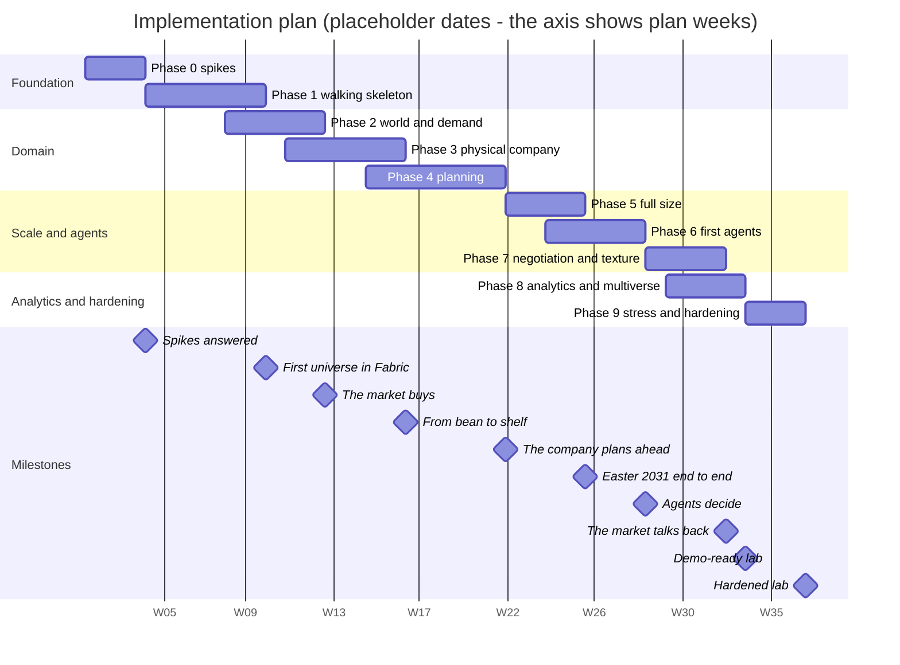

# 14 — Implementation plan

This chapter lays out the intended build sequence, phase exit criteria, measurements and estimated costs.
It starts with spikes for the open checks in chapter 12 §12.16 and cost measurements in chapter 13 §13.12,
then builds the walking skeleton, expands the universe and adds LLM agents after rules, decision logging and
replay are in place.

Durations and costs are estimates; chart dates are placeholders. The [index](./README.md) summarizes current
implementation separately from this target plan.

---

## 14.1 Principles

**Delivery scope.** Build Giandoria as one reusable demo in Sweden Central on a fixed F4. No `dev`,
`stress` or separate sandbox deployment is approved. Local development, isolated spike items and load measurement
remain useful, but larger-SKU phases and the original 36-week multi-environment cost schedule below are reference
studies, not the delivery commitment. Reduce load before requesting any SKU change.

**Current implementation.** The [overview](./README.md) distinguishes working increments from the target design.
The [Fabric summary](./20-fabric-walking-skeleton.md) states the verified scope; it does not imply completion of
the end-to-end walking skeleton below.

| # | Principle | What it means in practice |
|---:|---|---|
| 1 | **Walking skeleton first** | The first runnable thing is a tiny universe that goes all the way: clock, simulators, emitter, Eventstreams, Eventhouse, Lakehouse, a dashboard, hibernate and resume, the cost meter. Depth comes later |
| 2 | **Measure before expanding scope** | Measure Profile S on F4, then try M within the same F4; reduce speed/fidelity/profile on overload. Any SKU change needs a new decision |
| 3 | **Rules before LLM** | Every decision has a rule-based default (chapter 09 §9.1). Agents arrive after the planning engines, the decision log and replay, and they are measured against the rules |
| 4 | **Cost control from the first run** | Leases, limits, the cost meter, the watchdog and the safety net are part of the skeleton, not a later hardening step |
| 5 | **Code only, from the first commit** | Every element of chapter 12 is created by the bootstrap or by a pipeline. The only user-interface steps are those that decision D18 allows (chapter 15) |
| 6 | **Contracts before content** | The envelope, the event schemas, the step contract and the KQL generator are fixed early. Each later phase adds event types and simulators that fill them |
| 7 | **Deterministic from day one** | Seeds, deterministic event IDs, snapshots and replay exist from phase 1. They are test tools before they are demo tools |
| 8 | **Every phase ends in a usable lab** | Each phase ends with a run that someone can watch, a green smoke test, the environment hibernated and the documents updated (§14.16) |

---

## 14.2 Workstreams

The work splits into six streams. They follow the chapters of the design and run partly in parallel.

| Stream | Builds | Design | Busiest in phases |
|---|---|---|---|
| **Platform** | Bootstrap and guardrails, Azure foundation, Fabric workspace, pipelines; Chronos, the emitter library, Lab Control and its CLI; cost meter, watchdog, safety net | Chapters 07, 11, 12, 13 | 0, 1, 9 |
| **World and market** | sim-world, sim-market, sim-retail, sim-trade: territory, consumers, stores, customers, campaigns, competitors | Chapters 02, 03 | 2, 7 |
| **Company operations** | sim-factory, sim-supply, sim-logistics, svc-finance | Chapters 04, 05 | 3 |
| **Planning** | svc-planning: forecasting, S&OP, seasonal plans, reverse-time simulation, MPS, MRP, scheduling, DRP, ATP, allocation, the delivery outlook, plan publication | Chapters 06, 17 | 4, 5 |
| **Agents** | svc-agents: roster, role cards, prompts, decision log, budgets, replay, evaluation | Chapter 09 | 1 (one role), 6, 7 |
| **Data and experiences** | Event schemas, the KQL generator, Eventhouse and Lakehouse content, dashboards, reports, Activator rules, data quality, evaluation | Chapters 10, 11 §11.6 | Every phase; mostly 8 |

*Team assumption.* The durations assume a small team of about three engineers (platform; simulation and planning;
data and agents), plus a domain reviewer who checks every few weeks that the universe "looks right"
*(assumption)*. With a single person the plan takes roughly two to three times longer *(estimate)*.

---

## 14.3 Phases at a glance

| Phase | Name | Goal in one line | Plan weeks *(estimate)* | Environment and SKU | Ends with |
|---:|---|---|---|---|---|
| 0 | Spikes | Local tests, then isolated platform checks and cost calibration | Original weeks 1–3 | `demo`, F4 | *Spikes answered* |
| 1 | Walking skeleton | Cross every boundary without touching unrelated subscription resources | Original weeks 4–9 | `demo`, F4 | *First universe in Fabric* |
| 2 | World and demand | Territory, seasonality and hidden truth | Original weeks 8–12 | `demo`, F4 | *The market buys* |
| 3 | Physical company | Produce, buy, store, move and cost chocolate | Original weeks 11–16 | `demo`, F4 | *From bean to shelf* |
| 4 | Planning | Plan backwards with engines and rules | Original weeks 15–21 | `demo`, F4 | *The company plans ahead* |
| 5 | Retained history | Backfill, warm start and a measured larger profile within F4 | Original weeks 22–25 | `demo`, F4 | *Useful demo dataset* |
| 6 | First agents | Add budgeted roles, replay and evaluation | Original weeks 24–28 | `demo`, F4 | *Agents decide* |
| 7 | Texture | Add only the remaining stories needed for demonstrations | Original weeks 29–32 | `demo`, F4 | *The market talks back* |
| 8 | Experiences | Dashboards and human participation, subject to F4/API support | Original weeks 30–33 | `demo`, F4 | *Demo-ready lab* |
| 9 | Rehearsal | Restart, retention, failure and cost checks; larger-SKU stress is excluded | Original weeks 34–36 | `demo`, F4 | *Rehearsed demo* |

The phases add up to 47 weeks of work but take **about 36 calendar weeks**, because some of them overlap:

* **Phases 1 and 2.** The world and market simulators are written against the step contract (chapter 08 §8.3) and
  tested offline while the platform finishes the skeleton.
* **Phases 2 and 3, 3 and 4.** The next layer starts when the master data of the previous layer is stable. Planning
  engines can be developed against recorded event histories before the physical simulators are complete.
* **Phases 5 and 6.** The agent runtime (decision log, budgets, replay) is built while phase 5 measures Profile M.
* **Phases 7 and 8.** Reports and evaluation are built on runs that already exist.

The dates only serve to draw the chart. Monday 4 January 2027 opens ISO week 1, so the axis labels (W01, W02 …) are
the plan weeks. Holidays are ignored. These are **wall-calendar** dates for the project, not sim dates.

**Starting a phase.** Before a phase starts, the sources of the features it uses are checked again (chapter 16 §16.6):
items marked preview or *(verify)* in chapter 11 §11.3, features whose general availability was inferred rather than
stated (chapter 16 §16.5), and the prices on the price card. Any change updates the affected chapters before work
starts.

---

## 14.4 Phase 0 — Spikes

**Goal.** Answer the 29 open checks of chapter 12 §12.16 and the phase-0 cost measurements of chapter 13 §13.12 with
small, throw-away experiments, before any durable element exists. Four checks can change the design (1, 5, 7 and 19),
so they come first. Check 29 can as well, in tenants that turn off public access to Storage (chapter 18 §18.10).

**Where.** Local tests first, then isolated spike resources in the single `demo`, sharing its one F4 and using
scripts (`az`, `fab`/REST, Bicep and `fabric-cicd`). Temporary identities may stand in for runtime/control/deploy.
No separate sandbox capacity is created. Before billable checks, agree numeric D16 limits within the owner's
approximately EUR 200 initial-dataset objective. Every script suspends the capacity on completion/failure.
Clean up only explicitly owned throw-away items, never retained demo datasets or the shared Foundry.

| Spike | Week | Checks (§12.16) | Measurements (§13.12) | What it does |
|---|---|---|---|---|
| **Ingestion** | 1 | **1**, 2, 3, 4, **5**, 21 | — | A throw-away generator sends envelopes (chapter 10 §10.2) at Profile M rates, ≈ 3,000 events and 2–3 MB per wall second at S = 8,760, through four Eventstreams with direct ingestion. It measures the end-to-end latency with streaming ingestion and with 10–30 s batching (chapter 10 §10.7), and whether transactional update policies keep up |
| **Lake** | 1 | 6, **7**, 18, **19** | — | Mirroring to OneLake, shortcuts to mirrored tables, Direct Lake over two Lakehouses, writing Delta from a container through the OneLake endpoint, table maintenance from a job identity |
| **Identity and control** | 2 | 8, 9, 10, 11, 12, 13, 14, 20, 23, 26, **29** | — | The minimum custom role, the API names of the tenant settings, capacity administrators, name scopes, the policy alias, Container Apps authentication and scale rules, a Bicep deployment against a suspended capacity, storage behind a network security perimeter |
| **Experiences** | 2 | 15, 17, 22, 24 | — | Plan item API, data agent requirements, the Activator evaluation interval, starting and stopping Activator rules through the API |
| **Cost** | 1–3 | 16, 27, 28 | CM-01, CM-03, CM-04, CM-07, CM-09 | A one-hour F4 run at a known load, then suspend, then the billed meters over the next days; Eventstream charges with and without traffic; overage and surge-protection defaults; capacity events; the OneLake Cache while suspended |
| **Tooling** | 2–3 | 25 | — | Do the generated expansion functions and update policies run in the Kusto emulator container exactly as in the Eventhouse? The answer decides where the contract tests of `validate` run (§14.15) |

### Exit criteria

1. Every check has a recorded, dated answer. Where the answer is "no", the fallback of §12.16 is adopted and the
   affected chapters are updated.
2. The four design checks (1, 5, 7, 19) are answered, and check 29 where tenant policy turns off public access to
   Storage. If any answer is "no", the resulting design change is reviewed before phase 1 starts.
3. The price card (RT-02) has a first calibration from CM-01, CM-03 and CM-09. CM-07 continues into phase 1, because
   it needs several days with the capacity suspended.
4. The decisions due in phase 0 are closed (chapter 15): D1, D4 to D10, and D16 to D20.
5. Owned temporary spike items are cleaned up, retained datasets remain, the F4 is suspended and spending is recorded.

**Cost:** pending a current Sweden Central F4 price card, suspension settlement, model use and retained-storage
measurement. Historic USD estimates below are not authorization to spend the owner's EUR 200 target.

**Risks.** A Fabric administrator must be available to change tenant settings (checks 11 and 19) and to look at the
overage setting (check 27). Preview features can change within weeks, so every answer carries its date.

---

## 14.5 Phase 1 — Walking skeleton

**Goal.** A tiny universe that crosses every boundary of the design once, created by the pipeline from an empty
subscription. It proves the time model (chapter 07), the control plane (chapter 11 §11.5), the data path
(chapter 10) and the cost defences (chapter 13) before any domain depth exists.

### What is built

| Area | Content | Elements (chapter 12) |
|---|---|---|
| Bootstrap and guardrails | Groups, tenant settings, the Lab Control API registration, resource groups, identities, custom role, role assignments, ops storage, quota checks, the GitHub environment; policies, budgets, action group, safety net, delete lock | BS-01 to BS-19 (BS-05 waits for phase 8; BS-20 only in workspace option B); GR-01 to GR-12 |
| Azure foundation | Monitoring, Storage, registry, Container Apps environment, Foundry with its model deployments, the capacity | AZ-01 to AZ-05, AZ-13 to AZ-17, AZ-19; AZ-18 only with ingestion option B |
| Apps and jobs | Lab Control, the universe, the agents app, genesis, the watchdog | AZ-06 to AZ-09, AZ-12 |
| Fabric items | Workspace, roles, folders, Eventhouse, both KQL databases, both Lakehouses, the four Eventstreams, the bridge and exploration notebooks; `es_capacity` if check 28 allows it | FB-01 to FB-03, FB-05 to FB-15; FB-17 |
| Inside the KQL databases | Bronze tables and mapping, ingestion policy, the generator of silver tables, expansion functions, update policies, views and functions; data-quality functions; retention, caching and mirroring policies | KQ-01 to KQ-09, KQ-11, KQ-12; KQ-14 if needed; KQ-15 with FB-17 |
| Inside the Lakehouses | The 24 `dim_*` tables (filled with the small subset the skeleton needs), the sim calendar, an empty `plan_lines`, shortcuts, folders, table maintenance | LH-01 to LH-06, LH-08 |
| Experiences | A first semantic model, the lab dashboard and the lab Activator | VZ-01 (minimal), VZ-07 `rtd_lab`, VZ-13 `act_lab` |
| Run-time configuration | Wiring document, Lab Control settings with the price card, limits, the `smoke` scenario, the master-data version, one role card, the model aliases | RT-01 to RT-07 |
| Repository and pipelines | Repository, environments, all workflows (including `validate`, `release`, `hibernate` and `teardown`), Fabric configuration/publishing scripts, placeholders, the export path | CI-01 to CI-06 |

### The minimal universe

| Part | What the skeleton contains |
|---|---|
| Chronos | The tick protocol, pacing and lag, the clock state machine, the time ledger, snapshots, seeds and deterministic event IDs (chapter 07) |
| Emitter library | Envelope, routing to the four streams, retries, outbox, checkpoints, backpressure (chapter 08 §8.7) |
| Simulators | Thin stubs: sim-world (calendar and weather), sim-retail (one store, one SKU), sim-factory (one line), sim-supply (one supplier) and a truth source (the latent demand for that SKU). Enough to put events on all four streams |
| Agents | One decision type for one cheap role, for example the news writer on `chat-small`, with its fallback rule, the decision log and replay. It proves the decision path of chapter 09 §9.3 and step 6 of the smoke test |
| Lab Control and CLI | The commands used in the runbooks of chapter 13 §13.11: create, start, pause, resume, hibernate, stop, emergency stop, status, cost, speed, open and close. Leases and limits (RT-03) |
| Cost defences | The cost meter in Chronos with the price card, the watchdog with the daily reconciliation, the nightly `hibernate` workflow, the safety net (chapter 13 §13.7) |

### Measurements

* **Sizing.** Profile S at S = 730 and at S = 8,760, on F2 and on F4 (chapter 11 §11.7; CM-08 for `dev`).
* **Full speed in `dev`.** The usual speed limit of `dev` is S = 730 (RT-03). Until `demo` exists, phases 1 to 4 must
  prove that every new simulator keeps up at S = 8,760, so the `dev` limit is set to 8,760 until phase 5 and then goes
  back to 730. The SKU, wall-hour, token and money limits do not change, so the cost exposure stays the same.
* **CM-02** (Eventhouse uptime and vCores at Profile S), **CM-05** (Activator consumption), **CM-06** (the meter, the
  capacity events and the bill compared over three runs), and the end of **CM-07**.
* Capacity events (FB-17, KQ-15) are recommended in `dev` during this phase (chapter 13 §13.6).

### Exit criteria

1. From an empty subscription, the bootstrap and one `release` build `dev` with no portal step other than those that
   decision D18 allows.
2. The smoke test (chapter 12 §12.12) passes on three consecutive releases.
3. `teardown` followed by `release` rebuilds `dev`, and the smoke test passes again (OP-09).
4. Runs at S = 730 and at S = 8,760 complete with an effective speed of at least 95% of the target *(assumption)*.
   `DqGaps` stays empty across a hibernate, and across an emergency stop with recovery (OP-06).
5. A replay of a run produces the same event IDs at zero token cost.
6. The watchdog suspends the capacity when a lease expires, and a deliberate test of the safety net works (OP-11).
7. The cost meter never reports less than the bill for a run day, and at most about 20% more *(assumption)*.

**Environment and cost** *(estimate)*: `dev` on F4; ≈ $170–230 for the phase.

**Risks.** Gaps in `fabric-cicd` item/property support (fallback: targeted `fab`/REST only where an API exists, D7).
Latency or capacity surprises at S = 8,760, even with Profile S (the fallbacks of checks 4 and 5). Tenant-level
prerequisites that take time to obtain.

---

## 14.6 Phase 2 — World and demand

**Goal.** The territory comes alive and the market buys: calendar and weather, consumers and the layers of demand,
flagship stores, outlets and the e-shop, chains and the other trade customers, campaigns and competitors. The hidden
truth is generated next to what the company can observe (chapter 03 §3.10).

| Area | Content |
|---|---|
| sim-world | The Italian calendar of the epoch years (moving feasts, public holidays, school calendars, daylight saving), weather by region with heatwaves, tourism flows, rule-based news (chapter 03 §3.3, §3.7 and §3.8; chapter 07 §7.7) |
| sim-market | Latent demand per province, segment and day, built from the layers of chapter 03 §3.2: seasonality, prices and promotions, competitor archetypes on rules (chapter 02 §2.11) |
| sim-retail | Flagship stores, outlets and the e-shop: footfall, receipts, store stock, store events (chapter 02 §2.6) |
| sim-trade | The chains of the profile as store clusters per area (three chains over 20 regions in Profile S; six chains over 107 provinces in Profile M), wholesalers, cash-and-carry, professional distributors, travel retail, export distributors: orders, seasonal bookings, promotions, sell-out reports, returns (chapter 02 §2.7 and §2.12). Charity foundations and corporate gift clients run on rules (chapter 03 §3.6) |
| Supply stub | Until phase 3, a stub ships whatever is ordered from unlimited stock, so sales equal demand minus store stock-outs |
| Master data | Genesis builds the full Profile S: territory, stores, customers and sites, agreements, campaigns, segments and competitors (§14.14) |
| Data and experiences | Silver tables, views and functions for the `world`, `market`, `retail`, `trade` and `truth` families; `rtd_commerce` (VZ-09); seasonality analyses in `nb_explore` (FB-15); optional querysets (FB-16) |

### Exit criteria

1. A sim year at Profile S, on rules, shows the seasonal shape of chapter 03: Easter, Christmas, the summer trough,
   Halloween, Valentine's Day and the charity weekends, within calibration tolerances agreed in the phase against
   chapter 03 §3.1 and §3.4.
2. Truth and observation differ as designed: latent demand and lost sales in `kqldb_truth` can be compared with the
   observed sales in `kqldb_giandoria`.
3. The same scenario and seed give identical event IDs and identical daily totals.
4. Event volumes per family are within ±30% of chapter 10 §10.4, scaled to Profile S *(assumption)*.
5. The domain reviewer accepts a walk through one sim year.

**Environment and cost** *(estimate)*: `dev` on F4; ≈ $140–190.

**Risks.** Calibration takes longer than coding. Too many knobs: only the knobs listed in chapter 08 are exposed, and
the domain reviewer looks at the results every week.

---

## 14.7 Phase 3 — The physical company

**Goal.** Chocolate is made, materials are bought, products are stored, moved and costed. A store sale can be traced
back to a cocoa lot.

| Area | Content |
|---|---|
| sim-factory | The process chain from bean to box, forming technologies, lines and capacity, machine states, reliability and maintenance, changeovers, quality holds and genealogy, shifts, energy. Telemetry at L0 and L1, and L2 on a showcase line (chapter 04) |
| sim-supply | Suppliers and lanes, cocoa contracts and shipments, the hazelnut harvest, packaging and toy surprises, supplier behaviour with a hidden true capacity (chapter 05 §5.2 to §5.7) |
| sim-logistics | Warehouses and stock statuses, transport and the summer cold chain, order to cash with EDI documents, returns, recalls and write-offs (chapter 05 §5.8 to §5.12) |
| svc-finance | Standard costs, margins, cash and working capital, variances (chapter 08 §8.5) |
| Planning stub | Until phase 4, reorder points and a fixed production wheel keep the company working without svc-planning |
| Master data | Plants, lines, machines, tags, materials, BOMs, routings, suppliers, lanes and warehouses for Profile S |
| Data and experiences | `rtd_factory` (VZ-08), `rtd_supply` (VZ-10) and the operational rules of `act_operations` (VZ-12) |

### Exit criteria

1. Throughput times match chapter 04 §4.11, and OEE stays in the ranges of chapter 04, within tolerances agreed in
   the phase.
2. Stocks and money balance. For every location and material, opening stock plus receipts minus issues equals
   closing stock, and every delivered order is invoiced. Data-quality functions check this on every run.
3. A genealogy query goes from a store sale back to the cocoa lot (chapter 04 §4.7).
4. The factory's event volume at L1 is within ±30% of chapter 04 §4.10, scaled to Profile S *(assumption)*.
   Decision D3 is confirmed.
5. A sim year at Profile S completes at S = 8,760 without lag caused by the new simulators.

**Environment and cost** *(estimate)*: `dev` on F4; ≈ $170–230.

**Risks.** Discrete-event logic inside ticks may be slow at S = 8,760: profile early and aggregate telemetry at the
source. Detail creep: the deliberate simplifications of chapter 04 §4.13 and chapter 05 §5.16 define the scope.

---

## 14.8 Phase 4 — Planning

**Goal.** The company looks ahead. The planning hierarchy of chapter 06 works with engines and rules, and no LLM.
Easter 2031 is planned backwards, with finite capacity, by reverse-time simulation (chapter 17).

| Area | Content |
|---|---|
| Engines | Statistical forecasting (smoothing, Croston, event regression), S&OP as a linear programme with costed options, newsvendor sizing and reverse-time simulation for seasons (chapter 17), MPS (heuristic plus mixed-integer model), MRP, scheduling with a time limit, DRP and fair share, ATP and CTP (chapter 06 §6.6 to §6.12; technology in chapter 08 §8.9) |
| Rhythm | The planning calendar in sim time and the time fences (chapter 06 §6.3 and §6.4) |
| Inputs | The delivery outlook from customers and the forward-looking information from suppliers (chapter 06 §6.5; chapter 05 §5.14) |
| Publication | Plan headers and exceptions on the stream; plan lines as Delta tables in `lh_giandoria` (LH-03), with optional SQL views (LH-09) (chapter 06 §6.15) |
| Experiences | `rtd_planning` (VZ-11), `rpt_sop` (VZ-03), `rpt_forecast_accuracy` (VZ-04); the planning KPIs of chapter 06 §6.16 |
| Scenario | `easter-2031-base` at Profile S, with its epoch on 1 June 2030 (RT-04) |

### Exit criteria

1. In `easter-2031-base`, decisions E1 to E13 of chapter 06 §6.9 happen on their sim dates, taken by engines and
   fallback rules.
2. Forecast accuracy by lag and plan stability are computed from the plan history.
3. Every engine call fits its wall-time budget at S = 8,760 with Profile S, so the clock never lags because of
   planning. At that speed a sim day lasts about 10 wall seconds (chapter 07 §7.3).
4. Plan-line volumes match the estimate of chapter 06 §6.15, scaled to Profile S. Decision D12 is confirmed.
5. A shock, such as a late toy wave (chapter 06 §6.11), produces new plan versions and exceptions.
6. The reverse-time engine passes the tests of chapter 17 §17.9, mirror symmetry included, and reproduces the worked
   example of chapter 17 §17.6 to the hour.

**Environment and cost** *(estimate)*: `dev` on F4; ≈ $200–270.

**Risks.** Solver time at Profile M: time limits, warm starts, coarser buckets, and heavy solves only at decision
points behind a barrier (chapter 07 §7.9). Scope creep in planning: the plans listed in chapter 06 §6.15, and no more.

---

## 14.9 Phase 5 — Full size: Profile M and Easter end to end

**Goal.** Build and retain a useful history in the existing F4 `demo`, then demonstrate warm start and incremental
generation. Profile M at S = 8,760 is a measurement target, not an F4 guarantee. Reduce load/speed if necessary.
The `easter-2031-base` epoch is 1 June 2030; backfill/fork preserves its planning history (chapter 06 §6.14).

| Area | Content |
|---|---|
| Environment | Reuse the existing single F4 `demo`; never provision a second demo capacity |
| Master data | Genesis at Profile M: two plants, ≈ 14 lines, ≈ 180 SKUs, 20 own stores, 107 provinces (chapter 02 §2.12) |
| Backfill | The backfill job (AZ-10) in deployment mode C: JSON-lines files in `Files/backfill/`, then bulk ingestion into the same bronze tables (chapter 10 §10.7) |
| Warm start | A backfill of 12–18 sim months before the epoch; the live run forks from its snapshot (decision D11) |
| Archive and cleanup | The archive job (AZ-11) with the archive tables (LH-07); `lab keep` and the weekly cleanup (OP-08) |
| Lab operations | Fork, replay, backfill and measured speed changes; SKU remains F4 |

### Measurements

* **CM-02** at Profile M; **CM-06** over three runs in `demo`.
* **CM-08**: one-hour runs at Profile M on F4 and F8, and on F16 only if F8 throttles; one six-hour run.
* **CM-10**: CPU and memory of the universe container at S = 8,760.
* Capacity events are recommended in `demo` during this phase (chapter 13 §13.6).

### Exit criteria

1. `easter-2031-base` completes at S = 8,760 in about 55 wall minutes, with an effective speed of at least 95% of the
   target *(assumption)*, from a backfilled warm start.
2. The Easter numbers are plausible: ≈ 3.65 M eggs, the build on EGG1 and EGG2 from 3 November to 27 February, the
   stock peak at the end of January, the charity weekend of 22–23 March 2031 served (chapter 06 §6.9).
3. The smallest SKU that does not throttle Profile M is known and written into RT-02. The price card uses measured
   consumption.
4. The size of the universe container is fixed (CM-10). Decision D5, deployment mode A, is confirmed or revised.
5. A one-hour run on rules costs about the same as a replay in chapter 13 §13.4 (≈ $4–6), because neither uses tokens.

**Environment and cost** *(estimate)*: `demo` on F8 and `dev` on F4; ≈ $230–350.

**Risks.** Profile M may be too heavy for one container: move the heaviest simulator out (deployment mode B,
chapter 08 §8.8) or lower the fidelity. F8 may throttle: F16, shorter runs or L0 telemetry. Backfill volumes:
retention is based on ingestion time [F31], so old sim years are not deleted early.

---

## 14.10 Phase 6 — First agents

**Goal.** LLM agents take their first decisions under the rules of chapter 09: structured, validated, logged,
budgeted, replayable, and measured against the rules they replace.

| Area | Content |
|---|---|
| Runtime | svc-agents with Microsoft Agent Framework and Foundry models (chapter 09 §9.9): decision requests, cut-offs and barriers, validation and repair, fallback, decision log, budgets per role and per run, replay with substitution |
| Roles | S&OP chair, demand planner, procurement manager, logistics allocator: the first step of the starting set (chapter 09 §9.2) |
| Evaluation | The standard scenario suite (`calm-year`, `hazelnut-harvest`, `toy-delay`, `cocoa-spike`, `heatwave-june`, `quality-incident`; RT-04), run with rules and with agents; a scorecard per role (chapter 09 §9.8) |
| Observability | One trace per decision in Application Insights; the `agent.*` events; cost per role on `rtd_lab` |

### Exit criteria

1. Across the scenario suite at Profile M, at least 90% of decisions are valid at the first try, and fallbacks stay
   below 5% apart from budget exhaustion *(assumption)*.
2. Tokens and cost per sim year stay within chapter 09 §9.7: ≈ $9–12 per sim year for the full roster on gpt-5-mini,
   and less for four roles.
3. A replay of an agent run reproduces the same events at zero token cost. A replay with substitution re-decides one
   role only.
4. The scorecard compares agents and rules on every scenario. Whether the agents win is a finding, not an exit
   criterion.
5. Decision D14 (starting set, model tiers, language of free text) and the runtime part of D15 are confirmed.

**Environment and cost** *(estimate)*: `dev` and `demo`; ≈ $340–480, about two passes of the scenario suite plus
development runs.

**Risks.** Model latency at S = 8,760: fallback at the deadline, barriers only at decision points. Quota: at least
300k tokens per minute at S = 8,760 (chapter 09 §9.7). Prompt drift: every prompt version is tested by replay.

---

## 14.11 Phase 7 — Negotiation and texture

**Goal.** The market talks back. Buyers negotiate, foundations run tenders, news is written and read, and the
remaining roles join one at a time.

| Area | Content |
|---|---|
| Negotiations | Key account manager and chain buyers, with two chains played by LLM personas and the others on rules; turn limits, structured outcomes, relationship scores (chapter 09 §9.5) |
| Seasons and campaigns | Seasonal category manager; the charity tender committees (chapter 03 §3.6) |
| Texture | The news writer, whose items other agents read; corporate gift clients; supplier sales reps |
| Remaining roles | CEO, production planner, maintenance, quality, retail operations, marketing and pricing, controller; the competitor game master is optional. A role joins only when its fallback, its KPIs and its scenario tests exist. A role that is not ready stays on its rules, which is a valid state |

### Exit criteria

1. A full `easter-2031-base` run with the whole roster stays within the token limit of a `demo` run (30 M tokens), or
   degrades to rules when it reaches it (chapter 13 §13.4).
2. Every negotiation ends within its turn limit with a structured result.
3. A one-hour showcase run with agents costs ≈ $13–18 (chapter 13 §13.4).

**Environment and cost** *(estimate)*: `dev` and `demo`; ≈ $250–380.

**Risks.** Conversation loops: turn limits and budgets per conversation. Unrealistic behaviour: personas reviewed by
the domain reviewer, guardrails of chapter 09 §9.6.

---

## 14.12 Phase 8 — Analytics, multiverse and evaluation

**Goal.** The lab becomes a tool for analysis and demos: forks and the multiverse, evaluation against the hidden
truth, questions in natural language, a map, optional human decisions, packaged demos.

| Area | Content |
|---|---|
| Multiverse | `lab fork`, replay with substitution, comparisons across runs (chapter 10 §10.10); `rpt_multiverse` (VZ-05) |
| Evaluation | Evaluation functions (KQ-10), `lh_evaluation` with the truth shortcuts, `sm_evaluation` (VZ-02), `rpt_season_review` (VZ-06); the strict truth option if an audience needs it (BS-05, decision D8) |
| Lab agents | The data agent `da_giandoria` (VZ-14); the operations agent `oa_lab` (VZ-16, optional) |
| Map | `map_giandoria` (VZ-15): stores, warehouses, shipments and provinces |
| Optional items | Ontology (VZ-17), anomaly detector (VZ-18) |
| Human in the loop | "Pause at decision" with the front end chosen in decision D13. The Plan item (VZ-19) stays deferred unless check 15 found an API |
| Fabric in the loop | The optional mode of chapter 09 §9.9, behind a data barrier (decision D15) |
| Demo packaging | Kept runs, demo scripts, the demo day of chapter 13 §13.4 rehearsed |

### Exit criteria

1. One query compares two universes of the same scenario, for example rules against agents, or a shock against no
   shock.
2. Forecast error against latent demand, and lost sales, are measured in evaluation reports only.
3. The data agent answers a standard set of questions correctly, for example "why did OTIF drop in March 2031?". The
   question set is written during the phase.
4. A demo day runs from the runbook for ≈ $20–27 (chapter 13 §13.4).

**Environment and cost** *(estimate)*: mostly `demo` on F8; ≈ $300–420.

**Risks.** Preview items (map, ontology, operations agent, Plan item) may change; they are all optional. Below F64,
every report viewer needs a Power BI Pro licence (chapter 13 §13.4).

---

## 14.13 Phase 9 — Stress and hardening

**Goal.** Know the limits, survive failures, and prove that the lab can be rebuilt by someone who did not build it.

| Area | Content |
|---|---|
| Stress | A temporary `stress` environment with Profile L on F32 at S = 8,760 (chapter 11 §11.7), with the Eventstream medium tier [F14]. Deployment mode B if CM-10 shows that one container cannot keep up |
| Chaos tests | Kill the universe container in the middle of a tick; suspend the capacity under a running universe; let a lease expire; make the model endpoint throttle; take an Eventstream endpoint away so the outbox fills; stop the watchdog so that the safety net must act |
| Runbooks | OP-01 to OP-11 (chapter 13 §13.11), each rehearsed by someone who did not write it |
| Rebuild | Teardown of `demo` and rebuild from the exports, then replay of a kept run (OP-09) |
| Security | Review of identities, roles, tenant settings and data exposure. No secret anywhere |

### Exit criteria

1. A stress run (Profile L, one sim year in one wall hour) completes, or reports exactly where it saturates. It costs
   ≈ $27–42 (chapter 13 §13.4).
2. Every chaos test ends with no lost events (`DqGaps` empty), duplicates counted, and the capacity suspended.
3. Every runbook works as written.
4. The `stress` environment is torn down at the end. Only the bootstrap elements and guardrails remain.

**Environment and cost** *(estimate)*: `stress` on F32, with `dev` and `demo` mostly idle; ≈ $250–450. The `stress`
environment gets its own allowance (decision D16).

---

## 14.14 Genesis: creating the world

Genesis is the job (AZ-09 `caj-genesis`) that creates the universe's **master data** from a profile, a seed and public
reference data. It runs in stage 5 of every release (chapter 12 §12.2) and whenever the master-data version changes.

| Step | What it does |
|---:|---|
| 1 | Loads reference data: Italian regions, provinces and municipalities with their population, and tourism by municipality, from ISTAT open data [M32][M33][M34][M35]; holidays and school calendars of the epoch years [M24][M26][M30] |
| 2 | Builds the company: brands, product families, SKUs with BOMs and routings, plants, lines, machines and tags (chapters 02 and 04) |
| 3 | Builds the network: materials, suppliers and lanes, warehouses (chapter 05) |
| 4 | Builds the market: stores, customers and their sites, agreements, campaigns, segments, demand cells, competitors (chapters 02 and 03) |
| 5 | Builds the actors: agent roles and personas (chapter 09) |
| 6 | Validates everything (rules below) |
| 7 | Writes the 24 `dim_*` tables, `sim_calendar` and an empty `plan_lines` to `lh_giandoria` through the OneLake endpoint, and the same data as files in `genesis/{md_version}/` in Lab Storage, where the simulators read it |

**Rules.**

* **Deterministic.** The same profile, seed and generator version give the same master data.
* **Versioned.** Every output carries an `md_version`. Every run records the version it starts from (RT-05,
  chapter 10 §10.9), and older versions stay readable for older runs.
* **Grows with the plan.** A minimal subset in phase 1, the full Profile S in phases 2 to 4, Profile M from phase 5,
  Profile L in phase 9.
* **Validated before it is written.** Referential integrity. Every SKU has a BOM, a routing and at least one line.
  Every material has a supply lane. Every store and customer site lies in a province. The lines can make the planned
  annual volume with the shift patterns of chapter 04 §4.8, with a margin. Every seasonal or campaign SKU belongs to a
  season or campaign. Names and product categories follow chapter 02.
* **Not the plans in flight.** Open orders, bookings, stock and plan versions on the first day are created by the
  warm start (chapter 06 §6.14, decision D11), either synthetically or by backfill and fork.

---

## 14.15 Testing strategy

| Level | What is tested | Where | When |
|---|---|---|---|
| Unit | The domain rules of each simulator and engine | `validate` | Every pull request |
| Reverse-time planning | The tests of chapter 17 §17.9: hand-computed schedules, mirror symmetry, calendars with daylight-saving nights, determinism, and the worked example of §17.6 to the hour | `validate` | Every pull request |
| Step contract | Every simulator against the step contract (chapter 08 §8.3), with recorded ticks | `validate` | Every pull request |
| Event contract | Sample events of every type against their JSON Schemas (chapter 10 §10.14) | `validate` | Every pull request |
| KQL contract | Sample events of every type through the generated expansion functions and update policies (KQ-05, KQ-06). A transactional policy rejects a whole bronze batch when one event fails (chapter 12 §12.7), so this test protects ingestion. It runs in the Kusto emulator, or against a test database in `dev` if check 25 fails | `validate` | Every pull request |
| Determinism | The same scenario and seed give the same event IDs and daily digests; a replay gives identical events | `dev` | Every release *(assumption)* |
| Conservation and data quality | Stock, unit and money balances; `DqGaps`, `DqDuplicates`, `DqLatency` (chapter 10 §10.12) | Every run | Always |
| Calibration | Seasonal shapes, throughput times, OEE and volumes against the design chapters | `dev`, `demo` | End of phases 2 to 5 |
| Smoke | Chapter 12 §12.12 | Stage 7 | Every release |
| Scenario suite | Rules against agents (chapter 09 §9.8) | `demo` | Phases 6 to 8, then whenever prompts or models change |
| Chaos | The list of phase 9 | `stress` | Phase 9, then twice a year *(assumption)* |

---

## 14.16 Definition of done

A phase is done when:

1. Everything it created is in Git and deployed by the pipeline, and running `release` again changes nothing.
2. The smoke test is green and the exit criteria of the phase are met.
3. Its measurements are recorded and the price card is updated.
4. The chapters it touched, the runbooks and the decision log of chapter 15 are updated.
5. The environment is hibernated: `lab status` shows the idle checklist green, and the month is within its allowance.
6. A run that shows the result of the phase is kept (`lab keep`), so that it can be replayed later at no token cost.

---

## 14.17 Cost of the plan *(estimate)*

Lab costs follow the team's working rhythm rather than the phases: the same people run the same environments whichever
phase they are in. The total is therefore estimated per environment over the calendar, with the monthly rates of
chapter 13 §13.5.

| Environment | Plan weeks | Basis | Azure and Fabric cost |
|---|---|---|---:|
| Sandbox | 1–3 | The spikes of phase 0 (§14.4) | $50–100 |
| `dev` | 4–36 (≈ 7.6 months) | An active `dev` month ≈ $120–165: about 20 dev runs, 20 releases, 10 analysis sessions | $910–1,250 |
| `demo` | 22–36 (≈ 3.5 months) | An active `demo` month ≈ $250–340: about 12 showcase runs, 2 slow demos, 6 analysis sessions | $870–1,190 |
| `stress` | 34–36 | A few one-hour stress runs at ≈ $27–42 each, plus build and teardown | $150–300 |
| **Total over ≈ 36 weeks** | | | **≈ $2,000–2,800** |

The same money, seen per phase, shows where the effort goes:

| Phase | Weeks | Environments | Indicative cost |
|---:|---:|---|---:|
| 0 | 3 | Sandbox, F4 | $50–100 |
| 1 | 6 | `dev`, F4 | $170–230 |
| 2 | 5 | `dev`, F4 | $140–190 |
| 3 | 6 | `dev`, F4 | $170–230 |
| 4 | 7 | `dev`, F4 | $200–270 |
| 5 | 4 | `dev`, F4; `demo`, F8 | $230–350 |
| 6 | 5 | `dev`, F4; `demo`, F8 | $340–480 |
| 7 | 4 | `dev`, F4; `demo`, F8 | $250–380 |
| 8 | 4 | `demo`, F8; `dev` | $300–420 |
| 9 | 3 | `stress`, F32; `dev` and `demo` mostly idle | $250–450 |
| **Sum of the rows** | 47 | | **≈ $2,100–3,100** |

* **The rows add up to more than the calendar total,** because overlapping phases share environments and runs: a run
  in week 9 serves phases 1 and 2 at the same time.
* **LLM tokens appear from phase 6.** The two passes of the scenario suite push one `demo` month towards its
  allowance.
* **The allowances cap the worst case.** With $200 a month for `dev` from week 4, $400 a month for `demo` from week
  22, $300 for the `stress` window and $150 for the sandbox, the ceiling is ≈ $3,400 *(derivation)*.
* **Not included:** Power BI Pro licences for report users below F64 (≈ $14 per user per month [F80]), GitHub and
  development tools, and people's time.

---

## 14.18 Risks

| Risk | Likelihood | Impact | Mitigation | Retired or watched in |
|---|---|---|---|---|
| A design check fails (1, 5, 7 or 19; 29 in tenants that turn off public access to Storage) | Medium | High | The fallbacks of chapter 12 §12.16; design review before phase 1 | Phase 0 |
| Tenant policy denies or changes a resource: a region, public access, keys | Medium | Medium | Audit the tenant before phase 0 and phase 9 (chapter 18 §18.12); the consequences and fallbacks of chapter 18 §18.10 | Phases 0 and 9 |
| Preview features change or disappear (Plan item, map, ontology, operations agent, Fabric IQ tool) | Medium | Low | They are optional or deferred; nothing on the critical path depends on them | Phases 0 and 8 |
| `fabric-cicd` lacks an item type/property | Medium | Medium | Targeted `fab`/REST if the API exists; otherwise defer or report the blocker (D7) | Phases 0 and 1 |
| Ingestion latency too high at S = 8,760 | Medium | Medium | Streaming ingestion; a lower speed for live dashboards; lag shown honestly (decision D10) | Phases 0, 1 and 5 |
| The Eventhouse cannot keep up with Profile M | Low | High | Non-transactional policies, more bronze tables, a larger SKU, L0 telemetry | Phases 0 and 5 |
| The simulation is too slow at Profile M and S = 8,760 | Medium | High | Profiling, aggregation at the source, deployment mode B, a lower speed | Phases 3, 5 and 9 |
| Planning solvers do not fit in the tick budget | Medium | Medium | Time limits, warm starts, coarser buckets, barriers at decision points | Phases 4 and 5 |
| LLM cost or latency above the estimates | Medium | Medium | Budgets, model tiers, fallback rules, replay, the Batch API offline | Phases 6 and 7 |
| Agents behave implausibly | Medium | Medium | Guardrails, authority limits, review of personas, the scenario suite | Phases 6 to 8 |
| A forgotten capacity or a runaway run | Low | Medium | Defence layers of chapter 13 §13.7, from the first run | Phase 1, then always |
| The universe does not "look real" | Medium | High | Calibration targets per phase; a domain reviewer; the god view against the company view | Phases 2 to 5 |
| Tenant constraints (tenant settings, OneLake access from outside Fabric) | Medium | High | Workspace option B; genesis and plan writes moved into notebooks (check 19) | Phase 0 |
| Model quota in the chosen region | Low | Medium | Quota check in the bootstrap (BS-18); Global Standard deployments (decision D4) | Phase 1 |
| Scope creep | High | Medium | Optional elements stay optional; the deliberate simplifications of each chapter; decisions in chapter 15 | Every phase |

---

## 14.19 After phase 9

The lab is then complete for its purpose. Possible next steps, none of them required:

| Extension | Why | Depends on |
|---|---|---|
| Profile L as a regular demo size | Larger universes and export subsidiaries | Phase 9 results; a larger SKU |
| Deployment mode B by default | Independent teams per simulator | Phase 9 measurements |
| Human in the loop with the Plan item | Planners in the loop with planning sheets and write-back [F65] | An API for the item (check 15) |
| Ontology or digital twin of the company | A business model over the data, for agents and people | VZ-17 maturity |
| Fabric in the loop by default | The virtual company uses Fabric as its decision-support system | Phase 8 measurements of latency and cost |
| Private networking | Audiences that require it | Decision D19 |
| More companies | A competitor as a full simulator instead of an archetype | The step contract |
| Teaching packs | Planning, supply-chain and data courses on kept runs | Kept runs and replay |

Keeping the lab alive also needs a small routine:

* **Monthly:** review the price card against the Retail Prices API warning and the reconciliation.
* **When models change:** run the scenario suite again before switching an alias (RT-07).
* **When Fabric features reach general availability:** revisit the fallbacks of chapter 12 §12.16.
* **Twice a year:** a teardown-and-rebuild drill and the chaos tests *(assumption)*.
