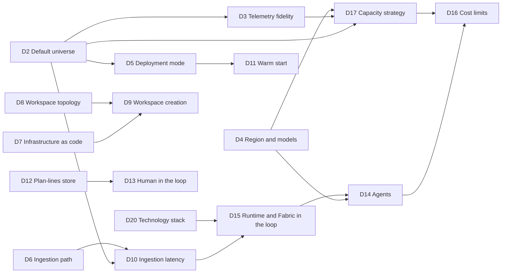

# 15 — Decisions and adopted assumptions

> The design of chapters 02 to 14 rests on **twenty decisions**. We adopt the recommended simple-demo choices
> as working assumptions, while keeping unverified platform behavior and numeric guardrails explicit. For each decision,
> this chapter says:
>
> * what the decision is about, and which options exist
> * why the default is recommended
> * what changes in the design if another option is chosen
> * by when it must be closed, and which checks or measurements provide the evidence
>
> The decisions work together with the 29 open checks of chapter 12 §12.16 and the cost measurements of chapter 13
> §13.12, which provide facts. An adopted assumption is permission to implement and test the choice, not proof
> that its dependencies work or that performance targets have been achieved.

---

## 15.1 How to read this chapter

**Our scope.** Only `demo` is deployed: Giandoria, F4, Sweden Central. There is no separate
`dev`, `stress` or sandbox environment. Larger-profile/SKU studies are reference material, not approved resources.
Local development and isolated experiments remain possible. Generated data and restart state survive hibernation.
Choosing an implementation does not close its platform checks. Bounded scripted deployment/experiments are authorized.

* **Decisions, checks and measurements.** A *decision* is a choice between options that all work, for example which
  region to use. A *check* is a question of fact about the platform, for example whether an API exists (chapter 12
  §12.16). A *measurement* turns an estimate into a number (chapter 13 §13.12). Checks and measurements are the
  evidence; decisions use it.
* **Defaults.** In each options table, the recommended default is in **bold**. The other chapters assume it.
* **If it changes.** Each decision lists what a different choice would change, so the effect can be judged before
  the choice is made.
* **Decide by.** The point in the plan of chapter 14 by which the decision must be closed. Some decisions are closed
  early with their default and **confirmed** later, when a measurement is available.
* **Status.** *Adopted assumption* means we proceed with the recommended choice and validate it through experiments.
  *Agreed* records a fixed scope constraint. Neither status closes an unverified technical check.
* **Option names.** Three families of lettered options already exist and keep their letters: deployment modes A, B
  and C (D5), ingestion options A, B and C (D6), and workspace options A and B (D9). All other options have names, not
  letters.

---

## 15.2 Summary and status

This table is also the decision log (§15.10).

| ID | Decision | Recommended default | Decide by | Evidence | Status |
|---|---|---|---|---|---|
| D1 | Names | Giandoria; prefix `giandoria`; only `demo` | In effect | Naming checks 13, 14 | Agreed |
| D2 | Default universe | `easter-2031-base`; profile/speed fitted to measured F4 capacity, not a promised year/hour | Before full simulation | CM-08 and speed measurements | Adopted assumption |
| D3 | Telemetry fidelity | Business/operational events by default; high machine detail on one showcase line only | Before machine simulation | Volume measurements | Adopted assumption |
| D4 | Region and models | Sweden Central; shared Foundry first; aliases chosen by measured cost, quality and quota | Before agent execution | BS-18, check 17; no newest-model preference | Agreed region; adopted model strategy |
| D5 | Deployment mode | Mode A modular monolith; mode C batch backfill | Before runtime deployment | CM-10 | Adopted assumption |
| D6 | Ingestion path | Emitter/outbox → Eventstream → Eventhouse; no extra Event Hubs by default | Before ingestion | Checks 1, 4, 5, 16 | Adopted assumption |
| D7 | Infrastructure as code | Bicep/AVM; `fab`/REST configuration; `fabric-cicd` definitions | In effect | Check 3 partial; 15, 21, 24, 28 open | Agreed |
| D8 | Workspace and truth | Existing single workspace; evaluation data separated and never exposed to agents | Before agent access | Checks 1, 7; no implicit item isolation for workspace members | Adopted assumption |
| D9 | Deployment identity | Dedicated secretless pipeline identity; preserve existing workspace | Before CI | Checks 11, 14; operator creation is not automation proof | Adopted assumption |
| D10 | Ingestion latency | Batch 10–30 s; lower latency only where measured useful | Before live demo | Check 4 | Adopted assumption |
| D11 | Warm start | Rule-led retained backfill and fork; avoid repeated LLM history generation | Before initial dataset | First backfill | Adopted assumption |
| D12 | Plan-lines store | Delta in `lh_giandoria`, subject to read/write checks | Before planning | Checks 18, 19 | Adopted assumption |
| D13 | Human in the loop | Simple Lab Control approval after the automatic flow works | Before interactive demo | Check 15 | Adopted assumption |
| D14 | Agents | Few meaningful roles, introduced progressively; English, optional Italian free text | Before agent rollout | Cost/quality replay suite | Adopted assumption |
| D15 | Agent runtime | Agent Framework; controlled tools; no autonomous Fabric queries initially | Before agent rollout | Check 17, D10 | Adopted assumption |
| D16 | Cost limits | EUR 500 whole subscription; bounded sessions, LLM caps, idle shutdown, retained data | Before continuous execution | Numeric amounts/currency/alerts still to measure and implement | Agreed ceiling; adopted guardrail strategy |
| D17 | Capacity | Fixed F4 PAYG; overage off; suspend when unused; no automatic upscale | In effect | CM-04, CM-08, check 27 | Agreed |
| D18 | UI use | Viewing, participation and stopped-demo authoring followed by export/redeploy | In effect | Check 27 | Agreed |
| D19 | Networking | Public Entra endpoints; resource-scoped network waivers | In effect | Chapter 19; check 29 remains fallback | Agreed; access verified |
| D20 | Stack | Python 3.13, PowerShell 7.4+, SimPy/OR-Tools/HiGHS/Agent Framework as needed | In effect | Performance measurements pending | Agreed |

---

## 15.3 How the decisions connect, and when they close

An arrow means "the first decision shapes the second". D1, D18 and D19 stand alone.

The weeks refer to the plan of chapter 14 §14.3.

| Week | Point in the plan | Decisions closed | Decisions confirmed by measurement |
|---:|---|---|---|
| 3 | End of phase 0 | D1, D4, D5, D6, D7, D8, D9, D10, D16, D17, D18, D19, D20 | — |
| 8 | Start of phase 2 | D2 | — |
| 9 | End of phase 1 | — | D10 (latency) and D17 (CM-08) at Profile S |
| 11 | Start of phase 3 | D3 | — |
| 15 | Start of phase 4 | D12 | — |
| 16 | End of phase 3 | — | D3 (telemetry volume) |
| 21 | End of phase 4 | D11 | D12 (plan-line volume) |
| 24 | Start of phase 6 | D14 | — |
| 25 | End of phase 5 | — | D2 (full size and speed), D5 (CM-10), D10, D17 (CM-08) at Profile M |
| 28 | End of phase 6 | — | D14; the runtime part of D15 |
| 30 | Start of phase 8 | D13; the Fabric-in-the-loop part of D15 | — |
| 30–33 | Phase 8 | The strict option of D8, only if an audience needs it | — |
| 34 | Demo rehearsal | No separate stress environment or larger SKU is approved | D16 actual costs and restart checks |

---

## 15.4 The universe

### D1 — Names

**Question.** What are the company, the universe and the cloud resources called? (chapter 02 §2.1; chapter 12 §12.15)

| Option | What it means |
|---|---|
| **Giandoria** | Both the fictional company and the demo are Giandoria. Resource prefix `giandoria`, environment `demo`, workspace `ws-giandoria-demo` (chapter 12 §12.15) |
| Other fictional names | Names the team prefers, under the same rules |

Whatever the names, these rules hold:

* Every company, chain, foundation, supplier, competitor and person in the universe is fictional (chapters 02 and 03).
  Prompts never mention real brands (chapter 09 §9.6).
* Products are named by category, such as gianduiotti, filled pralines, premium tablets or Easter eggs with a
  surprise, and never by a trademark.
* Charity and corporate campaigns use fictional foundations, such as Fondazione Orizzonte Ricerca (chapter 02 §2.8).

* **Why the default.** The names are neutral and Italian-sounding, and give the lab a recognisable identity. A
  trademark search is advisable before any public demo *(verify)*.
* **If it changes.** Before phase 1, only master data, role cards and these documents change. After phase 1, a new
  company name needs a new master-data version (RT-05). A new universe name needs a teardown and a rebuild (OP-09),
  because the resource groups, the workspace and most resource names contain it.
* **Decide by.** The end of phase 0, because the bootstrap creates the first named resources. **Evidence:** checks 13
  and 14 (name uniqueness and reuse) shape the name pattern, not the names.

### D2 — Default universe

**Question.** Which universe do demos and measurements use, unless a scenario says otherwise? (chapter 02 §2.12;
chapter 07 §7.3 to §7.7)

| Element | Default | Alternatives |
|---|---|---|
| Scenario | **`easter-2031-base`, "Easter 2031 end to end"**: epoch on 1 June 2030, about 11 sim months, Easter Sunday on 13 April 2031 (chapter 06 §6.9 and §6.14) | The scenario suite of chapter 09 §9.8, such as `calm-year` or `toy-delay`; a Christmas scenario *(optional)* |
| Epoch years | **2030 and 2031**: clearly virtual, with the real Italian calendar of those years (chapter 07 §7.7) | The current years: more familiar, but synthetic data could be mistaken for real data |
| Size | **Profile S first in `demo`; M after F4 measurements** | Profile L is a sizing study, not an approved cloud deployment |
| Speed | **S = 8,760 in `demo`** ("year per hour"); usually S ≤ 730 in `dev` (RT-03) | Lower speeds for storytelling and human decisions: S = 168 ("week per hour") or S = 24 ("day per hour") |
| Tick | **Δ = clamp(S × 0.5 s, 1 sim second, 1 sim hour)** (chapter 07 §7.5), which gives one sim hour at S = 8,760 | A fixed tick set by the scenario |

* **Why the default.** Easter is the richest cycle in the universe. Its decisions E1 to E13 run from June to April
  (chapter 06 §6.9) and involve toy surprises from Asia, a charity egg, chain bookings and a stock peak at the end of
  January. The whole cycle fits in about 55 wall minutes at S = 8,760, and nobody can mistake 2031 for real data.
* **If it changes.** Another scenario changes the story, not the design. Other epoch years mean that genesis loads
  other calendars. A larger profile changes the capacity (D17) and the limits (D16). Speeds above 8,760 are outside
  the design (RT-03).
* **Decide by.** The start of phase 2 (week 8), when sim-world gets the calendar of the epoch years. Phase 4 then runs
  `easter-2031-base` at Profile S. Confirmed at the end of phase 5, when the scenario completes at Profile M and
  S = 8,760 with an effective speed of at least 95% of the target (chapter 14 §14.9). **Evidence:** CM-08.

### D3 — Telemetry fidelity

**Question.** How much machine telemetry does the factory emit? (chapter 04 §4.10)

| Level | What is emitted | Volume at Profile M | Use |
|---|---|---|---|
| L0 — states and counts | State changes, production counts, alarms | ≈ 3,000–5,000 events per sim day | **Always on** |
| L1 — snapshots | One event per machine every 15 sim minutes, with the minimum, average, maximum and last value of each tag | ≈ 11,500 events per sim day | **The default at every speed** |
| L2 — high resolution | One value per tag per sim minute on selected machines | ≈ 58,000 rows per sim day for 40 tags | **Only on a showcase line, at S ≤ 168** |

* **Why the default.** L1 keeps the factory visible at S = 8,760 without dominating the event volume. Alarms carry
  their exact sim timestamp at every level.
* **If it changes.** L2 on all ≈ 14 lines, with 40 tags each, would add ≈ 0.8 M rows per sim day *(derivation)*. That
  is more than 25 times the rest of the universe at Profile M, and it would drive the capacity (D17). L0 alone would
  leave maintenance and anomaly analytics with little to work on.
* **Decide by.** The start of phase 3 (week 11), which builds sim-factory. Confirmed at the end of phase 3, when the
  measured volume at L1 is within ±30% of the estimate (chapter 14 §14.7).

---

## 15.5 Platform and data path

### D4 — Region and models

**Question.** In which Azure region do the resources run, and which models do the agents use? (chapter 11 §11.7;
chapter 12 §12.5, AZ-15)

| Element | Default | Alternatives |
|---|---|---|
| Region of Fabric and the core resources | **Sweden Central** | No automatic region fallback; report unavailable services |
| Region of Foundry | **Sweden Central** | A change needs owner approval; Global Standard does not guarantee regional inference residency |
| Foundry resource | **Shared Foundry first** | Economical dedicated deployments only if shared cost, quality or quota is inadequate |
| Deployment type | **Global Standard** | Data Zone (EU), when data residency matters more than price |
| Models | **Aliases selected through cost/quality/quota experiments**, not newest generation | Historical mini/nano sizing is reference only; no alias binding is assumed before verification |
| Versions | **Aliases only in code; pinned versions; `NoAutoUpgrade`** | — |

* **Why this choice.** We use one region for all new resources, Sweden Central, already used by the
  shared Foundry. The Italian business calendar remains Europe/Rome regardless of cloud region.
* **If it changes.** The regions are variables (`LOCATION` and `FOUNDRY_LOCATION`, chapter 12 §12.11). After phase 1,
  moving the core region means a teardown and a rebuild (OP-09). A model changes through its alias (RT-07), after a
  replay with substitution has shown the effect (chapter 09 §9.4).
* **Decide by.** The end of phase 0. **Evidence:** the quota check of the bootstrap (BS-18), which needs at least 300k
  tokens per minute for `chat-medium` at S = 8,760 (chapter 09 §9.7); check 17 (the region and SKU that the data agent
  needs); model availability per region *(verify)*.
* **In the reference tenant** (chapter 18). West Europe is denied, so the choice is between Italy North and Sweden
  Central. On the audit date the quota part of BS-18 passes: gpt-5-mini has 1M tokens per minute and gpt-5-nano 5M,
  with the same values in both regions [F84]. A shared model offers 250K tokens per minute, below what `chat-medium`
  needs at S = 8,760 (chapter 18 §18.9).

### D5 — Deployment mode

**Question.** How are Chronos and the simulators packaged and run? (chapter 08 §8.8)

| Mode | How it runs | When |
|---|---|---|
| **A — Modular monolith** | One container runs Chronos and every simulator in-process. svc-agents can run in the same process or separately | **The default:** the first implementation, demos, the highest speeds |
| B — Distributed | One Container App per simulator. Chronos calls `step` over the internal network | Teams that work on simulators independently, or a simulator that needs much more compute |
| C — Backfill | A batch job runs unpaced and writes history as files | **Always used for backfills**, including the warm start (D11) |

* **Why the default.** At S = 8,760, a one-hour tick lasts about 0.4 wall seconds (chapter 07 §7.3). Network calls
  between simulators would take a share of that budget at every tick *(derivation)*.
* **If it changes.** Moving from mode A to mode B is a packaging change, because the step contract is the same in
  every mode. It adds one Container App per simulator.
* **Decide by.** The end of phase 0. Confirmed at the end of phase 5 by CM-10, the size of the universe container at
  Profile M (chapter 14 §14.9). Phase 9 uses mode B for Profile L only if CM-10 shows that one container cannot keep
  up.

### D6 — Ingestion path

**Question.** How do events travel from the simulators to the Eventhouse? (chapter 10 §10.7)

| Option | Path | Advantages | Drawbacks |
|---|---|---|---|
| **A — Direct** | Emitter → Eventstream custom endpoint → Eventhouse | The fewest resources; the native Real-Time hub experience; Entra authentication | Availability tied to the capacity; the outbox covers outages |
| B — Event Hubs buffer | Emitter → Azure Event Hubs → Eventstream → Eventhouse | A durable buffer independent of the capacity; other consumers can read the same events | One more resource, ≈ $0.03 per throughput unit per hour, or ≈ $22 per month always on [F58]; more moving parts |
| C — Straight to the Eventhouse | Emitter → Eventhouse ingestion endpoint | The lowest latency; no Eventstream meters | No Eventstream routing and no stream-level Activator rules; more custom code |

* **Why the default.** The outbox and the backpressure signal of the emitter (chapter 08 §8.7) already protect against
  a suspended or throttled capacity. A second buffer adds cost without a clear gain for a lab.
* **If it changes.** Option B adds AZ-18 and one hop. Option C replaces the four Eventstreams with custom ingestion
  code and moves the routing into the emitter.
* **Decide by.** The end of phase 0. **Evidence:** checks 1 (direct ingestion into the second KQL database), 4
  (latency), 5 (update policies at Profile M) and 16 (Eventstream consumption without traffic).

### D7 — Infrastructure as code

**Question.** Which tools create and update the elements of chapter 12? (chapter 11 §11.8)

| Layer | Default | Alternative |
|---|---|---|
| Azure resources, including the Fabric capacity | **Bicep with Azure Verified Modules** (`avm/res/fabric/capacity`) [F45] | Terraform `azurerm` or `azapi` |
| Fabric workspace, roles and capacity assignment | **Idempotent `fab`/REST scripts** [F43][F47] | Terraform only after a new decision |
| Fabric item definitions | **`fabric-cicd`** [F44] | Targeted REST for available APIs not covered by the library |
| Tenant settings (once) and post-deploy wiring | **`fab` CLI** (v1.7) and the Fabric admin REST API [F43][F47][F64] | Scripted REST calls; Terraform `fabric_tenant_setting` |

* **Why this choice.** The demo has a small stable platform. Bicep/AVM manages Azure; `fab`/REST reconciles the
  workspace configuration; `fabric-cicd` publishes supported Git item definitions [F44][F62]. There is no Terraform
  state backend. Explicit configuration checks replace Terraform's uniform plan and drift detection.
* **Ownership and safety.** One tool manages each object. Scripts must be idempotent, reject conflicting ownership,
  report missing API coverage and delete only explicitly selected project resources. Publishing definitions is not
  copying datasets. Do not use orphan-item deletion on content the project does not own.
* **Measured evidence.** The [walking skeleton](./20-fabric-walking-skeleton.md) publishes Eventhouse/KQL items
  and creates/additively updates a table through `DatabaseSchema.kql`. This partly answers check 3, not its
  policy/view/mirroring cases or the remaining item-type checks. `fab` is not required for this REST-based path.
* **Decide by.** The end of phase 0. **Evidence:** the coverage of the provider found in phases 0 and 1 (chapter 14
  §14.18), and checks 3 (`DatabaseSchema.kql`), 15 (Plan item), 21 (KQL shortcuts), 24 (Activator rules) and 28
  (capacity-events source). Where the library has a gap, use `fab api` only if the required API actually exists.

### D8 — Workspace topology and truth isolation

**Question.** How many workspaces does each environment have, and how strictly is truth kept apart? (chapter 10
§10.11; chapter 11 §11.3)

| Option | Content | When |
|---|---|---|
| **One workspace per environment** | Everything in `ws-giandoria-{env}`. Truth sits in its own KQL database, `kqldb_truth`, and only evaluation reports use it | **The default:** the lab, demos, one team |
| Two workspaces (strict) | Adds `ws-giandoria-eval-{env}` with the truth data, `lh_evaluation`, `sm_evaluation` and the evaluation reports. Only the evaluator group (BS-05) can open it | Strict truth isolation in front of an audience |
| Three workspaces | Data, analytics and evaluation in separate workspaces | Larger teams; more governance |

* **Why the default.** Agents never query truth, and by default they do not query Fabric at all (chapter 09 §9.9).
  Workspace members can see every item in a workspace, so inside one workspace the isolation rests on convention.
  That is enough for a lab.
* **If it changes.** The strict option adds a workspace, the evaluator group and cross-workspace shortcuts. It can be
  added in phase 8 without changing the data flow. Whatever the option, if check 1 fails, truth moves to a second
  Eventhouse, `eh_truth`.
* **Decide by.** The end of phase 0. The strict option can be added in phase 8 (chapter 14 §14.12). **Evidence:**
  checks 1 and 7.

### D9 — Who creates the workspace

**Question.** Does the pipeline create the Fabric workspace, or does a Fabric administrator? (chapter 12 §12.3)

| Option | How | Tenant setting |
|---|---|---|
| **A — The deploy identity** *(assumption)* | Stage 2 of `release` creates `ws-giandoria-demo` with `fab`/REST | `ServicePrincipalAccessGlobalAPIs` enabled for the identities group (BS-01) [F46] |
| B — The Fabric administrator | The bootstrap creates the workspace with `fab` (BS-20); configuration scripts adopt it after explicit ownership checks | That setting stays disabled |

* **Why the default.** A teardown and a rebuild (OP-09) then need no human.
* **If it changes.** Option B needs one tenant setting fewer, which some tenants insist on. But a rebuild after a
  teardown then needs the Fabric administrator again, unless the teardown keeps the workspace *(derivation)*.
* **Decide by.** The end of phase 0, together with the tenant's Fabric administrator. **Evidence:** checks 11 (API
  names of the tenant settings) and 14 (reuse of a deleted workspace name).

### D10 — Ingestion latency

**Question.** How quickly must events reach the Eventhouse tables? (chapter 07 §7.9; chapter 10 §10.7)

At high speed, every wall second of latency becomes hours of sim time:

| Ingestion setting | Wall latency | Sim lag at S = 730 | Sim lag at S = 8,760 |
|---|---|---|---|
| Queued ingestion with the default batching | Up to 5 min [F30] | Up to ≈ 2.5 sim days | Up to ≈ 30 sim days |
| **Batching policy of 10–30 s** | 10–30 s, plus the Eventstream | 2–6 sim hours | 1–3 sim days |
| Streaming ingestion [F67] | A few seconds *(estimate)* | ≈ 1 sim hour for 5 s | ≈ 12 sim hours for 5 s |

* **Recommended default.** A batching policy of 10–30 s on the bronze tables, with streaming ingestion turned off on
  them (KQ-03). Streaming replaces it on the tables where check 4 shows a clear gain and check 5 shows that the
  update policies still keep up *(assumption)*.
* **Why.** Streaming is the Eventhouse default [F67], but Microsoft suggests queued ingestion when one table receives
  more than about 4 GB per hour [F81]. At S = 8,760, Profile M sends ≈ 7–11 GB per hour into the bronze tables, so
  the busiest one can pass that line, and Profile L passes it on every table. A batching policy behaves the same at
  every speed and profile. A lag of one to three sim days is acceptable on dashboards at S = 8,760, because they
  show `SimNow()` and the watermark of each source side by side (chapter 07 §7.9).
* **If it changes.** Keeping the Eventhouse default, streaming everywhere, lowers the lag to seconds. It suits the
  speeds of `dev` and any table well below 4 GB per hour. The expansion functions work on both paths, because they
  read only the newly ingested rows; a future update policy with a `join` would need streaming turned off on every
  upstream table [F67]. Queued ingestion with its default batching is never acceptable at high speed.
* **Decide by.** The end of phase 0, from the latency measured in the ingestion spike. Confirmed by the measurements
  of phases 1 and 5. **Evidence:** check 4.

---

## 15.6 Planning and agents

### D11 — Warm start

**Question.** How does a run begin with plans, orders and stock already in flight? (chapter 06 §6.14)

| Option | How | Trade-off |
|---|---|---|
| **Backfill and fork** | A backfill run in mode C starts 12–18 sim months before the epoch from a simple state. The live run forks from its snapshot | Consistent history, forecast versions and decision logs. Costs one unpaced batch run |
| Synthetic warm start | Genesis creates consistent in-flight objects from rules, such as "toy orders cover 80% of next season" | Fast but approximate. Decisions taken before the epoch have no history |

* **Why the default.** Forecast accuracy by lag, plan stability and the Easter commitments made before the epoch all
  need a real history.
* **If it changes.** The synthetic option saves the backfill, but the forecast-accuracy and plan-stability reports
  start empty, and so does the decision log.
* **Decide by.** The end of phase 4 (week 21), because phase 5 builds the warm start (chapter 14 §14.9).
  **Evidence:** the wall time and the cost of the first backfill.

### D12 — Where plan lines are stored

**Question.** Where do the lines of published plans go? Plan headers and exceptions always go on the stream
(chapter 06 §6.15; chapter 10 §10.9).

| Option | How | Trade-off |
|---|---|---|
| **Delta tables in `lh_giandoria`** | svc-planning writes `plan_lines` through the OneLake endpoint: append-only, partitioned by `run_id` and `plan_type`, with optional SQL views (LH-09) | Cheap storage, Direct Lake reads, KQL access through shortcuts. Needs OneLake access from outside Fabric (check 19) and compaction (LH-08, check 18) |
| Fabric SQL database [F39] | Plan lines in a relational store, possibly next to an ERP-like copy of open orders and stock | Transactions and relational queries; also a writeback target of the Plan item [F65]. One more engine, which consumes capacity while active |
| KQL tables | Plan lines on the stream, into the Eventhouse | One engine for everything, but ≈ 5 M lines per sim year at Profile M make the operational streams heavier |

* **Why the default.** Plan lines are batch artefacts: one forecast version can hold tens of thousands of lines. Delta
  tables keep the streams light and cost only storage.
* **If it changes.** The SQL database adds an item and its consumption, and changes the writer in svc-planning. KQL
  tables change the stream volumes and the Eventhouse sizing (D17). If check 19 fails, plan writes move into Fabric
  notebooks (chapter 12 §12.16). The SQL database, which svc-planning would reach without the OneLake endpoint, then
  deserves a second look *(derivation)*.
* **Decide by.** The start of phase 4 (week 15), which publishes the first plans. Confirmed at the end of phase
  4, when the measured volume matches the estimate (chapter 14 §14.8). **Evidence:** checks 18 and 19.

### D13 — Human in the loop

**Question.** How can a person take part in a planning decision? (chapter 06 §6.13)

| Option | How | Trade-off |
|---|---|---|
| **Lab Control web form** | A small form in Lab Control. With "pause at decision", the clock stops at an S&OP milestone until a human approves | Simple and code-only. Works at any speed, thanks to the pause |
| Fabric Plan item (preview) [F65] | Planning sheets and scenarios in Fabric, with writeback to Fabric SQL or OneLake. svc-planning reads the numbers at the decision cut-off, behind a data barrier (chapter 07 §7.9) | Shows Fabric IQ planning. A preview feature; VZ-19 stays deferred unless check 15 finds an API |
| No human in the loop | Engines and agents take every decision | The simplest; no human story in demos |

* **Why the default.** It needs nothing beyond Lab Control, and the pause removes the speed problem: people can follow
  decisions at S ≤ 730, but not at S = 8,760 without a pause.
* **If it changes.** The Plan item adds an item, a writeback target (D12) and a data barrier on its numbers.
* **Decide by.** The start of phase 8 (week 30), which builds it (chapter 14 §14.12). **Evidence:** check 15.

### D14 — Agents: starting set, model tiers and language

**Question.** Which roles get an LLM first, which model tier does each role use, and in which language do agents
write? (chapter 09)

| Element | Default | Alternatives |
|---|---|---|
| Starting set (chapter 09 §9.2) | **Three waves.** First: S&OP chair, demand planner, procurement manager, logistics allocator. Second: seasonal category manager, two chain buyers (the others stay rule-based), news writer. Third: every other role, once the decision log, replay and evaluation work | All roles at once; a single role for a focused demo |
| Model tiers (chapter 09 §9.7) | **`chat-medium` for most roles**; `chat-small` for the news writer, corporate gift clients and store events; `chat-large` *(optional)* for the S&OP chair or the CEO in showcase demos | One model for every role, which makes comparisons simpler |
| Language (chapter 09 §9.5) | **English** for prompts, schemas and rationales; Italian free text between Italian actors *(optional)* | Italian everywhere: more realistic, but harder to analyse and compare |

* **Why the default.** The first wave holds the roles with the largest effect on outcomes. With gpt-5-mini for every
  role, a sim year costs ≈ $6 in tokens, or ≈ $9–12 with tool calls (chapter 09 §9.7).
* **If it changes.** More roles at once means more tokens per run (D16), and it becomes harder to tell which role
  changed the outcome. A larger tier multiplies the cost: with gpt-4.1 for every role, a sim year costs ≈ $55–75 with
  tool calls.
* **Decide by.** The start of phase 6 (week 24). Confirmed at the end of phase 6 (chapter 14 §14.10). **Evidence:**
  the scenario suite of chapter 09 §9.8, run against the rules, and the token use per role.
* **Note.** Phase 1 already uses one cheap role, the news writer, to prove the decision path. The starting set
  concerns the roles that take business decisions.

### D15 — Agent runtime and Fabric in the loop

**Question.** Where do the agents run, and may they use Fabric to decide? (chapter 09 §9.9)

| Element | Default | Alternative |
|---|---|---|
| Runtime | **svc-agents** on Container Apps, built with Microsoft Agent Framework [F51], with Foundry models. It gives in-process control of latency, determinism, budgets and replay | Foundry Agent Service hosted agents [F50]: useful to expose lab agents to people, not needed inside the universe |
| Fabric in the loop | **Off.** Agents decide from briefings built from simulator state at a fixed cut-off, and never query Fabric | On for some demos: agents query a Fabric data agent [F36] through the Fabric IQ tool of Foundry (preview) [F38], behind a data barrier. Slower and more expensive. The classic data-agent tool of Foundry is being replaced [F37] |

* **Why the default.** Replay, determinism and budgets need control over every model call. Briefings are consistent
  and immediate, while Fabric lags behind the sim clock at high speed (D10).
* **Implemented experiment.** The [Data Agent showcase](./24-data-agent-showcase.md) supplies real semantic-model
  evidence to an isolated S&OP manager over MCP. It keeps a local replay ledger and never applies decisions to
  the company. [Secretless application authentication](./25-data-agent-authentication.md) is verified with an
  isolated enterprise workspace. The live default remains off; the runtime provider and live data barrier
  are not implemented.
* **If it changes.** Hosted agents move the model calls into a managed service, which makes replay and per-role
  budgets harder to enforce *(assumption)*. With Fabric in the loop, Chronos waits for the Eventhouse watermark at
  every agent decision.
* **Decide by.** The runtime is assumed from phase 1 (with D20) and confirmed at the end of phase 6 (week 28). Fabric
  in the loop is decided by the start of phase 8 (week 30). **Evidence:** check 17 (data agent requirements); the
  latency of D10.

---

## 15.7 Cost and governance

### D16 — Cost limits

**Question.** How much may each environment and each run spend? (chapter 12 §12.10, RT-03; chapter 13 §13.5)

| Objective | Our direction |
|---|---|
| Whole subscription | EUR 500 per month, including existing shared resources, other projects and governance; not a target and not fully allocated to Giandoria |
| Initial useful dataset and setup | Approximately EUR 200 if necessary; prefer less |
| An active demo day | A few tens of euros, with data generated during demonstrations |
| Hibernation | Persist datasets, scenarios, seed, decisions and restart state; suspend capacity and scale compute to zero |
| Recurring idle cost | Low, but not zero; include retained storage, registry and tenant Defender/governance baseline |
| Required fixed infrastructure | Private endpoints and other justified small recurring costs are acceptable; public access remains preferred where allowed |
| Numeric operating limits | Still pending: per-run money, tokens, wall hours, Giandoria allowance, alert thresholds and implementation of the subscription ceiling |

These are cost objectives, not a currency conversion or implemented enforcement. Bounded scripted experiments are
authorized; continuous business runs still need measured limits. Historic USD scenarios in
chapter 13 are sizing studies, not accepted budgets. Before a billable run, measure the F4/Sweden Central price
card, include model use and suspension settlement, account for existing shared subscription costs, and agree
billing-currency guardrails. Each spike suspends the capacity on completion or failure without deleting the dataset.
The Cost Management query on 18 October returned month-to-date ActualCost of USD 0 with only a Defender service
row. This is a lagged reporting snapshot, not proof of zero current/future charges. Billing reports USD while the
ceiling is EUR: do not silently compare numeric amounts without explicit currency handling. Azure budgets
alert; they do not automatically stop resources [F11]. No Azure budget or shutdown rule was created by recording D16.

* **Why this choice.** This is one reusable demo, not a multi-environment production programme. Build a useful
  retained history once, then append or replay it economically during demonstrations.
* **If it changes.** The limits are configuration (RT-03) and budgets (GR-05, GR-06). Higher limits raise the worst
  case, not the expected cost.
* **Validate before continuous business execution.** Concrete budgets and enforceable per-run/token/time limits.
  Short scripted experiments use explicit duration, volume and cleanup limits; these are not the full runtime guard.
  **Evidence:** the current price card and CM-01, CM-03 and CM-06. No separate stress budget is required.

### D17 — Capacity strategy

**Question.** Which Fabric SKU runs, when, and under which billing rules? (chapter 11 §11.7; chapter 13 §13.2)

| Element | Default | Alternatives |
|---|---|---|
| Starting SKU | **One F4 in `demo`**, also used for initial checks | Any different SKU requires owner approval |
| Policy cap (GR-01) | **F4**, subject to alias validation in check 20 | A control-plane check if the policy alias does not exist |
| SKU of a run | **Fixed F4**; reduce profile, speed or fidelity if required | No automatic upscale |
| Billing | **Pay-as-you-go**, with the capacity suspended whenever no run, CI stage or analysis session holds a lease | A reservation: about 40% cheaper per hour *(estimate)*, but billed every hour of its term, so it pays off only above ≈ 60% utilization [F2]. The lab is active less than 10% of the month |
| Overage | **Off.** The daily reconciliation watches the overage meter [F76] | On, with a limit over a rolling 24 hours, for a demo that must never throttle |
| Surge protection | **Used only if it can be set through an API** (CM-04) [F73] | — |
| Eventhouse minimum consumption | **Unset**, so the Eventhouse can suspend when idle [F26][F27] | Set: faster first queries, but the Eventhouse never suspends |
| Capacity events (FB-17, KQ-15) | **Optional**, tested in the single demo [F78] | The cost meter and daily reconciliation remain mandatory |
| Analysis sessions (`lab open`) | Lease-bounded; numeric duration pending D16 | No unlimited active capacity |

* **Why the default.** The lab is idle most of the time, so the cheapest capacity is a suspended one. Larger SKUs buy
  headroom, not throughput (chapter 13 §13.2).
* **If it changes.** A larger starting SKU raises the cost of every run in proportion. Overage removes throttling, but
  bills the excess at three times the CU price [F76].
* **Decide by.** The end of phase 0. Confirmed by CM-08 in phases 1 and 5. **Evidence:** CM-04, CM-08 and check 27.

### D18 — What the user interface may be used for

**Question.** The rule is that nothing is created through a graphical interface. Where exactly is the line?
(chapter 12 §12.11, CI-06; chapter 12 §12.14)

| Use of the user interface | Allowed |
|---|---|
| Viewing dashboards, reports, monitoring and the Capacity Metrics app | **Yes** |
| Taking part in a run: approving a decision in the Lab Control form, or in the Plan item if D13 chooses it | **Yes** |
| Visual authoring in the stopped `demo`, then export to Git and redeploy (CI-06) | **Yes.** An authored change is not canonical until versioned and redeployed |
| A one-time administrator check that overage is off, if check 27 finds no API | **Yes**, as the only portal step, recorded in the bootstrap guide |
| Fabric Git integration | Optional in `demo`; not a second deployment owner for `fabric-cicd`-managed items |
| A Fabric trial capacity [F10] | **Not on the code path**; only for a first exploration |
| Creating or changing any element of chapter 12 in any other way | **No** |

* **Why the default.** Every environment must be rebuildable from Git (OP-09), and running `release` a second time
  must change nothing (chapter 14 §14.16).
* **Single-environment safety.** Author only while the simulation is stopped. Export and review before deployment;
  never publish over unexported visual edits. Other manual resource changes remain forbidden.
* **Decide by.** The end of phase 0. **Evidence:** check 27.

---

## 15.8 Security and technology

### D19 — Networking

**Question.** Do the components talk over public endpoints or over private networks? (chapter 11 §11.4)

| Option | Content | Trade-off |
|---|---|---|
| **Public endpoints with Microsoft Entra ID** | Every call is authenticated with Entra ID; no keys and no secrets in the steady state | Enough for synthetic data; the simplest and cheapest option |
| Public endpoints, with Storage behind a network security perimeter | As the first option, but the Lab-state and ops storage accounts (AZ-03, BS-17) join a network security perimeter with `SecuredByPerimeter` access [F90] | Needed where tenant policy disables public access to Storage. CI on GitHub-hosted runners and the Fabric bridge notebook need another path (check 29) |
| Private networking | A virtual-network-integrated Container Apps environment, private endpoints for Storage and Foundry, Fabric private links | More cost and complexity; for audiences or policies that require it |

* **Why the default.** The data is synthetic and every identity is keyless.
* **Our choice.** Use authenticated public endpoints with non-expiring, resource-scoped network Waivers on
  Storage, ACR and shared experimental Foundry, limited to the members in
  [the exemption register](./19-policy-exemption-experiment.md). Do not change policy assignments or exempt
  authentication, encryption, vulnerability management or regional controls. Observe revocation without automatic
  recreation. This supersedes the earlier perimeter-first choice.
* **In the reference tenant** (chapter 18 §18.4). Policy sets public network access for Storage to `Disabled` unless a
  network security perimeter secures the account or a valid exemption applies. Perimeter/private networking remains
  the fallback if the waiver cannot be created or is revoked. Check 29 stays open for that fallback.
* **If it changes.** New elements appear: a virtual network, private endpoints with their DNS zones, and the Fabric
  private-link setup, which also changes how people reach the workspace *(verify)*. It can be added after phase 9
  (chapter 14 §14.19).
* **Decide by.** The end of phase 0. Revisit when an audience requires it. **Evidence:** check 29 and the security
  review of phase 9.

### D20 — Technology stack

**Question.** Which language and libraries build the simulators and services? (chapter 08 §8.9)

| Concern | Default | Alternatives |
|---|---|---|
| Language | **Python 3.13**; PowerShell 7.4+ for infrastructure scripts | Version changes require dependency compatibility checks |
| Discrete-event logic | **SimPy-style processes** inside the tick | Hand-written state machines |
| Backward planning | **Reverse-time simulation on SimPy**, the method introduced in chapter 17 (chapter 17) | Fixed lead-time offsets as in classic MRP, which ignore capacity; one constraint model over the whole season, slower and harder to explain *(estimate)* |
| Optimisation | **OR-Tools** for scheduling; **HiGHS** for linear and mixed-integer planning | Commercial solvers, with a licence cost |
| Forecasting | **Lightweight statistical libraries**: exponential smoothing, ARIMA, intermittent demand | Machine-learning models *(optional)*, if they beat the statistics |
| Event publishing | **Event Hubs protocol** (or Kafka) to the Eventstream custom endpoints | — |
| Agents | **Microsoft Agent Framework** with Foundry models (D15) | — |
| Observability | **OpenTelemetry** to Application Insights | — |
| Packaging | **Container images** in Container Registry, run on Container Apps | — |

* **Why the default.** One language covers simulation, optimisation, forecasting and agents, with open-source
  libraries and no licence cost.
* **If it changes.** The design does not depend on the language. Another language changes the libraries and the skills
  needed, not the contracts. The reverse-time engine needs only an ordinary discrete-event library, unmodified, so it
  moves with the language (chapter 17 §17.2).
* **Decide by.** The end of phase 0. **Evidence:** the speed criteria of phases 3 and 4: a sim year at S
  = 8,760 without lag caused by the simulators, and every engine call within its wall-time budget (chapter 14 §14.7
  and §14.8).

---

## 15.9 Settled by design

Some choices are not open, because the whole design depends on them. Changing one of them means revisiting most
chapters.

| Principle | Where it is defined |
|---|---|
| Two clocks, never mixed: business meaning comes from `sim_ts`; wall time is technical metadata | Chapter 07 §7.1 |
| When the lab stops, sim time stops. The sim timeline has no gaps; only the wall timeline does | Chapter 07 §7.4 and §7.6 |
| Stopping the lab stops the costs: hibernate suspends the capacity and scales the apps to zero | Chapter 13 §13.3 |
| Everything is created as code, by the bootstrap or by a pipeline | Chapter 12 |
| Every decision has a rule-based default and a fallback; an LLM is optional for each role | Chapter 09 §9.1 |
| Agents never see truth | Chapter 10 §10.11 |
| The simulators own the state. Fabric observes it through events, except in the optional Fabric-in-the-loop mode (D15) | Chapter 08 |
| The universe is fictional: no real companies, brands or people | Chapters 02 and 09 |
| Runs are reproducible: the same scenario and seed give the same events, and forks and replays reuse history | Chapter 07 §7.11 |

---

## 15.10 How decisions are recorded

* The table in §15.2 records current choices and adopted assumptions, not a chronology of conversations.
* Write "we use" or "we decided", without approval attribution or dates of requests.
* State technical dependencies and supporting measurements separately. A passing check is not implied by adoption.
* Publish only the conclusion, relevant version/date and material limits of supporting evidence.
  Keep one authoritative explanation and link to it; do not repeat measurements across chapters.
* Revisit assumptions when measurements contradict them; update every affected chapter in the same change.
* Keep operational executions, retries and raw measurements in the ignored local journal/reports, not public Markdown.
