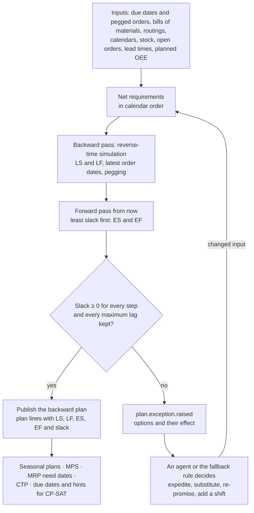
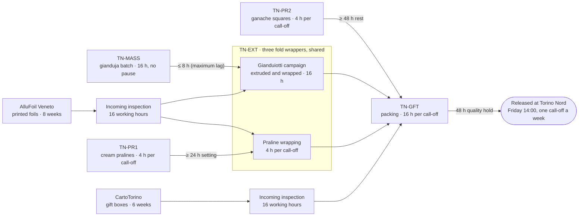
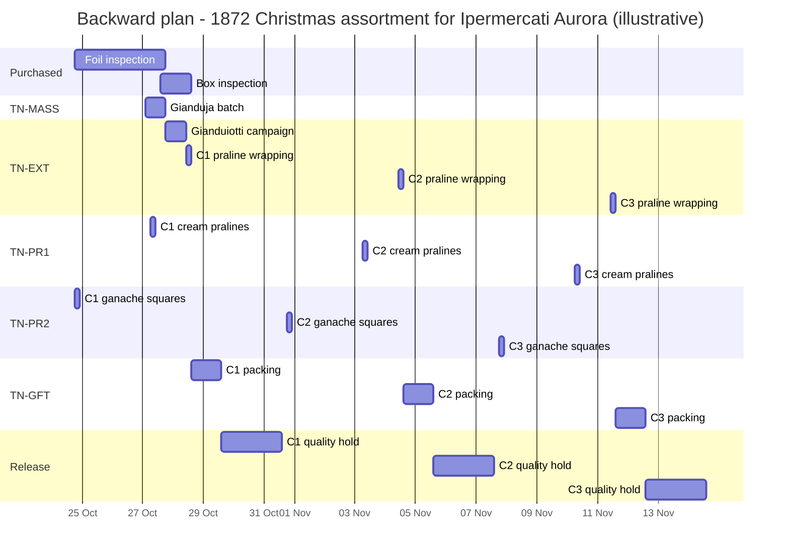

# 17 — Reverse-time simulation: my planning method

> **Origin.** I devised this reverse-time planning method
> independently in 2015 to plan the production of seasonal chocolate gift packs, and implemented it on SimPy, an
> open-source discrete-event simulation library, without changing the library. My earliest dated record is a
> presentation of July 2015. The research literature knows the same core idea as *backward simulation*: §17.10 tells
> the story and lists the prior art. Giandoria adopts the method as its engine for capacity-aware backward planning.
>
> This chapter explains:
>
> * the problem the method solves, and why the usual tools fall short (§17.1)
> * the mirror at its core, and the rules that keep it correct (§17.2, §17.3)
> * production boxes, the two passes and slack (§17.4, §17.5)
> * a worked example, checked to the hour (§17.6)
> * where Giandoria uses the method, how it runs and how it is tested (§17.7 to §17.9)
> * its origin, the prior art and its limits (§17.10, §17.11)

---

## 17.1 The idea in one page

Take a box of the Giandoria 1872 Christmas assortment. It holds three kinds of chocolates, made on three different
lines. Two of them are wrapped on the same machines, in printed foils that a supplier delivers eight weeks after the
order. Everything goes into a gift box that another supplier delivers six weeks after the order. The chain wants one
delivery a week. The planner's question is:

**What is the latest moment at which each step can happen, so that every box is ready on time?**

Latest, because chocolate made too early ages in the warehouse, ties up cash and space, and takes a line that another
order could have used. The usual tools each answer part of the question:

| Tool | What it gives | What it misses |
|---|---|---|
| MRP with fixed lead-time offsets (chapter 06 §6.7) | Need dates and order dates for every material, in seconds | Capacity: two orders can use the same line at the same hour |
| Forward simulation (sim-factory, chapter 08) | A realistic execution, with queues, shifts and breakdowns | It gives the earliest finish, not the latest start. The latest start can only be found by trial and error |
| Constraint programming (CP-SAT, chapter 08 §8.9) | An optimised detailed schedule for one or two weeks | A whole season in hourly detail is too large, and its answer is hard to explain to a planner or an agent |

**The idea.** Run the simulation with time flowing backwards. The clock starts at the last due date and moves towards
the past. A finished box asks for its components. Each component is made on its line, queues for the machine and the
crew, waits through closed shifts, and in turn asks for its own components, down to the purchase orders. A machine
that does one thing at a time in the mirrored world does one thing at a time in the real one, so **the plan respects
finite capacity**. Each step starts in the simulation as soon as it can, which in the calendar means **as late as
possible**.

**The result** is a plan with:

* a finite-capacity, as-late-as-possible (ALAP) date for every step on every resource
* the latest order date for every purchased item
* pegging: every step knows which customer order it serves
* slack: compared with a forward pass from today, the room each step has (§17.5)

**Why it matters for chocolate.** Pralines keep 6–9 months, so a plan that builds them too early wastes shelf life
(chapter 06 §6.7). Seasonal peaks make capacity the binding constraint exactly when the stakes are highest. And a
plan built as late as possible keeps stock low and leaves room for the last changes in the mix.

---

## 17.2 The mirror

My method rests on one change of variable. In my notation:

* **T** is the reference time: the latest due date in the problem, in the factory calendar
* **s** is the clock of the backward simulation: it starts at 0 and only grows, like any simulation clock
* **t = T − s** is the calendar time that corresponds to s

```text
t = T − s                           calendar time of simulation time s
an operation simulated from s_a to s_b (s_a < s_b)
occupies the calendar interval      [T − s_b, T − s_a]
its calendar start is T − s_b; its calendar finish is T − s_a
```

| What the mirror keeps | What the mirror reverses |
|---|---|
| **Durations.** A 16-hour batch lasts 16 hours in both worlds | **The order of events.** What happens first in s happens last in the calendar |
| **Overlap.** Two operations overlap in s if and only if they overlap in the calendar, so capacity limits hold in both worlds | **Start and finish.** The simulated start is the calendar finish |
| **Waiting.** A wait of 24 hours stays a wait of 24 hours | **Earliest and latest.** As soon as possible in s is as late as possible in the calendar |
| | **Precedence.** "A before B" becomes "B before A": the model must reverse every arrow explicitly |

The mirror is exact for durations and resources, which is why finite capacity survives it. Scheduling theory knows
this property as time symmetry: a scheduling problem and its mirror image are equivalent, and a solution of one,
mirrored, is a solution of the other [P49]. What the mirror does not do by itself is reverse the logic of the model.
Every rule that depends on the direction of time needs its own mirror; §17.3 lists them.

> **Three clocks, not to be confused.** Giandoria already has two clocks, wall time and sim time (chapter 07 §7.1).
> Reverse-time simulation adds a third one, but only inside one call of the planning engine:
>
> * **sim time** (`sim_ts`) is the time of the universe; the planner lives in it, and every event carries it
> * the **plan calendar** t is future sim time: the dates the plan talks about
> * the **reverse clock** s is internal to the engine; it is never emitted, stored or shown

---

## 17.3 Reversal rules

| Forward concept | In reverse time | Note |
|---|---|---|
| Due date D | The finished item is released into the backward run at s = T − D | Several due dates give several release times |
| Now, stock on hand, ETAs | Not part of the backward run. They become checks for the forward pass (§17.5) | A backward plan that starts "in the past" has negative slack |
| Assembly: a pack needs all its components (a join) | A **fork**: when packing completes in s, which is its calendar start, it asks for every component at once | Each request carries its need time and its pegged order (§17.4) |
| Campaign: one run serves several later needs (a split) | A **join**: requests for the same item wait and are released together, at the last request in s, which is the earliest calendar consumer | Only within a consolidation window (three weeks *(assumption)*) and within shelf life |
| Minimum time lag: cooling, setting, rest, quality hold | The same wait, in s | Exact |
| Maximum time lag: tank hold, "use within 8–24 h" (chapter 04 §4.6) | Checked when the predecessor is placed. If the gap is too long, the predecessor moves later in the calendar (local repair), or an exception is raised | A rule with no exact mirror (§17.11) |
| Sequence-dependent changeovers | The **transposed** matrix: the wheel dark → milk → nut (chapter 04 §4.6) reads nut → milk → dark in s | The changeover from A to B forward is the changeover from B to A in s |
| The state of a line today | Becomes the **last** changeover in s, into the state the line is in today | Known only at the end of the run |
| Shift calendars and closed periods | Reflected: the clock waits through closed intervals. An operation in progress pauses and resumes, unless it cannot be interrupted (a conche batch) | Calendars are converted once per call |
| Time zone and daylight saving time | s counts elapsed time in UTC; calendars stay in local time (Europe/Rome, chapter 07 §7.7) and are converted once | The 25-hour night at the end of October is handled by the conversion |
| Purchase lead time L | The request waits L in s; the purchase order sits at s + L, which is the **latest order date** | Supplier capacity can be a resource, if needed |
| First come, first served | **Latest need first**: in s, the request with the latest calendar need arrives first | The mirror of FIFO |
| Ties at the same s | **Shortest job first** in s, so the shortest job takes the latest slot in the calendar | The mirror of the shortest-processing-time rule; it minimises total earliness |
| Stock and open orders | Netted before the run, in calendar order | Stock serves the earliest needs, as it would in reality |
| Yield and scrap | The requirement is divided by the planned yield | — |
| Randomness: breakdowns, absences, supplier delays | None: planned OEE and planned lead times | Robustness is tested forward, in sim-factory or in a sandbox (chapter 06 §6.12) |

---

## 17.4 Production boxes

In my implementation the unit of work is a **production box**: a request for a quantity of an item, at a
need time, that travels backwards through the bill of materials.

| Field | Meaning | Example (§17.6) |
|---|---|---|
| Item | What must be made or bought | Wrapped hazelnut-cream pralines |
| Quantity | How much, in lots of the line or the supplier | 96,000 pieces |
| Need time | When the requester needs it, in the calendar and in s | Tue 28 Oct 2031 14:00 (s = 408) |
| Requester | The step that consumes it | Packing of call-off C1 on TN-GFT |
| Pegged order | The customer order or forecast it finally serves | Call-off C1 of Ipermercati Aurora |

**The life of a box.**

1. **Created** when its requester starts in the calendar, that is, when the requester completes in s.
2. **Queued** at the resource that makes it, with its priority: latest need first, then the tie rules (§17.3).
3. **Produced.** It holds the machine and the crew for its duration and waits through closed shifts. When it
   completes in s, which is its calendar start, it is **kitted**: it opens its own bill of materials and creates one
   box per component, each with a need time equal to this calendar start minus any minimum lag.
4. **Bought**, if the item is purchased. The box waits the inspection time and the lead time, and records the latest
   order date.
5. **Closed** when it reaches stock or a purchase order. Every box keeps the link to its requester, so the whole tree
   can be read back from any leaf.

**Campaigns.** Boxes for the same item that reach the same resource within the consolidation window are joined into
one campaign. The campaign is released at the last request in s, the earliest calendar consumer, and its quantity is
the sum. It saves changeovers and mass batches; the price is that later needs are made earlier than necessary
(§17.6).

**Pegging comes for free.** Each box knows its requester and its pegged order, so no separate pegging algorithm is
needed. When a foil delivery is late, the engine lists exactly which boxes, call-offs and customers are at risk. This
is the pegging that MRP provides (chapter 06 §6.7), but on a plan that respects capacity.

---

## 17.5 Two passes, slack and exceptions

A backward plan alone says when things should happen. It does not say whether they still can: the latest order date
of a foil may already be in the past. A second, ordinary forward pass answers that.

| Pass | Clock | Starts from | Priority | Gives |
|---|---|---|---|---|
| **Backward** (reverse-time simulation) | s, from the last due date towards the past | The due dates | Latest need first; ties by shortest job | Latest start (LS) and latest finish (LF) of every step; latest order dates; pegging |
| **Forward** (ordinary simulation) | Calendar time, from now | Today's stock, open orders, ETAs and line states | Least slack first (the smallest LS) | Earliest start (ES) and earliest finish (EF) of every step; the expected release of every order |

```text
slack of a step        = LS − ES          in hours; ≥ 0 means the step can still start on time
lateness of an order   = EF − due date    of its last step, quality hold included
```

* **Maximum lags in the forward pass.** A predecessor with a maximum lag, such as the mass batch before the
  extrusion, is released just in time, so that the lag holds in both passes.
* **Slack belongs to a step.** With calendars, slack is not additive: one hour lost on a Friday evening can cost a
  whole weekend. The engine reports slack per step and never adds it up along a path; §17.6 shows a case.
* **Both passes are greedy.** Each places one step at a time and never revisits it. The engine can iterate the two
  passes to improve the plan, as in the forward–backward improvement schemes of project scheduling [P48]. Computing
  the float of each task with a forward and a backward simulation is known in construction planning [P44].



A plan with negative slack is never published as if it were feasible. The engine raises `plan.exception.raised` with
the options it can see and their effect, and the decision maker chooses: an agent of chapter 09, or the
fallback rule. The engine then runs again with the changed input. Once every slack is ≥ 0, it publishes the backward
plan with the forward dates alongside, so that each step carries its window from ES to LS.

---

## 17.6 Worked example: a Christmas assortment for a chain

All values are *(illustrative)*. They are consistent with chapters 04 and 05, but chosen to keep the arithmetic
readable. Times are local times at Torino Nord, in 2031.

### The order and the box

Ipermercati Aurora books **36,000 boxes** of the Giandoria 1872 Christmas assortment, 250 g, in three call-offs of
12,000 boxes. Each call-off must be released at Torino Nord by Friday 14:00, in time for the afternoon shuttle to DC0
and the chain's delivery slot of the following week *(assumption)*.

| Call-off | Boxes | Released by | s at release |
|---|---:|---|---:|
| C1 | 12,000 | Fri 31 Oct 14:00 | 336 |
| C2 | 12,000 | Fri 7 Nov 14:00 | 168 |
| C3 | 12,000 | Fri 14 Nov 14:00 = T | 0 |

One box holds 15 gianduiotti (≈ 90 g), 8 hazelnut-cream pralines (≈ 88 g) and 8 dark ganache squares in paper cups
(≈ 72 g), on a tray, in a printed gift box. The gianduiotti and the pralines are wrapped in printed foil; the squares
are not.

| Step | Resource | Duration | How the duration was sized |
|---|---|---|---|
| Gianduja batch, ≈ 3.3 t in two conches | TN-MASS | 16 h, cannot pause | Conching 12–24 h at TN (chapter 04 §4.1) |
| Gianduiotti campaign for the three call-offs: 540,000 pieces, ≈ 3.2 t | TN-EXT | 16 h | ≈ 300 kg/h, limited by the fold wrappers: ≈ 11 h net, plus OEE and changeovers |
| Hazelnut-cream pralines: 96,000 per call-off, ≈ 1.1 t | TN-PR1 | 4 h | ≈ 400 kg/h: ≈ 2.6 h net |
| Dark ganache squares: 96,000 per call-off, ≈ 0.9 t | TN-PR2 | 4 h | ≈ 300 kg/h: ≈ 2.9 h net |
| Praline wrapping: 96,000 per call-off | The fold wrappers of TN-EXT, **shared** with the campaign | 4 h | 3 × ≈ 300 pieces/min: ≈ 1.8 h net, plus two format changes |
| Packing | TN-GFT | 16 h per call-off | ≈ 750 boxes/h *(assumption)* |
| Quality hold | — | 48 h | 24–72 h (chapter 04 §4.7) |
| Incoming inspection of purchased items | Not capacity-limited *(assumption)* | 16 working hours | — |

**Lags** *(assumption)*:

* gianduja batch end → campaign start: **at most 8 h** (a maximum lag), so that the last of the mass is used within
  ≈ 24 h of the batch end (chapter 04 §4.6)
* cream pralines → wrapping: **at least 24 h** of setting
* ganache squares → packing: **at least 48 h** of rest

**Purchased items:**

* printed foils from AlluFoil Veneto, 8 weeks; one order covers both designs, gianduiotti and pralines
* gift boxes from CartoTorino, 6 weeks
* everything else (trays, cups, cocoa mass, sugar, milk powder, hazelnut paste from LG-HAZ) is covered by stock and
  open orders after netting

**Calendars** *(assumption)*:

* TN-GFT, TN-PR1, TN-PR2 and incoming inspection: Monday to Friday, 06:00–22:00 (the autumn third shift on PR1 is
  left out, for readability)
* TN-EXT and TN-MASS: around the clock, from Sunday 22:00 to Friday 22:00

The example plans this order alone, on empty lines. In the engine, it is planned together with everything else.



### Backward pass

T is Fri 14 Nov 14:00. In s, C3 is released at 0, C2 at 168 and C1 at 336. Each call-off goes through its quality
hold and then asks for packing. Packing completes in s at its calendar start, and asks for its components.

| Call-off | Packing on TN-GFT | Fork at s | Praline wrapping | Cream pralines on TN-PR1 | Ganache squares on TN-PR2 |
|---|---|---:|---|---|---|
| C3 | Tue 11 Nov 14:00 → Wed 12 Nov 14:00 | 72 | Tue 11 Nov 10:00–14:00 | Mon 10 Nov 06:00–10:00 | Fri 7 Nov 18:00–22:00 |
| C2 | Tue 4 Nov 14:00 → Wed 5 Nov 14:00 | 240 | Tue 4 Nov 10:00–14:00 | Mon 3 Nov 06:00–10:00 | Fri 31 Oct 18:00–22:00 |
| C1 | Tue 28 Oct 14:00 → Wed 29 Oct 14:00 | 408 | Tue 28 Oct 10:00–14:00 | Mon 27 Oct 06:00–10:00 | Fri 24 Oct 18:00–22:00 |

| Shared or purchased item | Backward plan |
|---|---|
| Gianduiotti campaign on TN-EXT: a join of the three call-offs, released at s = 408 | Mon 27 Oct 18:00 → Tue 28 Oct 10:00 (s 412–428) |
| Gianduja batch on TN-MASS | Mon 27 Oct 02:00 → 18:00 (s 428–444), with no wait in the tank |
| Printed foils | Needed at the campaign start, Mon 27 Oct 18:00; arrive by Fri 24 Oct 18:00; **ordered by Fri 29 Aug** |
| Gift boxes | Needed at C1 packing, Tue 28 Oct 14:00; arrive by Mon 27 Oct 14:00; **ordered by Mon 15 Sep** |

How the plan came out:

* **Packing waits through the night.** Its 16 working hours run from Tuesday 14:00 to Wednesday 14:00.
* **The weekend pull.** The 48 h rest of the ganache squares points to Sunday, when TN-PR2 is closed, so the squares
  move back to Friday evening.
* **The shared wrappers.** At s = 408 the C1 wrapping (4 h) and the joined campaign (16 h) both ask for the fold
  wrappers. The tie rule puts the shorter job first in s, so the C1 wrapping takes the later slot, Tue 28 Oct
  10:00–14:00 (s 408–412), and the campaign runs just before it (s 412–428). The same rule keeps the C1 pralines on
  Monday morning. With the opposite order, the C1 wrapping would have moved to Monday evening, and the pralines,
  24 h before it, to Friday.
* **The maximum lag.** The gianduja batch must end at most 8 h before the campaign starts. As late as possible, it
  ends exactly at the campaign start.
* **Inspection over a weekend.** The foils need 16 working hours of inspection: Monday 06:00–18:00 and Friday
  18:00–22:00. They must therefore arrive by Friday 24 October.
* **Daylight saving time** ends on Sunday 26 October 2031. For steps before that night, s is one hour larger than the
  difference of local times. All the s values shown above are after the change.



### Forward pass

Now is Tue 2 Sep 12:00, the MRP data cut-off; purchase orders are placed on Wed 3 Sep 12:00 (chapter 06 §6.3). The
forward pass starts from there.

| Item or step | Forward (earliest) | Slack or lateness |
|---|---|---|
| Printed foils | Arrive Wed 29 Oct 12:00; available after inspection Thu 30 Oct 12:00 | **−114 h** at the order (≈ −4.75 days); −66 h at the line |
| Gift boxes | Arrive Wed 15 Oct 12:00; available Thu 16 Oct 12:00 | **+290 h** at the order (≈ +12 days) |
| Gianduja batch, released just in time | Wed 29 Oct 20:00 → Thu 30 Oct 12:00 | −66 h |
| Gianduiotti campaign | Thu 30 Oct 12:00 → Fri 31 Oct 04:00 | −66 h |
| C1 praline wrapping | Fri 31 Oct 04:00–08:00 | −66 h |
| C2 praline wrapping | Fri 31 Oct 08:00–12:00 | +98 h |
| C3 praline wrapping | Fri 31 Oct 12:00–16:00 | +262 h |
| C1 packing | Fri 31 Oct 08:00 → Mon 3 Nov 08:00 | −66 h at the start, −114 h at the finish |
| C1 release | Wed 5 Nov 08:00 | **114 h late**: misses the shuttle of Friday 31 October |
| C2 packing | Mon 3 Nov 08:00 → Tue 4 Nov 08:00 | +30 h |
| C2 release | Thu 6 Nov 08:00 | On time |
| C3 packing | Tue 4 Nov 08:00 → Wed 5 Nov 08:00 | +174 h (≈ 7 days) |
| C3 release | Fri 7 Nov 08:00 | On time |

The pralines, the ganache squares and the netted materials have ample slack and are not shown.

**What the engine sees.** The critical item is the printed foil: its latest order date, Friday 29 August, had already
passed when the plan was made. C2 and C3 are on time, but C1 will be released on Wednesday 5 November instead of
Friday 31 October.

**Slack is not additive.** The same delay reads −114 h at the supplier, −66 h at the line and 114 h late at the
truck. In the backward pass the foil inspection spans a weekend and C1 packing spans one night; in the forward pass
it is the other way round. The weekend falls in a different place in each pass, so each step sees a different slack.

### The exception and the decision

The engine raises `plan.exception.raised` for call-off C1, with three options:

| Option | Effect | Decided by (chapter 09) |
|---|---|---|
| 1. **Expedite:** a 7-week print slot at AlluFoil Veneto, with a surcharge *(assumption)* | Foils available Thu 23 Oct 12:00; slack at the line +103 h; every call-off on time | Procurement manager |
| 2. **Substitute:** the standard 1872 foil, from stock, for C1 only | The campaign splits in two, with one more gianduja batch and one more changeover on TN-EXT; every call-off on time, but C1 looks different | Key account manager, with the chain's consent |
| 3. **Re-promise:** C1 one week later, together with C2 | No extra work in the plant; a possible penalty under the trade terms | Key account manager |

The slack of option 1 is +103 h, not the +102 h that the local clocks suggest: the night of 26 October lasts 25 hours,
and slack counts elapsed hours.

If no agent answers before the decision is due, the fallbacks of chapter 09 apply. The procurement manager's fallback
places the MRP order as it is, with the preferred supplier; the key account manager's keeps the standard trade terms.
In effect, that is option 3. Whatever the decision, the engine runs again with the changed input and publishes the
backward plan.

### What the example teaches

* **The critical item is a foil, not a machine.** The forward pass finds it; the backward pass says by how much.
* **Joins move work earlier.** C3's gianduiotti are made two weeks before C3 is packed, to save two campaigns.
* **Weekends and nights move work earlier too.** The ganache squares run on Friday evenings.
* **Shared machines and tie rules decide the order of work.** The fold wrappers serve both the campaign and the
  pralines.
* **Slack belongs to a step.** Never add it up along a path.
* **Capacity matters more in a real season.** Here it moves the campaign by only 4 h. With dozens of SKUs on the same
  lines in the autumn, it decides whether the season fits at all.

---

## 17.7 Where Giandoria uses it

| Use | Planning level (chapter 06) | What the engine gives | Main reader (chapter 09) |
|---|---|---|---|
| Seasonal build plans | Easter milestones E6 and E7 (§6.9); Christmas and campaigns (§6.10) | The build by line and week; the latest commitment dates for toys, foils and boxes | S&OP chair, seasonal category manager, production planner |
| MPS feasibility | Weekly MPS, Tuesday (§6.7) | A finite-capacity check of the weekly buckets; the orders whose latest start has already passed | Production planner |
| Capacity-aware need dates for MRP | MRP, Wednesday (§6.7) | Need dates that respect line capacity, so purchase orders are neither too early nor too late: simulation-based order release [P41] | Procurement manager |
| Capable to promise | CTP for corporate gifts and export (§6.11) | The earliest date a new order can be promised, with the latest dates of its steps | Key account manager |
| Detailed scheduling | Daily schedule (§6.7) | Release and due dates per production order, and a starting solution (warm start) for CP-SAT | Engine |
| Agent briefings | All levels | Slack per step, critical items, options and their effect | Planning agents |
| What-if sandboxes | Sandboxes (§6.12) | Fast answers, such as "what if TN-EXT stops for a week?" | Agents and users |

---

## 17.8 How it runs

* **Where.** An engine of svc-planning (chapter 08 §8.5), next to MRP and CP-SAT. Its actor in the data is
  `engine:reverse-time` (chapter 10 §10.2).
* **One environment per call.** Each call builds a fresh SimPy environment from enterprise data, runs the two passes
  and discards the environment. The reverse clock s never leaves the call; every output is converted to `sim_ts`, in
  UTC.
* **Deterministic.** No random numbers, and stable tie keys (due date, item, order). The same input always gives the
  same plan, which replays, forks and the A/B evaluation of agents need (chapter 07 §7.11, chapter 09 §9.8).
* **Enterprise data only.** The engine sees what planners see: orders, bookings, stock, ETAs and planned OEE. It never
  reads the truth (chapter 03 §3.10).
* **Wall-time budget** *(estimate)*. About 2 s for the MRP need dates, and up to about 10 s for a seasonal plan.
  Seasonal runs happen behind a decision barrier, so the clock waits for them (chapter 07 §7.9).
* **Outputs.** No new event types are needed:
  * plan lines carry LS, LF, ES, EF, the slack in hours, the resource and the pegged order in their attributes
    (chapter 10 §10.9)
  * the plan headers of chapter 06 §6.15: `plan.season.published`, `plan.mps.published`, `plan.mrp.completed`
  * `plan.exception.raised` for negative slack or a broken maximum lag
* **Execution.** sim-factory executes the published plan forward, with real-world randomness. The schedule-adherence
  KPI (chapter 06 §6.16) shows how well the plan survived reality.

---

## 17.9 Tests

| Test | What it checks |
|---|---|
| Single machine | The backward plan equals a hand-computed as-late-as-possible schedule |
| Symmetry | Mirror a problem, solve the mirror with an ordinary forward simulation, mirror the result back: it equals the backward plan |
| Calendars | Closed nights and weekends, batches that cannot pause, the 25-hour night in October and the 23-hour night in March |
| Precedence and lags | Minimum lags, maximum lags (repair or exception), forks and joins |
| Capacity | Single machines, pools of identical machines, shared crews |
| Netting | Stock serves the earliest needs first |
| Determinism | Two runs with the same input give identical plans |
| Forward check | When every slack is ≥ 0, a deterministic forward run of the published plan meets every due date |
| Performance | A full Christmas season at Profile M within the wall-time budget (§17.8) |
| The worked example | §17.6 is reproduced to the hour |

---

## 17.10 Origin and prior art

**How I developed it.** In 2015 I had to plan the production of seasonal chocolate gift packs: boxes
of several wrapped chocolates, made on different lines from materials of different suppliers, due on a profile of
delivery dates. MRP ignored capacity, and forward simulation gave only the earliest dates. I turned the
simulation around: an unmodified SimPy run whose clock counts backwards from the last due date, with the factory
calendar read in reverse and the bill of materials unfolded by production boxes. At the time, I found the
method neither described nor implemented anywhere.

**The prior art.** The research for this chapter (October 2026) found that the same core idea has been published,
under the name *backward simulation*, since 1989. My method is therefore an independent invention of a known
idea. The main sources, in order of publication:

| Year | Source | What it contributes |
|---|---|---|
| 1989 | Jain, Barber and Osterfeld [P39] | The earliest use of backward simulation for scheduling cited by the literature review [P47] |
| 1992 | Li and Willis [P48] | Forward and backward passes, iterated, to improve resource-constrained schedules |
| 1993 | Watson, Medeiros and Sadowski [P40] | Release plans for components, generated by simulating backwards from the due dates |
| 1994 | Ying and Clark [P42] | Order release in a job shop with a bidirectional simulation |
| 1997 | Watson and colleagues [P41] | Backward planning with simulation for order release |
| 1997 | Jain and Chan [P43] | Experience with backward simulation for lot release planning |
| 2012 | Dori and Borrmann [P44] | The float of each task from a forward and a backward simulation, in construction |
| 2017 | Hanzálek and Šůcha [P49] | Formal time symmetry of resource-constrained scheduling with general temporal constraints |
| 2021 | Laroque, Leißau, Scholl and Schneider [P45] | Backward simulation for production planning in a real industrial case |
| 2023 | Leißau and Laroque [P46] | Automated backward simulation on a commercial simulator: the model's routings and rules are reversed automatically, and the result is turned back onto the time axis and checked by a forward run |
| 2024 | Leißau and Laroque [P47] | A systematic literature review of backward simulation |

**What is distinctive in my version.**

* **An unmodified open-source library.** SimPy runs as it is. The reversal lives in the mapping between the clock and
  the calendar, in the way the calendar is read, and in a model written backwards from the start, in which a finished
  product asks for its components. The recent published work instead transforms an existing forward model, with its
  routings and rules, on commercial simulation software [P46].
* **Recursive production boxes.** Requests carry their requester and their pegged order through a multi-level bill
  of materials, so kitting and pegging come for free (§17.4).
* **Shared crews and daily shift calendars** are resources of the backward run.
* **Seasonal confectionery.** Gift packs with several components, a limited shelf life and a profile of due dates.

> **An honest claim.** I developed the method independently in 2015,
> without knowledge of the earlier work. I claim no priority over the sources above, and I do not claim that mine
> was the first implementation on SimPy: the search for open-source implementations was limited (chapter 16
> §16.5).

---

## 17.11 Limits

* **Greedy.** Each pass places every step once, so the plan is good, not optimal. CP-SAT optimises the next one or
  two weeks (chapter 06 §6.7).
* **Rules matter.** Tie and priority rules change the plan; §17.6 shows a case. They are configuration, versioned and
  logged with every plan.
* **Maximum lags are hard.** Long chains of maximum lags, such as mass, extrusion and wrapping within hours, can need
  several repairs, or end in an exception.
* **Rework loops** are planned as separate demand, not as loops.
* **Path-dependent effects**, such as wear, cleaning counters or the state of a tank, are approximated with planned
  values.
* **Every rule needs a mirror.** A dispatching rule without a defined mirror cannot be used in the backward pass. The
  published work makes the same point about the critical-ratio rule [P46].
* **Randomness stays forward.** The backward run is deterministic. Uncertainty is handled by forward simulation and
  by the sandboxes (chapter 06 §6.12).
