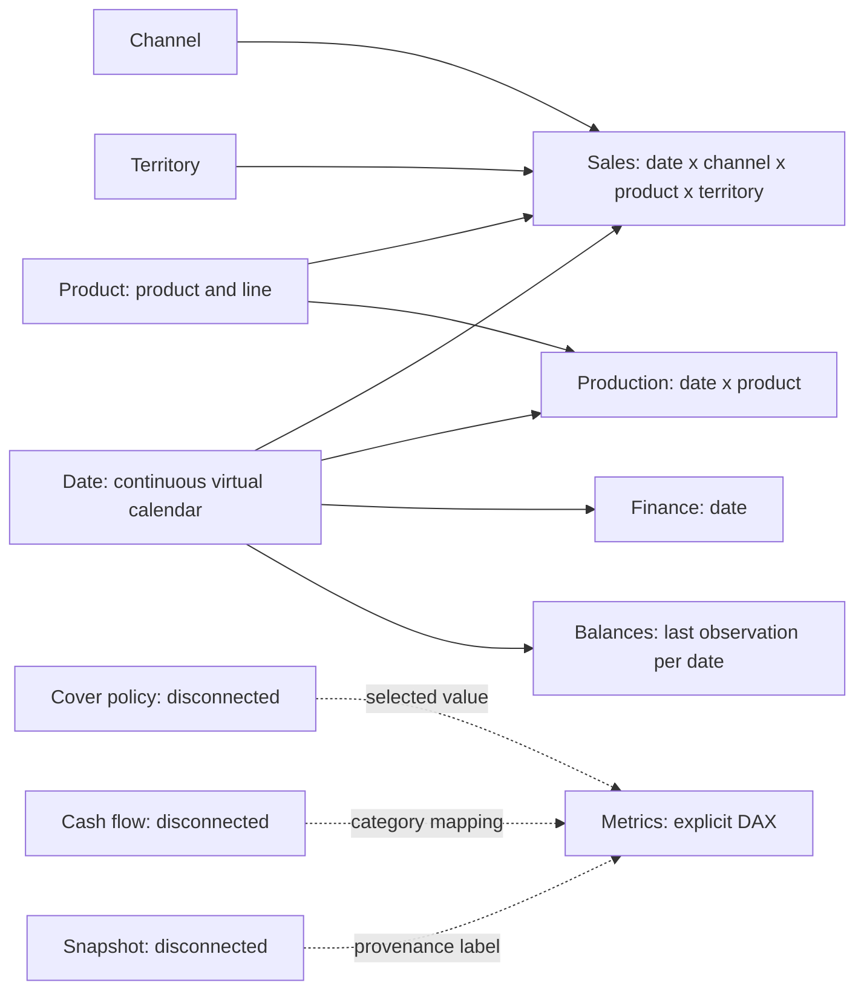

# 23 - Semantic model and report showcase

The Power BI showcase adds a **shared import semantic model** and two thin reports to the live Eventhouse
dashboard in [chapter 22](./22-dashboard-engineering.md). It is a teaching model focused on fact grain,
filter context and time intelligence—not a production-complete model—and uses a fixed synthetic snapshot,
not hidden truth or invented customer detail.

The same model supports the [Data Agent showcase](./24-data-agent-showcase.md). An isolated enterprise-only
copy provides a separate authentication boundary; it does not change the analytical model
([chapter 25](./25-data-agent-authentication.md)).
Publication and update commands belong to the [operating runbook](../infra/demo/README.md#power-bi-semantic-showcase).

## 23.1 Source and construction pipeline

| Source | Responsibility |
|---|---|
| [showcase.py](../src/giandoria/showcase.py) | Snapshot extraction/validation, typed import partitions, model/DAX, PBIR generation, guarded publication, processing and reconciliation |
| [fabric/showcase](../fabric/showcase) | Four enterprise KQL extraction queries, one per fact grain |
| [test_showcase.py](../tests/test_showcase.py) | Offline grain, calendar, compression, measure, binding and REST-operation regressions |
| [report_narratives.py](../src/giandoria/report_narratives.py) | Static KPI definitions, report-only publication and a separate archived snapshot-commentary experiment |
| [report_summaries.py](../src/giandoria/report_summaries.py) | Native Smart narrative trend transforms, dynamic KPI values and virtual-time scope |
| [test_report_narratives.py](../tests/test_report_narratives.py) | Commentary scope, replay/staleness, evidence arithmetic, generation limits and non-overlapping page layout |
| [fabric_deploy.py](../src/giandoria/fabric_deploy.py) | Shared workspace/ownership guards, accepted item registry and asynchronous Fabric REST operations |
| [cloud_io.py](../src/giandoria/cloud_io.py) | Recorded, host-restricted authenticated Kusto/Power BI requests |

The construction sequence is:

1. Read the recorded demo workspace and enterprise endpoint; reject mismatched identities.
2. Select the highest-sequence enterprise observation in the continued business run.
3. Freeze its virtual local date as an **exclusive cutoff**, and its sequence as an upper bound.
4. Run all four extraction queries with those same bounds. Sales, production and finance events are
   deduplicated by event ID before aggregation. Balances select the highest-sequence observation per date.
5. Reject duplicate fact keys, unknown configured dimension members, malformed rows, dates outside
   the snapshot and invalid quantities. Negative cash is valid; it must not become zero.
6. Generate the continuous Date dimension, configured dimensions, disconnected helper tables and explicit DAX.
7. Publish `sm_giandoria_showcase` as TMSL, read its definition back, process it and reconcile real DAX
   results against independent Python calculations over the extracted rows.
8. Publish `rp_giandoria_commercial` and `rp_giandoria_operations` as PBIR reports referencing that
   model's identity. Read their persisted definitions back, then inspect rendering in the authenticated browser.

The cutoff excludes the current partial virtual day. A shared sequence bound prevents separate fact
extractions from advancing to different simulation states. However, the latest observation is **not an
ingestion-completeness watermark**: a late-arriving earlier event can appear in a subsequent extraction.
The snapshot is a reproducible view of the data available to that extraction, not a certified accounting close.
Truth tables are never queried.

## 23.2 Model: a fact constellation



Solid arrows represent **one-way dimension-to-fact filtering**, not physical data movement.
TMSL describes the same eight relationships from their many-side fact column to their one-side dimension key.
There are no fact-to-fact, many-to-many or bidirectional relationships.

| Fact | Unique grain | Additive content | Dimension filters |
|---|---|---|---|
| Sales | Date, Channel, Product, Territory | Sell-out kg | All four dimensions |
| Production | Date, Product | Started, released, shipped kg | Date and Product |
| Finance | Date | Revenue/purchase/conversion postings and cash-flow components, in integer cents | Date only |
| Balances | Date of last sampled observation | Finished stock, backlog, WIP, cash, receivables, payables | Date only; amounts are **not additive over dates** |

Dimensions come from the actual reduced-detail business configuration: seven channels, three product
categories and three territories. Product includes its production line. These are not detailed SKUs or customers.
Hidden fact tables and non-summarizing raw columns steer report authors toward explicit measures in `Metrics`.
Measures have descriptions, numeric formats and display folders.

**Unsupported slicing returns BLANK rather than a plausible but false allocation.** Finance and enterprise
balance measures check whether Product, Channel or Territory is cross-filtered. Production checks Channel
and Territory. A finance card repeated for every product would otherwise suggest product-level revenue that
the source does not contain. Separate report pages also keep unrelated slicers away from those measures.

### The virtual Date dimension

The Date table contains every calendar date from the first extracted fact through the day before the cutoff,
including leap days and dates with no sales. It is marked as a time table with a unique Date key.
Year, month, year-month and weekday are available, with numeric sort columns and a Year → Month → Date
hierarchy. Facts use the event's Rome **virtual local date**, not real receipt time or a UTC-midnight conversion.
Daylight-saving transitions do not add or remove calendar dates.

No business DAX reads `TODAY()` or `NOW()`. Pausing or changing simulation speed cannot alter a stored
date or a comparison window. The snapshot label stays fixed even while the live lab continues.
The first and last years can be partial: select a complete comparable virtual year when explaining YoY.

## 23.3 DAX patterns and their lessons

Representative definitions below match the generated model.

### Additive flows and virtual time intelligence

```dax
Sold kg = SUM('Sales'[SoldKg])

Sold kg PY =
    CALCULATE([Sold kg], DATEADD('Date'[Date], -1, YEAR))

Sales YoY % =
    DIVIDE([Sold kg] - [Sold kg PY], [Sold kg PY])

Sales YTD kg =
    TOTALYTD([Sold kg], 'Date'[Date])

Sales rolling 30d kg =
    CALCULATE(
        [Sold kg],
        DATESINPERIOD('Date'[Date], MAX('Date'[Date]), -30, DAY)
    )
```

`MAX(Date)` is the end of the current filter context, not today's real date. A monthly point's rolling
measure ends on that month's selected last calendar day. Missing/zero prior-period denominators yield BLANK.
YTD, a rolling window and the same month last year answer different questions and must not share a label.
Grand totals reevaluate the expression in total context; they do not add displayed ratios or cumulative values.

### Filter context: share and rank

```dax
Channel share % =
    DIVIDE([Sold kg], CALCULATE([Sold kg], REMOVEFILTERS('Channel')))

Channel rank =
    IF(
        ISINSCOPE('Channel'[Channel]),
        RANKX(ALLSELECTED('Channel'[Channel]), [Sold kg], , DESC, DENSE)
    )
```

Share retains date/product/territory but removes **all channel filters**, including the channel slicer.
A selected subset's shares need not sum to 100%. Rank, in contrast, is among the selected channels and
is intentionally blank at the grand total. This is a useful concrete contrast between `REMOVEFILTERS`,
`ALLSELECTED` and `ISINSCOPE`.

### Semi-additive snapshots

```dax
Cash as observed EUR =
    VAR LastDay = MAX('Balances'[Date])
    RETURN
        IF(
            ISCROSSFILTERED('Product') ||
            ISCROSSFILTERED('Channel') ||
            ISCROSSFILTERED('Territory'),
            BLANK(),
            DIVIDE(
                CALCULATE(
                    SUM('Balances'[CashCents]),
                    KEEPFILTERS('Balances'[Date] = LastDay)
                ),
                100
            )
        )
```

The last **available observation inside the selected dates** is used, not the last calendar date.
Monthly stock rows may therefore use different observed days. The total is the last observation in the
whole selected period, not their sum. `Observation days` beside `Selected virtual days` exposes sparse
sampling. A month with no observation remains blank: no zero, interpolation or carry-forward is fabricated.
Stock and cash labels say "as observed", not "certified month-end".

### Cash bridge and disconnected policy

`Cash movement EUR` is retail receipts + trade collections − supplier payments − conversion payments.
The disconnected `Cash flow` table supplies ordered waterfall categories; `Cash component EUR` maps each
category to its signed finance amount with `SWITCH(SELECTEDVALUE(...))`. Its total is net cash movement.
This is a contribution bridge, **not** a reconciliation of opening/closing observed cash or a profit bridge.
Revenue is not cash; purchases are not COGS.

`Cover policy` has 2, 3, 4, 5 and 7 days and no relationship to any fact.
`Scenario cover days = SELECTEDVALUE('Cover policy'[Days], 3)` defaults to three when there is no
single selected value (including no selection or multiple selected values). The target is:

```dax
Daily sales 30d kg =
    DIVIDE(
        [Sales rolling 30d kg],
        COUNTROWS(DATESINPERIOD('Date'[Date], MAX('Date'[Date]), -30, DAY))
    )

Illustrative target kg =
    IF(
        ISCROSSFILTERED('Product') ||
        ISCROSSFILTERED('Channel') ||
        ISCROSSFILTERED('Territory'),
        BLANK(),
        [Daily sales 30d kg] * [Scenario cover days]
    )

Illustrative gap kg =
    IF(
        NOT ISBLANK([Finished as observed kg]),
        [Illustrative target kg] - [Finished as observed kg]
    )
```

The denominator includes no-sale **calendar** days, truncated at the start of available history.
A positive gap means stock is below this illustrative target; absent stock stays BLANK.
The target uses trailing sell-out, not unconstrained demand, safety-stock theory or an optimized production
plan. Its effective date and the last sampled stock date may differ. It is a classroom sensitivity test
and never changes the simulator or the manager agents.

## 23.4 Report catalogue and demonstration route

Each report has three pages, a fixed-cutoff card, a virtual-year slicer and a reader guide. Commercial pages
also expose channel/product/territory slicers. Native visual definitions bind fields and explicit measures
directly; there are no custom visuals, copied data models or report-local business measures.

| Report / page | Visuals | Suggested interaction and lesson |
|---|---|---|
| Commercial / Virtual calendar | Current/PY monthly lines, daily YTD/rolling lines, volume/growth matrix | Select a complete year; contrast period flow, cumulative flow, trailing window and non-additive growth totals |
| Commercial / Mix and concentration | Channel bars, product donut, share/rank matrix, channel scatter | Select channels; contrast all-channel share with selected-channel rank. Scatter X = prior-year kg, Y = current kg, bubble area = share; compare equal-length periods |
| Commercial / Territory and seasonality | Stacked monthly territory columns, weekday bars, Product × Territory matrix | Select a product/territory; inspect geography and calendar patterns without inventing finance allocation |
| Operations / Flows versus stocks | Starts/releases/shipments lines, sampled stock/backlog lines, coverage matrix | Compare flows with levels. Check why stock totals are not sums and why missing observation dates matter |
| Operations / Cash versus revenue | Revenue/cash lines, purchases/conversion columns, balance matrix, signed cash waterfall | Contrast accrual postings, signed liquidity flows and observed balance levels; do not call the chart profit |
| Operations / Stock policy sandbox | Cover-days slicer, target/stock lines, scenario matrix | Choose two then four days; targets double, observed stock stays unchanged. Clear/multi-select to demonstrate the explicit three-day default |

Chart selections cross-filter/highlight other visuals using native Power BI interactions. Reset selections
before changing the demonstration topic. On a small browser, scroll the report canvas to reach the lower
matrix/scatter/waterfall; tall pages use Fit to width. Interface chrome follows the signed-in user's
Power BI preferences; source-owned report labels remain English.

### Dynamic Smart narrative and optional reader guidance

Each page separates two kinds of English text:

* **KPI definitions - how to read this page** are optional static domain guidance below each chart. They
  explain sell-out versus shipment, channel and territory meanings, period comparisons, flows versus stock
  levels, receivables/payables, cash versus revenue, and the illustrative stock-cover calculation.
  Unsupported slices and missing OEE/profit measurements are described rather than glossed over.
* **Smart narrative - current selection**, above the charts, uses the native Power BI custom Smart narrative
  engine. It recalculates the trend sentence and explicit KPI values in the current filter context.

The implementation uses the native textbox-based Smart narrative representation: `general.paragraphs`
contains dynamic property references and template cases; `values` contains semantic expressions.
The `ChangeSummary` transform evaluates the page's primary measure against `Date.Date` and chooses an
increase, decrease or relatively-stable template. Its output supplies the change and virtual endpoint dates.
Other dynamic expressions reference existing governed DAX measures directly. No extra model measures,
external inference endpoint or browser-authored report state are required.

Primary trends are sold weight on the commercial pages, releases on the production page, revenue on the
finance page and the illustrative target on the stock-policy page. The narrative is deliberately bounded:
it summarizes an endpoint change, not causality, regression, profitability, OEE or full-year growth.
If the native engine cannot produce a supported trend, its trend paragraph is empty. Explicit KPI values
remain independently available; blanks represent unavailable or unsupported context, never an invented zero.

Year selection changes the narrative's period, direction, percentage and totals. The disconnected cover-day
slicer changes scenario values in the stock-policy narrative. Cross-filtering uses the same native filter
context as the charts. **Dynamic interpretation does not mean live source data:** the semantic model still
contains an embedded enterprise snapshot. It advances only after an explicit extraction/publication;
a normal model refresh reprocesses that same snapshot. No periodic commentary-generation job is installed.

Report-only publication verifies the persisted model's snapshot contract, updates only the two existing
registered report definitions and reads both back. It does not refresh/replace the semantic model, advance
the cutoff, republish the Data Agent or change the running company. The narrative precedes the charts;
the static guide follows them on enlarged pages. Scroll to the guide or adjust zoom on smaller displays.
Readback accepts only the minimal model connection or its known service-expanded form with the exact
workspace, catalog and semantic-model ID. All remaining report content must match the source exactly;
an unexpected connection or changed visual/text fails verification.

This is **native custom Smart narrative**, not generative Copilot mode. See
[Smart narrative and filter interactions][smart-narrative].
The native query/paragraph structure was checked against Microsoft's linked September 2020 sample;
report text, measures and construction are source-owned. Copilot mode is a distinct option with its own
tenant/capacity requirements and explicit narrative-refresh behavior.

The earlier Azure-generated fixed-snapshot commentary remains an isolated, reproducible generation
experiment in `report_narratives.generate`; its receipts are retained in ignored local state.
Neither normal showcase publication nor report-only publication consumes that prose or calls the model.

## 23.5 Definition and refresh mechanics

The model uses compatibility level 1600, `en-US` culture and `powerBI_V3`.
`model.bim` plus `definition.pbism` are the Fabric semantic-model definition. Every import partition
contains typed M: Base64 → raw Deflate decompression → JSON rows → `Table.FromRows` →
`Table.TransformColumnTypes`. Date strings become dates, integer quantities/cents remain integers.
There is no external M data source or stored credential.

Embedding the bounded **synthetic** snapshot makes the example reproducible on the existing F4 without
adding infrastructure. It is deliberately **not a production data-storage or incremental-refresh design**.
Generated payloads are ignored local artifacts, not files to edit or commit.
A normal semantic-model refresh only reprocesses the same embedded snapshot. To get newer business data,
rerun extraction and republish; to change just measures/visuals against identical data, reuse the saved snapshot.
No scheduled refresh is created. Capacity suspension still prevents interactive queries.

PBIR supplies `definition.pbir` (version 4.0 and its schema), the shared semantic-model connection,
version metadata, report/page metadata and individual visual JSON definitions. Stable source-derived
identities keep repeated publication deterministic. `Metrics`, rather than the reserved table name
`Measures`, is the measure home. Fabric may omit default relationship cardinality/filter properties on
readback; validation compares their semantic defaults instead of treating omission as changed behavior.

Only source-owned, registered demo items may be updated. Failed REST operations retain service error
details; ambiguous creation does not authorize adopting an unrelated same-name item. The existing
dashboard/queryset are not replaced. No capacity resize, new Azure service or lab-session change is part
of showcase publication.

## 23.6 Validation and boundaries

Offline tests cover fact-key uniqueness and mapped dimensions, leap-day continuity and sort metadata,
one-way relationships, import compression round-trip, no real-clock business expressions, blank grain guards,
deterministic thin-report bindings and asynchronous publication completion/error diagnostics.

Live validation reads back persisted definitions, processes the model and executes DAX to compare:
sell-out, financial totals, production flows, last observed cash and date count; unsupported finance slicing;
two/four-day scenario sensitivity; a complete virtual month's PY, YoY, YTD and trailing thirty days;
channel shares and dense ranks; and signed waterfall contributions. The comparison calculations read
the extracted rows independently of DAX. Browser inspection is separate: REST success and correct measures
alone do not prove that visual roles or interaction settings render correctly.

This showcase does not implement RLS, incremental refresh, Direct Lake, calculation groups, certified
governance, accounting inventory valuation, a complete P&L or performance/load certification.
Source observations remain synthetic and reduced-detail.

### Useful next reports, with real prerequisites

| Candidate | Educational value | Required source data before implementation |
|---|---|---|
| Forecast accuracy and bias | Actual vs plan, weighted errors, horizon/version selection | Frozen versioned forecasts at matching product/date grain; observed sales are not hidden unconstrained demand |
| Order promise and fulfillment | Cohort aging, on-time-in-full, backlog waterfall | Stable order lines, promised dates, partial shipment/delivery links and cancellation semantics |
| Inventory economics | Aging, turns, contribution margin, decomposition | Inventory movements/valuation, product costs, attributed net revenue and explicit COGS policy |
| Decision observatory | Before/after trends, drill-through to rationale | Versioned decision exposures and comparable baseline; observational changes are not causal proof of agent quality |

These are proposals, not implemented pages. They are preferable to visually impressive KPIs whose
denominators or business meaning cannot be supported by the enterprise data.

[smart-narrative]: https://learn.microsoft.com/en-us/power-bi/visuals/power-bi-visualization-smart-narrative
