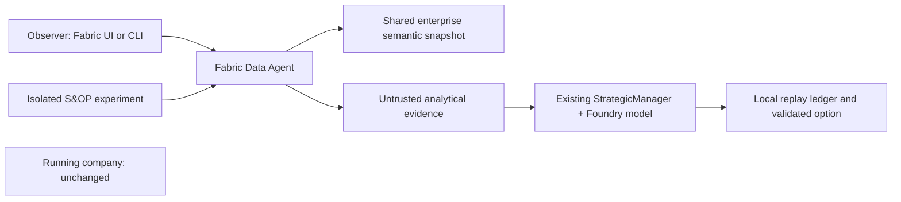

# 24 - Fabric Data Agent showcase

The laboratory publishes a real **Fabric Data Agent**, `da_giandoria`, over the shared Power BI
semantic model. An observer can ask natural-language questions through Fabric or the recorded CLI.
A separate S&OP experiment retrieves analytical evidence from that agent and passes it to the existing
validated manager. Its decision is persisted locally and **never applied to the running company**.
Publication, real MCP answers, a browser chat answer reconciled to the snapshot totals, and an actual
model-backed S&OP decision have been verified. The browser editor tests the draft configuration;
the MCP client uses the published configuration, and source readback verifies that both match.

This is a snapshot-based teaching experiment, not an autonomous live-worker integration. The worker
still receives simulator briefings. [Secretless application federation](./25-data-agent-authentication.md)
now provides a verified autonomous authentication path, but does not supply a live data-completeness barrier.
Operating commands belong to the [cloud runbook](../infra/demo/README.md#fabric-data-agent-showcase).

For an actual direct-versus-delegated comparison, see the
[CEO and line-lead experiment](./28-data-agent-delegation-experiment.md).
It tests the same generalist without retrieval, with a Data Agent tool, and with retrieved evidence supplied directly.

## 24.1 Architecture and educational purpose

The agent answers analytical questions; the manager selects one of the existing bounded business
options. Neither the Data Agent nor its answer can add tools, redefine options or execute transactions.
The manager also receives explicitly scoped factory/finance observations from the same snapshot.
This is therefore an **evidence-enriched briefing**, not a claim that every input came from natural language.

Using the [shared semantic model](./23-semantic-model-showcase.md), rather than exposing raw events,
demonstrates why business semantics matter to AI:

* Explicit measures distinguish sell-out, production, shipments, revenue and cash.
* The continuous virtual Date table supports complete-month, previous-year and YTD questions.
* Stock and cash are last-observed balances, not quantities to sum over days.
* Disconnected cover policies express a scenario, not an approved production instruction.
* Unsupported slicing returns `BLANK`; an apparently useful breakdown is not necessarily measurable.

The sole source is the enterprise snapshot. No truth database, hidden demand, unrestricted simulator
state or live KQL source is attached. Table selection helps the agent navigate; it is **not** an
authorization boundary or a substitute for source permissions/RLS. This synthetic demo has no
role-specific RLS. A production manager must receive only the sources and rows allowed for that role.

## 24.2 Construction from source

| Source | Responsibility |
|---|---|
| [data_agent.py](../src/giandoria/data_agent.py) | Definition generation, guarded deployment/readback, source checks, MCP client, observer questions, golden evaluation and local manager experiment |
| [instructions.txt](../fabric/data-agent/instructions.txt) | English analytical contract, supported measures/grains, virtual-time rules and unavailable measurements |
| [test_data_agent.py](../tests/test_data_agent.py) | Source drift, cutoff, MCP, numeric evaluation, isolation, reservation and replay regressions |
| [managers.py](../src/giandoria/managers.py) | Existing validated manager options, request/token reservations, replay and explicit rule fallbacks |
| [cloud_io.py](../src/giandoria/cloud_io.py) | Host-restricted authenticated HTTP, bounded read timeout and metadata/hash audit |

The generator emits `Files/Config/data_agent.json`, publication metadata, and matching **draft and
published** stage configurations, each with exactly one `semantic_model` source. Selected tables are
Date, Channel, Product, Territory, Metrics, Snapshot, Cover policy and Cash flow. Measures provide the
supported analytical interface over the underlying facts. The same English instructions are installed
at stage and source level.

Generic Fabric item REST APIs create or update the item. The existing ownership registry and exact
workspace/description checks prevent adoption of unrelated same-name items. Readback validates the
actual source identity, selected tables and instructions in both stages. Fabric may normalize source
directory names; validation follows the stage and source file rather than relying on that spelling.
Browser use is for reading/asking, not durable configuration changes.

The runtime client uses the documented **streamable-HTTP MCP endpoint**:
`initialize`, `notifications/initialized`, `tools/list`, then one `tools/call`. It accepts JSON or SSE,
matches JSON-RPC response IDs, checks tool errors, and stops reading once the matching result arrives.
If the server supplies an MCP session, cleanup deletes that ephemeral session, not the Fabric item.
No OpenAI Assistants compatibility layer or additional SDK dependency is needed.

The verified service response exposes answer text. The saved response is retained, but the showcase
does **not** claim to capture generated DAX, query plans or complete source citations from MCP.

## 24.3 Virtual time, source provenance and no future information

The analytical cutoff is the model's **virtual Rome date**, never the operator's date or elapsed wall time.
Stopping or accelerating the laboratory does not change the meaning of a month, a balance or a rolling window.
The agent is instructed to state its fixed snapshot cutoff and not call the snapshot live.

Before asking, the CLI checks the actual published semantic model against the saved extraction:

1. Run, first/last virtual dates and sequence annotation must match.
2. Tables, embedded M partitions and explicit measure expressions must match the source generator.
3. There must be no external model data sources, extra tables or extra partitions.
4. Relationship identities and filter properties must match the one-way star/constellation contract.
5. A digest of the persisted model definition accompanies the evidence.

A manager decision uses an **exclusive virtual date**. Every date in the entire attached model must be
strictly earlier than that cutoff. Asking the agent to ignore later rows is not enough: an experiment
for an earlier historical decision is rejected if its source model contains later dates.

The CLI reads the model/agent definitions again after retrieval; manager experiments check them again
before inference. A changed contract blocks use of the answer. Reusing an experiment name with changed
source evidence is rejected rather than rewriting history.

These checks detect configuration drift around a fixed embedded snapshot. They are **not transactional
isolation**, a certified ingestion watermark or proof that all earlier events have arrived. There is
also a small check/use interval; concurrent publication must be avoided. A production live loop needs
an immutable version or equivalent barrier, with role-scoped observations complete at the decision cutoff.
Ordinary Power BI refresh reprocesses the same embedded rows; extraction/publication advances the snapshot.

## 24.4 Bounded inference, replay and failure behavior

An observer CLI invocation issues one analytical tool call. Questions are limited to 2,000 characters,
and MCP responses to a 256 KB client envelope. A logical four-minute deadline and at most 180 seconds
per HTTP read bound slow requests; connection/authentication overhead means this is not a hard process
termination guarantee. Errors, empty answers and malformed envelopes fail explicitly. There are no
automatic inference retries.

Each named manager experiment reserves its evidence record **before** the potentially billable query.
It has one Data Agent tool call and at most one new manager inference, with a 4,096-token output limit
and 24,000-token reservation budget. Existing manager validation enforces the allowed option set and
records usage, model/deployment/version, input digest and any rule fallback.
These token limits cover the manager, not Fabric's internal Data Agent reasoning or capacity consumption,
which this MCP response does not expose as a client-enforceable token budget.

* Complete evidence is reused only for the same question and source contract.
* A reserved/interrupted evidence attempt is not automatically retried: service execution may already
  have incurred a charge. Use a new name only after consciously accepting a new attempt.
* Answers longer than 6,000 characters are not passed to the manager.
* Evidence is explicitly labelled untrusted data, not an instruction or authority.
* Replaying a completed experiment reuses both evidence and decision. Metadata readbacks still occur,
  but no new Data Agent tool call or manager inference is needed.
* An exclusive local lock prevents concurrent use of one experiment. After a process crash, verify that
  no experiment is running before removing only that experiment's stale lock.

The experiment store accepts only its local decision-ledger path. It cannot access the live cloud
decision store, call the simulation engine or advance a tick. Every result states `appliedToLab: false`.
The experiment can demonstrate a decision method, but its historical answer must not be mistaken for
an instruction suitable for the company's current state.

Ignored `.local` records retain unique observer answers, per-case evaluations, evidence reservations,
local decision ledgers and results. HTTP journals contain metadata and hashes rather than bearer tokens
or prompt bodies. Evidence files do contain synthetic question/answer text; treat analogous real-business
records according to their data classification.

## 24.5 Questions and independent evaluation

Useful observer prompts include:

* "What are total Sold kg and Revenue EUR? State the virtual cutoff and whether the data is live."
* "Compare the last complete virtual month's sales with the same month in the previous virtual year."
* "What are the last observed stock, backlog and cash balances? Include their observation date."
* "Compare two and four days of illustrative stock cover using the trailing 30 virtual calendar days."
* "Can you calculate OEE or operating margin? Explain which measurements are missing."
* "Can you break down cash by product? Explain whether the model supports that slice."

For boundaries, the correct answer is sometimes **not measured**, not a plausible estimate. OEE needs
actual availability, performance and first-pass quality inputs that this factory does not yet emit.
Released/started is not first-pass quality. Cash/revenue is not operating margin. Hidden unconstrained
demand is deliberately inaccessible.

The CLI golden suite derives expected values independently from the extracted rows, not from the
agent's own answer. It tests grand totals and semi-additive cash, complete-month/PY/YTD periods,
separate cover-policy scenarios, and unavailable OEE/margin/hidden demand. Answers must contain the
exact requested JSON fields, finite JSON numbers within 0.01 of expected display values, or `null` for unavailable
measurements. Strings, booleans, NaN, Infinity, missing/extra fields and fabricated boundary values fail.
Expected money retains full cents; illustrative stock targets are independently rounded to the model's
published one-decimal kg precision. The verified narrative interface returned those rounded targets even
when asked for raw values: requesting more decimals does not recover lost precision. This evaluation
therefore certifies the analytical display contract, not unrounded planning quantities. Use a validated
structured numeric interface if a downstream decision needs greater precision.
Each record is reserved, then saved as answered before validation, and marked passed only on success.

This is a representative evaluation, **not a guarantee that arbitrary natural-language answers are
numerically correct**. The manager consumes untrusted narrative evidence rather than a certified
structured financial feed. Production decisions require stronger structured evidence validation,
broader evaluation and explicit stale-data handling.

## 24.6 Identity, capacity and the path to a live loop

The CLI uses the operator's existing Azure CLI identity; browser authentication is separate.
No access token is stored in source. These observer/isolated-manager commands do not create principals or
change tenant settings or role grants. Successful user execution does not prove another identity has access.

Microsoft documents user and service-principal access, but **not managed-identity support**, for Fabric
Data Agent. The [application authentication extension](./25-data-agent-authentication.md) uses the worker's
managed identity as a federated credential of a dedicated service principal, with no client secret or Key Vault.
An actual Azure job has verified this path against an isolated enterprise-only model and Data Agent.
Service-principal access to KQL-backed Data Agents also has documented restrictions; this showcase uses
a semantic model, not KQL. Do not smuggle an operator's user token into the worker.

The live decision loop still needs a role-specific provider, a real data-completeness barrier,
bounded analytical/model calls, durable replay and budget reservations. It must preserve the current
decision validator and rule fallback rather than let the agent execute arbitrary recommendations.

Existing F4 satisfies the documented paid F2-or-higher capacity prerequisite. No additional Azure
fixed-cost resource or capacity resize is needed. Fabric capacity consumption and AI/model calls still
cost money. Request/token limits are not a subscription EUR spending cap; the normal lab deadline remains
responsible for shutdown.

Official references:

* [Fabric Data Agent overview](https://learn.microsoft.com/en-us/fabric/data-science/concept-data-agent)
* [Data Agent SDK and lifecycle](https://learn.microsoft.com/en-us/fabric/data-science/fabric-data-agent-sdk)
* [Data Agent MCP server](https://learn.microsoft.com/en-us/fabric/data-science/data-agent-mcp-server)
* [Service-principal authentication and limitations](https://learn.microsoft.com/en-us/fabric/data-science/data-agent-service-principal)
