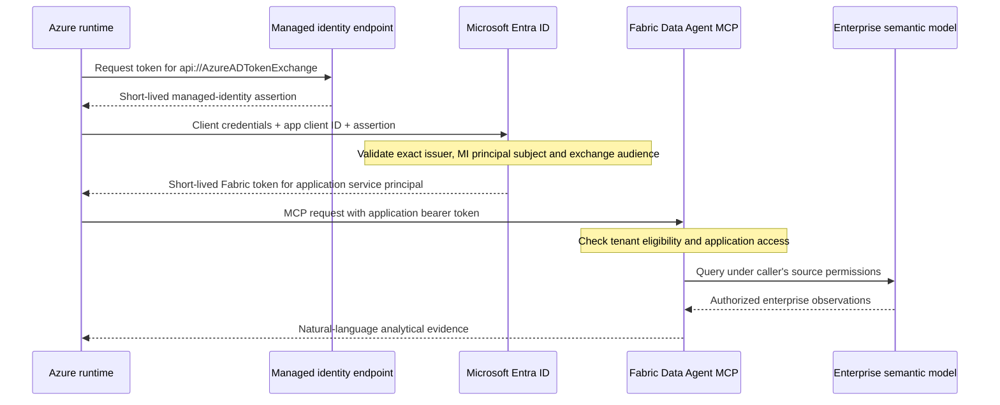

# 25 - Secretless application authentication for the Data Agent

The laboratory has a dedicated single-tenant Entra application and service principal for Fabric
Data Agent calls. It authenticates through **federation with the existing user-assigned managed
identity**, not through a password, client certificate or operator login. No Key Vault is necessary:
there is no long-lived application credential to store or rotate.

The application has **Contributor** access only to `ws-giandoria-agent-demo`, an enterprise-only workspace
on the existing F4. This is the documented minimum working workspace role for this application path.
It includes write access within that workspace: the application is **not a read-only security principal**.
The original workspace, including its truth items, is not granted to this application.
This is a separate authorization boundary within the same demo, not a new cloud environment.

The [operating runbook](../infra/demo/README.md#secretless-data-agent-application-identity) owns deployment
and probe commands. The [analytical showcase](./24-data-agent-showcase.md) explains snapshot semantics,
evaluation and isolated manager decisions. Authentication does not make the snapshot live or turn on
Fabric-backed decisions in the simulation automatically.

## 25.1 Why an application is needed

Fabric Data Agent currently accepts application service principals, but not direct managed-identity
authentication. Entra can nevertheless trust an exact managed identity as the **credential of an
application**. The identity presented to Fabric is then the application's service principal.
This is the documented workload-identity-federation flow, not token impersonation or a user-token workaround.

These objects have different roles:

| Object | Role |
|---|---|
| Runtime user-assigned managed identity | Authenticates the Azure workload and obtains the short-lived exchange assertion |
| App registration | Declares the single-tenant application and its exact federated trust |
| Application service principal | Receives the Fabric workspace/source permissions and appears as caller to Fabric |

The runtime keeps using its managed identity directly for existing Storage, publishing and model-inference
operations. It does not replace all its existing permissions with the application's credentials.
The application receives no Microsoft Graph application permissions, Azure roles or original-workspace role.

## 25.2 The token exchange, step by step

1. `ManagedIdentityCredential` selects the existing **user-assigned identity by client ID**. There is no
   `DefaultAzureCredential` fallback to a developer account.
2. It requests `api://AzureADTokenExchange/.default`. The token's audience is the exchange service,
   **not Fabric**. This assertion is never sent as the bearer token of a Fabric request.
3. `ClientAssertionCredential` presents the assertion to Entra with the dedicated application's client ID.
4. Entra checks the application's sole federated identity credential:
   * issuer: `https://login.microsoftonline.com/<tenant>/v2.0`;
   * subject: the managed identity's **principal/object ID**, not its client ID or resource ID;
   * sole audience: `api://AzureADTokenExchange`.
5. Entra issues an application token for `https://api.fabric.microsoft.com/.default`. The resulting caller
   is the application service principal, not the managed identity or the signed-in operator.
6. The client allows only that Fabric scope and `https://analysis.windows.net/powerbi/api/.default`.
   The latter obtains a separate application token for the probe's direct DAX reconciliation, not for MCP.
   Diagnostic claim checks require the recorded tenant, application client ID, service-principal object ID
   and the audience appropriate to each request. These checks catch wrong
   configuration; they do not replace cryptographic validation, which Entra/Fabric perform.
7. Fabric independently checks tenant service-principal eligibility, item/workspace access and underlying
   model permissions. Successful token acquisition alone does not prove that an analytical query can run.

The callback obtains a fresh managed-identity assertion when Azure Identity needs one; Azure Identity caches
application access tokens in process. Tokens and assertions are kept in memory, not source files, environment
variables, command arguments, deployment outputs or evidence records. Only non-secret identifiers belong
in the recorded service configuration.

## 25.3 Least privilege and the truth boundary

The original demo workspace contains items that must not become an AI manager's data source. Giving the new
application Member/Contributor there would defeat that boundary. Instead:

* The dedicated workspace uses the **same existing capacity**, with no new SKU or separate environment.
* Its only items are a source-generated copy of the enterprise semantic snapshot and its published Data Agent.
* The application has Contributor, not Admin or Member. Its source permissions come from this role;
  there is no additional model-access group or explicit dataset grant.
* Viewer plus model Read + Build did not provide working application query access in this tenant/path.
  Do not assume a successful token or HTTP response proves that a narrower grant can run the analysis.
* Contributor can modify the workspace's enterprise items. The client issues read-only analytical requests,
  but that is a code-level restriction, not a read-only Fabric permission. Isolation limits the role's scope;
  it does not remove its write capability.
* The application has no membership or role on the original workspace and no truth-source permission.
* Existing tenant eligibility for Fabric public APIs is reused; the scripts do not enable tenant-wide
  access, admin APIs, workspace creation or unrelated API permissions for service principals.

The operator performs provisioning, model processing and source readback using existing administrative access.
The application client only consumes the published service. Publishing new snapshots or changing permissions
remains an explicit operator operation; the live simulation does not refresh this model automatically.
Access reconciliation refuses an unexpected existing role rather than silently increasing privileges.

The managed identity retains its pre-existing runtime rights; this change does not certify or redesign those
rights. The additional application path is deliberately narrower. Compromise of that managed identity still
allows its holder to exchange tokens as the application: federation eliminates a reusable stored secret,
not the need to protect the workload and its existing permissions.

## 25.4 Source-owned provisioning and verification

| Source | Responsibility |
|---|---|
| [Deploy-DataAgentIdentity.ps1](../infra/demo/Deploy-DataAgentIdentity.ps1) | Exact application/SP receipts, single-tenant/no-secret contract and sole MI federation |
| [data_agent_service.py](../src/giandoria/data_agent_service.py) | Dedicated workspace on the original capacity, model publication/reconciliation, Data Agent publication and isolated Contributor role |
| [data_agent_auth.py](../src/giandoria/data_agent_auth.py) | Scope-restricted federated credential, diagnostic identity checks, bounded cloud authentication/answer probe |
| [Test-DataAgentIdentity.ps1](../infra/demo/Test-DataAgentIdentity.ps1) | Non-secret cloud configuration, pinned-image one-off job override, bounded polling and exact-execution cleanup |
| [test_data_agent_auth.py](../tests/test_data_agent_auth.py) | Identity/scope validation, exchange callback, source boundary and evidence validation regressions |
| [test_data_agent_service.py](../tests/test_data_agent_service.py) | Workspace ownership/capacity and explicit role-reconciliation regressions |

Existing same-name applications and workspaces are not adopted without matching local receipts and
ownership metadata. Interrupted creation leaves its accepted identities recorded; missing or conflicting
objects fail rather than silently replacing them. Unexpected application passwords, certificates, requested
API permissions or federation trusts are errors. Access reconciliation never silently upgrades
Viewer to Contributor.

The cloud probe runs a different command in **one bounded execution of the existing Container Apps Job**,
with the same managed identity and a pinned image from the existing registry. It does not acquire the business
lease, instantiate the simulator or edit the live decision ledger. The running simulation execution is not
stopped by this test. Failure cleanup targets only the probe's exact execution name.

The probe verifies more than HTTP success:

1. Entra really issued the application token via the runtime identity.
2. The application cannot enumerate the original workspace's items.
3. The service workspace exposes exactly the expected two enterprise items.
4. A direct DAX query under the **application identity** reconciles sold/revenue totals before invoking MCP.
5. One actual MCP question runs. Returned sold/revenue totals match independently calculated source expectations, including full cents,
   and the answer states the correct virtual snapshot cutoff.
6. Evidence progresses from Reserved to Answered to Complete in ignored operational Storage.
   A syntactically successful but fabricated answer is retained as Answered and causes failure.

Token claims are diagnostic evidence, not stored bearer tokens. Provisioning also reconciles model/source
readback and DAX under the operator identity; the cloud probe independently proves the application query path.
A production dynamic source still needs the snapshot
barrier described in chapter 24. The authentication probe is not permission to apply a historical answer
to the current company.

## 25.5 Operations, revocation and costs

There is no client secret to expire or rotate, and therefore no Key Vault deployment merely to hold one.
If federation becomes unavailable, do not silently create a password: revisit the credential design explicitly.
A certificate/secret alternative would need secure storage, narrowly scoped managed-identity retrieval,
expiry monitoring and rotation. It is not this laboratory's deployed path.

Revocation can disable the dedicated service principal, remove its federated credential or remove its Contributor
assignment. These actions affect different layers.
Removing federation blocks new exchanges; already issued access tokens may remain usable until expiry and
authorization caches can delay permission changes. Never promise instantaneous revocation.
The application must not be deleted as routine lab Stop: Start/Stop preserves configuration and data.

The normal scheduled lab shutdown still controls F4 and simulation compute. The workspace, app and federation
do not add a second capacity, Key Vault or continuously running service. Extra snapshot processing, model
storage, the short probe execution and Data Agent queries still consume paid resources.

Official references:

* [Configure an application to trust a managed identity](https://learn.microsoft.com/en-us/entra/workload-id/workload-identity-federation-config-app-trust-managed-identity)
* [Fabric Data Agent service-principal authentication](https://learn.microsoft.com/en-us/fabric/data-science/data-agent-service-principal)
* [Fabric workspace roles](https://learn.microsoft.com/en-us/fabric/fundamentals/roles-workspaces)
* [Power BI Execute Queries](https://learn.microsoft.com/en-us/rest/api/power-bi/datasets/execute-queries-in-group)
