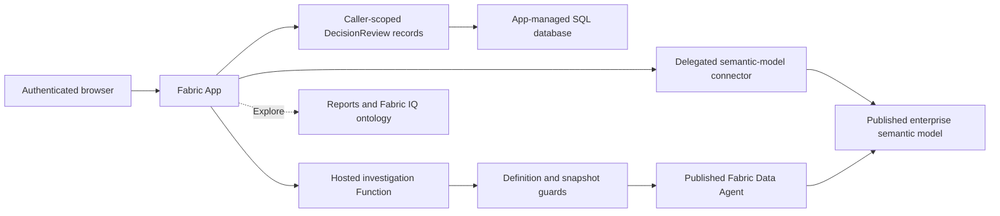

# 27. Decision Room: authoring a native Fabric App

The Decision Room is a native Fabric App for reading enterprise signals, investigating them with the Fabric
Data Agent and recording a private judgement. React supplies the interface; Rayfin supplies the Fabric-backed
authentication, typed data access, SQL records, connectors, Functions and deployment.

It reads the **published enterprise snapshot**, not the advancing simulation. Refreshing the page or generating
an AI answer does not advance that snapshot. Reviews and illustrative stock-cover calculations never change
the running company. The app links to the existing reports and ontology rather than replacing their models.

## 27.1 What the reader can do

| Area | Behaviour | Interpretation |
|---|---|---|
| Decision inbox | Inspect stock, backlog, sell-out and cash; select a rule-based signal | A proposal is a transparent rule, not an AI-approved action |
| Investigation | Ask the published Data Agent a bounded natural-language question | Newly generated explanation of the same fixed snapshot |
| Business explorer | Select an available product, channel and territory; query explicit measures | Unsupported dimensional slices remain **Not measured**, not zero |
| Scenario workbench | Compare stock with two, three, four, five or seven virtual days of average sell-out | Arithmetic sensitivity, not a forecast or a causal experiment |
| Review journal | Save evidence, question, answer, rationale and verdict; reload, revisit or delete | Mutable personal notes, not an immutable audit ledger |

The guide below the decision area explains the KPI vocabulary for readers unfamiliar with manufacturing.
Sampled stock and cash are balances, not amounts to sum across dates. Sell-out is consumer demand actually
recorded; it is not shipments, production releases or hidden lost sales.

The causal manager experiment described in [chapter 24](./24-data-agent-showcase.md) is a separate Python
workflow. The app does not launch that experiment or claim its arithmetic scenarios have measured outcomes.

## 27.2 Architecture and identity

These identity boundaries are different and must not be conflated:

* **App access:** Fabric authentication is enabled, password authentication is disabled, and hosted assets
  remain protected. The React authentication gate does not render business content before sign-in.
* **Semantic queries:** the connector uses delegated user authentication and source permissions.
* **App records:** the server-side `DecisionReview` policy requires the authenticated subject to match
  `owner_id` for every operation. Browser filtering alone would not provide this protection.
* **External Function calls:** the current application-auth Functions integration obtains external Fabric
  access using the item owner's identity and permissions, not the caller's delegated source identity.

Consequently, app sharing must be limited to the audience authorized to receive this enterprise snapshot.
The Function is not a general-purpose Fabric proxy: source coordinates and endpoint are fixed, definitions are
checked, and arbitrary URLs or item IDs are not accepted from the browser. Administrative workspace/database
privileges remain administrative privileges; the personal-record policy is not protection from administrators.

No hidden-truth source, service secret, browser token export or alternative semantic model is introduced.

## 27.3 Authoring: what is written and what is generated

The app lives in [apps/giandoria-decision-room](../apps/giandoria-decision-room/README.md). It starts from the
official Rayfin workspace and retains the stable internal package names:

| Package or file | Authoritative responsibility |
|---|---|
| `packages/frontend` | React pages, authentication boundary, evidence presentation, interactions and theme |
| `packages/data` | Decorated runtime entity and server-side ownership policy |
| `packages/shared` | Browser-safe record contracts and the exact enterprise evidence query |
| `packages/functions` | Trusted investigation, definition verification and bounded MCP transport |
| `rayfin/rayfin.yml` | Enabled services, package paths, authentication and connector declaration |
| Root manifest and lockfile | Workspace orchestration and pinned dependency resolution |

### Step 1: choose capabilities before editing their seeds

Use the installed, version-matched Rayfin documentation and project capability router. Apply the connector,
analytics, data-modeling and functions packs **one at a time** from the npm workspace root. Packs place their
dependencies in the owning package and update root orchestration.

Do not force-overwrite customized seeds, rename the stable member packages, create nested lockfiles or replace
the official SDK with a local patch. This app uses the existing approved workspace and capacity; provisioning
another workspace or accepting a trial is not a recovery strategy.

### Step 2: establish and verify the source contract

The preparation module checks the published snapshot receipts, semantic-model contract, Data Agent source
and ontology snapshot. It generates the ignored `source-context.ts` and connector coordinates from those
verified records. Resource IDs are local configuration, not public documentation or hand-written UI constants.

Run the exact DAX query through the real connector before implementing a result parser. The parser validates
column uniqueness, row width, finite measures, calendar dates, cutoff and publication sequence. Handle both
thrown transport errors and the connector's returned error envelope. Never substitute sample figures.

Semantic-model connectors are not GraphQL connectors. A documented `non-graphql-connector` generation skip
does not prove that the source works: the real query and deployed UI must still be verified independently.

### Step 3: author persistent data and its policy together

`DecisionReview` is an app-owned entity. Its decorated definition registers the table and authenticated-owner
policy; the shared package exposes the browser-safe contract without importing server decorators.

Records contain the virtual cutoff, snapshot digest, observed evidence, selected arithmetic policy, submitted
question, returned answer and human judgement. Text fields have explicit service-compatible bounds.
The browser uses typed create, update and delete operations, not local storage as a database.

A stable submission ID prevents repeated saves in the same investigation from creating duplicate records.
After creation, edits update that record. The saved question is the one actually submitted to the agent,
not an unsent edit. Journal requests use cursor pagination rather than assuming an unbounded list response.

### Step 4: author a trusted Function, then generate its client contract

The `investigate` Function declares its Fabric audience in the `RayfinContext` type annotation. Rayfin reads
that annotation to resolve token access. The Function receives its Fabric token from the platform; it does
not accept a token from React or expose one in the response.

The authoring workflow generates the Function request/response types from the implementation. Do not edit
generated `types.ts` to make a client compile against an undeployed or differently shaped Function.
Keep schema generation, the implementation and the actual deployed invocation consistent.

The Function checks source definitions before and after the answer, bounds the question and response, and
returns the answer with its virtual date and snapshot digest. The browser independently checks that stamp.
Definition reads request the semantic model explicitly in **TMSL** format so canonical hashes are comparable.

Fabric operation responses may advertise regional operation URLs. Validate the supported operation path,
then poll it through the public Fabric API origin; never forward a bearer token to an arbitrary `Location`
host. Definition checks, polling, MCP response sizes and total execution all have explicit bounds.
MCP sessions are cleaned up separately, including after an analytical failure. There are no automatic
inference retries and no success-shaped answer when investigation or required verification fails.

### Step 5: compose the React experience

The visual layer uses **Radix Themes 3.3.0** [F102], React and the existing Tailwind v4 tokens. Cards, buttons,
badges, progress, tooltips, text areas, spinners and confirmation dialogs share one component language.
Lucide icons support navigation and KPI recognition without replacing accessible control labels.

The design has a persistent workspace navigation, a clear virtual-time provenance strip, prominent KPI
cards, numbered signals, an evidence-to-judgement workflow and a quieter explanatory guide at the bottom.
The stock comparison encodes actual stock against the explicit arithmetic target; there are no invented
historical trends or decorative business values.

`brand-theme.css` owns the light/dark palette and bridges it to Radix. Component styles reference theme
variables; system Segoe UI/Aptos fonts avoid an external font service. CSS layers place Radix after the base
reset and before app components and utilities, preventing reset rules from flattening library controls.
Responsive rules stack the workspace and reduce KPI columns on smaller viewports.
Load the global stylesheet before importing components: CSS layer order is fixed by its first declaration,
so an earlier component layer would otherwise be overridden by the later base reset and library styles.
Use a bounded soft button rather than a content-box ghost button for full-width sidebar navigation.
Cards use the standard Radix `surface` variant and size presets. Radix alone owns their contour, radius
and padding; do not add a real border, custom shadow or pseudo-element override on top.
Selected signals recolor the framework's single contour and expose `aria-pressed`; they do not add another ring.
Buttons and text areas likewise retain the standard framework geometry and states.

Normalize app-record responses at the read boundary. This SDK version's legacy reader can hydrate ISO-looking
text as `Date` objects, including a virtual cutoff stored in a text column. The app restores a validated UTC
calendar string before rendering, without shifting business dates through the browser's local timezone.

Loading, permission, source-drift and database errors are visible states, not empty dashboards or permanent
spinners. Navigation and evidence refresh are disabled during investigation or save so a response cannot be
silently attached to a different on-screen context.

### Step 6: validate locally, preview the target, then publish

Use the root commands serially: typecheck, production build, lint and tests. The build uses TypeScript's
`--noCheck`; a successful build alone is not a type-safety result. Focused tests cover the evidence contract,
virtual dates, arithmetic thresholds, ownership payloads, submitted-question handling and service transport.

Local authoring can use the Fabric-backed backend, but a running frontend or completed type generation does
not prove that the local Functions host is ready. Check that host explicitly, particularly on Windows ARM64
and with Azure Functions Core Tools authentication. Validate the hosted Function independently.

Preview publication against the registered app in the approved workspace before deployment. Preserve the
deployment registry and apply schema through the supported authoring/deployment workflow, not portal SQL edits.
After publication, verify the actual signed-in app, connector, Function and database rather than just CLI
success. Operational commands and prerequisites are in the
[runbook](../infra/demo/README.md#native-decision-room-app).

## 27.4 Virtual time and provenance

Every business value is interpreted in the continuous virtual Europe/Rome calendar. A laboratory pause,
restart or speed change does not create a gap measured in wall-clock business time.
The imported model nevertheless stays at its published cutoff until explicitly republished.

The app distinguishes three clocks or markers:

1. The **virtual cutoff and observation dates** define which business evidence is available.
2. The **snapshot digest and publication sequence** identify the exact prepared source.
3. A review's **creation timestamp** is operational metadata, not a KPI axis or a business-event date.

The backlog rule compares the latest sample with the last available observation at or before seven virtual
days earlier. Stock cover uses average sell-out over the final 30 virtual days. Revenue/cash comparison
uses the same virtual window but does not assert that accounting revenue equals cash receipts.

AI explanations can contain mistakes: matching source hashes do not validate every generated factual claim.
Compare the explanation with the visible KPI evidence and source reports before recording a judgement.
AI explanations are generated on request from the governed snapshot. They are not cached static summaries,
and generation time is not a new observation date. A changed model or agent definition requires deliberate
source reconciliation and republication; the app fails closed instead of mixing versions.

## 27.5 Authentication, verification and operating limits

Rayfin CLI authentication, Azure CLI authentication and Edge cookies are separate contexts. A management
token accepted by Fabric does not automatically authorize the semantic connector's Power BI resource.
Use Rayfin's native login/resource-token acquisition for connector queries rather than injecting a token
with the wrong audience.

The lab browser launcher selects the configured Edge profile and preserves the complete authorization URL.
It does not change the system default browser. For `AADSTS50149`, inspect whether `code_challenge_method`
arrives as exactly `S256`; URL corruption is not corrected by weakening permissions, MFA or Conditional Access.

The hosted validation checklist is:

* An unauthenticated request cannot download protected app content.
* The requested Edge profile signs in and restores the app after navigation/reload.
* Real model evidence and a selected explorer slice render with explicit unsupported-grain blanks.
* A hosted investigation returns an answer with matching snapshot/date or an actionable failure.
* A clearly identified test review survives reload; its update and deletion also survive reload.
* Layout, theme, loading and destructive-action confirmation work in the published interface.

Unit tests do not prove cross-user hosted isolation. A one-user CRUD check does not prove it either;
server-side policy inspection and a separately authorized two-user check are distinct evidence.

This is a preview-platform app, not an unattended operational controller. The existing lab watchdog owns
capacity/worker shutdown; opening the app does not extend that deadline. Suspending F4 preserves resources
and does not remove managed SQL/storage retention costs. Keep app sharing, retained services and subscription
costs in the same governance review as the rest of the laboratory.

## 27.6 References

Version-matched guidance is shipped with the installed Microsoft Rayfin packages and the project's
[authoring instructions](../apps/giandoria-decision-room/AGENTS.md).
For component usage, see the
[Radix Themes documentation](https://www.radix-ui.com/themes/docs/overview/getting-started).
The source methodology is defined in [chapter 23](./23-semantic-model-showcase.md),
[chapter 24](./24-data-agent-showcase.md) and [chapter 26](./26-fabric-ontology.md).
