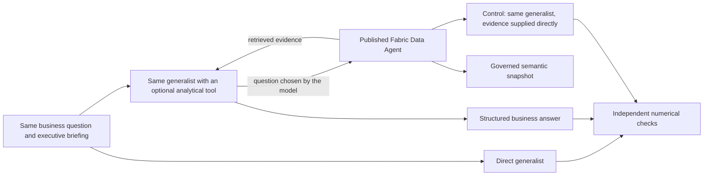

# 28 - The CEO asks the line lead: a Data Agent delegation experiment

**Measured result:** an overview-only generalist could not answer three detailed business questions.
The same generalist, allowed to ask the existing Fabric Data Agent, answered all three correctly against
independently calculated snapshot values. It chose to delegate; the harness did not force a tool call.
Neither configuration invented unavailable measurements.

This is a small, reproducible demonstration of **specialist evidence access**, not proof that general-purpose
models are incapable of analytics or that Fabric is the only way to provide it. No Copilot product or Copilot
runtime participates in the experiment.

## 28.1 The business problem

A vertically integrated company collects facts about purchasing, manufacturing, inventory, shipments, sales
and finance. Having those facts somewhere is not the same as answering a precise question.
Which product? Which channel? Which territory? Which virtual month? A flow, or a balance?

An executive briefing can summarize the whole company and still omit the small slice needed for a decision.
Asking a generalist to manufacture that detail from the summary is like asking the CEO for a wrapping line's
exact output. The CEO might know it, but remembering every counter is not the CEO's job.
The better answer can begin with: **"Let me ask the line lead."**

Here the generalist is the CEO and the Data Agent is the specialist who can consult the relevant records.
The metaphor describes responsibilities, not extra data: this reduced-detail demo has product/channel/territory
sales, but not individual wrapping-line telemetry. We test the detail actually present, not an imagined factory.

## 28.2 What we compared



| Configuration | What it receives | What it can do |
|---|---|---|
| Direct | Company scope, snapshot dates, lifetime sales total and measurement limits | Answer or admit missing detail; no retrieval |
| Delegated | Identical briefing and question, plus one optional read-only tool | Ask the real Data Agent, then synthesize its answer |
| Evidence supplied | Identical briefing/question plus the exact retrieved evidence | Answer without tool orchestration |

The third configuration is important. If it succeeds too, the generalist can reason with the right facts:
the gap is the retrieval path, not a mysterious difference in intelligence.
It receives the specialist's actual answer, **never the evaluator's expected values**.

The generalist is the existing Azure-hosted `gpt-5.6-terra` deployment, version `2026-07-09`, called through
Chat Completions with structured output. A small Python harness implements the read-only tool loop.
No new hosted agent service, model deployment, principal or permission is created.
The Data Agent uses its existing published semantic source and instructions; its internal model is not selected
or claimed to match the generalist.

## 28.3 Freeze the questions before asking

The runner persists the complete protocol, prompts, oracle values, source contract and call limits before inference.
It then runs all four cases in fixed order. The expected values come from the saved enterprise rows, not from
either agent. Model/agent definitions are checked against the snapshot before the comparison and again afterwards.

The analytical dataset is fixed through **virtual 2034-09-03**, not live.
An analysis-only lab session leaves the company's simulated clock unchanged.
The questions use virtual calendar dates even though the cloud experiment ran in October 2026.

| Case | Question and independent expected answer |
|---|---|
| Calendar | August 2034 sales **12,873 kg**; August 2033 **12,843 kg**; 2034 YTD through August **103,600 kg** |
| Specific slice | August 2034 `dark70` / `campaigns` / `centre`: **82 kg**; company total for that month **12,873 kg** |
| Cover policy | Trailing 30-calendar-day sales **12,527 kg**; separate two-day target **835.1 kg**, four-day target **1,670.3 kg** |
| Unavailable measurements | OEE, margin and hidden unconstrained demand: **all unavailable**, represented as `null` |

Each answer must have the exact metric keys, numeric values within **0.01** of the expected display values,
the correct virtual cutoff and explicit snapshot status. Strings, booleans, non-finite values and missing fields
do not count as measurements. Cover-policy targets use the model's published one-decimal display precision.
Unavailable values pass only as `null`; pretending to know them fails.

All configurations receive the same general instruction not to invent missing measurements.
The direct baseline is not prompted to hallucinate or prevented from admitting uncertainty.

## 28.4 The observed contrast

Observed with the existing published snapshot and Data Agent on **21 October 2026**:

| Case | Direct | Delegated | Evidence supplied |
|---|---|---|---|
| Calendar | No numerical answer; all three values `null` | All values correct | All values correct |
| Specific slice | No numerical answer; both values `null` | Both values correct | Both values correct |
| Cover policy | No numerical answer; all three values `null` | All values correct | All values correct |
| Unavailable measurements | Correctly declined | Correctly declined without calling the specialist | Not run: no evidence was retrieved |

The direct configuration failed the **answerability task**, not the honesty test.
It correctly identified that a lifetime total cannot determine a particular month or a three-dimensional slice.
The delegated configuration retrieved the missing evidence and returned the requested numbers.

### One question, end to end

**Business question:** how much `dark70` sold through campaigns in the Centre during August 2034,
and how much did the whole company sell in that month?

The direct generalist returned:

```json
{"slice_sold_kg": null, "sold_kg": null}
```

Its explanation was explicit:

> The fixed snapshot provides lifetime sold volume only and does not provide August 2034 sales, nor
> the dark70 × campaigns × centre slice. No proportional allocation or lifetime-total substitution was used.

With the optional tool available, the same generalist asked the specialist:

> At fixed snapshot cutoff, for virtual dates 2034-08-01 through 2034-08-31 inclusive, provide exact sold kg
> metrics: (1) slice_sold_kg for product dark70, channel campaigns, territory centre; and (2) sold_kg company
> total across all products/channels/territories in the same month. Include virtual_cutoff and whether data
> is snapshot.

After the real MCP response, its final answer contained:

```json
{
  "virtual_cutoff": "2034-09-03",
  "data_status": "snapshot",
  "metrics": {"slice_sold_kg": 82, "sold_kg": 12873}
}
```

These are selected fields from the actual structured outputs, not interface mockups or invented demonstrations.
The evaluator independently sums the matching Sales rows and the complete month's Sales rows.
The slice can now be sized without confusing a small campaign segment with the whole business.
It does not establish why those sales occurred, identify a production bottleneck or authorize a production change.

## 28.5 What the experiment proves, and what it does not

**The practical lesson is delegation, not replacement.** The generalist frames the question and explains the result;
the specialist retrieves the governed detail at the right grain.
Three different retrieval tasks succeeded: calendar comparison, dimensional slicing and a semantic-model scenario.
The negative control also matters: knowing where the measurements stop is part of analytical usefulness.

The evidence-supplied control succeeded on every measured task. Consequently:

* A larger prompt containing the relevant rows, a well-built SQL/DAX tool or another governed retrieval system
  might also solve these questions. We did not test or disprove those alternatives.
* This comparison deliberately changes information access. It does **not** isolate domain expertise while holding
  data access constant, nor measure whether the Data Agent outperforms another retrieval implementation.
* Four selected cases and one pass per configuration are not a statistical benchmark, a broad accuracy estimate
  or proof that the same answer will always recur. Fixed ordering was not randomized.
* The Data Agent adds an inference/retrieval hop, with latency and cost. Its text is untrusted evidence, not a
  certified data feed. Numerical checks, source pinning and access controls remain necessary.
* Snapshot success does not establish live completeness, individual-line diagnostics, cross-user isolation,
  optimization quality or financial-reporting certification.

There was no search through failed business answers to publish only a successful question:
the frozen suite completed in one run, and the table includes every case.
The generalist chose three specialist calls and no call for the explicitly unavailable measurements.
The no-tool negative-control path is retained rather than forced into an unnecessary delegation.

## 28.6 Reproduce and inspect

The [bounded operating command](../infra/demo/README.md#data-agent-delegation-comparison) starts analysis mode,
runs the suite and stops the lab in cleanup. Existing infrastructure, snapshot and operator authentication
are prerequisites; this does not create a second environment.

The [runner](../src/giandoria/agent_comparison.py) owns the frozen cases, real function-tool routing,
independent scoring and retained results.
The [offline tests](../tests/test_agent_comparison.py) cover the oracle, no answer leakage, numerical rejection,
tool routing, non-delegation, call reservations and explicit failure behavior.
The [Data Agent guide](./24-data-agent-showcase.md) remains authoritative for MCP transport, semantic contracts
and identity boundaries.

Each unique local experiment reserves its name before inference. Reusing it fails rather than silently
reissuing billable calls. All responses, tool questions, usage and errors remain in the ignored result record;
publication contains only the useful synthetic example and aggregate findings above.
No comparison writes into the company or changes the Data Agent's instructions.
