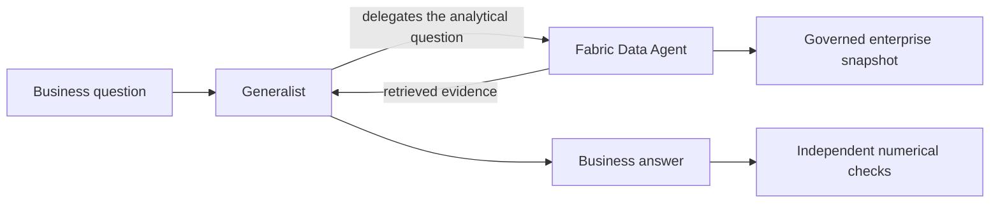

# 28 - The CEO asks the line lead: a Data Agent delegation experiment

When does a general-purpose AI agent need an analytical specialist?
This chapter tests that question on Giandoria's sales, cash and stock-policy data.
We compare a generalist answering alone with one that can ask the existing Fabric Data Agent,
then separate the benefit of **access to data** from that of **knowing what the data means**.

The experiment uses real queries against a fixed enterprise snapshot, with answers checked independently.
It is a small demonstration, not a benchmark designed to declare a winning product.
No Copilot product or runtime participates.

## 28.1 The business problem

A vertically integrated company records purchasing, production, inventory, sales and finance.
An executive summary cannot answer every question about a particular product, channel and virtual month.
Even with access to the records, an analyst must know which filters are valid, whether a number is a flow
or a balance, and which business rules apply.

The metaphor is a CEO asking a line lead: the generalist frames the question and explains the answer;
the specialist consults the governed detail. This does not imply that the specialist is always right.
Nor does it invent factory telemetry: the demo contains product/channel/territory sales, not individual-line data.

## 28.2 What we compared

We ask two distinct questions, in order:

1. **Does delegation supply missing evidence?** Compare an overview-only generalist with the same generalist
   allowed to ask the Data Agent. A third control receives the specialist's actual answer directly.
2. **Does specialist knowledge matter when the data is accessible?** Give the generalist full query access,
   vary the semantic information supplied, and compare its executed queries with the Data Agent's answers.



The generalist is the existing Azure-hosted `gpt-5.6-terra`, version `2026-07-09`.
The Data Agent uses its published semantic model and instructions; its internal model is not controlled here.
The comparison creates no new model deployment, identity or permission.

## 28.3 How we check the answers

All trials use a **fixed snapshot through virtual 2034-09-03**, not the evolving company stream.
Analysis mode does not advance business time. The snapshot's dates, embedded source rows, measures and
relationships are checked before and after each complete suite, as is the Data Agent's source configuration.
Queries made at different wall-clock times therefore target the same recorded data.

Questions and expected values are frozen before inference. Expected answers are calculated from saved
enterprise rows, never taken from either agent or supplied to it.
Numeric answers must match within **0.01**, with exact metric keys and `null` for unavailable measurements.
The cover target uses the model's one-decimal display precision.
Returned business answers must identify the virtual snapshot cutoff.

There are no automatic inference retries. Direct query arms get one DAX attempt per question;
compilation errors, wrong result shapes and wrong values count as failures.
All outcomes are retained, including an interrupted ablation attempt that is not counted as a complete trial.

## 28.4 First test: retrieving the missing detail

The direct generalist receives company scope, snapshot dates, lifetime sales and measurement limits,
but no retrieval tool. The delegated version receives the same briefing plus an optional Data Agent tool.
The evidence-supplied control receives the specialist's actual response, not the expected answer.

Observed on **21 October 2026**:

| Question and expected answer | Overview only | With Data Agent | Evidence supplied |
|---|---|---|---|
| August 2034 / August 2033 / 2034 YTD sales: 12,873 / 12,843 / 103,600 kg | All `null` | Correct | Correct |
| August `dark70` / `campaigns` / `centre`: 82 kg; company total: 12,873 kg | Both `null` | Correct | Correct |
| Separate two- and four-day cover targets: 835.1 / 1,670.3 kg; trailing sales: 12,527 kg | All `null` | Correct | Correct |
| OEE, margin and hidden unconstrained demand: unavailable | Correctly declined | Correctly declined; no specialist call | Not needed |

For example, the overview alone cannot determine the small campaign slice. The generalist admitted that
limitation rather than allocating a share of lifetime sales. With the tool, it requested that exact slice
and returned **82 kg**, alongside the company's **12,873 kg** for the month.
It chose three specialist calls; the harness did not force them.

**This demonstrates evidence access, not superior reasoning.** The evidence-supplied control succeeded too.
To test expertise rather than missing permissions, we need the second comparison.

## 28.5 What the specialist actually knows

The knowledge is an inspectable analytical contract in
[the Data Agent instructions](../fabric/data-agent/instructions.txt) and
[the semantic-model measures](../src/giandoria/showcase.py), not privileged intuition.

| Knowledge | Company-specific rule |
|---|---|
| Business time | Use virtual Europe/Rome dates and the snapshot cutoff, not today's real date |
| Valid analytical grain | Sales supports product/channel/territory; production supports product; cash cannot be allocated across those dimensions |
| Balances | Use the last observation within the selected period; do not sum daily balances or carry observations from outside it |
| Missing observations | An unknown balance is not zero; observation counts and calendar-day counts are different |
| Financial meaning | Purchases are not COGS; cash movement is not profit; sell-out is not revenue postings |
| Cover policy | No single selected value defaults to three days; the illustrative target uses trailing 30-calendar-day average sales |
| Measurement limits | OEE, OTIF, margin, downtime and hidden demand are not measured here |

Another agent can receive these rules too. In particular, measure expressions and descriptions already
transfer much of this expertise. Giving a generalist that catalogue is not the same as giving it raw schema.

## 28.6 Second test: same data access, different knowledge

Every query arm can read every row in the same enterprise model through Power BI `executeQueries`.
No fact table is withheld; hidden simulator truth is excluded for everyone.
The first comparison supplies the **full catalogue**: tables, columns, relationships, measure names,
descriptions, formats and DAX expressions. Its control adds the exact Data Agent instructions.
The published Data Agent answers the same questions through MCP.

### Full-catalogue comparison

| Question and expected answer | Generalist + catalogue | Same + instructions | Data Agent |
|---|---|---|---|
| August cash close: EUR 3,435,099.60; 31 observation days; 31 calendar days | Correct | Correct | Correct |
| August campaign slice: sold 82 kg; production and cash unavailable at this grain | Correct | Correct | **86 kg; failed** |
| Cover values 2 and 4 selected together: default 3 days; target 1,252.7 kg | Correct | Correct | Correct |
| June 2030: sold 8,129 kg; cash `null`; 0 observation days; 30 calendar days | Correct | Correct | Correct |

All eight direct DAX queries executed correctly. Extra prose instructions did not improve this baseline:
the catalogue already contained the relevant semantics.

The **82 kg** reference is independently reproducible: the selected Sales rows contain eleven days at
2 kg and twenty at 3 kg, totaling 82. Direct model queries agreed, and the source checks detected no drift.
The Data Agent's 86 kg answer is wrong for that question and snapshot, but its internal query is not exposed.
We cannot identify whether the cause was filtering, query generation or answer rendering.

### Removing the curated catalogue, not access to the data

After that baseline succeeded, we declared one additional comparison with the same four questions.
A **raw-schema** arm receives every table, column, column description and relationship, but no measure
catalogue. Existing measures remain queryable; only their metadata is omitted from the prompt.
The other arms remain unchanged.

| Case | Raw schema | Full catalogue | Catalogue + instructions | Data Agent |
|---|---|---|---|---|
| Cash close | Correct | Correct | Correct | Correct |
| Campaign slice | Correct | Correct | Correct | Correct: 82 kg |
| Policy multiselection | **Both values `null`; failed** | Correct | Correct | Correct |
| Missing observations | Correct | Correct | Correct | **Observation count `null` instead of 0; failed** |

All twelve direct queries compiled and executed. The raw-schema failure was semantic, not syntactic.
The Data Agent corrected the earlier sales answer but made a different error: treating an empty observation
count as unknown despite the explicit request for zero. Both complete comparisons are reported, not just wins.
The questions themselves explain several pitfalls, so this is not a test of unaided business-rule discovery.

### The useful failure: a policy default is not in the rows

With cover values **2 and 4 selected simultaneously**, the raw-schema generalist used
`SELECTEDVALUE('Cover policy'[Days])`. This valid DAX returns blank when more than one value is selected.
Its executed query therefore returned:

```json
{"cover_days": null, "target_kg": null}
```

But Giandoria's measure specifies `SELECTEDVALUE('Cover policy'[Days], 3)`.
The fallback to three days is a business rule, not something the list of available choices can reveal.
Both full-catalogue generalists and the Data Agent applied it and returned:

```json
{"cover_days": 3, "target_kg": 1252.7}
```

This is the concrete knowledge gap: **what an ambiguous selection means in this company**.
The raw-schema agent was cautious, not dishonest; it lacked the published policy semantics.
Delegation can supply that knowledge, but supplying the semantic catalogue directly worked too.

## 28.7 What we learned, and the limits

The CEO/line-lead architecture is useful because it separates question framing from governed detail.
The first test demonstrates the tool loop; the second isolates the query/evidence layer.
Together they show why access to rows alone is not enough, and why maintaining the analytical contract matters.
They do **not** show that a Data Agent is inherently more accurate than a well-equipped generalist.

These are small, fixed-order demonstrations, not randomized benchmarks or accuracy estimates.
The specialist's internal model, query and orchestration are not controlled or visible.
Its extra retrieval hop has cost and latency, and its answers still require verification.
Success on a snapshot does not establish live completeness, cross-user isolation, individual-line diagnostics,
financial certification or authority to change production.

## 28.8 Reproduce and inspect

The [operating runbook](../infra/demo/README.md#data-agent-delegation-comparison) provides the bounded commands
for all three protocols: evidence, full-catalogue queries and raw-schema ablation.
They use existing infrastructure, start analysis mode and stop the lab in cleanup without advancing company time.

The [runner](../src/giandoria/agent_comparison.py) contains the frozen questions, independent calculations,
actual DAX execution and function-tool loop.
The [offline tests](../tests/test_agent_comparison.py) check scoring, metadata differences, routing and failures.
The [Data Agent guide](./24-data-agent-showcase.md) covers transport and identity boundaries.

Unique experiment names prevent accidental billable reruns. Questions, responses, queries, usage and failures
remain in ignored local records, including the interrupted attempt; they are not replaced by a curated success log.
No comparison writes company state or changes the Data Agent's instructions.
