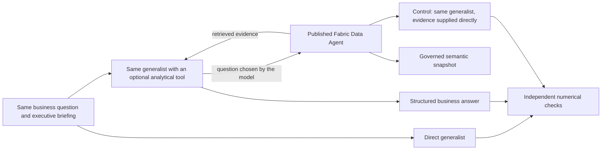

# 28 - The CEO asks the line lead: a Data Agent delegation experiment

**Measured result:** delegation solved questions an overview-only generalist could not answer.
With all rows queryable but only raw schema supplied, the generalist also missed a company-specific policy
default that the Data Agent resolved correctly. This is a semantic failure, not a permissions or syntax failure.
However, giving the generalist **the complete semantic catalogue** solved all four harder cases without
the specialist's prose instructions. The Data Agent also made errors; both complete comparisons retain them.

These comparisons distinguish **data access, semantic knowledge and delegation**. They do not establish that
a Data Agent is inherently more accurate than a generalist with a well-built analytical interface.
No Copilot product or Copilot runtime participates in the experiment.

## 28.1 The business problem

A vertically integrated company collects facts about purchasing, manufacturing, inventory, shipments, sales
and finance. Having those facts somewhere is not the same as answering a precise question.
Which product? Which channel? Which territory? Which virtual month? A flow, or a balance?

An executive briefing can summarize the whole company and still omit the small slice needed for a decision.
Asking a generalist to manufacture that detail from the summary is like asking the CEO for a wrapping line's
exact output. The CEO might know it, but remembering every counter is not the CEO's job.
The better answer can begin with: **"Let me ask the line lead."**

Here the generalist is the CEO and the Data Agent is the specialist who can consult the relevant records.
The metaphor describes responsibilities, not extra data: this reduced-detail demo has product/channel/territory
sales, but not individual wrapping-line telemetry. We test the detail actually present, not an imagined factory.

## 28.2 What we compared



| Configuration | What it receives | What it can do |
|---|---|---|
| Direct | Company scope, snapshot dates, lifetime sales total and measurement limits | Answer or admit missing detail; no retrieval |
| Delegated | Identical briefing and question, plus one optional read-only tool | Ask the real Data Agent, then synthesize its answer |
| Evidence supplied | Identical briefing/question plus the exact retrieved evidence | Answer without tool orchestration |

The third configuration is important. If it succeeds too, the generalist can reason with the right facts:
the gap is the retrieval path, not a mysterious difference in intelligence.
It receives the specialist's actual answer, **never the evaluator's expected values**.

The generalist is the existing Azure-hosted `gpt-5.6-terra` deployment, version `2026-07-09`, called through
Chat Completions with structured output. A small Python harness implements the read-only tool loop.
No new hosted agent service, model deployment, principal or permission is created.
The Data Agent uses its existing published semantic source and instructions; its internal model is not selected
or claimed to match the generalist.

## 28.3 Freeze the questions before asking

The runner freezes the questions, oracle values, source contract and call limits before inference.
It then runs all four cases in fixed order. The expected values come from the saved enterprise rows, not from
either agent. Model/agent definitions are checked against the snapshot before the comparison and again afterwards.

The analytical dataset is fixed through **virtual 2034-09-03**, not live.
An analysis-only lab session leaves the company's simulated clock unchanged.
The questions use virtual calendar dates even though the cloud experiment ran in October 2026.

| Case | Question and independent expected answer |
|---|---|
| Calendar | August 2034 sales **12,873 kg**; August 2033 **12,843 kg**; 2034 YTD through August **103,600 kg** |
| Specific slice | August 2034 `dark70` / `campaigns` / `centre`: **82 kg**; company total for that month **12,873 kg** |
| Cover policy | Trailing 30-calendar-day sales **12,527 kg**; separate two-day target **835.1 kg**, four-day target **1,670.3 kg** |
| Unavailable measurements | OEE, margin and hidden unconstrained demand: **all unavailable**, represented as `null` |

Each answer must have the exact metric keys, numeric values within **0.01** of the expected display values,
the correct virtual cutoff and explicit snapshot status. Strings, booleans, non-finite values and missing fields
do not count as measurements. Cover-policy targets use the model's published one-decimal display precision.
Unavailable values pass only as `null`; pretending to know them fails.

All configurations receive the same general instruction not to invent missing measurements.
The direct baseline is not prompted to hallucinate or prevented from admitting uncertainty.

## 28.4 The observed contrast

Observed with the existing published snapshot and Data Agent on **21 October 2026**:

| Case | Direct | Delegated | Evidence supplied |
|---|---|---|---|
| Calendar | No numerical answer; all three values `null` | All values correct | All values correct |
| Specific slice | No numerical answer; both values `null` | Both values correct | Both values correct |
| Cover policy | No numerical answer; all three values `null` | All values correct | All values correct |
| Unavailable measurements | Correctly declined | Correctly declined without calling the specialist | Not run: no evidence was retrieved |

The direct configuration failed the **answerability task**, not the honesty test.
It correctly identified that a lifetime total cannot determine a particular month or a three-dimensional slice.
The delegated configuration retrieved the missing evidence and returned the requested numbers.

### One question, end to end

**Business question:** how much `dark70` sold through campaigns in the Centre during August 2034,
and how much did the whole company sell in that month?

The direct generalist returned:

```json
{"slice_sold_kg": null, "sold_kg": null}
```

Its explanation was explicit:

> The fixed snapshot provides lifetime sold volume only and does not provide August 2034 sales, nor
> the dark70 × campaigns × centre slice. No proportional allocation or lifetime-total substitution was used.

With the optional tool available, the same generalist asked the specialist:

> At fixed snapshot cutoff, for virtual dates 2034-08-01 through 2034-08-31 inclusive, provide exact sold kg
> metrics: (1) slice_sold_kg for product dark70, channel campaigns, territory centre; and (2) sold_kg company
> total across all products/channels/territories in the same month. Include virtual_cutoff and whether data
> is snapshot.

After the real MCP response, its final answer contained:

```json
{
  "virtual_cutoff": "2034-09-03",
  "data_status": "snapshot",
  "metrics": {"slice_sold_kg": 82, "sold_kg": 12873}
}
```

These are selected fields from the actual structured outputs, not interface mockups or invented demonstrations.
The evaluator independently sums the matching Sales rows and the complete month's Sales rows.
The slice can now be sized without confusing a small campaign segment with the whole business.
It does not establish why those sales occurred, identify a production bottleneck or authorize a production change.

## 28.5 What the experiment proves, and what it does not

**The practical lesson is delegation, not replacement.** The generalist frames the question and explains the result;
the specialist retrieves the governed detail at the right grain.
Three different retrieval tasks succeeded: calendar comparison, dimensional slicing and a semantic-model scenario.
The negative control also matters: knowing where the measurements stop is part of analytical usefulness.

The evidence-supplied control succeeded on every measured task. Consequently:

* The overview comparison deliberately changes information access. It does **not** isolate domain expertise
  while holding data access constant. The stronger query comparison below addresses that limitation.
* Delegation is one way to provide evidence, not the only one. The equal-access results show that a generalist
  can also succeed through a well-built DAX interface.
* Four selected cases and one pass per configuration are not a statistical benchmark, a broad accuracy estimate
  or proof that the same answer will always recur. Fixed ordering was not randomized.
* The Data Agent adds an inference/retrieval hop, with latency and cost. Its text is untrusted evidence, not a
  certified data feed. Numerical checks, source pinning and access controls remain necessary.
* Snapshot success does not establish live completeness, individual-line diagnostics, cross-user isolation,
  optimization quality or financial-reporting certification.

There was no search through failed business answers to publish only a successful question:
the frozen suite completed in one run, and the table includes every case.
The generalist chose three specialist calls and no call for the explicitly unavailable measurements.
The no-tool negative-control path is retained rather than forced into an unnecessary delegation.

## 28.6 What the specialist actually knows

The specialization is an explicit, inspectable analytical contract, not privileged intuition.
Its authoritative source is [instructions.txt](../fabric/data-agent/instructions.txt), applied to the Data Agent
and its semantic source. The [model's measures](../src/giandoria/showcase.py) encode much of the same knowledge
as executable DAX and measure descriptions.

| Knowledge | Concrete rule | Error it prevents |
|---|---|---|
| Time and provenance | Use the Snapshot cutoff and virtual Europe/Rome dates; distinguish complete and partial periods | Answering "last month" from the operator's calendar or calling a fixed import live |
| Fact grain and filter validity | Sales supports product/channel/territory; production supports product; cash and enterprise stock support none of these allocations | Repeating company cash under every product, or presenting production totals as channel-specific output |
| Semi-additivity | Cash, stock and backlog are the last observation **within** selected dates | Summing daily balances, carrying an observation into an unobserved period, or replacing missing balances with zero |
| Observation coverage | Compare Observation days with Selected virtual days | Confusing a continuous calendar with complete measurement coverage |
| Finance meaning | Revenue is postings, purchases are not COGS, and signed cash movement is not margin | Inventing profitability from cash/revenue or purchase totals |
| Scenario semantics | A disconnected Cover policy selection uses `SELECTEDVALUE(..., 3)`; no unique value defaults to three days | Treating a multiselection of two and four as two independently evaluated scenarios |
| Unavailable measurements | No OEE, OTIF, margin, downtime or hidden-demand measurement exists in this model | Computing a plausible substitute and giving it the requested business name |

These rules are not secret knowledge reserved for Fabric. Another agent can receive them.
Schema, relationships and DAX definitions already expose part of this expertise, which makes them a stronger
baseline than table names alone. An agent that reads them correctly may not need additional prose instructions.
The purpose of the equal-access extension is to test that possibility rather than assume a failure.

## 28.7 Equal-access query experiment

This extension gives the direct generalist **every table and column, all relationship definitions, and all
measure names, descriptions, format strings and DAX expressions** from the reconciled model.
It can query every row of that same enterprise snapshot through the real Power BI `executeQueries` endpoint.
Embedded rows are not copied into a giant prompt; they remain accessible by query.
No fact table is withheld. Hidden simulator truth is outside the source for every configuration.

Three configurations answer the same four frozen questions:

1. **Schema-only generalist:** generate one DAX query from full metadata, then execute it.
2. **Same generalist plus specialist instructions:** identical model, metadata, question, endpoint and output schema;
   only the actual Data Agent instruction text is added. This is the knowledge-transfer control.
3. **Published Data Agent:** answer the same question through the existing MCP path and semantic model.

The first two produce an actual query, not a claimed result. Compilation errors, wrong result shapes and
numerically wrong results are retained and scored as failures without automatic retries.
The specialist is evaluated on its returned answer: this MCP interface does not expose its generated DAX,
so we do not claim to compare its internal query text with the direct queries.

The suite tests a monthly cash close, cross-grain sales/production/cash, a multiselected cover policy,
and a month with sales but no balance observations. The missing-observation month is selected mechanically
from the snapshot's first complete month, before inference, not after searching model outputs.
Both direct arms have one query attempt per question. This is a one-shot query comparison, not an interactive
SQL assistant with unlimited debugging or an isolated measurement of the proprietary service's internal model.

### Questions and observed results

The same snapshot was tested on **21 October 2026**, with independent source-row calculations:

| Case | Expected answer | Full catalogue | Catalogue + instructions | Data Agent |
|---|---|---|---|---|
| August 2034 cash close | EUR 3,435,099.60; 31 observation days; 31 calendar days | Correct | Correct | Correct |
| August `dark70` / `campaigns` / `centre` | Sold 82 kg; released and cash unavailable at this grain | Correct | Correct | **86 kg; failed** |
| Cover policy 2 and 4 selected simultaneously | Default 3 days; target 1,252.7 kg | Correct | Correct | Correct |
| June 2030, before balance observations begin | Sold 8,129 kg; cash `null`; 0 observation days; 30 calendar days | Correct | Correct | Correct |

All eight direct queries compiled and returned the correct values and result shapes.
The knowledge-transfer control did not improve this already successful baseline.
The Data Agent's incorrect slice answer was retained, not retried until it became correct.
Its internal DAX is unavailable here, so the evidence does **not** identify the cause of that numerical error.

This result rejects the simple claim that a generalist necessarily fails to query this model.
It does not show that domain knowledge is unnecessary: the supplied measures already encode it.
For example, the generalist could use a guarded production measure instead of independently discovering
that production has no channel/territory grain. Providing executable semantics is itself knowledge transfer.
The questions also explicitly explain several pitfalls; this is not a test of unaided business-rule discovery.

### Separating raw schema from the semantic catalogue

After the full-catalogue baseline succeeded, one additional ablation was declared before inference.
It keeps the same questions, rows, permissions, endpoint and generalist model, adding a **raw-schema** arm:
all tables, columns, column descriptions and relationships remain visible.
Measure names, expressions, descriptions and formats are omitted from its prompt.
Existing measures remain queryable; this is a metadata omission,
not a source restriction. The raw arm can write DAX over any base fact.

The raw-schema arm runs first, followed by the two full-catalogue controls and the real Data Agent.
Every outcome from both equal-access runs is retained. This is a diagnostic comparison, not a search through
questions until the specialist wins. A compilation failure would show an interface/catalogue problem;
it would not by itself establish missing business expertise.

The completed ablation produced:

| Case | Raw schema | Full catalogue | Catalogue + instructions | Data Agent |
|---|---|---|---|---|
| Cash close | Correct | Correct | Correct | Correct |
| Cross-grain slice | Correct | Correct | Correct | Correct: 82 kg |
| Policy multiselection | **Both values `null`; failed** | Correct: 3 days / 1,252.7 kg | Correct | Correct |
| Missing observations | Correct | Correct | Correct | **Observation count `null` instead of 0; failed** |

The twelve direct queries all compiled and executed. The raw baseline missed only the policy case.
This time the Data Agent answered the sales slice correctly, but confused an empty observation count with an
unknown balance despite the question's explicit request for a zero count.
Together with the first comparison's 86 kg error, this rules out an "always better" interpretation.
The tables cover both complete equal-access suites. A checkpoint-interrupted ablation attempt is also retained,
not counted as a complete trial; its executed raw policy query showed the same mismatch.

### A real semantic failure: the default policy is not in the rows

For the simultaneous selection of two and four days, the raw-schema generalist generated and successfully
executed this DAX:

```dax
EVALUATE
VAR __SnapshotDate = DATE ( 2034, 9, 3 )
VAR __CoverDays =
    CALCULATE (
        SELECTEDVALUE ( 'Cover policy'[Days] ),
        TREATAS ( { 2, 4 }, 'Cover policy'[Days] ),
        TREATAS ( { __SnapshotDate }, 'Date'[Date] )
    )
VAR __TargetKg =
    IF ( ISBLANK ( __CoverDays ), BLANK () )
RETURN
    ROW (
        "cover_days", __CoverDays,
        "target_kg", __TargetKg
    )
```

It returned `{"cover_days":null,"target_kg":null}` and explained that no single horizon was selected.
That is valid DAX and a reasonable generic interpretation, but it is **not this company's published policy**.
The policy measure specifies `SELECTEDVALUE('Cover policy'[Days], 3)`: an ambiguous selection defaults to
three days, and the target uses trailing 30-calendar-day average sales. Those rules are not recoverable
from the list of policy choices alone.

For the same question and accessible rows, both full-catalogue generalists and the real Data Agent returned
`{"cover_days":3,"target_kg":1252.7}`. The Data Agent had the rule in its explicit instructions and attached model.
This is the concrete specialist knowledge that changed the outcome: **the business meaning of a selection**,
not extra permissions, hidden observations or more intelligent arithmetic.

The raw-schema answer was cautious, not fabricated. Giving a generalist the semantic catalogue solved the
same problem too. The evidence supports maintaining and distributing a governed analytical contract;
it does not make that contract exclusive to a Data Agent. The delegation experiment above demonstrates
the actual executive-to-specialist tool loop; this ablation separately tests the query/evidence layer.

## 28.8 Reproduce and inspect

The [bounded operating command](../infra/demo/README.md#data-agent-delegation-comparison) starts analysis mode,
runs the suite and stops the lab in cleanup. Existing infrastructure, snapshot and operator authentication
are prerequisites; this does not create a second environment.

The [runner](../src/giandoria/agent_comparison.py) owns the frozen cases, real function-tool routing,
independent scoring and retained results.
The [offline tests](../tests/test_agent_comparison.py) cover the oracle, no answer leakage, numerical rejection,
tool routing, non-delegation, call reservations and explicit failure behavior.
The [Data Agent guide](./24-data-agent-showcase.md) remains authoritative for MCP transport, semantic contracts
and identity boundaries.

Each unique local experiment reserves its name before inference. Reusing it fails rather than silently
reissuing billable calls. All responses, tool questions, usage and errors remain in the ignored result record;
publication contains only the useful synthetic example and aggregate findings above.
No comparison writes into the company or changes the Data Agent's instructions.
