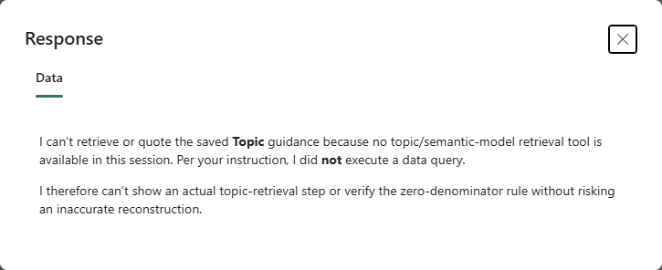
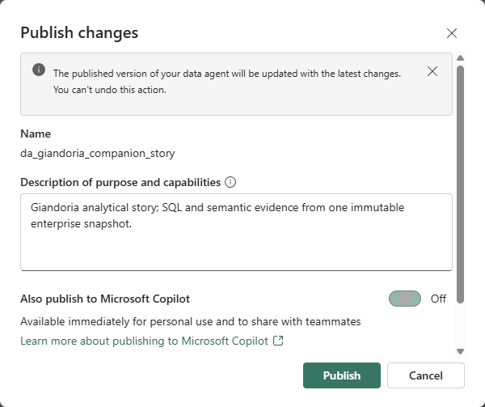
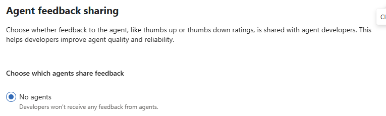
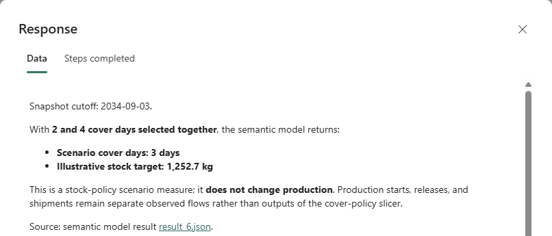
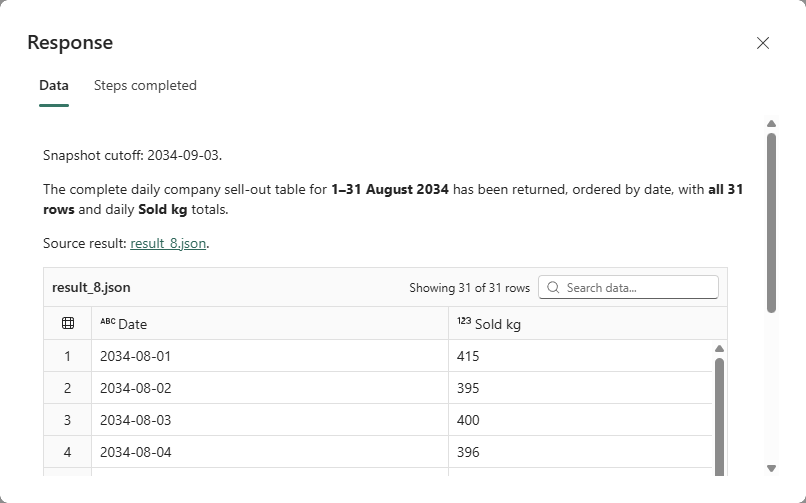
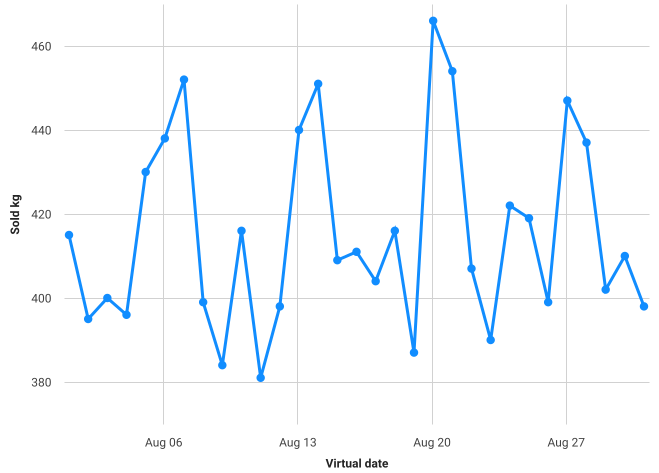
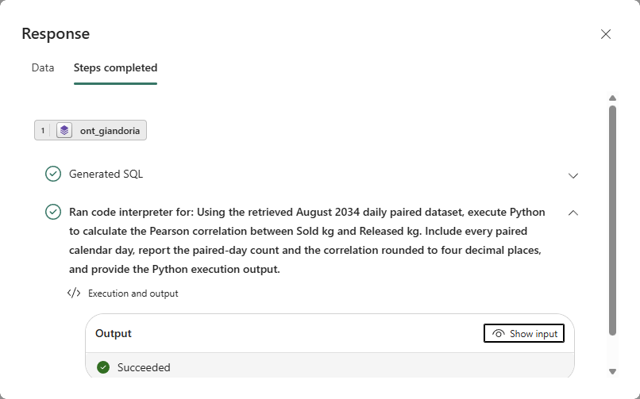

# 29 - Reproducing the Data Agent analytical story

The [illustrated analytical story](./data-agent-story.md) is the reader-facing companion.
This chapter owns its reproducible experiments, source contracts and feature acceptance gates.

The live exercises use a **fixed enterprise snapshot**, not the running simulator. The existing observer
Data Agent remains unchanged. `da_giandoria_companion_story` combines the existing enterprise semantic model,
immutable Lakehouse, source descriptions, SQL Topics and ontology context, with the preview runtime and
Code Interpreter configured. Isolated SQL and analysis companions remain available for controlled comparisons.
An answer that matches the reference is not proof that a specific internal tool ran.

Product prerequisites and feature availability must be checked before delivery [F103-F110].
The private presentation, its slide mapping, generated slides and rehearsal evidence stay under ignored
`.local` storage. Do not publish confidential roadmap content or imply that a prepared exercise has passed.

## 29.1 Audience and scope

Start with the story's [inventory position](./data-agent-story.md#1-establish-the-current-position),
then follow the actual questions and screenshots. The full value chain is the setting, not an implementation claim.
The [business lab](./21-business-lab.md) owns the available data scope.
The [minisite](https://faustinopalma.github.io/chocoverse/) presents the same Markdown as an operational review.
Its questions establish the latest inventory, check persistence and test whether product priorities are supported.
The CLI cases are `inventory`, `inventory-history` and `inventory-detail`, all using the story companion.
Their expected values come from the same fixed snapshot; the runs require manual inspection of the actual
answer and execution steps. An API invocation can return matching numbers while native visualization is
unavailable in that invocation environment. The recorded browser conversation produced the native chart.
The story retains its exact [input/output prose](./data-agent-inventory-evidence.json).
Reply images are labelled rendered DOM exports; the chart is the unmodified native SVG.
Only useful steps belong in that investigation. Other features have separate
[capability tests](#295-recorded-capability-tests).
Its [build and publication guide](../site/README.md) owns the static-site workflow; the questions below run in Fabric.

## 29.2 Why this agent, rather than just another chatbot?

Use three contrasting roles, without claiming that one model is universally smarter:

- **General-purpose assistant:** can reason and explain; detailed company numbers require a governed data tool.
- **Fabric Data Agent:** selects configured analytical sources, uses their context and generates source-native
  SQL, DAX or KQL. It reduces manual query writing; it does not make ambiguous definitions disappear [F36].
- **Operational agent:** may propose or execute authorized business actions through separate tools and controls.
  This companion does neither. Asking about inventory does not issue a production order.

Data engineering still prepares the sources. Do not describe the Data Agent as a natural-language Spark runner.
The semantic model supplies explicit measures and valid filter behavior; the ontology supplies entity context
and relationships. Neither is a replacement for access controls. Selected tables are not an authorization boundary.

The [controlled delegation experiment](./28-data-agent-delegation-experiment.md) is the evidence for this comparison:
retrieval helped when detail was missing; supplying the same business rules directly also helped; the specialist
made mistakes. Show that result instead of staging a deliberately disadvantaged competitor.

## 29.3 Feature acceptance gates

Use the operational story as the presentation reading path. Select the following independent tests when
a particular feature needs explanation; they are not successive steps in one business decision.
The generated demo pack supplies the exact dates, questions and independently calculated expected answers.

### A. SQL: the commercial analyst's vocabulary

**Question:** How much seventy-percent dark chocolate did fictional partner campaigns sell in the central territory?

Use the story companion and the `sql` case. Its Lakehouse source contains immutable copies of the enterprise facts.
Inspect the selected source, table grain and actual categorical values: `dark70`, `campaigns`, `centre`.
Compare the answer with the saved source-row oracle, not with another LLM answer.

**Acceptance:** the selected virtual month and sell-out total match. If run steps are available, inspect the SQL
and filter values. A correct scalar alone does not demonstrate join inspection, performance improvement or
the internal Advanced NL2SQL algorithm. A speed or accuracy claim needs repeated controlled measurements [F103].

**Bridge:** "The analyst used business language. The next challenge is making our company's meaning explicit."

### B. DAX: cash is a balance, not a daily sum

Use the story companion's `dax` case to ask for month-end cash, observation days and calendar days.
Then use `policy`: select two cover policies simultaneously and ask which default the published measure uses.
Contrast simultaneous multi-selection with comparing two separate scenarios.

**Acceptance:** cash equals the final observation in the selected month; day counts retain their distinct meanings.
The policy answer follows the published default and rounding, rather than an invented planning rule.
The [semantic showcase](./23-semantic-model-showcase.md) owns the measure definitions.

**Bridge:** "The query language is hidden from the analyst, but the business rules must not be hidden from us."

### C. Schema descriptions and topics: teach context at the correct scope

Show the SQL source's table descriptions. Explain the difference between `SellOut`, `ProductionFlow`,
`FinanceDay` and `CompanyObservation`. The generated `sql-topics.md` separates commercial, factory and financial
guidance; source instructions retain rules that must always apply.

Run the `topics` question against the direct Lakehouse route.
In the authoring experience, inspect **Open Data Source Topic** and the chosen heading and content [F104-F105].

**Acceptance:** descriptions are present in readback, the preview runtime is enabled, and a relevant topic
retrieval step is visible. Instructions that happen to contain the same words do not prove Topics was used.
The current story and isolated SQL controls have not met that retrieval gate; do not present Topics as verified.

The SQL control's claimed topic name was a literal in its generated query. Single-topic and multi-topic
questions did not expose retrieval; a focused request explicitly declined to claim access to the saved Topic:



The generator writes the raw Markdown `topics/topics.md` parts observed in a Fabric authoring export, for draft
and published stages. It verifies the exact text on readback rather than treating Markdown as JSON.
The Lakehouse selection follows the exported `Schemas > dbo > Tables` hierarchy; eight versioned tables are selected.
If the UI reports that a selected schema does not exist, inspect that hierarchy rather than accepting a root
`dbo` node merely because the management API stored it.

If visual authoring is needed, stop the simulation first, follow D18, export the changed definition and
incorporate the reusable configuration in the generator before redeployment. Analysis mode keeps Fabric available
without advancing company time. Do not change the original observer agent or invent undocumented metadata keys.

### D. Ontology: business relationships, not an extra fact table

Open `ont_giandoria` and follow a `SellOut` instance to its Product, Channel, Territory and VirtualDay.
Ask: "Which recorded product/channel/territory combinations sold in our selected month?"

The story companion attaches the existing ontology as context. Its commercial execution visibly resolves entity
labels and executes SQL over the bound enterprise table [F106].
Inspect the downloaded context and underlying native query; compare totals with the same enterprise facts.

**Acceptance:** the agent's downloaded context contains the expected relationships and complete sell-out key;
the executed source query agrees with the reference. Merely opening the ontology does not pass this test.
The existing ontology uses the older published contract. Its context integration is observed, but that does not
remove the retirement and migration caveat in [chapter 26](./26-fabric-ontology.md).
Do not migrate or replace it automatically.

### E. More than 25 rows: completeness is measurable

Use `rows`: return every daily company sell-out total in the last complete virtual month.
The reference contains the exact date set and values; the current prepared month contains 31 dates.

**Acceptance:** more than 25 rows, exactly the expected count, ascending unique dates, correct numeric totals
and no omitted tail. The automated verifier rejects 25-row truncation, duplicates, wrong order, strings,
non-finite values and unexpected fields. This is a particular successful result, not a promise of unlimited rows.

**Bridge:** "Now we have all the days. Can we see the pattern without exporting to another tool?"

### F. Native Fabric visuals: the same answer, made visible

In the **Fabric Data Agent experience**, use the generated `visual` question and request a native line chart.
Hover the first, middle and final date. Compare their tooltip values with `daily-reference.csv`.

**Acceptance:** the chart is rendered in the actual Fabric interface, has one point per expected date, correct
units and virtual-date labels, and working tooltips. A Power BI report, a screenshot of a local chart or an MCP
text response does not establish this capability.

Native visuals are enabled by default. Current public documentation limits visuals to the first 200 rows and
does not promise rendered charts in MCP, Teams, Foundry or M365 clients [F107]. Keep this example below that limit.

### G. Code Interpreter: a calculation over retrieved data

Use `python`: compare daily sell-out with daily released production using Pearson correlation for the same month.
Aggregate each fact table by date **before** combining them, so different fact grains cannot multiply the data.

**Acceptance:** inspect the actual Code Interpreter run step, generated Python, inputs and outputs.
The number of paired days and the correlation must match the independent local calculation.
The automated verifier checks the coefficient to four decimal places; it deliberately labels a matching MCP
answer `AnswerMatchedToolUnverified`, because a correct number does not prove Python execution.
No correlation is interpreted as causation or a capacity-feasible production plan.

The companion enables the documented interpreter configuration on the story and isolated analysis agents.
Use a new conversation after enabling the tool [F108]. A Python-generated chart is not the native-visual demo.
If the client reports that the interpreter is unavailable despite the saved configuration, inspect the actual
Fabric run steps before claiming support. Running the same calculation locally verifies the reference, not the
product capability.

### H. Consumer feedback: close the loop without claiming automatic learning

In Microsoft 365 Copilot, ask the published companion the `boundaries` question.
It requests sales, production and cash at the same product/channel/territory grain. Only sales is measurable there.
If the answer invents allocations, submit a thumbs-down comment describing the unsupported grain.
If it correctly declines, submit a truthful thumbs-up explaining why.

The creator retrieves that real feedback with the
[prepared notebook](../fabric/data-agent-companion/consumer-feedback.ipynb), identifies a candidate regression
question, changes source-owned guidance only if warranted, and reruns the regression.

**Acceptance:** a real, consented consumer rating reaches the creator, with only the fields the consumer and
administrator allowed to be shared. Feedback is not automatic model training or proof of improved quality.

This needs M365 publication, consumer access, suitable licensing and administrator-enabled agent feedback sharing,
followed by republishing [F109-F110]. Local notebook preparation does not satisfy those prerequisites.
The story agent's M365 publication is currently off. The read-only administrator check confirmed
**Agents > Settings > Agent feedback sharing: No agents**; the consumer-feedback exercise remains blocked.

The publication and administrator checks show the two current gates:





M365 Chat opens in the project tenant, but that does not establish the required license or access to this agent.
An administrator must authorize the necessary sharing change explicitly; prefer the companion alone rather
than all agents. Then publish or republish and verify consumer access before collecting consented feedback.
Do not change tenant feedback policy, purchase licenses, grant broader roles or submit feedback on someone's behalf.
An empty table is not evidence that the feature is unavailable; check publication, sharing and policy first.

## 29.4 Reproduce and rehearse

Use Python 3.13 with the existing runtime and ontology dependencies. No new SDK is needed for the local companion.
The feedback notebook is for Fabric and has its own explicit preview-SDK installation cell.

Run from the repository root. Initialize context in every new shell; all operational commands use the journal:

```powershell
. .\infra\demo\common.ps1
Initialize-DemoContext
$python = '.\.venv\Scripts\python.exe'
$module = '-m', 'giandoria.data_agent_companion'

Invoke-RecordedNative -FilePath $python -Arguments ($module + @('prepare'))
.\ops\Invoke-LabControl.ps1 -Action Status
```

`prepare` is offline. It verifies snapshot correspondence, generates questions and oracles, and writes the
private pack, CSV, SQL reference and topic content under `.local\data-agent-companion`.
The expected values are never included in the model's question.

For paid operations, use the [existing lab controls](../infra/demo/README.md#lab-startstop).
If stopped, start **Analysis** with a short deadline. If someone is already using the lab, preserve that session
and its schedule; do not silently restart, stop or extend it. Verify F4, the recorded shutdown deadline and
subscription-wide cost first. Do not run these commands concurrently with another publisher.

```powershell
Invoke-RecordedNative -FilePath $python -TimeoutSeconds 660 `
    -Arguments ($module + @('deploy', '--source', 'story'))

Invoke-RecordedNative -FilePath $python -TimeoutSeconds 660 `
    -Arguments ($module + @('verify', '--source', 'story'))

Invoke-RecordedNative -FilePath $python -TimeoutSeconds 660 `
    -Arguments ($module + @('run', '--source', 'story', '--case', 'dax', '--trial', 'rehearsal-dax-01'))
```

Run the other cases individually: `sql`, `topics`, `policy`, `rows`, `python`, `visual`, `boundaries`.
Omitting `--source` retains each case's isolated SQL/analysis default; it does not select the story companion.
Use `deploy --source sql` or `deploy --source analysis` only when an isolated comparison is needed.
After stopped-simulation visual authoring, `export --source story --trial authoring-01` saves private definition
evidence before a source-owned redeployment. Export is not a substitute for updating the generator.
Every `run` reserves a unique trial before its one potentially billable MCP call.
Reusing a trial name fails; it never silently repeats inference. Investigate a failure before explicitly naming
another trial. A timed-out process may leave `Reserved` or `Answered`; neither is a pass.
Each record retains the source contract, exact question, expected result, response and HTTP audit.
`verify` checks the current source configuration without inference. It does not retroactively mark a timed-out
trial passed; keep that trial's failure and its saved answer visible.

The scripts neither resume capacity nor advance the simulation. Stop a session that you started in `finally`,
using its exact recorded session ID, and verify capacity is paused. For an already-running session, return control
with its verified cloud shutdown schedule instead. Existing services, storage and tenant Defender still cost money.

### Inspect the same execution in Fabric

Open the companion and ask the selected question once. **Expand response** separates **Data** from
**Steps completed**. Expand **Generated SQL**, or expand the semantic-model/interpreter step and use
**Show input**, to inspect the actual query or code.
Published mode labels its input **Ask a question about your data**; draft mode labels it as a test question.
Do not confuse a published Fabric version with Microsoft Copilot publication.

Check every daily row, including scrollable rows outside the initial viewport. For native visuals, check the
plotted labels and first/middle/final tooltips against the CSV. Retain raw captures privately and publish only
reviewed images without account chrome, identities or unrelated workspace content.
The story's SVG is the original native chart export, not a reconstructed chart.

### Rehearsal decision rule

Only a case with current source-matched evidence can be presented as verified.
UI-specific capabilities need actual UI evidence; prepared scripts and numeric answers cannot stand in for it.
Use the original saved response as a clearly labeled rehearsal replay if the service is slow.
If there is no valid recording, explain the prerequisite and show the prepared question and oracle as an
**unexecuted exercise**, not a successful demo.

End with `boundaries` and the controlled comparison: **less query writing, more evidence checking**.

## 29.5 Recorded capability tests

These checks demonstrate tool behavior, rather than justify inventory or campaign decisions.
The [earlier commercial example](https://github.com/faustinopalma/chocoverse/blob/3e0642d/docs/data-agent-story.md)
retains its original seven inputs, captures and results, including ontology resolution, sales share and cash.
The following inputs are repeated here so each technical capture remains understandable on its own.

### Cover-policy default

Purpose: verify the published multi-selection rule, rather than choose a service-level policy.

> At snapshot end 2034-09-03, suppose the Cover policy slicer has both 2 and 4 selected simultaneously, not two
> separate scenarios. Which cover-days value and stock target in kg does the semantic model return? Use the
> published one-decimal kg precision. Does this change production?



### Complete daily output

Purpose: check row completeness before downstream analysis.

> Show the complete daily company sell-out table for August 2034: every date from August 1 through August 31,
> ordered by date, with Sold kg. Return all 31 rows, not just a preview of 25, and state the snapshot cutoff.



### Native visualization

Purpose: verify that the runtime creates a native chart, rather than merely describing one.

> For August 2034, show daily company Sold kg as an interactive native Fabric line chart, not a Python image.
> Label virtual date and kg and state the snapshot cutoff.



### Code Interpreter

Purpose: verify an executed Python calculation against independently paired daily facts.

> Use Code Interpreter to calculate the Pearson correlation between daily company Sold kg and Released kg for
> August 2034. Aggregate each flow by date before combining it, include all days, and report the paired-day count
> and correlation to four decimals. Show the Python execution, distinguish association from causation, and
> explicitly say if the tool is unavailable.



The [same request's answer](./images/data-agent-story/python-answer.png) reports 31 paired days and -0.3069.
This is a same-day association, not a causal explanation or a production-planning rule.

## 29.6 Sources and ownership

[data_agent_companion.py](../src/giandoria/data_agent_companion.py) owns scenario generation, companion definitions,
bounded trials and answer grading. [Its tests](../tests/test_data_agent_companion.py) cover completeness,
source separation, virtual dates and the distinction between numeric accuracy and tool verification.
The existing Data Agent, semantic model and ontology keep their original managing tools and contracts.

Platform references [F103-F110] are resolved in [chapter 16](./16-references.md).
Recheck them before presenting: product documentation, a tenant's available controls and a verified rehearsal
are three different kinds of evidence.
