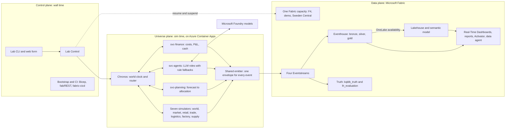

# Giandoria — a simulated chocolate universe on Azure and Microsoft Fabric

For a short visual introduction, start with the [Chocoverse illustrated tour](../README.md).
This index remains the detailed design and implementation map.

> **Current implementation:** a persistent local clock/events store, Azure demo infrastructure and a bounded
> Fabric publish/replay path. One `demo`, F4, Sweden Central; infrastructure uses Bicep/AVM, REST and `fabric-cicd`.
> Cloud Automation Start/Stop and deadline shutdown are verified. The causal reduced-detail business runtime
> has collected two simulated calendar years through Eventstream into Eventhouse, with exact payload verification
> and real weekly LLM decisions. Ordinary Start now continues that same company at configurable speed; Stop
> preserves its state/history. A five-page business dashboard and fifteen editable KQL queries accompany the runtime.
> A [shared semantic-model showcase](./23-semantic-model-showcase.md) adds two thin Power BI reports over a
> fixed virtual-time snapshot, with time intelligence, semi-additive balances and what-if analysis.
> Native Smart narrative summaries respond to filters; optional KPI reading guides follow the charts.
> A [Fabric IQ ontology implementation](./26-fabric-ontology.md) publishes enterprise entities and bindings
> over immutable OneLake snapshot tables, subject to the ontology-preview tenant prerequisite.
> A [Fabric Data Agent showcase](./24-data-agent-showcase.md) adds natural-language observation and an
> isolated, replayable S&OP evidence-to-decision experiment.
> [Secretless application authentication](./25-data-agent-authentication.md) is verified from Azure; the live
> worker still uses simulator briefings. See
> [the business lab](./21-business-lab.md) for scope and limits.
> Start with [the local example](#running-the-first-local-increment) or the [cloud runbook](../infra/demo/README.md).
> [Chapter 15](./15-open-decisions.md#152-summary-and-status) records our adopted choices;
> [chapter 20](./20-fabric-walking-skeleton.md) summarizes verified Fabric behavior and limits.

Giandoria is a laboratory in which a fictional Piedmontese chocolate maker, **Giandoria Cioccolato S.p.A.**, lives
through whole seasons. It buys cocoa, hazelnuts, toys and packaging; makes chocolate on machines with realistic
production times; stores and ships it; and sells it through retail chains, wholesalers, its own flagship stores, an
e-shop, airport stores, export distributors and charity and corporate campaigns, across a simulated Italy of 107
provinces. Consumers buy, or do not buy, depending on the calendar, the weather, prices, promotions and what is
actually on the shelf.

Several connected simulators play the parts of this world. Routine decisions are taken by rules and planning
engines; judgement calls are taken by agents backed by large language models. Every fact becomes an event with a
**virtual timestamp** and flows into **Microsoft Fabric**, where it is watched live and analysed later. Every
resource is created by code. Scale and speed are calibrated to F4 rather than promising one sim year per wall hour.
When the lab stops, both sim time and compute can stop.
Retained data and supporting services can still incur idle costs.

**Everything in the universe is fictional:** the company, its brands, the retailers, the suppliers, the foundations
and the people. Real-world facts are used only to make it realistic; chapter 16 lists the sources.

---

## Six ideas

1. **One connected chain.** Nothing is generated in isolation: a jammed wrapper in February can become an empty
   shelf before Easter, a lost sale and a smaller order the next year. Every link is an event, traceable to its cause.
2. **The calendar drives demand.** Thirteen occasions shape the year; Easter eggs exist only around Easter, and an
   early Easter behaves differently from a late one.
3. **Commit before knowing.** Toys travel by sea for 9–15 weeks and eggs are built months before they sell. The
   company plans ahead under uncertainty, using a delivery outlook, and lives with its commitments.
4. **A hidden truth.** The universe knows true demand, lost sales and real machine wear. The company and its agents
   see only what real systems would record; the truth is kept apart and used to score their decisions.
5. **Virtual time.** Two clocks, never mixed: every event carries its sim time and, separately, its wall time. When
   the lab stops, sim time stops, and nothing ages.
6. **Built by code, stopped by default.** No resource is created in a portal. The normal state of the lab is
   hibernated; actual idle cost includes retained Storage, ACR and tenant Defender requirements.

---

## Reverse-time simulation: my method

> **Planning backwards, against real capacity.** Giandoria plans production with **reverse-time simulation**, a
> method devised in 2015 by the author of chapter 17. A simulation runs with its clock reversed, from the due dates towards
> the past: a finished gift box asks for its chocolates, each chocolate queues for its line and waits through closed
> shifts, and each material gets the latest date by which it must be ordered. Every step lands as late as possible on
> a line that is really free. A forward pass from today then gives the slack of every step and flags what is already
> late. I arrived at the idea independently; [chapter 17](./17-reverse-time-simulation.md) explains it with a
> short numerical example, links to the original Excel-driven SimPy repository, and credits the earlier
> backward-simulation literature. The full planning engine remains part of the target design.

---

## The big picture



* **Universe plane.** Chronos is the only component that moves time. The simulators own their state and talk only
  through in-universe messages; svc-planning runs the planning engines; svc-agents runs the LLM roles, each with a
  rule-based fallback, authority limits and a budget.
* **Data plane.** Fabric observes the universe; it does not drive it. The live path is Real-Time Intelligence
  (Eventstreams, the Eventhouse, Real-Time Dashboards, Activator); the batch path is a Lakehouse in OneLake, a
  semantic model and Power BI reports. The truth has its own stream, database and Lakehouse.
* **Control plane.** Lab Control starts, pauses, hibernates and stops runs, changes speed, enforces budgets and
  resumes or suspends the capacity. The bootstrap script and the CI pipelines create every resource and item.

---

## The documents

### Running the first local increment

From the project root, using PowerShell and Python 3.13:

```powershell
python -m venv .venv
.\.venv\Scripts\python -m pip install -e .
.\.venv\Scripts\python -m unittest discover -s tests -v
.\ops\Test-DemoReadiness.ps1
.\ops\Test-DemoReadiness.ps1 -CheckAzure

.\.venv\Scripts\python -m giandoria init --run-id r-0001
.\.venv\Scripts\python -m giandoria start
.\.venv\Scripts\python -m giandoria advance --ticks 24
.\.venv\Scripts\python -m giandoria hibernate
.\.venv\Scripts\python -m giandoria status
.\.venv\Scripts\python -m giandoria resume
.\.venv\Scripts\python -m giandoria advance --ticks 24
.\.venv\Scripts\python -m giandoria hibernate
.\.venv\Scripts\python -m giandoria export --output .local\events-0001.jsonl
```

The configuration is [config/demo.json](../config/demo.json). The run and append-only CloudEvents log persist
transactionally in `.local\demo.sqlite3`; restarting the process preserves simulation time and sequence numbers.
Initialization and export refuse to overwrite existing files. Use `--database <path>` before the subcommand for a
different local run. Local runs are not separate Azure environments.

**Current limits.** This increment implements clock transitions, explicit unpaced ticks, event envelopes and durable
local storage. It does not yet simulate chocolate production, build the useful historical business dataset, call
LLMs or pace at the target speed. A separate bounded experiment publishes retained events to Fabric.
Effective-speed metrics are clock-step compute measurements, not full simulator or ingestion benchmarks.
Local `hibernate` freezes and saves the local run only: it never
suspends an Azure capacity or scales cloud compute.

The readiness script is read-only. `-CheckAzure` uses the context in the untracked `.env`, checks the effective
policy-assignment count and discovers project-tagged resources; it does not evaluate every policy, query billing
or certify deployment readiness. Missing `fab` does not block the implemented REST/fabric-cicd path.
The larger target architecture still needs remaining platform checks beyond the verified reduced-detail business lab.
Storage check 29 is a fallback if the existing public-network waivers are revoked.

**Cost and retention.** Our target is about EUR 200 for the initial useful dataset if needed, then a few
tens of euros per active demo day with low recurring idle costs. These are targets to measure, not approved
numeric operating limits. Preserve data across hibernation; retained storage and tenant Defender/governance are
not free. Older larger-SKU and multi-environment cost studies in the chapters are reference estimates only.

Start with chapter 01: it tells the whole story in plain words and can be read on its own. The focused chapters hold
the details, the numbers and the sources. Chapter 01 §1.15 suggests reading paths for business, engineering, cost
and approval.

| Ch. | Document | What it answers |
|---:|---|---|
| 01 | [Vision and mental model](./01-vision-and-mental-model.md) | The whole idea: the company, truth and observation, the engine room, time, planning, Easter 2031 step by step, the data, cost, what must be agreed, the glossary. **Start here** |
| 02 | [The universe: domain model](./02-universe-domain-model.md) | Who and what exists: Giandoria, its brands and products, the sites, the territory, the own stores, B2B customers, campaigns, consumers, suppliers, competitors, the size profiles |
| 03 | [Market, demand and seasonality](./03-market-and-seasonality.md) | Where demand comes from and why it peaks: ten layers of demand, the Italian calendar, Easter and Christmas, campaigns, weather, tourism, prices and promotions |
| 04 | [The factory: processes, lines and machines](./04-factory-and-processes.md) | How chocolate is made and how long it takes: the process chain, plants and lines, machine states, wear, changeovers, quality holds, shifts, energy, telemetry |
| 05 | [Supply chain and logistics](./05-supply-chain-and-logistics.md) | Materials in and products out: lead times, cocoa, hazelnuts, toys and packaging, supplier behaviour, inventory, warehouses, the summer cold chain, order-to-cash |
| 06 | [Planning](./06-planning-model.md) | How the company looks ahead: the planning hierarchy, fences, the delivery outlook, S&OP, Easter 2031 planned backwards, ATP and allocation, uncertainty |
| 07 | [The time model](./07-time-model.md) | How time is accelerated, stopped and replayed: two clocks, speed, the clock states, ticks, the time ledger, bi-temporal data, reproducibility |
| 08 | [Simulators and services](./08-simulators-architecture.md) | The engine room: the step contract, the seven simulators and five services, the shock catalogue, the emitter, the deployment modes |
| 09 | [LLM agents](./09-llm-agents.md) | Who decides, with what information, and how it stays safe and cheap: the roster, briefings, guardrails, models and cost, evaluation, the runtime |
| 10 | [Data model and events](./10-data-model-and-events.md) | Every event and table: the envelope, the event catalogue, bronze, silver and gold, the Lakehouse, runs and forks, truth and visibility, volumes |
| 11 | [Azure and Fabric architecture](./11-azure-and-fabric-architecture.md) | The platform as a whole: Azure resources, Fabric items, identity and permissions, the control plane, the experiences, environments, infrastructure as code |
| 12 | [Elements to create](./12-elements-to-create.md) | **The inventory:** every element the code creates, stage by stage, with its ID, creator, order and lifecycle; naming; the 29 open checks |
| 13 | [Cost control and operations](./13-cost-control-and-operations.md) | What it costs and what stops the costs: billing, lab states, allowances, the cost meter, nine defence layers, runbooks, cost measurements |
| 14 | [Implementation plan](./14-implementation-plan.md) | How it gets built: ten phases with goals and exit criteria, genesis, testing, the definition of done, the cost of the plan, risks |
| 15 | [Decisions and adopted assumptions](./15-open-decisions.md) | Our twenty choices and remaining technical evidence |
| 16 | [References](./16-references.md) | Sources and known gaps |
| 17 | [Reverse-time simulation](./17-reverse-time-simulation.md) | **Reverse-time planning, briefly:** the time mirror, two passes and slack, a small example, the original SimPy repository and implementation limits |
| 18 | [Tenant governance](./18-tenant-governance.md) | **What the reference tenant allows:** the policies that deny, change or add settings, Defender plans and their cost, roles and Privileged Identity Management, model quota, the consequences for Giandoria, the shared Foundry resource |
| 19 | [Public endpoints and exemptions](./19-policy-exemption-experiment.md) | Waiver scope, access controls and revocation handling |
| 20 | [Fabric walking skeleton](./20-fabric-walking-skeleton.md) | Verified behavior, replay semantics and remaining work |
| 21 | [The causal business lab](./21-business-lab.md) | Implemented modules, verified two-year dataset, strategic decisions and limits |
| 22 | [Dashboard engineering](./22-dashboard-engineering.md) | Code-generated dashboards, metric catalogue, virtual-time analytics, safe publication and validation |
| 23 | [Semantic model showcase](./23-semantic-model-showcase.md) | Fact constellation, explicit DAX, thin Power BI reports, educational visuals and snapshot limits |
| 24 | [Fabric Data Agent showcase](./24-data-agent-showcase.md) | Model-backed natural-language answers, isolated manager evidence, virtual cutoffs, replay and identity limits |
| 25 | [Secretless Data Agent authentication](./25-data-agent-authentication.md) | Managed-identity federation to an application, token audiences, isolated authorization and real cloud verification |
| 26 | [Fabric IQ ontology](./26-fabric-ontology.md) | Enterprise entities, composite identities, relationship bindings, immutable Delta sources and preview prerequisites |
| 27 | [Decision Room and app authoring](./27-decision-room.md) | Native Fabric App, Rayfin authoring, Radix interface, governed investigations and private review lifecycle |
| 28 | [Data Agent delegation experiment](./28-data-agent-delegation-experiment.md) | The same generalist alone and with a specialist: frozen questions, measured answers, an evidence control and limits |

The first infrastructure in code is the shared Foundry resource of chapter 18 §18.11:
[infra/shared-foundry](../infra/shared-foundry/README.md).

---

## Scope and reference scale

The demo scope below is adopted. Company/scenario figures describe the target universe, not implemented throughput.

| Topic | Baseline | Where |
|---|---|---|
| Deployment | One `demo` in Sweden Central; no separate cloud dev/stress environment | 15: D1, D4 |
| Capacity | F4 PAYG, suspended when unused; reduce load before considering a SKU change | 13; 15: D17 |
| Cost | EUR 500/month ceiling for the whole subscription, not a spending target; retained services still cost at idle | 13; 15: D16 |
| Company | ≈ €300 M of net sales, ≈ 180 SKUs, two plants, 13 finishing lines, ≈ 120 machines | 01 §1.2; 02, 04 |
| Territory and channels | 20 regions and 107 provinces; seven channels; six retail chains; 20 own stores and an e-shop | 01 §1.2; 02, 03 |
| Seasons | 13 occasions; Easter eggs are built from November to February and sell in about ten weeks | 01 §1.2, §1.7; 03, 06 |
| Scenario | `easter-2031-base`: epoch 1 June 2030, Easter on 13 April 2031, end 1 May 2031 | 07; 15: D2 |
| Speed and volume | Calibrate to measured F4 headroom; S = 8,760 and Profile M are reference targets, not verified performance | 07; 10; 15: D2 |
| Evidence | Remaining platform checks and cost measurements are separate from adopted decisions | 12 §12.16; 13 §13.12; 15 |

---

## Decisions and next steps

Our choices and assumptions are recorded in [chapter 15](./15-open-decisions.md).
The [worksheet](../decisions/phase-0-decisions.md) retains remaining tenant/repository facts.
Implementation follows [chapter 14](./14-implementation-plan.md); measurements can revise an assumption but
adoption alone does not close a platform check. Feedback is most useful when it names a section, decision or check.

---

## Conventions

* All documents are in English. Numbers describe Profile M and `easter-2031-base` unless a chapter says otherwise.
* Durations name their clock: sim hours, wall seconds. Dates inside the universe are sim dates.
* Values without a source carry a marker such as *(estimate)*, *(assumption)* or *(verify)*. Chapter 01 §1.15
  lists them all.
* Chapters 02 to 15, 17 and 18 cite sources as [M#] for the market, [P#] for production, supply and planning
  methods and [F#] for the platform; chapter 16 resolves every ID.
* Diagrams are written in Mermaid. GitHub renders them directly; other viewers may need a Mermaid extension.
* Documentation explains the current design and reusable procedures, not development sessions.
  Summaries link to focused detail; command traces and transient measurements stay in ignored local records.
  The [writing rules](../.github/copilot-instructions.md#writing-documentation) define what to publish and retain.
